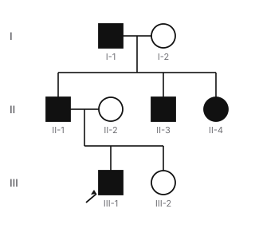
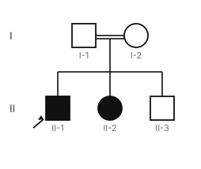
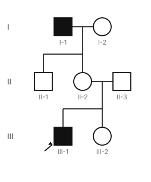
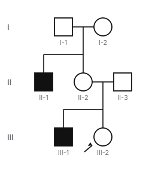
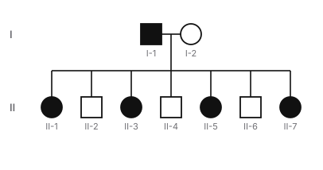
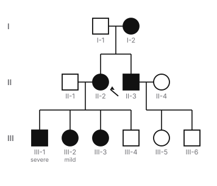

# Biochemistry — Genetics batch 1 review packet

Status: **draft, AI-drafted, not medically reviewed.** Reviewer: mark each concept approved, needs changes or rejected, with notes. A citation alone is not approval.

## How to read this packet

- Options are listed in their **stored** order (deterministically shuffled per item, with opaque ids). Learners see a fresh random order on every presentation; answers are checked by option id, never by position. ✅ marks the correct option.
- Each item shows its **reasoning task** and the **depth** that follows from it: recall/identification → recognition; mechanism → mechanism; interpretation/prediction/comparison/multistep → application. A vignette that only asks for the classic diagnosis is identification (recognition), not application. Application items list the inferential steps they require.
- Facts are split into **verified** (a supporting source was read in full text or as a published abstract/summary and states the claim) and **awaiting direct confirmation** (reasoned from pathway logic, or supported only by sources checked for existence). Awaiting facts block approval in the validator until a reviewer confirms them against a source.
- Citation “checked”: **full-text** (page read), **summary** (published abstract or summary read), **existence** (record confirmed but full text not accessible).
- Mastery: true/false and crossword answers count as weaker recognition evidence; repeating an item within 7 days adds little; “strong” needs at least 3 distinct items, including a mechanism or application item.
- Connections puzzles are checked for a single solution against the **global category catalog** (every bank category, every curated category and decoy, and a catalog of medically plausible groupings such as inheritance patterns, drug classes and toxin sources), not only against their own decoys. The daily builder applies the same check to every board it generates.

- **Two independent classifications.** *Step 1 relevance*: **CORE** (topic and depth supported by the official outline and mainstream Step 1 preparation), **SUPPLEMENTARY** (within the curriculum but beyond core depth; shown less often in games), **SPECIALIST** (obscure or postgraduate; never shown in games, excluded from coverage) or **UNREVIEWED** (not yet evaluated; never assumed core). *Cognitive depth*: **RECOGNITION**, **MECHANISM** or **APPLICATION**, from the reasoning task. A complex vignette on a classic mechanism can be CORE; a simple recall of an obscure finding can be SPECIALIST. The ~80/20 recognition-and-mechanism vs application mix is a flexible game-design target, not a relevance judgement.

## Summary

| Measure | Value |
|---|---|
| Concepts | 14 |
| Objectives taught | 23 |
| Facts verified / awaiting direct confirmation | 61 / 0 |
| **Playable learning items (total)** | **82** |
| — MCQs / true-false / crossword clues | 39 / 23 / 16 |
| — Mechanism Lab sequences / Match Up sets | 1 / 2 |
| — Complete Connections puzzles / Mystery Patient cases | 0 / 1 |
| Connections category-bank entries (builder input, **not** playable alone; excluded from item counts and coverage) | 0 |
| Items, Step 1 relevance: CORE / SUPPLEMENTARY / SPECIALIST / UNREVIEWED | 79 / 3 / 0 / 0 |
| Items, cognitive depth: RECOGNITION / MECHANISM / APPLICATION | 53 / 10 / 19 |
| Objectives, Step 1 relevance: CORE / SUPPLEMENTARY / SPECIALIST / UNREVIEWED | 23 / 0 / 0 / 0 |
| Playable items: recall | 45 |
| Playable items: identification | 8 |
| Playable items: mechanism | 10 |
| Playable items: interpretation | 11 |
| Playable items: prediction | 5 |
| Playable items: comparison | 1 |
| Playable items: multistep | 2 |

## Autosomal dominant inheritance: pedigrees, risk and mechanisms (`gen-ad`)

Objectives: `bc-ad-inheritance.pedigree`, `bc-ad-inheritance.risk`, `bc-ad-inheritance.mechanisms`

**Citations**

1. MedlinePlus Genetics: What are the different ways a genetic condition can be inherited? — <https://medlineplus.gov/genetics/understanding/inheritance/inheritancepatterns/> — checked: full-text
2. MedlinePlus Genetics: If a genetic disorder runs in my family, what are the chances that my children will have the condition? — <https://medlineplus.gov/genetics/understanding/inheritance/riskassessment/> — checked: full-text
3. MedlinePlus Genetics: Achondroplasia — <https://medlineplus.gov/genetics/condition/achondroplasia/> — checked: full-text
4. Chamarthi VS et al. Achondroplasia: autosomal dominant with full penetrance; over 80% of cases are de novo, and advanced paternal age is a known risk factor. StatPearls — PMID 32644689 — <https://pubmed.ncbi.nlm.nih.gov/32644689/> — checked: summary
5. MedlinePlus Genetics: Neurofibromatosis type 1 — <https://medlineplus.gov/genetics/condition/neurofibromatosis-type-1/> — checked: full-text
6. Veitia RA et al. Mechanisms of Mendelian dominance: dominant negative mutations poison macromolecular complexes; haploinsufficiency from a heterozygous null allele. Clin Genet 2018 — PMID 28755412 — <https://pubmed.ncbi.nlm.nih.gov/28755412/> — checked: summary

**Verified facts** [supporting citations]

- In autosomal dominant inheritance one altered copy of the gene in each cell is enough to cause the disorder; an affected person may inherit it from an affected parent or have a new variant with no family history (for example Huntington disease, Marfan syndrome). [1]
- A person with an autosomal dominant disorder has a 50 percent chance of passing the altered gene to each child; a new (de novo) variant arising in an egg or sperm or early embryo gives an affected child of unaffected parents, who can then pass it on. [2]
- About 80 percent of people with achondroplasia are born to average-height parents because of new FGFR3 variants, and advanced paternal age is a known risk factor for these de novo mutations. Inheriting two altered FGFR3 copies causes a severe form with extreme bone shortening and an underdeveloped rib cage. [3, 4]
- About half of neurofibromatosis type 1 cases are inherited from an affected parent; the rest are new NF1 mutations. [5]
- Dominance can arise when a defective subunit poisons a protein complex (dominant negative effect) or when one null allele leaves too little product (haploinsufficiency). [6]

**Mechanism.** One abnormal allele is enough. That happens when half the normal amount of product is not sufficient (haploinsufficiency), when the abnormal protein interferes with the normal one in a multi-part structure (dominant negative), or when the mutant protein gains a harmful function. Because autosomes pass from either parent to either child, the trait appears in every generation, in both sexes, with father-to-son transmission.

**Quick.** AD: every generation, both sexes, male-to-male transmission; affected × unaffected → 50% each child. New mutations are common (achondroplasia ~80%, advanced paternal age; NF1 ~50%). Mechanisms: haploinsufficiency, dominant negative, gain of function; homozygotes are often more severe.

**Detailed**

> An autosomal dominant pedigree shows affected people in every generation, males and females equally, and transmission from father to son (which excludes X-linked inheritance). Each child of an affected heterozygote has a 50% chance of inheriting the variant.

> Many dominant disorders also arise de novo: about 80% of achondroplasia, linked to advanced paternal age, and about half of neurofibromatosis type 1. A single abnormal allele causes disease through haploinsufficiency, a dominant negative effect in a multi-part protein, or a gain of function; two abnormal alleles, as in homozygous achondroplasia, are usually more severe.

**Misconception.** An affected child with unaffected parents does not rule out a dominant disorder: a new mutation is common in achondroplasia and neurofibromatosis type 1.

**Takeaway.** AD = vertical, both sexes, male-to-male, 50% risk; new mutations common.

- **MCQ** **CORE** · depth APPLICATION · `gen-ad:mcq1` · interpretation → **application** · difficulty 3 · `bc-ad-inheritance.pedigree`
  - In a three-generation pedigree, a disorder affects a grandfather, two of his sons and one daughter, and a son of one affected son. Unaffected people never have affected children. Which inheritance pattern fits best?
  - Figure (pedigree, original, generated from data; passes validation):

    

  - Figure text: Pedigree. Generation I: I-1 male, affected; I-2 female, unaffected. Generation II: II-1 male, affected; II-2 female, unaffected; II-3 male, affected; II-4 female, affected. Generation III: III-1 male, affected (proband); III-2 female, unaffected. I-1 and I-2 have II-1, II-3, II-4. II-1 and II-2 have III-1, III-2.
  - ✅ A. Autosomal dominant
  - ◻️ B. X-linked dominant — _An affected father would pass an X-linked dominant trait to all daughters and no sons._
  - ◻️ C. Autosomal recessive — _Recessive disorders usually skip generations; affected people in three successive generations make this much less likely._
  - ◻️ D. X-linked recessive — _X-linked traits are never passed from father to son, but here an affected son has an affected son._
  - ◻️ E. Mitochondrial — _Fathers do not transmit mitochondrial disorders._
  - Steps: (1) The trait appears in every generation in both sexes → dominant. (2) An affected father has an affected son → not X-linked (fathers give sons a Y). (3) Fathers transmit it → not mitochondrial → autosomal dominant.
  - Explanation: Every generation, both sexes, and father-to-son transmission = autosomal dominant. Male-to-male transmission excludes X-linked and mitochondrial inheritance.
- **MCQ** **CORE** · depth RECOGNITION · `gen-ad:mcq2` · recall → **recognition** · difficulty 1 · `bc-ad-inheritance.risk`
  - A woman heterozygous for a fully penetrant autosomal dominant disorder and a man who does not carry the variant plan a pregnancy. What is the chance that their child will be affected?
  - ◻️ A. 25% — _Twenty-five percent is the risk for two carriers of a recessive disorder._
  - ✅ B. 50%
  - ◻️ C. 0%, because the father is unaffected — _One altered copy from either parent is enough in dominant inheritance._
  - ◻️ D. 67% — _Two-thirds is the carrier chance of an unaffected sibling in a recessive disorder._
  - ◻️ E. 100% — _A heterozygous parent passes the altered allele to only half of the children on average._
  - Explanation: A heterozygote passes the altered allele to each child with 50% probability; one copy is enough to cause a dominant disorder.
- **MCQ** **CORE** · depth RECOGNITION · `gen-ad:mcq3` · identification → **recognition** · difficulty 2 · `bc-ad-inheritance.risk`
  - A newborn has achondroplasia. Both parents are of average height; the father is 52 years old. What is the most likely explanation?
  - ◻️ A. Both parents are carriers of a recessive allele — _Achondroplasia is autosomal dominant, not recessive._
  - ✅ B. A new FGFR3 mutation, more likely with older fathers
  - ◻️ C. Uniparental disomy from the father — _The usual cause of a sporadic case is a new mutation._
  - ◻️ D. Maternal nondisjunction of chromosome 4 — _Achondroplasia is a single-gene disorder, not an aneuploidy._
  - ◻️ E. An X-linked mutation from the mother — _FGFR3 is autosomal and the disorder is dominant._
  - Explanation: About 80% of achondroplasia arises from new FGFR3 mutations in children of average-height parents, and advanced paternal age is a known risk factor.
- **MCQ** **CORE** · depth APPLICATION · `gen-ad:mcq4` · prediction → **application** · difficulty 3 · `bc-ad-inheritance.risk`, `bc-ad-inheritance.mechanisms`
  - Two people with achondroplasia (both heterozygous) have children. Which outcome distribution is expected, and why is one group most severely affected?
  - ◻️ A. All children have achondroplasia — _Each parent can pass the normal allele, so a quarter are unaffected._
  - ◻️ B. 1/2 unaffected, 1/2 achondroplasia — _With two heterozygous parents, a quarter of children inherit two altered copies._
  - ◻️ C. 1/4 unaffected, 3/4 equally affected — _Inheriting two altered copies causes a much more severe form._
  - ◻️ D. 3/4 unaffected, 1/4 achondroplasia — _This is a recessive pattern; achondroplasia is dominant._
  - ✅ E. 1/4 unaffected, 1/2 achondroplasia, 1/4 severe homozygous form
  - Steps: (1) Each parent passes the altered allele with probability 1/2. (2) So children are 1/4 normal, 1/2 heterozygous and 1/4 homozygous. (3) Two altered copies give a stronger effect → the homozygous quarter is most severe.
  - Explanation: Two heterozygotes: 1/4 normal, 1/2 heterozygous (achondroplasia), 1/4 homozygous. Two altered FGFR3 copies cause a severe form with extreme bone shortening and a small rib cage.
- **MCQ** **CORE** · depth MECHANISM · `gen-ad:mcq5` · mechanism → **mechanism** · difficulty 2 · `bc-ad-inheritance.mechanisms`
  - Achondroplasia is caused by FGFR3 variants that make the receptor overly active. Why is a child who inherits two such alleles much more severely affected than a heterozygous parent?
  - ◻️ A. Two copies cause anticipation by repeat expansion — _Achondroplasia is not a repeat expansion disorder._
  - ◻️ B. The child also inherits mitochondrial DNA from both parents — _Mitochondrial DNA comes from the mother only and is unrelated._
  - ◻️ C. Homozygosity causes loss of all FGFR3 function — _The variants increase activity; two copies increase it further._
  - ◻️ D. The second allele converts the disorder to recessive — _The disorder stays dominant; a second allele adds to the effect._
  - ✅ E. Two overactive alleles give more receptor overactivity
  - Explanation: Achondroplasia is a gain-of-function (overactive FGFR3) dominant disorder. Two altered copies double the abnormal signal, giving a severe form with extreme bone shortening and a small rib cage.
- **True/false** **CORE** · depth RECOGNITION · `gen-ad:tf1` · recall → **recognition** · difficulty 1 · `bc-ad-inheritance.pedigree`: Male-to-male transmission of a trait excludes X-linked inheritance. → **True**. Correct: fathers pass a Y, not an X, to their sons.
- **True/false** **CORE** · depth RECOGNITION · `gen-ad:tf2` · recall → **recognition** · difficulty 2 · `bc-ad-inheritance.mechanisms`: Haploinsufficiency means one normal copy of a gene does not make enough product for normal function. → **True**. Correct: a heterozygous null allele can then cause a dominant disorder.
- **Crossword** **CORE** · depth RECOGNITION · `gen-ad:clue1` · recall → **recognition** · difficulty 2 · `bc-ad-inheritance.risk`: Describes a new variant not present in either parent (two words, run together) → **DENOVO**
- **Match Up** **CORE** · depth RECOGNITION · `match:inheritance-clues` · recall → **recognition** · difficulty 2 · `bc-ad-inheritance.pedigree`, `bc-ar-inheritance.pedigree`, `bc-xlinked-inheritance.xr-pedigree`, `bc-xlinked-inheritance.xd-pedigree`, `bc-mito-inheritance.pattern`: Read the pedigree clue. Match each pedigree clue to the inheritance pattern it points to.
  - Male-to-male transmission, every generation ↔ Autosomal dominant
  - Affected siblings of unaffected consanguineous parents ↔ Autosomal recessive
  - Affected men linked through unaffected women ↔ X-linked recessive
  - Affected father: all daughters affected, no sons ↔ X-linked dominant
  - Passes through mothers only; fathers never transmit ↔ Mitochondrial
  - Earlier onset in each generation ↔ Anticipation (repeat expansion)
  - Who transmits to whom is the key: fathers to sons excludes X-linked; fathers to all daughters means X-linked dominant; only mothers transmitting means mitochondrial.

---

## Autosomal recessive inheritance: pedigrees, risk and why enzyme defects are recessive (`gen-ar`)

Objectives: `bc-ar-inheritance.pedigree`, `bc-ar-inheritance.risk`, `bc-ar-inheritance.enzymes`

**Citations**

1. MedlinePlus Genetics: What are the different ways a genetic condition can be inherited? — <https://medlineplus.gov/genetics/understanding/inheritance/inheritancepatterns/> — checked: full-text
2. MedlinePlus Genetics: If a genetic disorder runs in my family, what are the chances that my children will have the condition? — <https://medlineplus.gov/genetics/understanding/inheritance/riskassessment/> — checked: full-text
3. Kacser H, Burns JA. The molecular basis of dominance: a 50% reduction of enzyme activity in heterozygotes is usually not detectable, so enzyme mutants are recessive. Genetics 1981 — PMID 7297851 — <https://pubmed.ncbi.nlm.nih.gov/7297851/> — checked: summary

**Verified facts** [supporting citations]

- In autosomal recessive inheritance variants occur in both copies of the gene; the parents of an affected person each carry one copy and typically have no signs, and these disorders are typically not seen in every generation (for example cystic fibrosis, sickle cell disease). [1]
- Two carriers have, with each pregnancy, a 25 percent chance of an affected child, a 50 percent chance of an unaffected carrier and a 25 percent chance of a child who is neither; the chance is the same for each pregnancy. If only one parent is a carrier, no child is affected and each has a 50 percent chance of being a carrier. [2]
- Enzymes work within networks, so halving one enzyme’s activity, as in a heterozygote, usually causes no detectable change in the pathway’s output; enzyme mutants are therefore usually recessive. [3]

**Mechanism.** A recessive disorder needs two altered copies, so it appears in children of two unaffected carriers, often in a single sibship. Carrier × carrier gives 1/4 affected, 1/2 carriers, 1/4 neither. For enzymes, half the normal activity in a carrier is usually enough to keep the pathway working, which is why most inborn errors of metabolism are recessive.

**Quick.** AR: affected siblings of unaffected parents; often skips generations; consanguinity raises risk. Carrier × carrier → 25% affected, 50% carrier, 25% neither (each pregnancy). Unaffected sibling of an affected child → 2/3 carrier. Most enzyme defects are recessive: 50% activity usually suffices.

**Detailed**

> Recessive disorders cluster within a sibship: affected brothers and sisters whose parents are unaffected carriers. Shared ancestry (consanguinity) makes it likelier that both parents carry the same rare allele. The risk of 25% applies independently to each pregnancy.

> An unaffected child of two carriers cannot be the affected genotype, so of the three remaining equally likely outcomes, two are carriers: a 2/3 carrier probability. Most enzyme deficiencies are recessive because pathways are buffered: a carrier’s half-normal enzyme activity usually keeps the pathway’s output normal.

**Misconception.** A 25% risk does not mean that after one affected child the next three will be unaffected: the risk is the same for every pregnancy.

**Takeaway.** AR = horizontal; carrier × carrier 25%; unaffected sibling 2/3 carrier; enzymes are usually recessive.

- **MCQ** **CORE** · depth APPLICATION · `gen-ar:mcq1` · interpretation → **application** · difficulty 3 · `bc-ar-inheritance.pedigree`
  - Two unaffected first cousins have three children; two (a son and a daughter) have the same metabolic disorder. No other relatives in four generations are affected. Which inheritance pattern is most likely?
  - Figure (pedigree, original, generated from data; passes validation):

    

  - Figure text: Pedigree. Generation I: I-1 male, unaffected; I-2 female, unaffected. Generation II: II-1 male, affected (proband); II-2 female, affected; II-3 male, unaffected. I-1 and I-2 (related) have II-1, II-2, II-3.
  - ◻️ A. Mitochondrial — _Mitochondrial disorders pass from an affected mother to all her children._
  - ◻️ B. X-linked dominant — _An X-linked dominant trait would appear in a parent._
  - ◻️ C. Autosomal dominant — _Dominant disorders appear in every generation; here both parents are unaffected._
  - ◻️ D. X-linked recessive — _An affected daughter of an unaffected father makes X-linked recessive unlikely._
  - ✅ E. Autosomal recessive
  - Steps: (1) Both sexes affected, but the parents are not → recessive. (2) An affected daughter with an unaffected father → not X-linked recessive. (3) Consanguinity raises the chance both parents carry the same allele → autosomal recessive.
  - Explanation: Affected siblings of both sexes with unaffected (consanguineous) parents and no other affected relatives = autosomal recessive.
- **MCQ** **CORE** · depth APPLICATION · `gen-ar:mcq2` · multistep → **application** · difficulty 4 · `bc-ar-inheritance.risk`
  - A couple, both shown to be carriers, has a child with cystic fibrosis. Their unaffected daughter asks her chance of being a carrier. What is it?
  - ◻️ A. 1/2 — _One half ignores that the affected genotype is already excluded for her._
  - ◻️ B. 3/4 — _Three quarters is the chance that a child of two carriers is unaffected._
  - ◻️ C. 1/3 — _One third is her chance of carrying no altered allele._
  - ◻️ D. 1/4 — _One quarter is the chance of an affected child, not of a carrier._
  - ✅ E. 2/3
  - Steps: (1) An affected child means both parents are carriers. (2) Their children are 1/4 AA, 1/2 Aa, 1/4 aa. (3) She is unaffected, so aa is excluded: Aa is 2 of the remaining 3 parts → 2/3.
  - Explanation: Both parents are carriers. An unaffected child is one of three equally likely genotypes (AA, Aa, aA), two of which are carriers: 2/3.
- **MCQ** **CORE** · depth RECOGNITION · `gen-ar:mcq3` · recall → **recognition** · difficulty 1 · `bc-ar-inheritance.risk`
  - Both parents carry the same autosomal recessive allele. Their first child is affected. What is the chance that their next child is affected?
  - ◻️ A. 0%, because they have already had their affected child — _Each pregnancy is independent; the risk does not fall after an affected child._
  - ✅ B. 25%
  - ◻️ C. 100% — _Each parent may pass the normal allele, so not every child is affected._
  - ◻️ D. 75% — _Seventy-five percent is the chance of an unaffected child._
  - ◻️ E. 50% — _Fifty percent is the chance of a carrier child._
  - Explanation: Carrier × carrier gives a 25% chance of an affected child with every pregnancy, whatever happened before.
- **MCQ** **CORE** · depth MECHANISM · `gen-ar:mcq4` · mechanism → **mechanism** · difficulty 2 · `bc-ar-inheritance.enzymes`
  - Why are most inherited enzyme deficiencies autosomal recessive rather than dominant?
  - ◻️ A. Heterozygotes make no enzyme at all — _Heterozygotes keep one working allele and make about half the enzyme._
  - ✅ B. Half of the normal enzyme activity is usually enough
  - ◻️ C. Mutant enzymes always poison the normal enzyme — _Poisoning the normal protein is a dominant negative effect, which would give dominance._
  - ◻️ D. Enzyme genes are all on the X chromosome — _Most enzyme genes are autosomal._
  - ◻️ E. Enzyme deficiencies arise only by new mutation — _Most are inherited from carrier parents._
  - Explanation: Enzymes act in buffered networks, so a carrier’s 50% activity usually keeps the pathway working; disease needs two altered copies.
- **True/false** **CORE** · depth RECOGNITION · `gen-ar:tf1` · recall → **recognition** · difficulty 1 · `bc-ar-inheritance.pedigree`: Consanguinity increases the risk of autosomal recessive disorders. → **True**. Correct: related parents are more likely to carry the same rare allele.
- **True/false** **CORE** · depth RECOGNITION · `gen-ar:tf2` · recall → **recognition** · difficulty 2 · `bc-ar-inheritance.risk`: If one parent is a carrier and the other is not, each child has a 25% chance of an autosomal recessive disorder. → **False**. No child is affected; each has a 50% chance of being a carrier.
- **Crossword** **CORE** · depth RECOGNITION · `gen-ar:clue1` · recall → **recognition** · difficulty 2 · `bc-ar-inheritance.pedigree`: Parents related by descent, raising recessive risk → **CONSANGUINITY**

---

## X-linked recessive inheritance and X-inactivation (`gen-xlr`)

Objectives: `bc-xlinked-inheritance.xr-pedigree`, `bc-xlinked-inheritance.xr-risk`, `bc-xlinked-inheritance.lyonization`

**Citations**

1. MedlinePlus Genetics: What are the different ways a genetic condition can be inherited? — <https://medlineplus.gov/genetics/understanding/inheritance/inheritancepatterns/> — checked: full-text
2. MedlinePlus Genetics: If a genetic disorder runs in my family, what are the chances that my children will have the condition? — <https://medlineplus.gov/genetics/understanding/inheritance/riskassessment/> — checked: full-text
3. MedlinePlus Genetics: Hemophilia — <https://medlineplus.gov/genetics/condition/hemophilia/> — checked: full-text
4. Morey C, Avner P. X-inactivation: females shut down one of their two X chromosomes at random (Lyon). PLoS Genet 2011 — PMID 21811421 — <https://pubmed.ncbi.nlm.nih.gov/21811421/> — checked: summary
5. MedlinePlus Genetics: Can changes in the number of chromosomes affect health and development? — <https://medlineplus.gov/genetics/understanding/mutationsanddisorders/chromosomalconditions/> — checked: full-text

**Verified facts** [supporting citations]

- In X-linked recessive inheritance one altered copy causes the disorder in males, who have one X, whereas females usually need both copies altered, so males are affected much more often; fathers cannot pass X-linked traits to their sons (for example hemophilia). [1]
- The sons of a man with an X-linked recessive disorder are unaffected and all his daughters are carriers. A carrier woman, with each pregnancy, has a 50 percent chance that a son is affected and a 50 percent chance that a daughter is a carrier. [2]
- Early in embryonic development females permanently inactivate one of their two X chromosomes at random in each somatic cell (X-inactivation, described by Mary Lyon). [4]
- A female carrier of hemophilia can be affected when the X chromosome carrying the normal F8 or F9 copy is inactivated in most cells. [3]
- Women with Turner syndrome usually have only one X chromosome in every cell (45,X). [5]

**Mechanism.** Males have one X, so a single recessive allele shows. Females have two, but in each cell one X is silenced at random early in development. A carrier is usually protected because about half her cells use the normal X; if inactivation is skewed so most cells silence the normal X, or if she has only one X (Turner syndrome), she can be affected.

**Quick.** XR: mostly males; no male-to-male; carrier mothers. Affected father → all daughters carriers, no sons affected. Carrier mother → 50% of sons affected, 50% of daughters carriers. Females affected by skewed X-inactivation or 45,X (Turner).

**Detailed**

> An X-linked recessive pedigree shows affected males related through unaffected females, often passing from grandfather to grandson through a carrier daughter, and never father-to-son transmission. Every daughter of an affected man inherits his X and is a carrier; each son of a carrier mother has a 50% chance of being affected.

> Females are protected by having two X chromosomes, but each cell keeps only one active: X-inactivation is random and permanent early in development. If, by chance, most cells inactivate the X carrying the normal allele, a carrier can show disease (for example a symptomatic hemophilia carrier). A woman with Turner syndrome (45,X) has a single X and can be affected like a male.

**Misconception.** Daughters of an affected man are not at 50% risk of being carriers: every daughter receives his X, so all are obligate carriers.

**Takeaway.** XR = affected males via carrier females; no male-to-male; X-inactivation explains affected carriers.

- **MCQ** **CORE** · depth APPLICATION · `gen-xlr:mcq1` · prediction → **application** · difficulty 3 · `bc-xlinked-inheritance.xr-risk`
  - A man has hemophilia A. Testing shows his partner does not carry an F8 variant. What are the risks for their children?
  - ◻️ A. Each child has a 25% chance of being affected — _Twenty-five percent is the autosomal recessive carrier × carrier risk._
  - ◻️ B. Half of sons affected; half of daughters carriers — _That is the pattern for a carrier mother, not an affected father._
  - ◻️ C. All sons affected; no daughters carriers — _A father passes his Y, not his X, to sons._
  - ✅ D. All daughters carriers; no sons affected
  - ◻️ E. Half of all children affected regardless of sex — _That is autosomal dominant inheritance._
  - Steps: (1) The father’s only X carries the F8 variant. (2) Every daughter receives that X → all are carriers. (3) Every son receives his Y → none affected (their X comes from the mother).
  - Explanation: An affected father gives his X to every daughter (all carriers) and his Y to every son (none affected).
- **MCQ** **CORE** · depth APPLICATION · `gen-xlr:mcq2` · interpretation → **application** · difficulty 3 · `bc-xlinked-inheritance.xr-pedigree`
  - Several men in a family have the same bleeding disorder. An affected man’s grandson through his unaffected daughter is affected, but none of the affected men’s sons are. Which inheritance pattern fits?
  - Figure (pedigree, original, generated from data; passes validation):

    

  - Figure text: Pedigree. Generation I: I-1 male, affected; I-2 female, unaffected. Generation II: II-1 male, unaffected; II-2 female, unaffected; II-3 male, unaffected. Generation III: III-1 male, affected (proband); III-2 female, unaffected. I-1 and I-2 have II-1, II-2. II-3 and II-2 have III-1, III-2.
  - ◻️ A. Y-linked — _A Y-linked trait would pass from father to every son._
  - ◻️ B. Autosomal dominant — _Dominant inheritance would usually affect the daughter, and father-to-son transmission would be expected._
  - ✅ C. X-linked recessive
  - ◻️ D. Autosomal recessive — _Recessive inheritance can occasionally produce a similar picture, but affected males only, in different branches linked through unaffected women and never father to son, fits X-linked recessive far better._
  - ◻️ E. Mitochondrial — _Affected men cannot transmit mitochondrial disorders._
  - Steps: (1) Only males are affected, and never father to son. (2) The disorder passes from an affected man through his unaffected (likely carrier) daughter to her son. (3) That pattern is most consistent with X-linked recessive inheritance.
  - Explanation: Affected males linked through unaffected females, with no male-to-male transmission, is best explained by X-linked recessive inheritance (as in hemophilia). Other patterns can mimic it in a small family, but are much less likely.
- **MCQ** **CORE** · depth MECHANISM · `gen-xlr:mcq3` · mechanism → **mechanism** · difficulty 3 · `bc-xlinked-inheritance.lyonization`
  - A woman is a proven carrier of hemophilia A but has prolonged bleeding after dental extraction and a low factor VIII level. What best explains her symptoms?
  - ◻️ A. Anticipation of a repeat expansion — _Hemophilia A is not caused by an expanding repeat._
  - ◻️ B. Both of her X chromosomes are active in every cell — _In each cell only one X stays active._
  - ◻️ C. A mitochondrial F8 mutation — _F8 is on the X chromosome, not in mitochondrial DNA._
  - ✅ D. Skewed X-inactivation silencing the normal F8 allele
  - ◻️ E. Dominant inheritance of hemophilia A — _Hemophilia A is X-linked recessive; most carriers are unaffected._
  - Explanation: X-inactivation is random. If most cells happen to silence the X carrying the normal F8 copy, a carrier makes too little factor VIII and bleeds.
- **MCQ** **CORE** · depth APPLICATION · `gen-xlr:mcq4` · prediction → **application** · difficulty 3 · `bc-xlinked-inheritance.lyonization`
  - A girl with Turner syndrome (45,X) inherited her single X chromosome from her mother, a carrier of hemophilia A. What is expected?
  - ◻️ A. She is protected by X-inactivation of her abnormal X — _With only one X there is no second, normal X to rely on._
  - ✅ B. She can have hemophilia A, like an affected boy
  - ◻️ C. Her risk is 25%, as in autosomal recessive inheritance — _With one X carrying the variant, there is no remaining chance of a normal copy._
  - ◻️ D. Turner syndrome prevents expression of X-linked genes — _Her single X is active and expressed in every cell._
  - ◻️ E. She will be an unaffected carrier like her mother — _Carriers are protected by a second, normal X, which she lacks._
  - Steps: (1) Carrier females are protected by a second, normal X active in some cells. (2) A 45,X girl has only one X, inherited here from her carrier mother. (3) If that X carries the F8 variant, no cell has a normal copy → she can be affected like a male.
  - Explanation: Females are usually protected because, with random X-inactivation, about half their cells use a normal X. A 45,X girl has a single X; if it carries the F8 variant, every cell lacks a normal copy and she can have hemophilia A.
- **True/false** **CORE** · depth RECOGNITION · `gen-xlr:tf1` · recall → **recognition** · difficulty 1 · `bc-xlinked-inheritance.xr-risk`: Every daughter of a man with an X-linked recessive disorder is a carrier. → **True**. Correct: each daughter receives his only X chromosome.
- **True/false** **CORE** · depth RECOGNITION · `gen-xlr:tf2` · recall → **recognition** · difficulty 1 · `bc-xlinked-inheritance.lyonization`: In females, the same X chromosome (always the paternal one) is inactivated in every cell. → **False**. X-inactivation is random in each cell early in development.
- **Crossword** **CORE** · depth RECOGNITION · `gen-xlr:clue1` · recall → **recognition** · difficulty 2 · `bc-xlinked-inheritance.lyonization`: Random inactivation of one X chromosome in female cells → **LYONIZATION**
- **Mystery Patient** **CORE** · depth APPLICATION · `case:xlr-family` · multistep → **application** · difficulty 4 · `bc-xlinked-inheritance.xr-risk`: The bleeding cousins
  - Presentation: A 26-year-old woman, pregnant with a boy, asks about her risk. She has no bleeding symptoms.
  - History: Her brother has hemophilia A. Her parents are unaffected, and her mother’s brother also had hemophilia A.
  - Further clue: Her own factor VIII level has not been tested, and no genetic testing has been done in the family.
  - Q: What is the chance that her son will have hemophilia A?
  - Figure (pedigree, original, generated from data; passes validation):

    

  - Figure text: Pedigree. Generation I: I-1 male, unaffected; I-2 female, unaffected. Generation II: II-1 male, affected; II-2 female, unaffected; II-3 male, unaffected. Generation III: III-1 male, affected; III-2 female, unaffected (proband). I-1 and I-2 have II-1, II-2. II-3 and II-2 have III-1, III-2.
  - ◻️ A. 1/2 — _One half would apply only if she were a proven carrier; she is a carrier with probability 1/2._
  - ◻️ B. 0, because she has no symptoms — _Most carriers of hemophilia have no symptoms._
  - ✅ C. 1/4
  - ◻️ D. 2/3 — _Two thirds is the carrier chance of an unaffected sibling in an autosomal recessive disorder._
  - ◻️ E. 1/8 — _One eighth would apply to a child of unknown sex; the fetus is known to be male._
  - Her affected brother and affected maternal uncle show that her mother is a carrier. She therefore has a 1/2 chance of being a carrier, and a carrier’s son has a 1/2 chance of being affected: 1/2 × 1/2 = 1/4.
  - Differentials: Proven carrier (If she were known to be a carrier, her son’s risk would be 1/2.); Daughter of an affected man (She would be an obligate carrier; her son’s risk would be 1/2.)

---

## X-linked dominant inheritance (`gen-xld`)

Objectives: `bc-xlinked-inheritance.xd-pedigree`

**Citations**

1. MedlinePlus Genetics: What are the different ways a genetic condition can be inherited? — <https://medlineplus.gov/genetics/understanding/inheritance/inheritancepatterns/> — checked: full-text
2. MedlinePlus Genetics: If a genetic disorder runs in my family, what are the chances that my children will have the condition? — <https://medlineplus.gov/genetics/understanding/inheritance/riskassessment/> — checked: full-text
3. MedlinePlus Genetics: X-linked hypophosphatemia — <https://medlineplus.gov/genetics/condition/x-linked-hypophosphatemia/> — checked: full-text
4. MedlinePlus Genetics: Rett syndrome — <https://medlineplus.gov/genetics/condition/rett-syndrome/> — checked: full-text
5. MedlinePlus Genetics: Alport syndrome — <https://medlineplus.gov/genetics/condition/alport-syndrome/> — checked: full-text

**Verified facts** [supporting citations]

- In X-linked dominant disorders one altered copy is enough in males and in females; females may be less severely affected, and there is no male-to-male transmission (fragile X syndrome is listed as an example). [1]
- A man with an X-linked dominant disorder passes it to all his daughters and none of his sons; an affected woman has a 50 percent chance of passing it to each child, son or daughter. [2]
- X-linked hypophosphatemia causes low blood phosphate with rickets in children and osteomalacia in adults; females with one PHEX variant typically have similar features to affected males. [3]
- Classic Rett syndrome (MECP2) has an X-linked dominant pattern, affects mostly females and often arises from new mutations; males with MECP2 mutations often die in infancy. [4]
- About two-thirds of Alport syndrome (kidney disease with hematuria, sensorineural hearing loss, eye abnormalities) is X-linked (COL4A5), with males more severely affected than females. [5]

**Mechanism.** One altered X is enough to cause disease. A father gives his X to every daughter and his Y to every son, so all daughters and no sons are affected. A heterozygous mother passes the altered X to half of her children of either sex. Females are often milder because, with X-inactivation, some of their cells use the normal X.

**Quick.** XD: affected father → all daughters, no sons; affected mother → 50% of sons and daughters; no male-to-male transmission. Examples: X-linked hypophosphatemic rickets, Rett syndrome (mostly females; males often die in infancy), fragile X, X-linked Alport syndrome.

**Detailed**

> X-linked dominant disorders need only one altered X. An affected man passes it to all daughters and to no sons; an affected woman passes it to half of her sons and half of her daughters, which can resemble autosomal dominant inheritance until the father-to-daughter pattern is examined.

> Classic examples: X-linked hypophosphatemia (rickets and osteomalacia from low phosphate), Rett syndrome (MECP2; mostly girls, often new mutations, usually lethal in male infancy), fragile X syndrome and most Alport syndrome (COL4A5; hematuria, hearing loss, eye changes; more severe in males).

**Misconception.** An affected father with only affected daughters is not chance: he passes his X to every daughter, which is the signature of X-linked dominant inheritance.

**Takeaway.** XD = father to all daughters, no sons; mother to half of all children.

- **MCQ** **CORE** · depth APPLICATION · `gen-xld:mcq1` · interpretation → **application** · difficulty 3 · `bc-xlinked-inheritance.xd-pedigree`
  - A man with hypophosphatemic rickets has four daughters and three sons with a woman who does not carry the variant. All four daughters have low phosphate; none of the sons does. Which inheritance pattern explains this?
  - Figure (pedigree, original, generated from data; passes validation):

    

  - Figure text: Pedigree. Generation I: I-1 male, affected; I-2 female, unaffected. Generation II: II-1 female, affected; II-2 male, unaffected; II-3 female, affected; II-4 male, unaffected; II-5 female, affected; II-6 male, unaffected; II-7 female, affected. I-1 and I-2 have II-1, II-2, II-3, II-4, II-5, II-6, II-7.
  - ◻️ A. X-linked recessive — _Daughters of an affected man would be carriers, usually unaffected._
  - ◻️ B. Autosomal recessive — _An affected parent with an unaffected partner would rarely have affected children._
  - ◻️ C. Mitochondrial — _Fathers do not pass on mitochondrial disorders._
  - ◻️ D. Autosomal dominant — _Autosomal dominant inheritance would affect sons and daughters equally._
  - ✅ E. X-linked dominant
  - Steps: (1) The father gives his X to every daughter and his Y to every son. (2) All daughters affected and no sons → the trait travels on his X. (3) One copy is enough in the daughters → X-linked dominant.
  - Explanation: Affected father → all daughters affected and no sons = X-linked dominant, as in X-linked hypophosphatemia.
- **MCQ** **SUPPLEMENTARY** · depth RECOGNITION · `gen-xld:mcq2` · identification → **recognition** · difficulty 2 · `bc-xlinked-inheritance.xd-pedigree`
  - A girl develops normally until 12 months, then loses purposeful hand use and speech and develops repetitive hand movements. Most cases of this disorder occur in girls. Which gene and inheritance pattern are involved?
  - ✅ A. MECP2, X-linked dominant
  - ◻️ B. FMR1, autosomal recessive — _FMR1 causes fragile X syndrome, which is X-linked._
  - ◻️ C. HTT, autosomal dominant — _HTT causes Huntington disease in adults._
  - ◻️ D. A mitochondrial gene, maternal inheritance — _Mitochondrial disorders affect both sexes through the mother._
  - ◻️ E. DMD, X-linked recessive — _DMD causes Duchenne muscular dystrophy, mainly in boys._
  - Explanation: Rett syndrome: MECP2 mutation, X-linked dominant, mostly in girls and often new; affected males often die in infancy.
- **True/false** **CORE** · depth RECOGNITION · `gen-xld:tf1` · recall → **recognition** · difficulty 1 · `bc-xlinked-inheritance.xd-pedigree`: A man with an X-linked dominant disorder passes it to all of his daughters. → **True**. Correct: each daughter receives his only X chromosome; sons receive his Y.
- **Crossword** **CORE** · depth RECOGNITION · `gen-xld:clue1` · recall → **recognition** · difficulty 2 · `bc-xlinked-inheritance.xd-pedigree`: Childhood bone disease of X-linked hypophosphatemia → **RICKETS**

---

## Mitochondrial inheritance and heteroplasmy (`gen-mito`)

Objectives: `bc-mito-inheritance.pattern`

**Citations**

1. MedlinePlus Genetics: What are the different ways a genetic condition can be inherited? — <https://medlineplus.gov/genetics/understanding/inheritance/inheritancepatterns/> — checked: full-text
2. MedlinePlus Genetics: If a genetic disorder runs in my family, what are the chances that my children will have the condition? — <https://medlineplus.gov/genetics/understanding/inheritance/riskassessment/> — checked: full-text
3. MedlinePlus Genetics: Mitochondrial DNA — <https://medlineplus.gov/genetics/chromosome/mitochondrial-dna/> — checked: full-text
4. McCormick EM et al. Heteroplasmy can mask the disease phenotype unless a threshold proportion of mutant mtDNA is reached. Hum Mutat 2020 — PMID 32906214 — <https://pubmed.ncbi.nlm.nih.gov/32906214/> — checked: summary

**Verified facts** [supporting citations]

- Mitochondrial (maternal) inheritance applies to genes in mitochondrial DNA. Only egg cells contribute mitochondria to the embryo, so only females pass on mitochondrial variants; these disorders can appear in every generation and affect both sexes, but fathers do not pass them on (for example Leber hereditary optic neuropathy). [1]
- A woman with a disorder caused by a mitochondrial DNA change passes the variant to all of her children; the children of an affected man do not inherit it. [2]
- Cells can contain a mix of mitochondria with and without a variant (heteroplasmy), and the severity of many mitochondrial disorders is thought to depend on the percentage of mitochondria carrying the change. [3]
- Heteroplasmy can mask the disease unless a threshold proportion of mutant mitochondrial DNA is reached, so a child who inherits a maternal variant may be mildly affected or unaffected. [4]

**Mechanism.** The embryo’s mitochondria all come from the egg, so a mother can pass a mitochondrial DNA variant to any of her children and a father to none. Transmission does not guarantee disease: each cell carries many mitochondrial genomes, the share carrying the variant (heteroplasmy) differs between children and tissues, and symptoms appear only above a threshold, so relatives can range from unaffected to severely ill.

**Quick.** Mitochondrial: transmitted only by mothers (to sons and daughters), never by fathers. Disease is not certain in every child: heteroplasmy, tissue distribution and a threshold effect give variable severity, and some children are unaffected. Example: Leber hereditary optic neuropathy.

**Detailed**

> Mitochondria are inherited from the egg, so a mitochondrial DNA variant passes from a mother to her sons and daughters, while affected men have unaffected children. The pattern can look dominant (every generation) but always runs through women.

> Each cell has many copies of mitochondrial DNA. When normal and variant copies coexist (heteroplasmy), the proportion in each child and tissue varies, and disease appears only when the mutant share passes a threshold. That is why siblings who all inherited the variant can range from unaffected to severely ill.

**Misconception.** Mitochondrial inheritance is not X-linked: sons and daughters of an affected mother are both at risk, and affected men never transmit it.

**Takeaway.** Mitochondrial = through mothers, never fathers; heteroplasmy and thresholds make expression variable.

- **MCQ** **CORE** · depth APPLICATION · `gen-mito:mcq1` · interpretation → **application** · difficulty 3 · `bc-mito-inheritance.pattern`
  - In a family with a neuromuscular disorder, an affected woman (whose mother was also affected) has four children: three are affected, from mild to severe, and one is unaffected. Her affected brother’s children are all unaffected. Which mechanism explains both the pattern and the variability?
  - Figure (pedigree, original, generated from data; passes validation):

    

  - Figure text: Pedigree. Generation I: I-1 male, unaffected; I-2 female, affected. Generation II: II-1 male, unaffected; II-2 female, affected (proband); II-3 male, affected; II-4 female, unaffected. Generation III: III-1 male, affected (severe); III-2 female, affected (mild); III-3 female, affected; III-4 male, unaffected; III-5 female, unaffected; III-6 male, unaffected. I-1 and I-2 have II-2, II-3. II-1 and II-2 have III-1, III-2, III-3, III-4. II-3 and II-4 have III-5, III-6.
  - ◻️ A. Autosomal recessive with consanguinity — _Recessive disorders do not pass to all children of one parent._
  - ◻️ B. X-linked recessive with skewed X-inactivation — _X-linked recessive disorders affect mainly sons, not all children._
  - ✅ C. Mitochondrial inheritance with heteroplasmy
  - ◻️ D. Anticipation from a repeat expansion — _Anticipation does not explain why only the mother transmits it._
  - ◻️ E. Autosomal dominant with reduced penetrance — _The brother’s children would then be at 50% risk, yet none is affected._
  - Steps: (1) The mother transmits to her children; the affected man transmits to none. (2) That is the signature of mitochondrial (maternal) inheritance. (3) Variable severity, including an unaffected child, reflects different proportions of mutant mtDNA (heteroplasmy) and a threshold effect.
  - Explanation: Transmission through the mother but never the father = mitochondrial. Different proportions of variant mtDNA (heteroplasmy) and a threshold effect explain the range from unaffected to severe.
- **MCQ** **CORE** · depth MECHANISM · `gen-mito:mcq2` · mechanism → **mechanism** · difficulty 2 · `bc-mito-inheritance.pattern`
  - Why do men with a mitochondrial DNA disorder not pass it to their children?
  - ◻️ A. The disorder is X-linked recessive — _X-linked recessive disorders pass from affected men to all daughters as carriers._
  - ◻️ B. Sperm mitochondrial DNA is always normal — _The point is that sperm mitochondria are not passed on, whatever their DNA._
  - ◻️ C. Men have heteroplasmy but women do not — _Heteroplasmy occurs in both sexes and does not explain transmission._
  - ✅ D. Only the egg contributes mitochondria to the embryo
  - ◻️ E. Mitochondrial genes are on the Y chromosome — _Mitochondrial DNA is separate from the nuclear chromosomes._
  - Explanation: The embryo’s mitochondria come only from the egg, so mitochondrial DNA variants pass from mothers to all their children and never from fathers.
- **True/false** **CORE** · depth RECOGNITION · `gen-mito:tf1` · recall → **recognition** · difficulty 1 · `bc-mito-inheritance.pattern`: A man with a mitochondrial DNA disorder can pass it to his daughters. → **False**. Only mothers transmit mitochondrial DNA; an affected man’s children do not inherit it.
- **True/false** **CORE** · depth RECOGNITION · `gen-mito:tf2` · recall → **recognition** · difficulty 2 · `bc-mito-inheritance.pattern`: Heteroplasmy helps explain why family members with the same mitochondrial variant differ in severity. → **True**. Correct: the proportion of variant mitochondrial DNA varies between people and tissues.
- **Crossword** **CORE** · depth RECOGNITION · `gen-mito:clue1` · recall → **recognition** · difficulty 2 · `bc-mito-inheritance.pattern`: Mix of normal and variant mitochondrial DNA in a cell → **HETEROPLASMY**

---

## Codominance, incomplete penetrance and variable expressivity (`gen-expression-terms`)

Objectives: `bc-gen-terms.codominance`, `bc-gen-terms.penetrance`

**Citations**

1. MedlinePlus Genetics: What are the different ways a genetic condition can be inherited? — <https://medlineplus.gov/genetics/understanding/inheritance/inheritancepatterns/> — checked: full-text
2. MedlinePlus Genetics: What are reduced penetrance and variable expressivity? — <https://medlineplus.gov/genetics/understanding/inheritance/penetranceexpressivity/> — checked: full-text
3. MedlinePlus Genetics: Neurofibromatosis type 1 — <https://medlineplus.gov/genetics/condition/neurofibromatosis-type-1/> — checked: full-text

**Verified facts** [supporting citations]

- In codominant inheritance two different alleles are both expressed, each making a slightly different protein, and both influence the trait; examples are the ABO blood group and α1-antitrypsin deficiency. [1]
- Penetrance is the proportion of people with a variant who show signs of the disorder; reduced (incomplete) penetrance is common in familial cancer syndromes, for example many but not all people with a BRCA1 or BRCA2 variant develop cancer. [2]
- Variable expressivity is the range of signs among people with the same genetic condition: in Marfan syndrome (FBN1), some people are only tall and thin with long fingers, while others have life-threatening heart and vessel complications. [2]
- The signs and symptoms of neurofibromatosis type 1 vary widely among affected people. [3]

**Mechanism.** Codominance: both alleles make their own product, so a heterozygote shows both (blood group AB). Penetrance asks whether a person with the variant shows the disorder at all; expressivity asks how severe or varied it is among those who do. Both reflect other genes, environment and chance.

**Quick.** Codominance: both alleles expressed (ABO type AB; α1-antitrypsin). Incomplete penetrance: variant present, disorder absent (BRCA1/2). Variable expressivity: same variant, different severity (Marfan, NF1).

**Detailed**

> In codominance each allele is expressed and both contribute to the phenotype: a person with A and B alleles has blood group AB, and α1-antitrypsin alleles each make their own protein.

> Penetrance and expressivity describe how a variant shows itself. Reduced penetrance means some carriers never develop the disorder (many BRCA1/BRCA2 cancer syndromes), which can make a dominant disorder seem to skip a generation. Variable expressivity means affected people differ in severity, as in Marfan syndrome and neurofibromatosis type 1.

**Misconception.** A skipped generation in a dominant pedigree does not prove recessive inheritance: an unaffected carrier of a dominant variant reflects incomplete penetrance.

**Takeaway.** Codominance = both alleles show; penetrance = whether; expressivity = how much.

- **MCQ** **CORE** · depth RECOGNITION · `gen-expression-terms:mcq1` · identification → **recognition** · difficulty 2 · `bc-gen-terms.penetrance`
  - A woman has a pathogenic BRCA1 variant but has never had cancer at 70; her daughter, who inherited the variant, developed breast cancer at 38. Which concept explains the woman’s lack of disease?
  - ◻️ A. Variable expressivity — _Expressivity describes differences in severity among affected people; she is unaffected._
  - ◻️ B. Germline mosaicism — _She carries the variant in her own cells, so mosaicism does not explain it._
  - ◻️ C. Codominance — _Codominance means both alleles are expressed in the phenotype._
  - ◻️ D. Anticipation — _Anticipation refers to earlier, more severe disease from repeat expansion._
  - ✅ E. Incomplete penetrance
  - Explanation: Having the variant without the disorder is incomplete (reduced) penetrance, typical of familial cancer syndromes such as BRCA1/BRCA2.
- **MCQ** **CORE** · depth RECOGNITION · `gen-expression-terms:mcq2` · recall → **recognition** · difficulty 1 · `bc-gen-terms.codominance`
  - A father with blood group A and a mother with blood group B have a child with blood group AB. What does the child’s blood group illustrate?
  - ◻️ A. Incomplete dominance — _In incomplete dominance the heterozygote is intermediate; here both antigens are fully expressed._
  - ◻️ B. Variable expressivity — _Expressivity refers to severity among affected people with one condition._
  - ◻️ C. Incomplete penetrance — _Both alleles are clearly expressed, not missing._
  - ◻️ D. Uniparental disomy — _The child inherited one allele from each parent._
  - ✅ E. Codominance
  - Explanation: In blood group AB, both the A and B alleles are expressed: codominance.
- **MCQ** **CORE** · depth RECOGNITION · `gen-expression-terms:mcq3` · identification → **recognition** · difficulty 2 · `bc-gen-terms.penetrance`
  - Two sisters share the same FBN1 variant. One is tall and thin with long fingers; the other has aortic root dilation needing surgery. What explains the difference?
  - ◻️ A. Incomplete penetrance — _Both sisters show features, so the variant is penetrant in both._
  - ◻️ B. X-inactivation — _FBN1 is autosomal, so X-inactivation does not apply._
  - ◻️ C. Heteroplasmy — _Heteroplasmy applies to mitochondrial DNA._
  - ◻️ D. Codominance — _Codominance concerns expression of two different alleles._
  - ✅ E. Variable expressivity
  - Explanation: The same variant producing different severity is variable expressivity, characteristic of Marfan syndrome.
- **MCQ** **CORE** · depth APPLICATION · `gen-expression-terms:mcq4` · prediction → **application** · difficulty 3 · `bc-gen-terms.codominance`
  - A mother with blood group AB and a father with blood group O have children. Which blood groups are possible, and why?
  - ◻️ A. A, B, AB or O equally — _With an O father, no child can receive both A and B, and none can be OO._
  - ◻️ B. An intermediate blend of A and B — _A and B are codominant, not blended._
  - ✅ C. A or B, each about half the time
  - ◻️ D. AB only, because AB is dominant — _Each child receives only one of the mother’s two alleles, A or B._
  - ◻️ E. O only, because O is dominant — _O is recessive to A and B; a child with one A or B allele shows that antigen._
  - Steps: (1) The mother (AB) passes either A or B; the father (OO) passes O. (2) Children are AO or BO, each with probability 1/2. (3) O is recessive, so they are blood group A or B.
  - Explanation: The mother passes A or B; the father passes O. Children are AO (group A) or BO (group B). A and B are codominant with each other and dominant over O.
- **MCQ** **CORE** · depth APPLICATION · `gen-expression-terms:mcq5` · interpretation → **application** · difficulty 3 · `bc-gen-terms.penetrance`
  - In a family with a dominant cancer syndrome, a grandmother and her granddaughter developed early breast cancer. The granddaughter’s father (the grandmother’s son) is 70, has never had cancer, and carries the same variant. Which concept explains the apparent skipped generation?
  - ◻️ A. Anticipation — _Anticipation is earlier, more severe disease with repeat expansion, not absence of disease._
  - ✅ B. Incomplete penetrance in the father
  - ◻️ C. Autosomal recessive inheritance — _A single variant shared across three generations fits dominant inheritance._
  - ◻️ D. Codominance — _Codominance concerns expression of two different alleles._
  - ◻️ E. Germline mosaicism in the grandmother — _The father carries the variant constitutionally, so mosaicism is not needed._
  - Steps: (1) The variant passes grandmother → son → granddaughter, as in dominant inheritance. (2) The son carries it but is unaffected. (3) A carrier without the disorder = incomplete penetrance, which makes the generation seem skipped.
  - Explanation: The father carries the variant but has no cancer: incomplete penetrance, common in familial cancer syndromes. He still passed the variant on.
- **True/false** **CORE** · depth RECOGNITION · `gen-expression-terms:tf1` · recall → **recognition** · difficulty 2 · `bc-gen-terms.penetrance`: Incomplete penetrance can make an autosomal dominant disorder appear to skip a generation. → **True**. Correct: an unaffected person can carry and pass on the variant.
- **Crossword** **CORE** · depth RECOGNITION · `gen-expression-terms:clue1` · recall → **recognition** · difficulty 2 · `bc-gen-terms.penetrance`: Variable ___: same variant, different severity → **EXPRESSIVITY**
- **Crossword** **CORE** · depth RECOGNITION · `gen-expression-terms:clue2` · recall → **recognition** · difficulty 1 · `bc-gen-terms.codominance`: Both alleles expressed, as in blood group AB → **CODOMINANCE**

---

## Anticipation and trinucleotide repeat expansion (`gen-anticipation`)

Objectives: `bc-gen-terms.anticipation`

**Citations**

1. MedlinePlus Genetics: What do geneticists mean by anticipation? — <https://medlineplus.gov/genetics/understanding/inheritance/anticipation/> — checked: full-text
2. MedlinePlus Genetics: Huntington disease — <https://medlineplus.gov/genetics/condition/huntington-disease/> — checked: full-text

**Verified facts** [supporting citations]

- Anticipation is the tendency of some genetic conditions to become more severe and appear earlier as they pass from one generation to the next; it is seen in Huntington disease, myotonic dystrophy and fragile X syndrome. [1]
- Anticipation typically occurs with trinucleotide repeat expansions: segments with abnormal numbers of repeats are unstable during cell division and can grow when passed from parent to child. [1]
- In Huntington disease, the CAG repeat often grows between generations, and larger repeats give earlier onset: adult-onset disease typically has 40–50 repeats and the juvenile form more than 60. [2]

**Mechanism.** An expanded trinucleotide repeat is unstable: when it is copied for an egg or sperm, it can grow. A longer repeat disrupts the gene more, so the next generation gets the disorder earlier and more severely.

**Quick.** Anticipation = earlier onset and greater severity in successive generations, caused by unstable trinucleotide repeats that expand on transmission (Huntington CAG, myotonic dystrophy, fragile X). Longer repeat → earlier onset.

**Detailed**

> Some disorders begin earlier and are more severe in each successive generation. The molecular reason is a trinucleotide repeat that is unstable and tends to lengthen when passed from parent to child.

> Huntington disease shows this clearly: adult-onset disease usually has 40–50 CAG repeats, and juvenile disease, which appears in childhood or adolescence and progresses faster, usually has more than 60. Myotonic dystrophy and fragile X syndrome also show anticipation.

**Misconception.** Anticipation is not a vague tendency for families to notice disease sooner: it has a molecular cause, the growing repeat.

**Takeaway.** Anticipation = expanding repeats → earlier, worse disease each generation.

- **MCQ** **CORE** · depth APPLICATION · `gen-anticipation:mcq1` · interpretation → **application** · difficulty 3 · `bc-gen-terms.anticipation`
  - A man developed chorea at 48 and has 42 CAG repeats in HTT. His son develops rigidity and seizures at 14 and has 68 repeats. What explains the son’s earlier, more severe disease?
  - ◻️ A. The son inherited two mutant HTT alleles — _One expanded allele with more repeats explains it; the mother is not affected._
  - ◻️ B. Incomplete penetrance in the father — _The father is affected, so penetrance is not the issue._
  - ◻️ C. Mitochondrial heteroplasmy — _Huntington disease is autosomal dominant, not mitochondrial._
  - ✅ D. The unstable repeat expanded on transmission
  - ◻️ E. Skewed X-inactivation — _HTT is on chromosome 4 and the son is male._
  - Steps: (1) The repeat is longer in the son (68) than in the father (42). (2) Expanded repeats are unstable and can grow on transmission. (3) Longer repeats give earlier, more severe disease → anticipation.
  - Explanation: The repeat grew from 42 to 68 when passed to the son. Longer CAG repeats cause earlier onset (juvenile Huntington disease usually >60): anticipation.
- **MCQ** **CORE** · depth MECHANISM · `gen-anticipation:mcq2` · mechanism → **mechanism** · difficulty 2 · `bc-gen-terms.anticipation`
  - What is the molecular basis of anticipation in disorders such as Huntington disease?
  - ◻️ A. Mitochondrial DNA accumulates over generations — _Huntington disease is nuclear and autosomal dominant._
  - ✅ B. Unstable repeats lengthen on transmission
  - ◻️ C. Penetrance falls with each generation — _Anticipation means earlier and more severe disease, not less penetrance._
  - ◻️ D. Imprinting silences the maternal allele — _Imprinting concerns parent-of-origin expression, not growing repeats._
  - ◻️ E. Each generation acquires a new point mutation — _The same repeat grows; new unrelated mutations are not the mechanism._
  - Explanation: Trinucleotide repeats above the normal range are unstable and tend to grow when passed to children; longer repeats cause earlier, more severe disease.
- **True/false** **CORE** · depth RECOGNITION · `gen-anticipation:tf1` · recall → **recognition** · difficulty 1 · `bc-gen-terms.anticipation`: Anticipation is typically caused by expansion of an unstable trinucleotide repeat. → **True**. Correct: Huntington disease, myotonic dystrophy and fragile X are examples.
- **Crossword** **CORE** · depth RECOGNITION · `gen-anticipation:clue1` · recall → **recognition** · difficulty 1 · `bc-gen-terms.anticipation`: Earlier onset in each generation from repeat expansion → **ANTICIPATION**

---

## Dominant negative mutations and haploinsufficiency (`gen-dominant-negative`)

Objectives: `bc-gen-terms.dominant-negative`

**Citations**

1. Veitia RA et al. Mechanisms of Mendelian dominance: dominant negative mutations poison macromolecular complexes; haploinsufficiency from a heterozygous null allele. Clin Genet 2018 — PMID 28755412 — <https://pubmed.ncbi.nlm.nih.gov/28755412/> — checked: summary
2. MedlinePlus Genetics: Achondroplasia — <https://medlineplus.gov/genetics/condition/achondroplasia/> — checked: full-text

**Verified facts** [supporting citations]

- In a dominant negative mutation a defective subunit poisons a macromolecular complex, so the mutant protein disables the normal protein made from the other allele. [1]
- Dominance can also come from haploinsufficiency: a heterozygous null allele leaves too little normal product. [1]
- Inheriting two altered FGFR3 copies causes a severe form of achondroplasia with extreme shortening of the bones. [2]

**Mechanism.** If a protein works as part of a complex (several copies assembled together), one bad subunit can spoil the whole assembly, so a heterozygote has far less than half the normal function: dominant negative. If the protein works alone but half the amount is not enough, losing one copy causes disease: haploinsufficiency. A missense mutant that is made and incorporated is usually worse than a null allele that makes nothing.

**Quick.** Dominant negative: mutant subunit disables the normal one in a complex → heterozygote has much less than 50% function (e.g. some collagen mutations in osteogenesis imperfecta). Haploinsufficiency: one null allele, 50% product is not enough.

**Detailed**

> Dominant negative mutations act in proteins that assemble from several copies. The mutant protein is made and incorporated, and it spoils complexes that contain normal subunits, so function falls far below 50%. Collagen, a triple helix, is the classic setting: an abnormal chain built into the helix damages the whole molecule (Molecular batch: osteogenesis imperfecta).

> Haploinsufficiency is the simpler case: one allele makes no product, and the remaining 50% is not enough for normal function. Comparing the two explains why, for some genes, a nonsense allele that makes no protein gives a milder disease than a missense allele that makes a poisonous one.

**Misconception.** A mutation that makes no protein is not always worse than one that makes an abnormal protein: in a multi-subunit complex, the abnormal protein can be the more harmful (dominant negative).

**Takeaway.** Dominant negative = bad subunit spoils the complex; haploinsufficiency = half is not enough.

- **MCQ** **CORE** · depth MECHANISM · `gen-dominant-negative:mcq1` · mechanism → **mechanism** · difficulty 3 · `bc-gen-terms.dominant-negative`
  - A protein functions as a complex of four identical subunits. A missense allele makes a stable but inactive subunit that still joins complexes. Why is a heterozygote more severely affected than a person with one null (no-protein) allele?
  - ◻️ A. The null allele makes extra normal protein — _A null allele makes no protein._
  - ◻️ B. The missense allele silences the normal gene’s transcription — _The effect is at the protein level, through mixed complexes._
  - ◻️ C. The null allele is recessive and causes no disease — _Whether a null allele causes disease depends on haploinsufficiency, not on the missense allele._
  - ◻️ D. Missense mutations always cause gain of a new function — _Here the subunit is inactive, not newly active._
  - ✅ E. The mutant subunit poisons complexes that contain normal subunits
  - Explanation: With four subunits, most complexes in a heterozygote contain at least one mutant subunit and fail: function falls far below 50% (dominant negative). A null allele just halves the amount.
- **True/false** **CORE** · depth RECOGNITION · `gen-dominant-negative:tf1` · recall → **recognition** · difficulty 1 · `bc-gen-terms.dominant-negative`: In a dominant negative mutation, the mutant protein interferes with the normal protein from the other allele. → **True**. Correct: a defective subunit poisons a multi-subunit complex.

---

## Somatic and germline (gonadal) mosaicism (`gen-mosaicism`)

Objectives: `bc-gen-terms.mosaicism`

**Citations**

1. MedlinePlus Genetics: What is a gene variant and how do variants occur? — <https://medlineplus.gov/genetics/understanding/mutationsanddisorders/genemutation/> — checked: full-text
2. MedlinePlus Genetics: Can changes in the number of chromosomes affect health and development? — <https://medlineplus.gov/genetics/understanding/mutationsanddisorders/chromosomalconditions/> — checked: full-text
3. MedlinePlus Genetics: McCune-Albright syndrome — <https://medlineplus.gov/genetics/condition/mccune-albright-syndrome/> — checked: full-text

**Verified facts** [supporting citations]

- Mosaicism means a set of cells has a different genetic makeup from others because a variant arose after fertilization; when some somatic cells carry it, it is somatic mosaicism, and it may or may not cause health problems. [1]
- When a proportion of egg or sperm cells carry a variant (germline mosaicism), an unaffected parent can pass a genetic condition to a child. [1]
- Chromosomal mosaicism arises from an error in cell division after fertilization, so some cells have 45 or 47 chromosomes and others 46 (for example mosaic Turner syndrome). [2]
- McCune–Albright syndrome is caused by a GNAS mutation that arises after conception, so it is present in only some cells and is not inherited. [3]

**Mechanism.** If a mutation happens in an early embryo, only the descendants of that cell carry it. In body tissues this gives patchy disease (somatic mosaicism, as in McCune–Albright). If the mutated cells include the germ line, the parent can be unaffected yet have more than one affected child (germline mosaicism), which looks like recessive inheritance for a dominant disorder.

**Quick.** Mosaicism: mutation after fertilization → mixed cell lines. Somatic: patchy disease, not passed on unless gonads are involved (McCune–Albright). Germline (gonadal): unaffected parent, two or more affected children with a "dominant" disorder; recurrence risk is not zero.

**Detailed**

> Mosaicism arises when a genetic change occurs after fertilization. In somatic mosaicism only some body cells carry it, so disease can be patchy or mild; McCune–Albright syndrome (postzygotic GNAS mutation) is the classic example, and it is not inherited. Chromosomal mosaicism, such as mosaic Turner syndrome, works the same way.

> In germline (gonadal) mosaicism, a proportion of a parent’s eggs or sperm carry the variant although the parent’s other cells, including blood, do not. Two children with the same dominant disorder born to unaffected parents, whose blood tests are normal, suggests germline mosaicism, so the recurrence risk is not zero.

**Misconception.** A negative blood test in a parent does not make recurrence impossible: a variant confined to the gonads (germline mosaicism) can be passed to more than one child.

**Takeaway.** Somatic mosaicism = patchy disease; germline mosaicism = unaffected parent, recurrent affected children.

- **MCQ** **CORE** · depth APPLICATION · `gen-mosaicism:mcq1` · interpretation → **application** · difficulty 3 · `bc-gen-terms.mosaicism`
  - Two children of unaffected parents both have the same autosomal dominant disorder caused by an identical new variant. Neither parent carries the variant in blood. What best explains this?
  - ◻️ A. Incomplete penetrance in both parents — _The parents do not carry the variant in blood, so they are not unaffected carriers._
  - ◻️ B. Autosomal recessive inheritance — _The disorder is dominant and both children carry one identical variant._
  - ◻️ C. Two independent new mutations by chance — _Two identical new mutations in one family is very unlikely._
  - ◻️ D. Somatic mosaicism in the children only — _Somatic mosaicism in the children would not explain the same variant in both._
  - ✅ E. Germline mosaicism in one parent
  - Steps: (1) A dominant disorder recurs in two siblings with unaffected parents. (2) The parents’ blood is negative, so neither is a constitutional carrier. (3) A variant confined to one parent’s germ cells (germline mosaicism) explains recurrence.
  - Explanation: A variant present in some of a parent’s eggs or sperm but not in blood (germline mosaicism) explains recurrence of a dominant disorder in children of unaffected parents.
- **MCQ** **CORE** · depth MECHANISM · `gen-mosaicism:mcq2` · mechanism → **mechanism** · difficulty 2 · `bc-gen-terms.mosaicism`
  - Why is McCune–Albright syndrome patchy and not passed on to children?
  - ◻️ A. It shows anticipation across generations — _Anticipation is a feature of repeat expansions._
  - ◻️ B. It has incomplete penetrance in all carriers — _The patchiness reflects which cells carry the mutation._
  - ◻️ C. It is mitochondrial and depends on heteroplasmy — _GNAS is a nuclear gene, not mitochondrial DNA._
  - ✅ D. The mutation arose after conception in some cells only
  - ◻️ E. It is X-linked recessive and mothers are carriers — _McCune–Albright is caused by a postzygotic GNAS mutation, not X-linked inheritance._
  - Explanation: A postzygotic GNAS mutation is present only in the cells descended from the mutated cell (somatic mosaicism), giving patchy disease that is not inherited.
- **True/false** **CORE** · depth RECOGNITION · `gen-mosaicism:tf1` · recall → **recognition** · difficulty 1 · `bc-gen-terms.mosaicism`: In germline mosaicism, an unaffected parent can pass a genetic condition to a child. → **True**. Correct: some of the parent’s eggs or sperm carry the variant.
- **Crossword** **CORE** · depth RECOGNITION · `gen-mosaicism:clue1` · recall → **recognition** · difficulty 1 · `bc-gen-terms.mosaicism`: Two or more genetically different cell lines in one person → **MOSAICISM**

---

## Nondisjunction, maternal age and the three causes of Down syndrome (`gen-nondisjunction`)

Objectives: `bc-autosomal-trisomies.nondisjunction`

**Citations**

1. OpenStax Biology 2e, 13.2 Chromosomal Basis of Inherited Disorders — <https://openstax.org/books/biology-2e/pages/13-2-chromosomal-basis-of-inherited-disorders> — checked: full-text
2. MedlinePlus Genetics: Can changes in the number of chromosomes affect health and development? — <https://medlineplus.gov/genetics/understanding/mutationsanddisorders/chromosomalconditions/> — checked: full-text
3. MedlinePlus Genetics: Down syndrome — <https://medlineplus.gov/genetics/condition/down-syndrome/> — checked: full-text
4. Petersen MB, Mikkelsen M. Nondisjunction in trisomy 21: maternal errors start mostly in meiosis I; advanced maternal age is the only well-documented risk factor. Cytogenet Cell Genet 2000 — PMID 11173856 — <https://pubmed.ncbi.nlm.nih.gov/11173856/> — checked: summary
5. Allen EG et al. The maternal-age association with chromosome 21 nondisjunction is restricted to errors in the egg (meiosis I and II). Hum Genet 2009 — PMID 19050929 — <https://pubmed.ncbi.nlm.nih.gov/19050929/> — checked: summary

**Verified facts** [supporting citations]

- Nondisjunction occurs when homologous chromosomes or sister chromatids fail to separate during meiosis I or II, producing a gamete with an abnormal chromosome number; the risk increases with parental age. [1]
- Aneuploidy is a gain or loss of whole chromosomes: trisomy (for example trisomy 21, 47 chromosomes) or monosomy (for example 45,X in Turner syndrome). [2]
- Most Down syndrome results from trisomy 21 arising at random by nondisjunction, usually in the egg; less commonly part of chromosome 21 is translocated to another chromosome (translocation Down syndrome, which can be inherited from a balanced carrier parent); a very small percentage is mosaic. [3]
- Maternal meiotic errors in trisomy 21 seem to be initiated almost always in meiosis I, and advanced maternal age is the only well-documented risk factor for maternal nondisjunction. [4]
- The association between advanced maternal age and chromosome 21 nondisjunction is restricted to errors in the egg, not in sperm or after fertilization. [5]

**Mechanism.** If chromosomes fail to separate at meiosis, one gamete gets two copies of a chromosome and another none; fertilization then gives a trisomy or a monosomy. For chromosome 21 this usually happens in the mother’s egg, mostly at meiosis I, and the risk rises with maternal age. Down syndrome can also come from a translocation (inheritable) or from mosaicism (a postzygotic error).

**Quick.** Nondisjunction: chromosomes fail to separate in meiosis I or II → trisomy/monosomy; risk rises with maternal age (egg errors, mostly meiosis I). Down syndrome: ~most nondisjunction (random), less often Robertsonian translocation (can be inherited), rarely mosaic.

**Detailed**

> Meiotic nondisjunction sends both copies of a chromosome (homologues at meiosis I, sister chromatids at meiosis II) into one gamete. The resulting embryo is trisomic or monosomic. For trisomy 21, the extra chromosome usually comes from the egg, and maternal errors begin mostly at meiosis I; advanced maternal age is the established risk factor.

> There are three routes to Down syndrome: free trisomy 21 from nondisjunction (most cases, not inherited), translocation of chromosome 21 material onto another chromosome (a parent may carry a balanced form, so recurrence risk is higher), and mosaicism from a postzygotic error (some cells trisomic, often milder).

**Misconception.** Nondisjunction Down syndrome does not usually come from the father: most trisomy 21 arises in the egg, and the maternal-age effect applies to egg errors.

**Takeaway.** Nondisjunction (maternal meiosis I, maternal age) causes most Down syndrome; translocation and mosaicism are the others.

- **MCQ** **CORE** · depth RECOGNITION · `gen-nondisjunction:mcq1` · identification → **recognition** · difficulty 2 · `bc-autosomal-trisomies.nondisjunction`
  - A 44-year-old woman has a child with Down syndrome; karyotype shows 47,XY,+21. In which cell and division did the error most likely occur?
  - ◻️ A. In the sperm, at meiosis II — _Most trisomy 21 arises in the egg; the maternal-age effect applies to egg errors._
  - ◻️ B. After fertilization, in an early embryonic mitosis — _A postzygotic error causes mosaicism, not trisomy in every cell._
  - ✅ C. In the egg, at meiosis I
  - ◻️ D. From a balanced translocation in the father — _A translocation would give 46 chromosomes with extra 21 material, not 47,+21._
  - ◻️ E. From a mitochondrial DNA variant — _Down syndrome is a chromosome-number disorder._
  - Explanation: Free trisomy 21 usually results from nondisjunction in the egg, mostly starting in meiosis I, and the risk rises with maternal age.
- **MCQ** **CORE** · depth APPLICATION · `gen-nondisjunction:mcq2` · prediction → **application** · difficulty 3 · `bc-autosomal-trisomies.nondisjunction`
  - A child with Down syndrome has a karyotype of 46,XX with extra chromosome 21 material attached to chromosome 14. How does this change the counseling for the parents?
  - ◻️ A. No change: the risk depends only on maternal age — _Translocation Down syndrome can be inherited, unlike free trisomy._
  - ◻️ B. The child does not really have Down syndrome — _Extra chromosome 21 material causes Down syndrome even with 46 chromosomes._
  - ◻️ C. Only the father needs testing — _Either parent may carry the balanced rearrangement._
  - ◻️ D. The error must have arisen in the child’s own cells after birth — _A constitutional translocation is present from conception._
  - ✅ E. A parent may carry a balanced translocation; test both
  - Steps: (1) 46 chromosomes with extra 21 material = translocation Down syndrome. (2) Translocations can be inherited from a balanced carrier parent. (3) So both parents are karyotyped: a carrier has a higher recurrence risk than maternal age alone predicts.
  - Explanation: Translocation Down syndrome can be inherited from an unaffected parent carrying a balanced rearrangement, so parental karyotypes guide recurrence risk.
- **True/false** **CORE** · depth RECOGNITION · `gen-nondisjunction:tf1` · recall → **recognition** · difficulty 1 · `bc-autosomal-trisomies.nondisjunction`: Most trisomy 21 is inherited from a parent who carries a balanced translocation. → **False**. Most is free trisomy from random nondisjunction; translocation is a minority.
- **True/false** **CORE** · depth RECOGNITION · `gen-nondisjunction:tf2` · recall → **recognition** · difficulty 1 · `bc-autosomal-trisomies.nondisjunction`: Advanced maternal age raises the risk of nondisjunction in the egg. → **True**. Correct: it is the best-documented risk factor for maternal nondisjunction.
- **Crossword** **CORE** · depth RECOGNITION · `gen-nondisjunction:clue1` · recall → **recognition** · difficulty 1 · `bc-autosomal-trisomies.nondisjunction`: Failure of chromosomes to separate at meiosis → **NONDISJUNCTION**
- **Crossword** **CORE** · depth RECOGNITION · `gen-nondisjunction:clue2` · recall → **recognition** · difficulty 2 · `bc-autosomal-trisomies.nondisjunction`: Gain or loss of whole chromosomes → **ANEUPLOIDY**
- **Mechanism Lab** **CORE** · depth MECHANISM · `seq:nondisjunction-t21` · mechanism → **mechanism** · difficulty 2 · `bc-autosomal-trisomies.nondisjunction`: How an extra 21 arises. Order the steps leading to free trisomy 21.
  1. An oocyte begins meiosis I
  2. The two chromosome 21 homologues fail to separate
  3. The egg receives two copies of chromosome 21
  4. A normal sperm adds one more chromosome 21
  5. The zygote has 47 chromosomes with three copies of 21
  6. Every cell of the child carries trisomy 21
  - Maternal meiosis I nondisjunction (risk rising with maternal age) gives an egg with two chromosome 21s; fertilization makes 47,+21 in every cell.

---

## Down syndrome: features and associations (`gen-down`)

Objectives: `bc-autosomal-trisomies.down`, `bc-autosomal-trisomies.down-associations`

**Citations**

1. MedlinePlus Genetics: Down syndrome — <https://medlineplus.gov/genetics/condition/down-syndrome/> — checked: full-text
2. Stoll C et al. Down syndrome anomalies: heart defects most common (AV septal defect leading); duodenal atresia and Hirschsprung disease lead the digestive anomalies. Eur J Med Genet 2015 — PMID 26578241 — <https://pubmed.ncbi.nlm.nih.gov/26578241/> — checked: summary
3. Brink DS. Transient myeloproliferative disorder (transient abnormal myelopoiesis) occurs in about 10% of Down syndrome neonates; GATA1 mutation. Adv Anat Pathol 2006 — PMID 16998319 — <https://pubmed.ncbi.nlm.nih.gov/16998319/> — checked: summary
4. Davidson RG. The AAP Committee on Sports Medicine reported a remarkably high incidence of atlantoaxial instability in Down syndrome; whether radiographic instability predicts dislocation is uncertain. Pediatrics 1988 — PMID 2966926 — <https://pubmed.ncbi.nlm.nih.gov/2966926/> — checked: summary
5. Grosfeld JL, Rescorla FJ. Duodenal atresia and stenosis: Down syndrome common; diagnosis by a double-bubble sign on abdominal radiograph in most infants. World J Surg 1993 — PMID 8337875 — <https://pubmed.ncbi.nlm.nih.gov/8337875/> — checked: summary

**Verified facts** [supporting citations]

- Down syndrome causes intellectual disability, weak muscle tone (hypotonia) in infancy and a characteristic appearance: flattened face, upslanting palpebral fissures, small ears, short neck, protruding tongue, small hands and feet and a single palmar crease. [1]
- About half of children with Down syndrome have a heart defect; about 15 percent have hypothyroidism; approximately half of adults develop Alzheimer disease, often earlier than usual; a small percentage of children develop leukemia. [1]
- Heart defects are the most common associated anomalies, led by atrioventricular septal defect; among digestive anomalies, duodenal atresia is most common, followed by Hirschsprung disease. [2]
- A transient myeloproliferative disorder (transient abnormal myelopoiesis) occurs in about 10% of newborns with Down syndrome and involves GATA1 mutation; it can precede later myeloid leukemia. [3]
- Atlantoaxial instability is a recognised association of Down syndrome, reported at a remarkably high incidence. [4]
- Duodenal atresia is often diagnosed by a double-bubble sign on abdominal radiograph, and many affected infants have Down syndrome. [5]

**Mechanism.** An extra copy of chromosome 21 genes disturbs development across many organs. The endocardial cushions are often affected (atrioventricular septal defect), the gut can fail to canalize (duodenal atresia) or lack ganglion cells (Hirschsprung disease), and blood-forming cells are prone to transient and later leukemic proliferation. Extra chromosome 21 material also brings early-onset Alzheimer disease.

**Quick.** Down syndrome: hypotonia, flat face, upslanting fissures, single palmar crease, intellectual disability. Associations: AV septal defect, duodenal atresia, Hirschsprung, transient myeloproliferative disorder and leukemia, hypothyroidism, early Alzheimer, atlantoaxial instability.

**Detailed**

> Newborns with Down syndrome are hypotonic, with a flattened face, upslanting palpebral fissures, small ears, a protruding tongue and a single palmar crease; intellectual disability is usual.

> Look for associated problems: about half have congenital heart disease, most characteristically an atrioventricular septal defect; duodenal atresia and Hirschsprung disease are the leading gut anomalies; about 10% of newborns have a transient myeloproliferative disorder (GATA1), and leukemia is more common; about 15% have hypothyroidism; about half of adults develop Alzheimer disease, often early; and atlantoaxial instability is a recognised association.

**Misconception.** The most characteristic Down syndrome heart lesion is not tetralogy of Fallot: atrioventricular septal (endocardial cushion) defect leads the list.

**Takeaway.** Down: hypotonia + characteristic face; AV canal, duodenal atresia, Hirschsprung, leukemia, hypothyroidism, early Alzheimer, atlantoaxial instability.

- **MCQ** **CORE** · depth APPLICATION · `gen-down:mcq1` · interpretation → **application** · difficulty 3 · `bc-autosomal-trisomies.down`, `bc-autosomal-trisomies.down-associations`
  - A hypotonic newborn has upslanting palpebral fissures, a flat facial profile and a single palmar crease. Within hours she vomits bile-stained fluid, and a radiograph shows a "double bubble". Which heart lesion is she most likely to have as well?
  - ◻️ A. Supravalvular aortic stenosis — _Supravalvular aortic stenosis is not a typical Down syndrome lesion._
  - ✅ B. Atrioventricular septal defect
  - ◻️ C. Transposition of the great arteries — _Transposition is not the characteristic Down syndrome lesion._
  - ◻️ D. Ebstein anomaly — _Ebstein anomaly is not a characteristic Down syndrome lesion._
  - ◻️ E. Coarctation of the aorta — _Coarctation is not the characteristic Down syndrome lesion._
  - Steps: (1) Hypotonia, upslanting fissures, flat face and a single crease → Down syndrome. (2) Bilious vomiting with a double bubble → duodenal atresia, a Down association. (3) The most characteristic Down heart defect → atrioventricular septal defect.
  - Explanation: Features of Down syndrome plus duodenal atresia (double bubble). The characteristic heart lesion is an atrioventricular septal (endocardial cushion) defect.
- **MCQ** **SUPPLEMENTARY** · depth RECOGNITION · `gen-down:mcq2` · identification → **recognition** · difficulty 3 · `bc-autosomal-trisomies.down-associations`
  - A 3-day-old with Down syndrome has a white count of 60,000/mm³ with circulating blasts but is otherwise well. What is the most likely diagnosis?
  - ◻️ A. Chronic myeloid leukemia with BCR-ABL1 — _CML is not the newborn myeloproliferation of Down syndrome._
  - ◻️ B. Leukemoid reaction to bacterial sepsis — _She is well; circulating blasts in a Down newborn suggest the transient disorder._
  - ✅ C. Transient myeloproliferative disorder
  - ◻️ D. Hodgkin lymphoma — _Hodgkin lymphoma does not present with neonatal blasts._
  - ◻️ E. Polycythemia vera with JAK2 V617F — _Polycythemia vera is an adult myeloproliferative neoplasm._
  - Explanation: About 10% of newborns with Down syndrome have a transient myeloproliferative disorder (transient abnormal myelopoiesis) with blasts, involving GATA1; it can precede later myeloid leukemia.
- **MCQ** **CORE** · depth RECOGNITION · `gen-down:mcq3` · recall → **recognition** · difficulty 2 · `bc-autosomal-trisomies.down-associations`
  - An adult with Down syndrome develops progressive memory loss in his 40s. Which explanation is most consistent with the genetics of his condition?
  - ◻️ A. Germline mosaicism in a parent — _Mosaicism in a parent does not explain adult cognitive decline._
  - ◻️ B. Anticipation of a trinucleotide repeat — _Down syndrome is not a repeat disorder._
  - ◻️ C. Hypothyroidism alone always explains dementia in Down syndrome — _Hypothyroidism is common and should be checked, but early Alzheimer disease affects about half of adults._
  - ◻️ D. A new mitochondrial mutation — _Mitochondrial disease is not the expected cause here._
  - ✅ E. Extra chromosome 21 material predisposes to early Alzheimer disease
  - Explanation: About half of adults with Down syndrome develop Alzheimer disease, often earlier than usual; the extra chromosome 21 material is the predisposition.
- **True/false** **CORE** · depth RECOGNITION · `gen-down:tf1` · recall → **recognition** · difficulty 1 · `bc-autosomal-trisomies.down-associations`: About half of children with Down syndrome are born with a heart defect. → **True**. Correct: atrioventricular septal defect is the most characteristic.
- **True/false** **CORE** · depth RECOGNITION · `gen-down:tf2` · recall → **recognition** · difficulty 2 · `bc-autosomal-trisomies.down-associations`: Hypothyroidism is uncommon in Down syndrome. → **False**. About 15% of people with Down syndrome have hypothyroidism.
- **True/false** **CORE** · depth RECOGNITION · `gen-down:tf3` · recall → **recognition** · difficulty 1 · `bc-autosomal-trisomies.down`: Upslanting palpebral fissures, a single palmar crease and infant hypotonia are features of Down syndrome. → **True**. Correct: with a flattened face, small ears and intellectual disability.
- **True/false** **CORE** · depth RECOGNITION · `gen-down:tf4` · recall → **recognition** · difficulty 1 · `bc-autosomal-trisomies.down-associations`: Atlantoaxial instability is a recognised association of Down syndrome. → **True**. Correct: it is reported at a high incidence in people with Down syndrome.
- **Crossword** **CORE** · depth RECOGNITION · `gen-down:clue1` · recall → **recognition** · difficulty 2 · `bc-autosomal-trisomies.down-associations`: Aganglionic colon disease associated with Down syndrome → **HIRSCHSPRUNG**
- **Match Up** **CORE** · depth RECOGNITION · `match:chromosomal-syndromes` · recall → **recognition** · difficulty 2 · `bc-autosomal-trisomies.down-associations`, `bc-autosomal-trisomies.edwards`, `bc-autosomal-trisomies.patau`, `bc-structural-chromosome.22q11`, `bc-structural-chromosome.robertsonian`: Name the chromosomal syndrome. Match each finding to the chromosomal disorder.
  - Atrioventricular septal defect and duodenal atresia ↔ Trisomy 21
  - Clenched fists with overlapping fingers ↔ Trisomy 18
  - Holoprosencephaly, cleft lip and polydactyly ↔ Trisomy 13
  - Absent thymus and hypocalcemia ↔ 22q11.2 deletion
  - Healthy carrier with 45 chromosomes and miscarriages ↔ Robertsonian translocation
  - Trisomy 21: AV canal, duodenal atresia; 18: clenched overlapping fingers; 13: midline defects and polydactyly; 22q11.2: pharyngeal pouches; Robertsonian: balanced carrier, unbalanced offspring.

---

## Trisomy 18 (Edwards) and trisomy 13 (Patau) (`gen-trisomy-18-13`)

Objectives: `bc-autosomal-trisomies.edwards`, `bc-autosomal-trisomies.patau`

**Citations**

1. MedlinePlus Genetics: Trisomy 18 — <https://medlineplus.gov/genetics/condition/trisomy-18/> — checked: full-text
2. MedlinePlus Genetics: Trisomy 13 — <https://medlineplus.gov/genetics/condition/trisomy-13/> — checked: full-text
3. Caba L et al. Patau syndrome: classic triad of cleft lip/palate, microphthalmia/anophthalmia and postaxial polydactyly; scalp defects and heart anomalies. Rev Med Chir Soc Med Nat Iasi 2013 — PMID 24340511 — <https://pubmed.ncbi.nlm.nih.gov/24340511/> — checked: summary
4. Hammou HA et al. Trisomy 13 findings include holoprosencephaly, microphthalmia, cleft lip and palate, polydactyly and heart defects. Afr Health Sci 2023 — PMID 38974285 — <https://pubmed.ncbi.nlm.nih.gov/38974285/> — checked: summary
5. Shaw J. Trisomy 18: prominent occiput, micrognathia, clenched fists with overlapping fingers, rocker-bottom feet. Neonatal Netw 2008 — PMID 18232589 — <https://pubmed.ncbi.nlm.nih.gov/18232589/> — checked: summary

**Verified facts** [supporting citations]

- Trisomy 18 (Edwards syndrome) causes intrauterine growth restriction and low birth weight, heart defects, a small abnormally shaped head, a small jaw and mouth, and clenched fists with overlapping fingers. Many affected infants die before birth or within the first month, and only 5–10% live past the first year. [1]
- Trisomy 13 (Patau syndrome) causes severe intellectual disability, heart defects, brain or spinal cord abnormalities, very small or poorly developed eyes (microphthalmia), extra fingers or toes, cleft lip with or without cleft palate and hypotonia. Many infants die within the first days or weeks, and only 5–10% live past the first year. [2]
- The classic Patau triad is cleft lip and palate, microphthalmia/anophthalmia and postaxial polydactyly; scalp defects are common. [3]
- Holoprosencephaly is a major finding in trisomy 13. [4]
- Infants with trisomy 18 typically have a prominent occiput, micrognathia, clenched fists with the index finger overlapping the third and the fifth overlapping the fourth, and rocker-bottom feet. [5]

**Mechanism.** Both are trisomies of larger autosomes than 21 and disturb development of many organs, so most affected fetuses are lost and survival beyond the first year is uncommon. Trisomy 18 stands out for growth restriction, a small jaw and clenched hands with overlapping fingers; trisomy 13 for midline defects (holoprosencephaly, cleft lip and palate), small eyes and polydactyly.

**Quick.** Trisomy 18: growth restriction, prominent occiput, micrognathia, clenched overlapping fingers, rocker-bottom feet, heart defects. Trisomy 13: holoprosencephaly, cleft lip/palate, microphthalmia, polydactyly, scalp defects, heart defects. Both: 5–10% survive the first year.

**Detailed**

> Trisomy 18 (Edwards syndrome) presents with growth restriction and low birth weight, a prominent occiput, a small jaw, clenched fists with overlapping fingers, rocker-bottom feet and heart defects; many die before birth or in the first month.

> Trisomy 13 (Patau syndrome) has midline brain and face defects (holoprosencephaly, cleft lip and palate), small or absent eyes, postaxial polydactyly, scalp defects and heart defects, with severe intellectual disability. For both, only 5–10% of children survive the first year.

**Misconception.** Overlapping fingers and polydactyly point to different trisomies: clenched fists with overlapping fingers suggest trisomy 18, extra digits suggest trisomy 13.

**Takeaway.** T18 = clenched overlapping fingers, small jaw, prominent occiput, rocker-bottom feet; T13 = midline defects, small eyes, extra digits.

- **MCQ** **CORE** · depth RECOGNITION · `gen-trisomy-18-13:mcq1` · identification → **recognition** · difficulty 2 · `bc-autosomal-trisomies.edwards`
  - A newborn has a prominent occiput, a small jaw, clenched fists with the index finger overlapping the third finger, rocker-bottom feet and a heart defect, and was small for gestational age. Which karyotype is most likely?
  - ◻️ A. 47,XX,+13 — _Trisomy 13 features midline defects, small eyes and polydactyly._
  - ◻️ B. 46,XX,del(5p) — _A 5p deletion is a structural disorder with a different pattern of findings._
  - ◻️ C. 47,XX,+21 — _Down syndrome features hypotonia, upslanting fissures and a single palmar crease._
  - ◻️ D. 45,X — _Monosomy X (Turner syndrome) does not cause this pattern of findings._
  - ✅ E. 47,XX,+18
  - Explanation: Growth restriction, prominent occiput, micrognathia, clenched fists with overlapping fingers and rocker-bottom feet, plus a heart defect = trisomy 18 (Edwards).
- **MCQ** **CORE** · depth RECOGNITION · `gen-trisomy-18-13:mcq2` · identification → **recognition** · difficulty 2 · `bc-autosomal-trisomies.patau`
  - A newborn has a single central forebrain on imaging (holoprosencephaly), bilateral cleft lip and palate, very small eyes and an extra digit on each hand. Which diagnosis is most likely?
  - ◻️ A. 22q11.2 deletion — _22q11.2 deletion causes heart defects, hypocalcemia and immune problems, not this pattern._
  - ◻️ B. Trisomy 21 — _Down syndrome does not typically cause holoprosencephaly._
  - ◻️ C. Trisomy 18 — _Trisomy 18 features clenched fists with overlapping fingers rather than this midline pattern._
  - ◻️ D. Klinefelter syndrome — _A sex chromosome aneuploidy does not cause this midline pattern._
  - ✅ E. Trisomy 13
  - Explanation: Holoprosencephaly, cleft lip and palate, microphthalmia and polydactyly = trisomy 13 (Patau).
- **MCQ** **CORE** · depth APPLICATION · `gen-trisomy-18-13:mcq3` · comparison → **application** · difficulty 3 · `bc-autosomal-trisomies.edwards`, `bc-autosomal-trisomies.patau`
  - Two newborns are evaluated. Baby P has clenched fists with overlapping fingers and a small jaw. Baby Q has holoprosencephaly, cleft lip and palate and postaxial polydactyly. Which pairing of karyotypes is correct?
  - ◻️ A. P: trisomy 18; Q: trisomy 21 — _Holoprosencephaly and polydactyly are not typical of Down syndrome._
  - ◻️ B. P: trisomy 21; Q: trisomy 13 — _Down syndrome features hypotonia and upslanting fissures, not clenched overlapping fingers._
  - ◻️ C. P: trisomy 13; Q: trisomy 18 — _Overlapping fingers point to trisomy 18 and midline defects with polydactyly to trisomy 13._
  - ◻️ D. Both: trisomy 18 — _Holoprosencephaly with polydactyly is the trisomy 13 pattern._
  - ✅ E. P: trisomy 18; Q: trisomy 13
  - Steps: (1) Clenched fists with overlapping fingers and a small jaw → trisomy 18. (2) Midline defects (holoprosencephaly, cleft lip) with polydactyly → trisomy 13. (3) So P has trisomy 18 and Q has trisomy 13.
  - Explanation: Clenched fists with overlapping fingers and micrognathia = trisomy 18. Holoprosencephaly, cleft lip/palate and polydactyly = trisomy 13.
- **True/false** **CORE** · depth RECOGNITION · `gen-trisomy-18-13:tf1` · recall → **recognition** · difficulty 1 · `bc-autosomal-trisomies.edwards`, `bc-autosomal-trisomies.patau`: Most children with trisomy 18 or trisomy 13 live past their first year. → **False**. Only 5–10% survive past the first year.
- **Crossword** **CORE** · depth RECOGNITION · `gen-trisomy-18-13:clue1` · recall → **recognition** · difficulty 1 · `bc-autosomal-trisomies.patau`: Eponym for trisomy 13 → **PATAU**
- **Crossword** **CORE** · depth RECOGNITION · `gen-trisomy-18-13:clue2` · recall → **recognition** · difficulty 1 · `bc-autosomal-trisomies.edwards`: Eponym for trisomy 18 → **EDWARDS**

---

## Robertsonian translocation (`gen-robertsonian`)

Objectives: `bc-structural-chromosome.robertsonian`

**Citations**

1. Poot M, Hochstenbach R. Robertsonian translocations: fusion of two acrocentric chromosomes (13, 14, 15, 21, 22); carriers risk unbalanced offspring. Mol Syndromol 2021 — PMID 33776621 — <https://pubmed.ncbi.nlm.nih.gov/33776621/> — checked: summary
2. Baruffi MR et al. Robertsonian translocations fuse the long arms of two acrocentric chromosomes. Sao Paulo Med J 2013 — PMID 24346783 — <https://pubmed.ncbi.nlm.nih.gov/24346783/> — checked: summary
3. Kolgeci S et al. A maternal rob(14;21) caused miscarriages and translocation Down syndrome. Acta Inform Med 2015 — PMID 26236088 — <https://pubmed.ncbi.nlm.nih.gov/26236088/> — checked: summary
4. MedlinePlus Genetics: Down syndrome — <https://medlineplus.gov/genetics/condition/down-syndrome/> — checked: full-text
5. MedlinePlus Genetics: Trisomy 13 — <https://medlineplus.gov/genetics/condition/trisomy-13/> — checked: full-text

**Verified facts** [supporting citations]

- A Robertsonian translocation is the fusion of the long arms of two acrocentric chromosomes (13, 14, 15, 21 or 22), losing parts of the short arms; it is the most common chromosomal rearrangement in healthy people (about 1 in 800), and rob(13;14) and rob(14;21) are the common types. [1, 2]
- Carriers of a Robertsonian translocation are usually healthy (balanced) but are at increased risk of offspring with chromosomal imbalance. [1]
- A maternal rob(14;21) can cause recurrent miscarriages and translocation Down syndrome in the children. [3, 4]
- A person with a balanced translocation involving chromosome 13 has an increased chance of passing extra chromosome 13 material to their children (translocation trisomy 13 can be inherited). [5]

**Mechanism.** Two acrocentric chromosomes fuse at their centromeres; the tiny short arms are lost, but they carry no essential unique genes, so the carrier has 45 chromosomes and is healthy. At meiosis the fused chromosome can segregate with a normal partner chromosome, giving gametes with extra or missing long-arm material: miscarriages, or a child with translocation Down syndrome (or trisomy 13).

**Quick.** Robertsonian translocation: fusion of long arms of two acrocentrics (13, 14, 15, 21, 22). Balanced carrier = 45 chromosomes, healthy, but risks unbalanced offspring: miscarriage, translocation Down syndrome (rob 14;21) or trisomy 13. Common: ~1 in 800.

**Detailed**

> Acrocentric chromosomes have their centromere near one end. In a Robertsonian translocation two of them fuse, keeping both long arms and losing the short arms, which carry repeated ribosomal DNA. The carrier has 45 chromosomes but a balanced genome and is usually healthy.

> The problem is reproductive: gametes can carry the fused chromosome plus a normal copy of one partner, giving an unbalanced conceptus. Carriers therefore have miscarriages and children with translocation Down syndrome (often rob(14;21)) or translocation trisomy 13. Parental karyotyping identifies carriers.

**Misconception.** A balanced carrier with 45 chromosomes is not missing important genetic material: the lost short arms contain repeated (ribosomal) DNA, so the carrier is healthy.

**Takeaway.** Robertsonian = acrocentric long arms fused; healthy carrier, unbalanced offspring.

- **MCQ** **CORE** · depth APPLICATION · `gen-robertsonian:mcq1` · interpretation → **application** · difficulty 3 · `bc-structural-chromosome.robertsonian`
  - A healthy woman with two miscarriages has a son with Down syndrome. Her karyotype is 45,XX,der(14;21)(q10;q10). What does this result mean?
  - ◻️ A. She is missing essential chromosome 14 genes — _Only the short arms are lost, which carry no essential unique genes._
  - ◻️ B. She has Down syndrome herself — _Her genome is balanced; she has no extra chromosome 21 material._
  - ◻️ C. Her son’s Down syndrome must be free trisomy from nondisjunction — _Her translocation explains translocation Down syndrome in her son._
  - ◻️ D. Her future pregnancies carry no extra risk — _Carriers have an increased risk of unbalanced offspring and miscarriage._
  - ✅ E. She is a balanced Robertsonian carrier at risk of unbalanced offspring
  - Steps: (1) 45 chromosomes with a 14;21 fusion = balanced Robertsonian translocation. (2) Her genome is balanced, so she is healthy. (3) Her gametes can carry extra or missing 21 material → miscarriages and translocation Down syndrome.
  - Explanation: Fusion of the long arms of 14 and 21 with 45 chromosomes = balanced Robertsonian carrier: healthy, but gametes can be unbalanced, causing miscarriage and translocation Down syndrome.
- **MCQ** **CORE** · depth MECHANISM · `gen-robertsonian:mcq2` · mechanism → **mechanism** · difficulty 2 · `bc-structural-chromosome.robertsonian`
  - A balanced Robertsonian translocation carrier has only 45 chromosomes. Why is the carrier usually healthy?
  - ◻️ A. The missing chromosome is replaced by X-inactivation — _X-inactivation applies to X chromosomes, not autosomes._
  - ◻️ B. The fused chromosome makes twice as much protein — _The fusion does not change gene dosage for the long arms._
  - ◻️ C. Carriers have extra mitochondrial DNA to compensate — _Mitochondrial DNA does not substitute for chromosomes._
  - ◻️ D. Carriers are usually mosaic for a normal cell line — _Carriers are constitutional, not mosaic._
  - ✅ E. Only the short arms are lost, and they carry no essential unique genes
  - Explanation: The long arms of both acrocentrics are kept on the fused chromosome; the lost short arms contain repeated ribosomal DNA, so the genome is effectively balanced.
- **True/false** **CORE** · depth RECOGNITION · `gen-robertsonian:tf1` · recall → **recognition** · difficulty 1 · `bc-structural-chromosome.robertsonian`: Robertsonian translocations involve acrocentric chromosomes such as 13, 14, 15, 21 and 22. → **True**. Correct: their long arms fuse.
- **True/false** **CORE** · depth RECOGNITION · `gen-robertsonian:tf2` · recall → **recognition** · difficulty 2 · `bc-structural-chromosome.robertsonian`: A balanced Robertsonian carrier usually has 46 chromosomes and severe disease. → **False**. A carrier has 45 chromosomes and is usually healthy; the risk is to offspring.
- **Crossword** **CORE** · depth RECOGNITION · `gen-robertsonian:clue1` · recall → **recognition** · difficulty 2 · `bc-structural-chromosome.robertsonian`: Chromosome with its centromere near one end, as in 13, 14, 15, 21, 22 → **ACROCENTRIC**

---

## 22q11.2 deletion (DiGeorge) syndrome (`gen-22q11`)

Objectives: `bc-structural-chromosome.22q11`

**Citations**

1. MedlinePlus Genetics: 22q11.2 deletion syndrome — <https://medlineplus.gov/genetics/condition/22q112-deletion-syndrome/> — checked: full-text
2. Altshuler E et al. 22q11.2 microdeletion impairs pharyngeal pouch development: craniofacial, parathyroid, thymus and cardiac outflow tract anomalies. BMJ Case Rep 2022 — PMID 35110278 — <https://pubmed.ncbi.nlm.nih.gov/35110278/> — checked: summary
3. Miles B, Srinivasan VN. The pharyngeal pouches give rise to the middle ear cavity, palatine tonsils, thymus, parathyroid glands and thyroid parafollicular cells; malformation causes DiGeorge syndrome. StatPearls 2023 — PMID 32491656 — <https://pubmed.ncbi.nlm.nih.gov/32491656/> — checked: summary
4. Hong R. The DiGeorge anomaly: pharyngeal pouch derivatives fail to arise, usually from inadequate neural crest contribution; conotruncal anomalies (type B interrupted aortic arch, truncus arteriosus) are characteristic. Immunodefic Rev 1991 — PMID 1931005 — <https://pubmed.ncbi.nlm.nih.gov/1931005/> — checked: summary
5. Ilahi A et al. Superior parathyroids derive from the fourth pharyngeal pouch and inferior parathyroids from the third. StatPearls 2023 — PMID 30725888 — <https://pubmed.ncbi.nlm.nih.gov/30725888/> — checked: summary

**Verified facts** [supporting citations]

- 22q11.2 deletion syndrome is caused by deletion of about 3 million base pairs on one chromosome 22 (a contiguous gene deletion of 30–40 genes); loss of TBX1 probably causes many features, including heart defects, cleft palate, distinctive facial features and low calcium. [1]
- People with 22q11.2 deletion syndrome commonly have congenital heart abnormalities, recurrent infections caused by immune problems, distinctive facial features and palate abnormalities (often submucosal cleft palate). [1]
- The 22q11.2 microdeletion impairs development of the pharyngeal pouch system, giving abnormalities of craniofacial structures, the parathyroid glands, the thymus and the cardiac outflow tract. [2]
- The pharyngeal pouches give rise to the thymus and the parathyroid glands, among other structures; the inferior parathyroids derive from the third pouch and the superior parathyroids from the fourth. [3, 5]
- In the DiGeorge anomaly, pharyngeal pouch derivatives fail to develop, usually because of inadequate neural crest contribution, and conotruncal (outflow-tract) heart defects are characteristic. [4]

**Mechanism.** The 3-Mb deletion removes many genes, including TBX1. Two developmental systems are affected: the pharyngeal pouches, which form the thymus (T cells) and parathyroid glands (calcium), and the cardiac neural crest and outflow tract, whose abnormal development causes conotruncal heart defects. Palate and facial anomalies are also common.

**Quick.** 22q11.2 deletion (DiGeorge): 3-Mb deletion (TBX1). Pharyngeal pouches → thymic hypoplasia (T cells) and hypoparathyroidism (hypocalcemia). Cardiac neural crest/outflow tract → conotruncal defects. Also cleft palate, facial features. Detected by FISH or microarray.

**Detailed**

> The usual deletion removes about 3 million base pairs of chromosome 22, including TBX1, too small to see on a routine karyotype. The missing genes are needed for the pharyngeal pouch system and the cardiac outflow tract.

> The findings follow from embryology. Abnormal pharyngeal pouch development gives thymic hypoplasia (T-cell deficiency, recurrent infections) and parathyroid hypoplasia (hypocalcemia, sometimes neonatal seizures). Abnormal cardiac neural crest and outflow-tract development gives conotruncal heart defects. Palate abnormalities and distinctive facial features complete the picture. FISH or chromosomal microarray detects the deletion (Laboratory batch).

**Misconception.** The immune problem in 22q11.2 deletion is not a B-cell defect: absent or small thymus reduces T cells.

**Takeaway.** 22q11.2 = pouches (thymus, parathyroids) + cardiac neural crest/outflow tract (conotruncal defects) + palate.

- **MCQ** **CORE** · depth APPLICATION · `gen-22q11:mcq1` · interpretation → **application** · difficulty 3 · `bc-structural-chromosome.22q11`
  - A newborn with an outflow-tract heart defect has a seizure; serum calcium is low and PTH is inappropriately low. Chest imaging shows no thymic shadow. Which embryologic explanation best accounts for all three findings?
  - ◻️ A. Failure of the first pharyngeal arch alone — _The thymus and parathyroids derive from the pharyngeal pouches, and the heart defect involves neural crest._
  - ◻️ B. Failure of neural tube closure — _Neural tube defects do not explain thymic and parathyroid absence._
  - ◻️ C. Failure of the endocardial cushions alone — _Cushion defects are typical of Down syndrome and do not explain hypocalcemia._
  - ◻️ D. Pharyngeal pouch failure explains the heart defect too — _The pouches form the thymus and parathyroids; conotruncal defects reflect neural crest and outflow-tract development._
  - ✅ E. Abnormal pharyngeal pouch and cardiac neural crest development
  - Steps: (1) Low calcium with low PTH and no thymic shadow → parathyroid and thymic hypoplasia, both pharyngeal pouch derivatives. (2) The outflow-tract (conotruncal) defect reflects abnormal cardiac neural crest and outflow-tract development. (3) Together they point to 22q11.2 deletion, which disturbs both systems.
  - Explanation: In 22q11.2 deletion, abnormal pharyngeal pouch development explains the absent thymus (T cells) and parathyroids (hypocalcemia with low PTH); the conotruncal heart defect reflects abnormal cardiac neural crest and outflow-tract development.
- **MCQ** **CORE** · depth MECHANISM · `gen-22q11:mcq2` · mechanism → **mechanism** · difficulty 2 · `bc-structural-chromosome.22q11`
  - Why does a single 22q11.2 deletion cause both hypocalcemia and T-cell deficiency?
  - ✅ A. Both glands arise from the pharyngeal pouches
  - ◻️ B. The deletion causes autoimmune destruction of both glands — _The defect is developmental, present from birth._
  - ◻️ C. The deletion removes the PTH and T-cell receptor genes — _The effects come from abnormal development of the glands, not from loss of those genes._
  - ◻️ D. Vitamin D deficiency causes both findings — _Both result from pharyngeal pouch maldevelopment, not vitamin D lack._
  - ◻️ E. Low calcium kills T cells in the thymus — _The thymus itself fails to develop._
  - Explanation: The deletion impairs pharyngeal pouch development; the parathyroid glands (calcium) and thymus (T cells) both derive from the pouches, so both are small or absent.
- **True/false** **CORE** · depth RECOGNITION · `gen-22q11:tf1` · recall → **recognition** · difficulty 1 · `bc-structural-chromosome.22q11`: The immune defect in 22q11.2 deletion syndrome mainly affects T cells. → **True**. Correct: the thymus is small or absent.
- **Crossword** **SUPPLEMENTARY** · depth RECOGNITION · `gen-22q11:clue1` · recall → **recognition** · difficulty 2 · `bc-structural-chromosome.22q11`: Gene family whose member 1 is lost in the 22q11.2 deletion → **TBX**

---

## Items judged SUPPLEMENTARY (shown less often in games)

- `gen-xld:mcq2` (depth recognition) — The clinical details of Rett syndrome are taught with Neurology; its X-linked dominant pattern is the core point here.
- `gen-down:mcq2` (depth recognition) — Transient myeloproliferative disorder is a less common association; the increased leukemia risk in Down syndrome is core.
- `gen-22q11:clue1` (depth recognition) — Gene name detail; the pharyngeal pouch consequences are core.

## Items flagged SPECIALIST (excluded from gameplay pending editorial review)

None in this batch.

## Medical Connections: complete puzzles (16 tiles, verified single solution against the global catalog)

## Connections category bank (builder input, not complete games)

