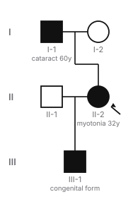
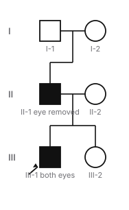

# Biochemistry — Genetics batch 2 review packet

Status: **draft, AI-drafted, not medically reviewed.** Reviewer: mark each concept approved, needs changes or rejected, with notes. A citation alone is not approval.

## How to read this packet

- Options are listed in their **stored** order (deterministically shuffled per item, with opaque ids). Learners see a fresh random order on every presentation; answers are checked by option id, never by position. ✅ marks the correct option.
- Each item shows its **reasoning task** and the **depth** that follows from it: recall/identification → recognition; mechanism → mechanism; interpretation/prediction/comparison/multistep → application. A vignette that only asks for the classic diagnosis is identification (recognition), not application. Application items list the inferential steps they require.
- Facts are split into **verified** (a supporting source was read in full text or as a published abstract/summary and states the claim) and **awaiting direct confirmation** (reasoned from pathway logic, or supported only by sources checked for existence). Awaiting facts block approval in the validator until a reviewer confirms them against a source.
- Citation “checked”: **full-text** (page read), **summary** (published abstract or summary read), **existence** (record confirmed but full text not accessible).
- Mastery: true/false and crossword answers count as weaker recognition evidence; repeating an item within 7 days adds little; “strong” needs at least 3 distinct items, including a mechanism or application item.
- Connections puzzles are checked for a single solution against the **global category catalog** (every bank category, every curated category and decoy, and a catalog of medically plausible groupings such as inheritance patterns, drug classes and toxin sources), not only against their own decoys. The daily builder applies the same check to every board it generates.

- **Two independent classifications.** *Step 1 relevance*: **CORE** (topic and depth supported by the official outline and mainstream Step 1 preparation), **SUPPLEMENTARY** (within the curriculum but beyond core depth; shown less often in games), **SPECIALIST** (obscure or postgraduate; never shown in games, excluded from coverage) or **UNREVIEWED** (not yet evaluated; never assumed core). *Cognitive depth*: **RECOGNITION**, **MECHANISM** or **APPLICATION**, from the reasoning task. A complex vignette on a classic mechanism can be CORE; a simple recall of an obscure finding can be SPECIALIST. The ~80/20 recognition-and-mechanism vs application mix is a flexible game-design target, not a relevance judgement.

## Summary

| Measure | Value |
|---|---|
| Concepts | 13 |
| Objectives taught | 23 |
| Facts verified / awaiting direct confirmation | 49 / 1 |
| **Playable learning items (total)** | **68** |
| — MCQs / true-false / crossword clues | 34 / 20 / 10 |
| — Mechanism Lab sequences / Match Up sets | 1 / 2 |
| — Complete Connections puzzles / Mystery Patient cases | 0 / 1 |
| Connections category-bank entries (builder input, **not** playable alone; excluded from item counts and coverage) | 0 |
| Items, Step 1 relevance: CORE / SUPPLEMENTARY / SPECIALIST / UNREVIEWED | 67 / 1 / 0 / 0 |
| Items, cognitive depth: RECOGNITION / MECHANISM / APPLICATION | 37 / 13 / 18 |
| Objectives, Step 1 relevance: CORE / SUPPLEMENTARY / SPECIALIST / UNREVIEWED | 23 / 0 / 0 / 0 |
| Playable items: recall | 33 |
| Playable items: identification | 4 |
| Playable items: mechanism | 13 |
| Playable items: interpretation | 8 |
| Playable items: prediction | 6 |
| Playable items: comparison | 1 |
| Playable items: multistep | 3 |

## Genomic imprinting and uniparental disomy (`gen-imprinting`)

Objectives: `bc-imprinting.mechanism`, `bc-imprinting.upd`

**Citations**

1. MedlinePlus Genetics: What are genomic imprinting and uniparental disomy? — <https://medlineplus.gov/genetics/understanding/inheritance/updimprinting/> — checked: full-text
2. Engel E. Uniparental disomy: isodisomy (duplicate of one parental chromosome) raises the risk of recessive disorders by reduction to homozygosity; heterodisomy keeps two different homologues. Am J Med Genet 1993 — PMID 8362910 — <https://pubmed.ncbi.nlm.nih.gov/8362910/> — checked: summary
3. Benn P. Uniparental disomy: maternal heterodisomy is the most common type. Prenat Diagn 2021 — PMID 33179335 — <https://pubmed.ncbi.nlm.nih.gov/33179335/> — checked: summary
4. Kotzot D. In maternal heterodisomy with known timing of nondisjunction, about two-thirds were due to a maternal meiosis I error. Eur J Hum Genet 2004 — PMID 14747835 — <https://pubmed.ncbi.nlm.nih.gov/14747835/> — checked: summary

**Verified facts** [supporting citations]

- In genomic imprinting only one of the two gene copies is active, depending on whether it came from the egg or the sperm; the parental origin is marked during egg and sperm formation by methylation. Only a small percentage of genes are imprinted, clustering at 11p15 and 15q11–q13. [1]
- Uniparental disomy (UPD) is inheriting both copies of a chromosome, or part of one, from one parent. It often has no effect, because most genes are not imprinted, but it can leave a person with no active copy of an imprinted gene (Prader–Willi and Angelman syndromes from 15q; Beckwith–Wiedemann syndrome from 11p). [1]
- In isodisomy the two copies are duplicates of one parental chromosome, raising the risk of a recessive disorder by making the person homozygous; in heterodisomy the two copies are the two different homologues of one parent. [2]
- Maternal heterodisomy is the most common type of UPD. [3]

**Awaiting direct source confirmation** (reasoned or existence-only; must be confirmed before approval)

- Heterodisomy (both different homologues from one parent) most often reflects a meiosis I error; isodisomy (two copies of one homologue) fits a meiosis II error or duplication of a single chromosome after fertilization. [2, 4]

**Mechanism.** Methyl marks laid down in the egg or sperm silence one parental copy of imprinted genes, so a child depends on the copy from the other parent. Losing that active copy (by deletion, or by inheriting both copies from the wrong parent) removes the gene’s function. Isodisomy also makes every gene on the chromosome homozygous, so a parent’s recessive variant can cause disease even though the other parent is not a carrier.

**Quick.** Imprinting: one parental copy silenced by methylation (11p15, 15q11–q13). UPD: both copies from one parent. Heterodisomy = two different homologues; isodisomy = two copies of one (homozygous → can unmask a recessive variant with only one carrier parent).

**Detailed**

> Imprinted genes are expressed from only one parental copy. The parental origin is marked by methylation when eggs and sperm form, so the silenced copy cannot substitute for the active one. Imprinted genes are few and clustered, chiefly at 11p15 and 15q11–q13.

> Uniparental disomy means both copies came from one parent. Heterodisomy keeps that parent’s two different homologues; isodisomy duplicates one homologue, so every gene on it is homozygous. Isodisomy explains a child with a recessive disease whose only carrier parent is the one who contributed both copies.

**Misconception.** Uniparental disomy is not always harmful: for non-imprinted chromosomes it is often silent unless isodisomy makes a recessive variant homozygous.

**Takeaway.** Imprinting = methylation silences one parental copy; isodisomy can unmask a recessive variant.

- **MCQ** **CORE** · depth APPLICATION · `gen-imprinting:mcq1` · interpretation → **application** · difficulty 3 · `bc-imprinting.upd`
  - A child has cystic fibrosis. Testing shows the father carries no CFTR variant; the mother is a carrier. SNP analysis shows both copies of chromosome 7 came from the mother and are identical. What explains the disease?
  - ✅ A. Maternal isodisomy made the variant homozygous
  - ◻️ B. Nonpaternity explains the result — _The child has two identical maternal chromosome 7s, so the explanation is uniparental isodisomy._
  - ◻️ C. A dominant negative CFTR variant — _Cystic fibrosis is autosomal recessive; one variant does not cause it._
  - ◻️ D. Maternal heterodisomy of chromosome 7 — _Heterodisomy would give the mother’s two different homologues, not two identical copies._
  - ◻️ E. Imprinting silenced the paternal CFTR allele — _The child has no paternal chromosome 7 at all._
  - Steps: (1) Cystic fibrosis needs two variant alleles, but only the mother is a carrier. (2) Both chromosome 7s are maternal and identical → maternal isodisomy. (3) Duplicating the mother’s variant-bearing chromosome makes the child homozygous → disease.
  - Explanation: Two identical maternal chromosome 7s = maternal isodisomy, so the mother’s single CFTR variant became homozygous in the child even though the father is not a carrier.
- **MCQ** **CORE** · depth MECHANISM · `gen-imprinting:mcq2` · mechanism → **mechanism** · difficulty 2 · `bc-imprinting.mechanism`
  - How is the parental origin of an imprinted gene marked so that one copy stays silent?
  - ◻️ A. By X-inactivation in the embryo — _X-inactivation affects one X chromosome, not imprinted autosomal genes._
  - ◻️ B. By a point mutation in the silent copy — _Imprinting is epigenetic and leaves the DNA sequence unchanged._
  - ◻️ C. By deletion of the gene from one parent’s chromosome — _Imprinted genes are present on both chromosomes; one is silenced, not deleted._
  - ◻️ D. By mitochondrial inheritance from the mother — _Imprinted genes are nuclear and marked by parent of origin._
  - ✅ E. By methylation laid down during egg or sperm formation
  - Explanation: Methyl groups added to DNA during egg and sperm formation mark which copy came from which parent; the methylated copy of an imprinted gene is kept silent.
- **MCQ** **CORE** · depth MECHANISM · `gen-imprinting:mcq3` · mechanism → **mechanism** · difficulty 3 · `bc-imprinting.upd`
  - Why can uniparental isodisomy, but not heterodisomy, give a child a recessive disease when only one parent carries the variant?
  - ◻️ A. Isodisomy turns a recessive variant into a dominant one — _The variant stays recessive; it causes disease because it becomes homozygous._
  - ◻️ B. Isodisomy deletes the allele inherited from the other parent — _Nothing is deleted: the child has no copy of that chromosome from the other parent._
  - ✅ C. Isodisomy duplicates one homologue, so the variant is present twice
  - ◻️ D. Heterodisomy always comes from the noncarrier parent — _Either parent can contribute both homologues in heterodisomy._
  - ◻️ E. Heterodisomy silences both copies of every gene by imprinting — _Most genes are not imprinted; heterodisomy keeps two different homologues._
  - Explanation: In isodisomy both copies are the same parental homologue, so a carrier parent’s variant appears twice (homozygous). Heterodisomy gives the parent’s two different homologues, only one of which carries the variant.
- **True/false** **CORE** · depth RECOGNITION · `gen-imprinting:tf1` · recall → **recognition** · difficulty 1 · `bc-imprinting.mechanism`: Most human genes are imprinted. → **False**. Only a small percentage are; they cluster at 11p15 and 15q11–q13.
- **True/false** **CORE** · depth RECOGNITION · `gen-imprinting:tf2` · recall → **recognition** · difficulty 2 · `bc-imprinting.upd`: Uniparental isodisomy can cause a recessive disorder when only one parent is a carrier. → **True**. Correct: the carrier parent’s chromosome is duplicated, making the child homozygous.
- **Crossword** **CORE** · depth RECOGNITION · `gen-imprinting:clue1` · recall → **recognition** · difficulty 1 · `bc-imprinting.mechanism`: Parent-of-origin gene silencing by methylation → **IMPRINTING**

---

## Prader–Willi and Angelman syndromes (`gen-pws-angelman`)

Objectives: `bc-imprinting.pws`, `bc-imprinting.angelman`

**Citations**

1. MedlinePlus Genetics: Prader-Willi syndrome — <https://medlineplus.gov/genetics/condition/prader-willi-syndrome/> — checked: full-text
2. MedlinePlus Genetics: Angelman syndrome — <https://medlineplus.gov/genetics/condition/angelman-syndrome/> — checked: full-text
3. MedlinePlus Genetics: What are genomic imprinting and uniparental disomy? — <https://medlineplus.gov/genetics/understanding/inheritance/updimprinting/> — checked: full-text

**Verified facts** [supporting citations]

- Prader–Willi syndrome causes hypotonia, feeding difficulties and poor growth in infancy, then extreme hunger with overeating and obesity from childhood, mild to moderate intellectual impairment, behavioral problems, short stature, small hands and feet and underdeveloped genitals with delayed or incomplete puberty. [1]
- Prader–Willi syndrome results from loss of genes on chromosome 15 that are active only on the paternal copy: about 70% from deletion of the paternal 15q segment, about 25% from maternal uniparental disomy, and rarely from a translocation or a change that inactivates the paternal genes. [1, 3]
- Angelman syndrome causes developmental delay, intellectual disability, severe speech impairment, ataxia, seizures, microcephaly and a happy, excitable demeanor with frequent smiling, laughter and hand-flapping. [2]
- Angelman syndrome results from loss of the maternal UBE3A copy, the only active copy in brain neurons: about 70% from deletion of the maternal 15q segment, 10–20% from a UBE3A variant on the maternal copy, and a small percentage from paternal uniparental disomy. [2, 3]

**Mechanism.** The same 15q11–q13 region holds genes that are active only on the paternal copy (lost in Prader–Willi syndrome) and UBE3A, which in neurons is active only on the maternal copy (lost in Angelman syndrome). Which parent’s copy is missing decides the syndrome: a paternal deletion or two maternal copies → Prader–Willi; a maternal deletion, two paternal copies or a maternal UBE3A variant → Angelman.

**Quick.** Same 15q11–q13 region, opposite parent. Prader–Willi = loss of paternal genes (paternal deletion ~70%, maternal UPD ~25%): hypotonic poor feeder → hyperphagia, obesity, hypogonadism, short stature. Angelman = loss of maternal UBE3A (maternal deletion ~70%, UBE3A variant, paternal UPD): seizures, ataxia, absent speech, happy demeanor.

**Detailed**

> Prader–Willi syndrome: infants are hypotonic and feed poorly; from childhood, extreme hunger leads to overeating and obesity. Mild to moderate intellectual impairment, behavioral problems, short stature, small hands and feet and underdeveloped genitals are typical. Paternally expressed genes are lost by paternal deletion (about 70%) or maternal uniparental disomy (about 25%).

> Angelman syndrome: severe intellectual disability with little or no speech, ataxia, seizures, microcephaly and a happy, excitable demeanor with frequent laughter. Neurons use only the maternal UBE3A copy, so maternal deletion (about 70%), a maternal UBE3A variant or paternal uniparental disomy causes the disorder.

**Misconception.** A 15q11–q13 deletion does not always give the same syndrome: the parent of origin of the deleted chromosome decides between Prader–Willi (paternal) and Angelman (maternal).

**Takeaway.** PWS = paternal copy missing (Paternal deletion or maternal UPD); Angelman = maternal UBE3A missing.

- **MCQ** **CORE** · depth APPLICATION · `gen-pws-angelman:mcq1` · interpretation → **application** · difficulty 3 · `bc-imprinting.pws`
  - A hypotonic infant fed poorly and needed tube feeding; by age 4 she eats constantly and is obese, with small hands and feet. FISH shows a 15q11–q13 deletion. On which parental chromosome is the deletion most likely?
  - ◻️ A. Both chromosome 15s — _Losing the region from both copies is not the usual cause._
  - ◻️ B. The X chromosome from her mother — _The deletion is on chromosome 15._
  - ◻️ C. Either, with the same effect — _Imprinting makes the parent of origin decisive._
  - ◻️ D. The maternal chromosome 15 — _A maternal deletion of this region causes Angelman syndrome._
  - ✅ E. The paternal chromosome 15
  - Steps: (1) Infant hypotonia and poor feeding, then hyperphagia and obesity → Prader–Willi syndrome. (2) Prader–Willi results from loss of genes active only on the paternal copy. (3) So the deletion is on the paternal chromosome 15.
  - Explanation: Hypotonia and poor feeding followed by hyperphagia and obesity = Prader–Willi syndrome, caused by loss of paternally expressed 15q11–q13 genes, most often a paternal deletion.
- **MCQ** **CORE** · depth APPLICATION · `gen-pws-angelman:mcq2` · multistep → **application** · difficulty 4 · `bc-imprinting.angelman`
  - A 3-year-old has severe developmental delay, no words, seizures, an unsteady gait and frequent laughter with hand-flapping. FISH for 15q11–q13 is normal and both chromosome 15s are biparental. Which result would most likely explain the condition?
  - ◻️ A. A paternal UBE3A variant — _The paternal UBE3A copy is normally silent in neurons, so its loss has no effect._
  - ◻️ B. A deletion on the paternal chromosome 15 — _FISH is normal, and a paternal deletion would cause Prader–Willi syndrome._
  - ◻️ C. Maternal uniparental disomy 15 — _The chromosomes are biparental, and maternal UPD causes Prader–Willi syndrome._
  - ◻️ D. Trisomy 15 mosaicism — _The findings point to loss of maternal UBE3A function._
  - ✅ E. A pathogenic variant in the maternal UBE3A copy
  - Steps: (1) Severe delay, absent speech, seizures, ataxia and laughter → Angelman syndrome. (2) Normal FISH excludes a deletion; biparental chromosomes exclude paternal UPD. (3) The remaining common cause is a variant in the maternal UBE3A copy, the only active copy in neurons.
  - Explanation: Angelman features with no deletion and no UPD point to a maternal UBE3A variant (10–20% of cases): neurons rely only on the maternal UBE3A copy.
- **MCQ** **CORE** · depth MECHANISM · `gen-pws-angelman:mcq3` · mechanism → **mechanism** · difficulty 3 · `bc-imprinting.pws`
  - Why does maternal uniparental disomy of chromosome 15 cause Prader–Willi syndrome even though no DNA is missing?
  - ◻️ A. A double dose of maternally expressed 15q genes is toxic to neurons — _The syndrome results from absent paternal gene activity, not a toxic maternal dose._
  - ✅ B. Both copies carry maternal imprints, so paternally expressed genes are silent
  - ◻️ C. Maternal uniparental disomy always carries a hidden 15q deletion — _No deletion is needed: two maternal copies alone remove paternal expression._
  - ◻️ D. The extra maternal chromosome 15 is deleted after fertilization — _The child keeps two maternal chromosome 15s; nothing is deleted._
  - ◻️ E. Maternal UBE3A is silenced in neurons by the second maternal copy — _Loss of maternal UBE3A causes Angelman syndrome, not Prader–Willi syndrome._
  - Explanation: The 15q11–q13 Prader–Willi genes are active only on the paternal copy. With two maternal copies, both carry the maternal (silenced) imprint, so these genes have no active copy.
- **MCQ** **CORE** · depth MECHANISM · `gen-pws-angelman:mcq4` · mechanism → **mechanism** · difficulty 3 · `bc-imprinting.angelman`
  - Why does paternal uniparental disomy of chromosome 15 cause Angelman syndrome?
  - ✅ A. Both UBE3A copies are paternal, and the paternal copy is silent in neurons
  - ◻️ B. Paternal disomy always comes with a deletion of the maternal 15q segment — _No maternal chromosome 15 is present, and no deletion is required._
  - ◻️ C. The paternally expressed 15q genes are lost from both chromosomes — _Loss of paternally expressed genes causes Prader–Willi syndrome._
  - ◻️ D. Paternal transmission expands a CGG repeat in UBE3A — _Repeat expansion is the mechanism of fragile X syndrome, not Angelman syndrome._
  - ◻️ E. Two active paternal UBE3A copies overproduce the protein in neurons — _The paternal UBE3A copy is silent in neurons, so it is not overexpressed._
  - Explanation: Neurons use only the maternal UBE3A copy. With two paternal chromosome 15s there is no maternal copy, so neurons have no active UBE3A.
- **True/false** **CORE** · depth RECOGNITION · `gen-pws-angelman:tf1` · recall → **recognition** · difficulty 2 · `bc-imprinting.pws`: Maternal uniparental disomy of chromosome 15 causes Prader–Willi syndrome. → **True**. Correct: with two maternal copies, the paternally expressed genes are missing (about 25% of cases).
- **True/false** **CORE** · depth RECOGNITION · `gen-pws-angelman:tf2` · recall → **recognition** · difficulty 1 · `bc-imprinting.angelman`: In brain neurons, only the paternal copy of UBE3A is active. → **False**. Only the maternal copy is active in neurons; its loss causes Angelman syndrome.
- **Crossword** **CORE** · depth RECOGNITION · `gen-pws-angelman:clue1` · recall → **recognition** · difficulty 1 · `bc-imprinting.angelman`: Syndrome from loss of maternal UBE3A → **ANGELMAN**
- **Crossword** **CORE** · depth RECOGNITION · `gen-pws-angelman:clue2` · recall → **recognition** · difficulty 2 · `bc-imprinting.pws`: Extreme overeating that begins in childhood in Prader–Willi syndrome → **HYPERPHAGIA**
- **Match Up** **CORE** · depth RECOGNITION · `match:imprinting-causes` · recall → **recognition** · difficulty 2 · `bc-imprinting.pws`, `bc-imprinting.angelman`, `bc-imprinting.bws`: Which parent’s copy is missing?. Match each genetic finding to the syndrome it causes.
  - Paternal 15q11–q13 deletion ↔ Prader–Willi syndrome
  - Maternal UPD 15 ↔ Prader–Willi (two maternal 15s)
  - Maternal 15q11–q13 deletion ↔ Angelman syndrome
  - Paternal UPD 15 ↔ Angelman (two paternal 15s)
  - 11p15 imprinting defect ↔ Beckwith–Wiedemann syndrome
  - Prader–Willi = no active paternal 15q genes; Angelman = no active maternal UBE3A; Beckwith–Wiedemann = 11p15 imprinting.

---

## Beckwith–Wiedemann syndrome (`gen-bws`)

Objectives: `bc-imprinting.bws`

**Citations**

1. MedlinePlus Genetics: Beckwith-Wiedemann syndrome — <https://medlineplus.gov/genetics/condition/beckwith-wiedemann-syndrome/> — checked: full-text
2. MedlinePlus Genetics: What are genomic imprinting and uniparental disomy? — <https://medlineplus.gov/genetics/understanding/inheritance/updimprinting/> — checked: full-text
3. Reik W. Loss of imprinting of the paternally expressed growth enhancer IGF2 is the most common molecular defect in Beckwith–Wiedemann syndrome; IGF2 overexpression can reproduce most of its features. Trends Genet 1997 — PMID 9260520 — <https://pubmed.ncbi.nlm.nih.gov/9260520/> — checked: summary

**Verified facts** [supporting citations]

- Beckwith–Wiedemann syndrome is an overgrowth syndrome: infants are larger than normal (macrosomia), may have hemihyperplasia (one side larger), an abdominal wall defect such as omphalocele, an enlarged tongue (macroglossia), enlarged abdominal organs, ear creases or pits and low blood glucose in infancy. [1]
- Children with Beckwith–Wiedemann syndrome have an increased risk of tumors, particularly Wilms tumor (kidney) and hepatoblastoma (liver). [1]
- Most cases result from abnormal regulation of imprinted genes on chromosome 11p15; at least half involve methylation changes at imprinting control regions that regulate growth genes including CDKN1C, H19 and IGF2. [1, 2]
- Overexpression of the paternally expressed growth factor gene IGF2 contributes to the overgrowth. [1, 3]

**Mechanism.** Imprinting errors at 11p15 unbalance growth-regulating genes so that growth-promoting activity (including IGF2) is increased. The result is prenatal and childhood overgrowth, organ enlargement and a raised risk of embryonal tumors.

**Quick.** Beckwith–Wiedemann: 11p15 imprinting disorder (growth genes incl. IGF2) → macrosomia, macroglossia, omphalocele, hemihyperplasia, neonatal hypoglycemia; increased Wilms tumor and hepatoblastoma risk.

**Detailed**

> Beckwith–Wiedemann syndrome is an overgrowth disorder: large-for-dates babies with a large tongue, abdominal wall defects (omphalocele, umbilical hernia), sometimes one side of the body larger, enlarged organs and low glucose in infancy.

> The cause is abnormal imprinting at 11p15, where methylation controls growth genes such as IGF2, H19 and CDKN1C. Affected children have an increased risk of embryonal tumors, especially Wilms tumor and hepatoblastoma.

**Misconception.** Beckwith–Wiedemann syndrome is not an extra chromosome: it is an imprinting disorder of 11p15.

**Takeaway.** BWS = 11p15 imprinting → overgrowth, macroglossia, omphalocele; Wilms and hepatoblastoma risk.

- **MCQ** **CORE** · depth RECOGNITION · `gen-bws:mcq1` · identification → **recognition** · difficulty 2 · `bc-imprinting.bws`
  - A newborn weighs 4.9 kg, has a large protruding tongue, an omphalocele and recurrent low glucose; one leg is longer than the other. Which tumors is this child at increased risk of?
  - ◻️ A. Medullary thyroid carcinoma and pheochromocytoma — _These are associated with MEN2 (RET)._
  - ◻️ B. Acute lymphoblastic leukemia only — _The overgrowth picture points to Beckwith–Wiedemann syndrome._
  - ◻️ C. Retinoblastoma and osteosarcoma — _These are associated with germline RB1 variants._
  - ◻️ D. Neurofibromas and optic gliomas — _These are associated with neurofibromatosis type 1._
  - ✅ E. Wilms tumor and hepatoblastoma
  - Explanation: Macrosomia, macroglossia, omphalocele, hypoglycemia and hemihyperplasia = Beckwith–Wiedemann syndrome (11p15 imprinting), with increased Wilms tumor and hepatoblastoma risk.
- **MCQ** **CORE** · depth APPLICATION · `gen-bws:mcq2` · interpretation → **application** · difficulty 3 · `bc-imprinting.bws`
  - A newborn has macrosomia, macroglossia and an omphalocele, with low glucose in the first days of life. The karyotype is normal 46,XY. Which further result would most likely explain the condition?
  - ✅ A. Abnormal methylation at imprinting control regions on 11p15
  - ◻️ B. Deletion of the paternal 15q11–q13 segment — _A paternal 15q deletion causes Prader–Willi syndrome, with hypotonia, not overgrowth._
  - ◻️ C. Expansion of a CGG repeat in FMR1 — _Fragile X does not cause neonatal overgrowth, macroglossia or omphalocele._
  - ◻️ D. A heteroplasmic mitochondrial DNA variant — _The overgrowth picture points to an 11p15 imprinting disorder._
  - ◻️ E. Trisomy 13 detected on repeat karyotype — _The karyotype is normal, and trisomy 13 does not cause overgrowth._
  - Steps: (1) Macrosomia, macroglossia, omphalocele and neonatal hypoglycemia → Beckwith–Wiedemann syndrome. (2) It is an imprinting disorder of 11p15, invisible on a routine karyotype. (3) At least half of cases show abnormal methylation at 11p15 imprinting control regions.
  - Explanation: Overgrowth with macroglossia, omphalocele and neonatal hypoglycemia = Beckwith–Wiedemann syndrome. A normal karyotype fits, because the usual cause is a methylation (imprinting) change at 11p15, not a visible chromosome change.
- **True/false** **CORE** · depth RECOGNITION · `gen-bws:tf1` · recall → **recognition** · difficulty 1 · `bc-imprinting.bws`: Beckwith–Wiedemann syndrome is caused by abnormal imprinting on chromosome 11p15. → **True**. Correct: methylation changes there unbalance growth genes such as IGF2.
- **Crossword** **CORE** · depth RECOGNITION · `gen-bws:clue1` · recall → **recognition** · difficulty 2 · `bc-imprinting.bws`: Enlarged tongue of Beckwith–Wiedemann syndrome → **MACROGLOSSIA**

---

## Hardy–Weinberg equilibrium and carrier frequency (`gen-hardy-weinberg`)

Objectives: `bc-hardy-weinberg.equations`, `bc-hardy-weinberg.ar-calc`, `bc-hardy-weinberg.x-calc`, `bc-hardy-weinberg.violations`

**Citations**

1. OpenStax Biology 2e, 19.1 Population Evolution — <https://openstax.org/books/biology-2e/pages/19-1-population-evolution> — checked: full-text
2. OpenStax Biology 2e, 19.2 Population Genetics — <https://openstax.org/books/biology-2e/pages/19-2-population-genetics> — checked: full-text
3. Naik RP, Haywood C Jr. The HbS mutation has been selected repeatedly because of its malarial protective effect in heterozygotes (sickle cell trait). Hematology Am Soc Hematol Educ Program 2015 — PMID 26637716 — <https://pubmed.ncbi.nlm.nih.gov/26637716/> — checked: summary

**Verified facts** [supporting citations]

- For two alleles at a locus with frequencies p and q, p + q = 1, and the genotype frequencies are p² (homozygous for p), 2pq (heterozygous) and q² (homozygous for q), with p² + 2pq + q² = 1. [1]
- The Hardy–Weinberg principle states that allele and genotype frequencies stay stable unless an evolutionary force acts; it assumes a very large population with no mutation, migration or selection, and random combination of alleles. [1]
- Genetic drift is a random change in allele frequency that matters most in small populations; the founder effect is a change in allele frequency in a small, isolated group that is not typical of the original population. [2]
- The sickle hemoglobin allele has been selected repeatedly because heterozygotes (sickle cell trait) are protected against malaria (heterozygote advantage). [3]

**Mechanism.** If allele frequencies are p and q and alleles combine at random, genotypes follow p², 2pq and q². For a rare recessive disease the affected frequency is q², so q = √(prevalence) and the carrier frequency 2pq is close to 2q. For an X-linked recessive disease, males show the allele frequency directly (q) and affected females are q². Drift, founder effects, selection and heterozygote advantage move a population away from these expectations.

**Quick.** p + q = 1; p² + 2pq + q² = 1 (large population, random mating, no mutation, migration or selection). Rare AR disease: q = √prevalence, carriers ≈ 2q. XR: affected males = q, affected females = q². Departures: drift, founder effect, selection, heterozygote advantage.

**Detailed**

> Hardy–Weinberg assumes a large, randomly mating population without mutation, migration or selection; then allele frequencies (p, q) and genotype frequencies (p², 2pq, q²) stay constant. For a rare autosomal recessive disease, prevalence = q², so q = √prevalence; with p ≈ 1, carriers = 2pq ≈ 2q. For an X-linked recessive disease, each male has one X, so the proportion of affected males equals q; affected females need two copies, q².

> Real populations depart from equilibrium through genetic drift (chance, strongest in small populations), founder effects (a small isolated group with unusual allele frequencies), selection, and heterozygote advantage, the classic example being sickle cell trait protecting against malaria.

**Misconception.** The carrier frequency is not the square root of prevalence: √prevalence gives the allele frequency q; carriers are about 2q.

**Takeaway.** q = √prevalence; carriers ≈ 2q; X-linked males = q; drift, founders and heterozygote advantage break equilibrium.

- **MCQ** **CORE** · depth APPLICATION · `gen-hardy-weinberg:mcq1` · multistep → **application** · difficulty 4 · `bc-hardy-weinberg.ar-calc`
  - An autosomal recessive disease affects 1 in 10,000 people in a population in Hardy–Weinberg equilibrium. What is the approximate carrier frequency?
  - ✅ A. 1 in 50
  - ◻️ B. 1 in 200 — _Carriers are 2q, which is twice (not half) the allele frequency._
  - ◻️ C. 1 in 100 — _One in 100 is the allele frequency q, not the carrier frequency._
  - ◻️ D. 1 in 25 — _One in 25 would need an allele frequency of 1 in 50._
  - ◻️ E. 1 in 10,000 — _That is the prevalence of affected homozygotes, q²._
  - Steps: (1) Affected homozygotes = q² = 1/10,000. (2) q = √(1/10,000) = 1/100; p ≈ 1. (3) Carriers = 2pq ≈ 2 × 1/100 = 1/50.
  - Explanation: q² = 1/10,000 → q = 1/100; carriers = 2pq ≈ 2q = 2/100 = 1 in 50.
- **MCQ** **CORE** · depth APPLICATION · `gen-hardy-weinberg:mcq2` · prediction → **application** · difficulty 3 · `bc-hardy-weinberg.x-calc`
  - An X-linked recessive disease affects 1 in 5,000 males in a population in Hardy–Weinberg equilibrium. Approximately how often would it affect females?
  - ◻️ A. 1 in 70,700 — _That is roughly √(1/5,000), which is not the female frequency._
  - ◻️ B. 1 in 2,500 — _Females are far less often affected than males in X-linked recessive disease._
  - ✅ C. 1 in 25,000,000
  - ◻️ D. 1 in 10,000 — _Halving the male frequency does not model two-copy inheritance._
  - ◻️ E. 1 in 5,000 — _That is the male frequency (q); females need two copies._
  - Steps: (1) Each male has one X, so affected males = q = 1/5,000. (2) Affected females must inherit two variant X chromosomes: q². (3) (1/5,000)² = 1/25,000,000.
  - Explanation: In males the affected frequency equals the allele frequency: q = 1/5,000. Affected females need two copies: q² = 1/25,000,000.
- **MCQ** **CORE** · depth RECOGNITION · `gen-hardy-weinberg:mcq3` · identification → **recognition** · difficulty 2 · `bc-hardy-weinberg.violations`
  - A rare recessive disorder is far more common in an isolated community descended from a few settlers than in the population they came from. What explains this?
  - ◻️ A. Anticipation — _Anticipation describes worsening of repeat disorders over generations._
  - ✅ B. Founder effect
  - ◻️ C. Hardy–Weinberg equilibrium — _Equilibrium predicts stable frequencies; this is a departure from them._
  - ◻️ D. Heterozygote advantage — _Heterozygote advantage requires a selective benefit to carriers, which is not described._
  - ◻️ E. New mutations in every generation — _Recurrent new mutation would not concentrate the allele in one isolated group._
  - Explanation: A small founding group can carry an allele at a frequency atypical of its source population; isolation preserves it: the founder effect.
- **MCQ** **CORE** · depth MECHANISM · `gen-hardy-weinberg:mcq4` · mechanism → **mechanism** · difficulty 2 · `bc-hardy-weinberg.equations`
  - In Hardy–Weinberg equilibrium, why is the carrier frequency of a rare recessive allele approximately 2q?
  - ◻️ A. Heterozygote advantage doubles the number of carriers — _Selection breaks equilibrium; the 2q estimate assumes no selection._
  - ✅ B. Heterozygotes are 2pq, and p is close to 1 when q is small
  - ◻️ C. Carriers equal the square root of the disease prevalence — _The square root of prevalence is the allele frequency q, not the carrier frequency._
  - ◻️ D. Carriers and affected people are both q² in frequency — _q² is the frequency of affected homozygotes only._
  - ◻️ E. Each carrier has two copies of the variant allele — _Carriers are heterozygotes with one copy; two copies give affected homozygotes (q²)._
  - Explanation: Genotypes are p², 2pq and q². Heterozygous carriers are 2pq; for a rare allele p ≈ 1, so carriers ≈ 2q.
- **True/false** **CORE** · depth RECOGNITION · `gen-hardy-weinberg:tf1` · recall → **recognition** · difficulty 1 · `bc-hardy-weinberg.equations`: Hardy–Weinberg equilibrium assumes no mutation, migration or selection in a very large population. → **True**. Correct, with random combination of alleles.
- **True/false** **CORE** · depth RECOGNITION · `gen-hardy-weinberg:tf2` · recall → **recognition** · difficulty 1 · `bc-hardy-weinberg.violations`: Sickle cell trait is maintained in malaria-endemic regions by heterozygote advantage. → **True**. Correct: heterozygotes are protected against malaria.
- **True/false** **CORE** · depth RECOGNITION · `gen-hardy-weinberg:tf3` · recall → **recognition** · difficulty 1 · `bc-hardy-weinberg.equations`: In Hardy–Weinberg equilibrium, the frequency of heterozygotes is p². → **False**. Heterozygotes are 2pq; p² and q² are the homozygotes.
- **Crossword** **CORE** · depth RECOGNITION · `gen-hardy-weinberg:clue1` · recall → **recognition** · difficulty 1 · `bc-hardy-weinberg.violations`: Genetic ___: random change in allele frequency, strongest in small populations → **DRIFT**

---

## Trinucleotide repeat disorders: fragile X, Friedreich ataxia, myotonic dystrophy and parent-of-origin bias (`gen-repeats`)

Objectives: `bc-trinucleotide.principles`, `bc-trinucleotide.fragile-x`, `bc-trinucleotide.friedreich`, `bc-trinucleotide.match`, `bc-muscular-dystrophy.myotonic`

**Citations**

1. MedlinePlus Genetics: Fragile X syndrome — <https://medlineplus.gov/genetics/condition/fragile-x-syndrome/> — checked: full-text
2. MedlinePlus Genetics: FMR1 gene — <https://medlineplus.gov/genetics/gene/fmr1/> — checked: full-text
3. Meraj N et al. Fragile X premutation alleles (56–200 CGG) expand to full mutations (>200) during maternal transmission. BMC Womens Health 2022 — PMID 35246105 — <https://pubmed.ncbi.nlm.nih.gov/35246105/> — checked: summary
4. MedlinePlus Genetics: Friedreich ataxia — <https://medlineplus.gov/genetics/condition/friedreich-ataxia/> — checked: full-text
5. MedlinePlus Genetics: Myotonic dystrophy — <https://medlineplus.gov/genetics/condition/myotonic-dystrophy/> — checked: full-text
6. MedlinePlus Genetics: DMPK gene — <https://medlineplus.gov/genetics/gene/dmpk/> — checked: full-text
7. MedlinePlus Genetics: Huntington disease — <https://medlineplus.gov/genetics/condition/huntington-disease/> — checked: full-text
8. Tzagournissakis M et al. Huntington anticipation is seen particularly when inherited through the father; the CAG repeat tends to expand in paternal meioses. Hum Mol Genet 1995 — PMID 8634693 — <https://pubmed.ncbi.nlm.nih.gov/8634693/> — checked: summary
9. Nicolas G et al. Juvenile Huntington disease: usually >60 CAG repeats; paternal transmission in 80–90% of cases. Am J Med Genet A 2011 — PMID 21412977 — <https://pubmed.ncbi.nlm.nih.gov/21412977/> — checked: summary

**Verified facts** [supporting citations]

- Fragile X syndrome is caused by more than 200 CGG repeats in FMR1, which silence the gene and prevent production of FMRP; 55–200 repeats is a premutation. Features include intellectual disability (milder and less frequent in females), autism features in about one-third, a long narrow face, large ears, a prominent jaw, flexible fingers and enlarged testes after puberty. [1, 2]
- Fragile X premutation alleles expand to full mutations during maternal transmission. [3]
- Friedreich ataxia is autosomal recessive and caused by a GAA repeat expansion in FXN (normally 5–33, in disease 66 to more than 1,000), reducing frataxin, a protein important for mitochondrial function; onset is usually between 5 and 15 years with progressive ataxia, loss of strength and sensation, hypertrophic cardiomyopathy, and sometimes diabetes or scoliosis. [4]
- Myotonic dystrophy type 1 is autosomal dominant and caused by an expanded CTG repeat in DMPK (normally 5–34; 50 to over 1,000 in disease, more than 1,000 in the congenital form). It causes myotonia (difficulty releasing a grip), progressive muscle weakness, cataracts, cardiac conduction defects and diabetes, and shows anticipation. [5, 6]
- Huntington disease shows anticipation particularly when inherited through the father, because the CAG repeat tends to expand in paternal meioses; juvenile Huntington disease is paternally transmitted in 80–90% of cases. [7, 8, 9]
- The long GAA repeat disrupts production of frataxin, severely reducing it; certain nerve and muscle cells cannot function properly without enough frataxin. [4]
- The expanded DMPK repeat produces an abnormally long messenger RNA that traps proteins in clumps inside the cell, interfering with the production of many other proteins. [5, 6]

**Mechanism.** Repeats above a threshold are unstable and can grow when passed on. The parent matters: Huntington CAG repeats expand mainly in the father’s germ line, fragile X premutations expand to full mutations through the mother, and large myotonic dystrophy expansions can give a congenital form. Where the repeat sits sets the mechanism: CGG silencing (fragile X), GAA loss of frataxin (Friedreich), toxic CTG RNA (myotonic dystrophy), and polyglutamine CAG (Huntington).

**Quick.** CAG Huntington (AD, paternal expansion). CGG fragile X (X-linked, FMR1 silenced; premutation 55–200 expands via mother; long face, large ears, macroorchidism). GAA Friedreich (AR, frataxin; ataxia, cardiomyopathy, diabetes). CTG myotonic dystrophy 1 (AD, DMPK; myotonia, cataracts, conduction defects).

**Detailed**

> Trinucleotide repeat disorders share instability: long repeats tend to lengthen on transmission, giving anticipation. The parent of origin matters. Huntington CAG repeats expand mainly through the father (juvenile cases are mostly paternal), while fragile X premutations become full mutations through the mother.

> The repeat and gene predict the disease. Fragile X (CGG, FMR1, X-linked): silencing of FMR1, intellectual disability, autism features, long face, large ears, macroorchidism. Friedreich ataxia (GAA, FXN, recessive): childhood-onset ataxia, sensory loss, hypertrophic cardiomyopathy, diabetes, scoliosis. Myotonic dystrophy type 1 (CTG, DMPK, dominant): myotonia, weakness, cataracts, conduction defects, diabetes, with a severe congenital form from very large expansions.

**Misconception.** Not every repeat disorder is dominant or shows anticipation in the same way: Friedreich ataxia is recessive, and fragile X expansions occur on maternal transmission whereas Huntington expansions occur mainly through fathers.

**Takeaway.** CAG–Huntington (father), CGG–fragile X (mother), GAA–Friedreich (recessive), CTG–myotonic dystrophy (dominant).

- **MCQ** **CORE** · depth RECOGNITION · `gen-repeats:mcq1` · identification → **recognition** · difficulty 2 · `bc-trinucleotide.friedreich`
  - A 9-year-old with progressive gait ataxia, absent ankle reflexes and loss of sensation in the feet is found to have hypertrophic cardiomyopathy. His parents and sister are unaffected. Which repeat and inheritance are most likely?
  - ◻️ A. CTG expansion in DMPK, autosomal dominant — _Myotonic dystrophy causes myotonia and cataracts._
  - ◻️ B. CGG expansion in FMR1, X-linked — _Fragile X causes intellectual disability, not this ataxia with cardiomyopathy._
  - ◻️ C. CAG expansion in HTT, autosomal dominant — _Huntington disease causes a movement disorder in adults, typically with an affected parent._
  - ✅ D. GAA expansion in FXN, autosomal recessive
  - ◻️ E. Mitochondrial DNA variant, maternal — _The picture fits Friedreich ataxia, a nuclear recessive disorder._
  - Explanation: Childhood-onset progressive ataxia, sensory loss and hypertrophic cardiomyopathy with unaffected parents = Friedreich ataxia: autosomal recessive GAA expansion in FXN (frataxin).
- **MCQ** **CORE** · depth MECHANISM · `gen-repeats:mcq2` · mechanism → **mechanism** · difficulty 3 · `bc-trinucleotide.principles`, `bc-trinucleotide.fragile-x`
  - A woman carries a fragile X premutation of 90 CGG repeats. Her father carried the same premutation and was intellectually normal. Why is her son at risk of fragile X syndrome when her father’s children were not affected?
  - ◻️ A. Fragile X is autosomal recessive — _Fragile X is X-linked, not autosomal recessive._
  - ◻️ B. Her son will inherit the premutation from his father — _Sons inherit their X from their mother._
  - ✅ C. Premutations expand to full mutations on maternal transmission
  - ◻️ D. Fragile X repeats shrink in every generation — _Premutation alleles tend to expand, not shrink._
  - ◻️ E. Her father’s premutation was mitochondrial — _FMR1 is on the X chromosome._
  - Explanation: Premutation alleles (55–200 CGG) can expand to full mutations (>200) when passed through a mother, so a carrier mother’s son can have fragile X syndrome even though her transmitting father’s children were unaffected.
- **MCQ** **CORE** · depth APPLICATION · `gen-repeats:mcq3` · interpretation → **application** · difficulty 3 · `bc-muscular-dystrophy.myotonic`
  - A 35-year-old man cannot let go of a door handle after gripping it, and has early cataracts and a cardiac conduction defect. His mother had cataracts at 60; his newborn son was floppy at birth. Which gene and repeat are involved?
  - Figure (pedigree, original, generated from data; passes validation):

    

  - Figure text: Pedigree. Generation I: I-1 male, unaffected; I-2 female, affected (cataracts 60y). Generation II: II-1 male, affected (proband) (myotonia 35y); II-2 female, unaffected. Generation III: III-1 male, affected (floppy newborn). I-1 and I-2 have II-1. II-1 and II-2 have III-1.
  - ✅ A. CTG expansion in DMPK
  - ◻️ B. CGG expansion in FMR1 — _Fragile X causes intellectual disability and is X-linked._
  - ◻️ C. Deletion in the dystrophin gene — _Dystrophinopathies do not cause myotonia or cataracts._
  - ◻️ D. GAA expansion in FXN — _Friedreich ataxia is recessive and causes ataxia with cardiomyopathy._
  - ◻️ E. CAG expansion in HTT — _Huntington disease causes a movement disorder, not myotonia and cataracts._
  - Steps: (1) Difficulty releasing a grip, cataracts and conduction defects → myotonic dystrophy. (2) Each generation is affected earlier and more severely → anticipation from repeat expansion. (3) Myotonic dystrophy type 1 = autosomal dominant CTG expansion in DMPK.
  - Explanation: Myotonia, cataracts and conduction defects with anticipation over three generations (late cataracts → adult myotonia → floppy newborn) = myotonic dystrophy type 1, a dominant CTG expansion in DMPK.
- **MCQ** **CORE** · depth MECHANISM · `gen-repeats:mcq4` · mechanism → **mechanism** · difficulty 2 · `bc-trinucleotide.friedreich`
  - How does the expanded GAA repeat in FXN cause Friedreich ataxia?
  - ◻️ A. Its messenger RNA traps proteins in clumps inside the cell — _Toxic RNA clumps are the mechanism of the DMPK CTG repeat in myotonic dystrophy._
  - ✅ B. It severely reduces frataxin, a protein needed for mitochondrial function
  - ◻️ C. It adds a toxic polyglutamine tract to the encoded protein — _A polyglutamine tract is the mechanism of CAG repeats such as Huntington disease._
  - ◻️ D. It produces a dominant negative frataxin protein — _Friedreich ataxia is recessive: disease results from too little frataxin._
  - ◻️ E. It silences an X-linked gene by hypermethylation — _FXN is autosomal; methylation silencing of FMR1 causes fragile X syndrome._
  - Explanation: The long GAA repeat disrupts frataxin production. Frataxin is important for mitochondrial function, and certain nerve and muscle cells cannot function properly without enough of it.
- **MCQ** **CORE** · depth APPLICATION · `gen-repeats:mcq5` · prediction → **application** · difficulty 3 · `bc-trinucleotide.friedreich`
  - A 12-year-old girl has a progressively clumsy gait, frequent falls, absent ankle reflexes and reduced sensation in her feet. Her parents and brother are unaffected. Which finding is she most likely to develop as the disorder progresses?
  - ◻️ A. Progressive hearing loss with hematuria — _Hearing loss with kidney disease suggests Alport syndrome, not a childhood ataxia._
  - ◻️ B. Cataracts with difficulty releasing her grip — _Cataracts and myotonia point to myotonic dystrophy, which is dominant and would usually affect a parent._
  - ◻️ C. Chorea and dementia in mid-adulthood — _Huntington disease is dominant with adult onset, usually with an affected parent._
  - ◻️ D. Severe intellectual disability with absent speech — _This suggests Angelman syndrome; her presentation is a progressive ataxia with sensory loss._
  - ✅ E. Hypertrophic cardiomyopathy
  - Steps: (1) Progressive childhood ataxia, absent reflexes and sensory loss with unaffected parents → Friedreich ataxia (recessive). (2) Frataxin shortage impairs certain nerve and muscle cells, including heart muscle. (3) Hypertrophic cardiomyopathy is a characteristic feature to anticipate.
  - Explanation: Childhood-onset progressive ataxia with sensory loss and unaffected parents suggests Friedreich ataxia (autosomal recessive GAA expansion in FXN). Frataxin deficiency also affects heart muscle, so hypertrophic cardiomyopathy is expected.
- **MCQ** **CORE** · depth MECHANISM · `gen-repeats:mcq6` · mechanism → **mechanism** · difficulty 3 · `bc-muscular-dystrophy.myotonic`
  - How does the expanded CTG repeat in DMPK cause myotonic dystrophy type 1?
  - ◻️ A. It silences DMPK by hypermethylation so that no protein is made at all — _Hypermethylation silencing of the repeat-bearing gene is the mechanism of fragile X syndrome (FMR1)._
  - ◻️ B. It deletes exons of the dystrophin gene and shifts the reading frame — _Frameshift dystrophin deletions cause Duchenne muscular dystrophy._
  - ◻️ C. It severely reduces frataxin needed for mitochondrial function — _Frataxin deficiency from a GAA repeat causes Friedreich ataxia._
  - ◻️ D. It is passed only through the mitochondria of the mother — _Myotonic dystrophy type 1 is autosomal dominant, nuclear inheritance._
  - ✅ E. Its long mRNA traps proteins in clumps, disrupting other protein production
  - Explanation: The expanded DMPK repeat produces an abnormally long messenger RNA that traps proteins in clumps; the clumps interfere with the production of many other proteins.
- **MCQ** **CORE** · depth APPLICATION · `gen-repeats:mcq7` · comparison → **application** · difficulty 3 · `bc-trinucleotide.match`, `bc-trinucleotide.principles`
  - A man developed chorea at 48. His son developed it at 36, and his son’s son developed the disease at 14. Which repeat best explains the disease and its earlier onset in each generation?
  - ✅ A. A CAG repeat in HTT that tends to expand in paternal meioses
  - ◻️ B. A mitochondrial DNA variant passed down by the fathers — _Mitochondrial DNA is inherited from the mother, not the father._
  - ◻️ C. A CTG repeat in DMPK that expands mainly through mothers — _Myotonic dystrophy causes myotonia, cataracts and conduction defects, not chorea._
  - ◻️ D. A GAA repeat in FXN inherited in a recessive pattern — _The disease appears in every generation through affected parents, a dominant pattern._
  - ◻️ E. A CGG repeat in FMR1 that expands through the mother — _Transmission is father to son, and fragile X does not cause adult chorea._
  - Steps: (1) Chorea in each generation, passed father to son → autosomal dominant movement disorder → Huntington disease. (2) Earlier onset each generation = anticipation from repeat expansion. (3) Huntington = CAG in HTT, which expands mainly through fathers; the other repeats differ in gene, phenotype or parent of origin.
  - Explanation: Chorea in three generations through fathers, with onset earlier each time = Huntington disease (autosomal dominant CAG in HTT), whose repeat tends to expand in paternal meioses.
- **True/false** **CORE** · depth RECOGNITION · `gen-repeats:tf1` · recall → **recognition** · difficulty 1 · `bc-trinucleotide.fragile-x`: Fragile X syndrome is caused by more than 200 CGG repeats in FMR1, which silence the gene. → **True**. Correct; 55–200 repeats is a premutation.
- **True/false** **CORE** · depth RECOGNITION · `gen-repeats:tf2` · recall → **recognition** · difficulty 2 · `bc-trinucleotide.principles`: Juvenile Huntington disease is usually inherited from the father. → **True**. Correct: the CAG repeat tends to expand in paternal meioses (paternal in 80–90% of juvenile cases).
- **True/false** **CORE** · depth RECOGNITION · `gen-repeats:tf3` · recall → **recognition** · difficulty 1 · `bc-trinucleotide.friedreich`: Friedreich ataxia is an autosomal dominant CAG repeat disorder. → **False**. It is autosomal recessive, caused by a GAA expansion in FXN.
- **Crossword** **CORE** · depth RECOGNITION · `gen-repeats:clue1` · recall → **recognition** · difficulty 2 · `bc-trinucleotide.fragile-x`: Enlarged testes after puberty in fragile X syndrome → **MACROORCHIDISM**
- **Crossword** **CORE** · depth RECOGNITION · `gen-repeats:clue2` · recall → **recognition** · difficulty 1 · `bc-muscular-dystrophy.myotonic`: Delayed muscle relaxation, as in failing to release a grip → **MYOTONIA**
- **Crossword** **CORE** · depth RECOGNITION · `gen-repeats:clue3` · recall → **recognition** · difficulty 2 · `bc-trinucleotide.friedreich`: Mitochondrial protein reduced in Friedreich ataxia → **FRATAXIN**
- **Match Up** **CORE** · depth RECOGNITION · `match:repeat-disorders` · recall → **recognition** · difficulty 2 · `bc-trinucleotide.match`: Repeat, gene and pattern. Match each repeat disorder to its repeat, gene and inheritance.
  - Huntington disease ↔ CAG in HTT, autosomal dominant
  - Fragile X syndrome ↔ CGG in FMR1, X-linked
  - Friedreich ataxia ↔ GAA in FXN, autosomal recessive
  - Myotonic dystrophy type 1 ↔ CTG in DMPK, autosomal dominant
  - Huntington CAG (expands through fathers), fragile X CGG (expands through mothers), Friedreich GAA (recessive), myotonic dystrophy CTG (dominant, anticipation).
- **Mystery Patient** **CORE** · depth APPLICATION · `case:fragile-x-family` · interpretation → **application** · difficulty 3 · `bc-trinucleotide.fragile-x`, `bc-trinucleotide.principles`: A grandfather’s quiet premutation
  - Presentation: A 5-year-old boy has speech delay, intellectual disability and avoids eye contact. He has a long narrow face and large ears.
  - History: His mother is healthy. Her father, also healthy, was found to carry an FMR1 premutation of 80 CGG repeats.
  - Laboratory: The boy’s FMR1 testing shows more than 200 CGG repeats with methylation of the gene.
  - Q: Which statement best explains the boy’s full mutation?
  - ◻️ A. A new deletion of FMR1 arose in the boy — _The test shows an expanded, methylated CGG repeat, not a deletion._
  - ◻️ B. His father passed a premutation to him — _Sons inherit their X chromosome from their mother._
  - ✅ C. The premutation expanded when his mother passed it on
  - ◻️ D. He inherited the full mutation directly from his grandfather — _The grandfather had a premutation, and a boy inherits his X from his mother, not his grandfather directly._
  - ◻️ E. Mitochondrial heteroplasmy from his mother — _FMR1 is on the X chromosome._
  - The grandfather passed his premutation to his daughter (all daughters of a man inherit his X). Fragile X premutations expand to full mutations during maternal transmission, so her son received a full mutation (>200 CGG, methylated, FMR1 silenced) and has fragile X syndrome.
  - Differentials: Premutation in the boy (Would usually not cause the full syndrome; testing shows >200 repeats.); Autism spectrum disorder without fragile X (The FMR1 full mutation explains his findings.)

---

## 47,XYY syndrome (`gen-xyy`)

Objectives: `bc-sex-chromosome.xyy`

**Citations**

1. MedlinePlus Genetics: 47,XYY syndrome — <https://medlineplus.gov/genetics/condition/47xyy-syndrome/> — checked: full-text

**Verified facts** [supporting citations]

- 47,XYY syndrome is an extra Y chromosome in each of a male’s cells. Many affected males are taller than average; most have normal testosterone and sexual development and are usually able to father children. [1]
- 47,XYY is associated with increased risks of learning disabilities, delayed speech and language, delayed motor development, hypotonia, and behavioral, social and emotional difficulties. [1]
- 47,XYY is not inherited: it usually arises as a random event during sperm formation, when nondisjunction produces a sperm cell with an extra Y chromosome. [1]

**Mechanism.** An extra Y chromosome usually has mild effects: tall stature and an increased risk of learning, speech and behavioral difficulties, with typically normal sexual development and fertility.

**Quick.** 47,XYY: tall, usually normal testosterone, sexual development and fertility; increased risk of learning, speech and behavioral difficulties.

**Detailed**

> 47,XYY syndrome is an extra Y chromosome in a male. Many affected males are taller than average and have normal male development and fertility.

> The condition raises the risk of learning disabilities, delayed speech and motor development and behavioral and emotional difficulties, but effects vary and are often mild.

**Misconception.** 47,XYY does not usually cause infertility or abnormal sexual development; many affected males are never diagnosed.

**Takeaway.** 47,XYY = tall, usually fertile, increased learning and behavioral difficulties.

- **MCQ** **CORE** · depth RECOGNITION · `gen-xyy:mcq1` · identification → **recognition** · difficulty 2 · `bc-sex-chromosome.xyy`
  - A tall 14-year-old boy with normal puberty has speech delay and learning difficulties. Karyotype shows 47 chromosomes with an extra sex chromosome. Which karyotype fits best?
  - ✅ A. 47,XYY
  - ◻️ B. 47,XX,+21 — _Down syndrome has characteristic dysmorphic features and is not a sex chromosome aneuploidy._
  - ◻️ C. 47,XXY — _Klinefelter syndrome usually causes small testes and hypogonadism, unlike normal puberty here._
  - ◻️ D. 46,XY — _This is the normal karyotype; the boy has 47 chromosomes._
  - ◻️ E. 45,X — _Turner syndrome affects females._
  - Explanation: An extra Y (47,XYY): tall stature with usually normal sexual development, and increased risk of speech and learning difficulties.
- **True/false** **CORE** · depth RECOGNITION · `gen-xyy:tf1` · recall → **recognition** · difficulty 1 · `bc-sex-chromosome.xyy`: Most males with 47,XYY are infertile. → **False**. Most have normal sexual development and are usually able to father children.

---

## Cystic fibrosis: genetics and CFTR physiology (`gen-cf`)

Objectives: `bc-cystic-fibrosis.genetics`, `bc-cystic-fibrosis.physiology`

**Citations**

1. MedlinePlus Genetics: Cystic fibrosis — <https://medlineplus.gov/genetics/condition/cystic-fibrosis/> — checked: full-text
2. MedlinePlus Genetics: CFTR gene — <https://medlineplus.gov/genetics/gene/cftr/> — checked: full-text
3. Okiyoneda T et al. F508del CFTR is recognized by ER quality control, retained in the ER and degraded by the ubiquitin–proteasome pathway. Cell Mol Life Sci 2024 — PMID 38888668 — <https://pubmed.ncbi.nlm.nih.gov/38888668/> — checked: summary
4. Bhuiyan I et al. CF diagnosis: compatible clinical picture plus two sweat chloride results ≥60 mmol/L or two disease-causing CFTR variants. Orphanet J Rare Dis 2025 — PMID 41318507 — <https://pubmed.ncbi.nlm.nih.gov/41318507/> — checked: summary
5. Reddy MM, Stutts MJ. In cystic fibrosis, salt and fluid absorption by gland duct epithelia is effectively prevented by loss of CFTR; in airway epithelia, CFTR-mediated Cl⁻ secretion is absent. Cold Spring Harb Perspect Med 2013 — PMID 23284077 — <https://pubmed.ncbi.nlm.nih.gov/23284077/> — checked: summary

**Verified facts** [supporting citations]

- Cystic fibrosis is autosomal recessive; the CFTR gene is on chromosome 7 and encodes a chloride channel in cells that produce mucus, sweat, saliva, tears and digestive enzymes. [1, 2]
- The most common CFTR mutation, ΔF508 (F508del), deletes one amino acid at position 508; the misfolded protein is recognized by endoplasmic reticulum quality control, retained in the ER and degraded by the ubiquitin–proteasome pathway. [2, 3]
- Without functional CFTR, the flow of chloride and water into and out of cells is disrupted, and mucus becomes thick and sticky: it clogs the airways (infections, lung damage), the pancreas (digestive problems) and, in most affected men, the vas deferens (congenital bilateral absence, infertility); some babies have meconium ileus. [1, 2]
- Cystic fibrosis is diagnosed by a compatible clinical picture plus two elevated sweat chloride results (≥60 mmol/L) or two disease-causing CFTR variants. [4]
- In the sweat duct, CFTR normally reabsorbs chloride, so loss of CFTR leaves sweat abnormally salty; in airway and intestinal epithelium, CFTR secretes chloride, so its loss dehydrates secretions. [1, 5]

**Mechanism.** CFTR is a chloride channel. In airways, gut and pancreas it secretes chloride, which draws water and keeps secretions thin; in the sweat duct it reabsorbs chloride, recovering salt. ΔF508 CFTR misfolds and is destroyed in the ER, so little reaches the membrane: secretions become thick (lung infection, pancreatic insufficiency, meconium ileus, absent vas deferens), while sweat stays salty (high sweat chloride).

**Quick.** CF: AR, CFTR (chr 7) chloride channel. ΔF508 → misfolding, ER retention, proteasomal degradation. Airway/gut: CFTR secretes Cl⁻ → thick mucus (infections, pancreatic insufficiency, meconium ileus, absent vas deferens). Sweat duct: CFTR reabsorbs Cl⁻ → high sweat chloride (≥60 mmol/L).

**Detailed**

> Cystic fibrosis is autosomal recessive (CFTR, chromosome 7). The commonest variant, ΔF508, removes phenylalanine 508; the protein misfolds, is held in the endoplasmic reticulum by quality control and is degraded by the proteasome, so little CFTR reaches the cell surface.

> CFTR moves chloride in opposite directions in different tissues. Where it secretes chloride (airways, intestine, pancreatic ducts), its loss leaves secretions thick and dehydrated: recurrent lung infection, pancreatic insufficiency, meconium ileus and congenital absence of the vas deferens. Where it reabsorbs chloride (the sweat duct), its loss leaves sweat salty, the basis of the sweat chloride test (≥60 mmol/L on two occasions).

**Misconception.** ΔF508 CFTR is not a channel stuck closed at the membrane: most of it never arrives there, because the misfolded protein is degraded in the ER.

**Takeaway.** CF: ΔF508 misfolds and is degraded; thick secretions where CFTR secretes, salty sweat where it reabsorbs.

- **MCQ** **CORE** · depth MECHANISM · `gen-cf:mcq1` · mechanism → **mechanism** · difficulty 2 · `bc-cystic-fibrosis.genetics`
  - Most patients with cystic fibrosis carry ΔF508 CFTR. In their epithelial cells, where is most of the mutant protein?
  - ◻️ A. At the apical membrane, but permanently closed — _Most ΔF508 protein never reaches the membrane._
  - ◻️ B. Secreted into the airway lumen — _CFTR is a membrane channel, not a secreted protein._
  - ◻️ C. In the nucleus, blocking transcription — _CFTR does not act in the nucleus._
  - ◻️ D. Absent because the gene is deleted — _ΔF508 removes one amino acid; the protein is made but misfolds._
  - ✅ E. Retained in the ER and degraded by the proteasome
  - Explanation: ΔF508 deletes phenylalanine 508; ER quality control recognizes the misfolded CFTR, retains it and sends it for ubiquitin–proteasome degradation.
- **MCQ** **CORE** · depth MECHANISM · `gen-cf:mcq2` · mechanism → **mechanism** · difficulty 3 · `bc-cystic-fibrosis.physiology`
  - A child with cystic fibrosis has thick airway mucus yet salty sweat. How can loss of the same channel cause both findings?
  - ◻️ A. Airway and sweat effects come from two different genes — _Both come from loss of CFTR._
  - ◻️ B. CFTR pumps sodium out of all epithelial cells — _CFTR is a chloride channel, not a sodium pump._
  - ◻️ C. Sweat glands overexpress CFTR in cystic fibrosis — _Cystic fibrosis is loss of CFTR function everywhere._
  - ✅ D. CFTR secretes chloride in airways but reabsorbs it in sweat ducts
  - ◻️ E. Thick mucus causes salty sweat by blocking sweat ducts — _The sweat finding reflects failed chloride reabsorption, not duct blockage._
  - Explanation: Where CFTR secretes chloride (airways), its loss dehydrates secretions; where it reabsorbs chloride (sweat duct), its loss leaves salt in the sweat.
- **MCQ** **CORE** · depth APPLICATION · `gen-cf:mcq3` · interpretation → **application** · difficulty 3 · `bc-cystic-fibrosis.physiology`
  - A 25-year-old man is evaluated for infertility. Semen has no sperm, and the vas deferens cannot be felt on either side. He has had several sinus and chest infections. Which test result would best support the likely diagnosis?
  - ◻️ A. Karyotype 47,XXY — _Klinefelter syndrome causes small testes, not absent vasa deferentia with recurrent infections._
  - ✅ B. Sweat chloride of 75 mmol/L on two occasions
  - ◻️ C. Elevated CAG repeats in HTT — _Huntington disease is unrelated to these findings._
  - ◻️ D. Low serum testosterone with high LH — _The problem is the absent duct carrying sperm, not testicular failure._
  - ◻️ E. Normal CFTR sequencing with normal sweat chloride — _That would argue against the likely diagnosis._
  - Steps: (1) Absent sperm with absent vasa deferentia → congenital bilateral absence of the vas deferens. (2) Together with recurrent sinus and chest infections → cystic fibrosis. (3) High sweat chloride (≥60 mmol/L, twice) supports the diagnosis.
  - Explanation: Congenital bilateral absence of the vas deferens with recurrent respiratory infections suggests cystic fibrosis; two sweat chloride results ≥60 mmol/L support it.
- **True/false** **CORE** · depth RECOGNITION · `gen-cf:tf1` · recall → **recognition** · difficulty 1 · `bc-cystic-fibrosis.genetics`: The CFTR gene is on chromosome 7. → **True**. Correct; cystic fibrosis is autosomal recessive.
- **True/false** **CORE** · depth RECOGNITION · `gen-cf:tf2` · recall → **recognition** · difficulty 2 · `bc-cystic-fibrosis.physiology`: Most men with cystic fibrosis have congenital bilateral absence of the vas deferens. → **True**. Correct: they are infertile unless they have fertility treatment.
- **Crossword** **CORE** · depth RECOGNITION · `gen-cf:clue1` · recall → **recognition** · difficulty 1 · `bc-cystic-fibrosis.physiology`: Ion carried by CFTR and measured in the sweat test → **CHLORIDE**
- **Mechanism Lab** **CORE** · depth MECHANISM · `seq:cftr-df508` · mechanism → **mechanism** · difficulty 2 · `bc-cystic-fibrosis.genetics`: From ΔF508 to thick mucus. Order the steps from the commonest CF mutation to airway disease.
  1. ΔF508 deletes phenylalanine 508 from CFTR
  2. The mutant CFTR misfolds in the endoplasmic reticulum
  3. ER quality control retains it and the proteasome degrades it
  4. Little CFTR reaches the apical membrane
  5. Chloride secretion into the airway falls
  6. Airway mucus becomes thick and sticky, causing infection
  - ΔF508 is a trafficking defect: the protein is made but destroyed before reaching the membrane, so chloride and water secretion fail.

---

## Sickle cell disease genetics (`gen-sickle`)

Objectives: `bc-ar-diseases.sickle`

**Citations**

1. MedlinePlus Genetics: Sickle cell disease — <https://medlineplus.gov/genetics/condition/sickle-cell-disease/> — checked: full-text
2. MedlinePlus Genetics: HBB gene — <https://medlineplus.gov/genetics/gene/hbb/> — checked: full-text
3. Naik RP, Haywood C Jr. The HbS mutation has been selected repeatedly because of its malarial protective effect in heterozygotes (sickle cell trait). Hematology Am Soc Hematol Educ Program 2015 — PMID 26637716 — <https://pubmed.ncbi.nlm.nih.gov/26637716/> — checked: summary

**Verified facts** [supporting citations]

- Hemoglobin S results from an HBB variant that replaces glutamic acid with valine at position 6 of β-globin (Glu6Val); the abnormal hemoglobin S molecules stick together into long rigid polymers that bend red cells into a sickle shape. [2]
- Sickle cell anemia (HbSS) is the most common form of sickle cell disease; compound heterozygotes such as HbSC and HbS-β thalassemia also cause sickle cell disease. Hemoglobin C replaces glutamic acid with lysine at position 6. [1, 2]
- The HbS allele has been selected repeatedly because heterozygotes (sickle cell trait) are protected against malaria. [3]

**Mechanism.** A single-base change swaps a charged glutamic acid for a hydrophobic valine at position 6 of β-globin. Deoxygenated HbS polymerizes, distorting red cells into rigid sickle shapes. Two HbS alleles (or HbS with HbC or β-thalassemia) cause disease, while carriers are protected against malaria, which keeps the allele common where malaria is endemic.

**Quick.** Sickle cell: HBB Glu6Val (point mutation) → HbS polymerizes when deoxygenated → sickled red cells. AR (HbSS; also HbSC, HbS-β thal). HbC = Glu6Lys. Trait (HbAS) protects against malaria → heterozygote advantage.

**Detailed**

> The sickle mutation is a single nucleotide change in HBB that replaces glutamic acid with valine at position 6 (Glu6Val). Hemoglobin S molecules polymerize into long rigid fibers that deform red cells into sickles. HbC has lysine at the same position.

> Disease needs two abnormal β-globin alleles: HbSS (sickle cell anemia), HbSC or HbS-β thalassemia. Heterozygotes have sickle cell trait and are protected against malaria, which is why the allele is common where malaria is endemic.

**Misconception.** Sickle cell disease is not only HbSS: compound heterozygotes such as HbSC and HbS-β thalassemia also have sickle cell disease.

**Takeaway.** Glu6Val → HbS polymer; recessive disease; trait protects against malaria.

- **MCQ** **CORE** · depth MECHANISM · `gen-sickle:mcq1` · mechanism → **mechanism** · difficulty 2 · `bc-ar-diseases.sickle`
  - Why is the HbS allele common in regions where falciparum malaria is endemic, even though HbSS disease shortens life?
  - ✅ A. Heterozygotes are protected against malaria
  - ◻️ B. Malaria causes the HBB mutation — _Malaria selects for the allele; it does not cause it._
  - ◻️ C. HbSS homozygotes are protected and reproduce more — _The advantage belongs to heterozygous carriers._
  - ◻️ D. Sickle cell disease is autosomal dominant — _Disease requires two abnormal alleles._
  - ◻️ E. HbS is a new mutation in each generation — _The allele has been selected, not freshly generated._
  - Explanation: Carriers (HbAS) are protected against malaria, so selection favors heterozygotes and keeps the allele common despite the cost of HbSS disease: heterozygote advantage.
- **MCQ** **CORE** · depth APPLICATION · `gen-sickle:mcq2` · prediction → **application** · difficulty 3 · `bc-ar-diseases.sickle`
  - A mother has sickle cell trait (HbAS) and the father has hemoglobin C trait (HbAC). What proportion of their children are expected to have sickle cell disease?
  - ◻️ A. 1/2 — _Half of the children would be carriers of one abnormal allele (AS or AC), not affected._
  - ✅ B. 1/4 (HbSC)
  - ◻️ C. 3/4 — _Only children who inherit both S and C are affected._
  - ◻️ D. 1/4, all with HbSS — _The father has no S allele to pass on._
  - ◻️ E. None, because neither parent has disease — _One parent can pass S and the other C, giving HbSC disease._
  - Steps: (1) The mother passes S with probability 1/2; the father passes C with probability 1/2. (2) A child with both S and C (1/2 × 1/2 = 1/4) has HbSC. (3) HbSC is a form of sickle cell disease.
  - Explanation: Children inherit S or A from the mother and C or A from the father: 1/4 SC (sickle cell disease), 1/4 AS, 1/4 AC, 1/4 AA.
- **True/false** **CORE** · depth RECOGNITION · `gen-sickle:tf1` · recall → **recognition** · difficulty 1 · `bc-ar-diseases.sickle`: The sickle mutation replaces glutamic acid with valine at position 6 of β-globin. → **True**. Correct: Glu6Val (E6V).
- **Crossword** **CORE** · depth RECOGNITION · `gen-sickle:clue1` · recall → **recognition** · difficulty 1 · `bc-ar-diseases.sickle`: Amino acid that replaces glutamic acid in hemoglobin S → **VALINE**

---

## Hemophilia A and B genetics (`gen-hemophilia`)

Objectives: `bc-x-linked-diseases.hemophilia`

**Citations**

1. MedlinePlus Genetics: Hemophilia — <https://medlineplus.gov/genetics/condition/hemophilia/> — checked: full-text
2. MedlinePlus Genetics: F8 gene — <https://medlineplus.gov/genetics/gene/f8/> — checked: full-text
3. Han JP et al. About 50% of severe hemophilia A is caused by the F8 intron 22 inversion. Biology (Basel) 2021 — PMID 34439937 — <https://pubmed.ncbi.nlm.nih.gov/34439937/> — checked: summary

**Verified facts** [supporting citations]

- Hemophilia A (F8, factor VIII) and hemophilia B (F9, factor IX) are X-linked recessive; one altered copy causes disease in males, while females usually need both copies altered. [1]
- The most common mutation in severe hemophilia A is an inversion within the F8 gene; about 50% of severe hemophilia A is caused by the F8 intron 22 inversion. [2, 3]
- A female carrier can be affected when the X chromosome with the normal F8 or F9 copy is inactivated in most cells. [1]

**Mechanism.** Factor VIII and IX genes are on the X chromosome, so a single variant causes disease in males. Carriers usually make enough factor from the normal X, unless X-inactivation happens to silence the normal copy in most cells. In severe hemophilia A, a large intron 22 inversion disrupts F8 in about half of patients.

**Quick.** Hemophilia A (F8) and B (F9): X-linked recessive. Intron 22 inversion of F8 ≈ 50% of severe hemophilia A. Female carriers usually unaffected; symptomatic if X-inactivation silences the normal copy in most cells.

**Detailed**

> Hemophilia A (factor VIII, F8) and hemophilia B (factor IX, F9) are X-linked recessive. In severe hemophilia A, about half of patients have an inversion involving intron 22 of F8, which disrupts the gene.

> Female carriers usually have enough clotting factor from their normal X. Some are symptomatic when X-inactivation silences the normal copy in most of their cells.

**Misconception.** Severe hemophilia A is not mostly caused by point mutations: about half is a large intron 22 inversion of F8.

**Takeaway.** Hemophilia A = F8 (half of severe: intron 22 inversion); B = F9; carriers affected only with skewed X-inactivation.

- **MCQ** **SUPPLEMENTARY** · depth RECOGNITION · `gen-hemophilia:mcq1` · recall → **recognition** · difficulty 2 · `bc-x-linked-diseases.hemophilia`
  - A boy has severe hemophilia A with factor VIII activity below 1%. Which single genetic change is found in about half of such patients?
  - ◻️ A. A Robertsonian translocation — _Hemophilia is a single-gene disorder._
  - ◻️ B. A deletion of the whole X chromosome — _Males cannot survive without an X chromosome._
  - ✅ C. An inversion involving intron 22 of F8
  - ◻️ D. A point mutation in F9 — _F9 variants cause hemophilia B._
  - ◻️ E. A CGG repeat expansion in FMR1 — _That causes fragile X syndrome._
  - Explanation: About 50% of severe hemophilia A is caused by an inversion involving intron 22 of F8, which disrupts the gene.
- **MCQ** **CORE** · depth APPLICATION · `gen-hemophilia:mcq2` · multistep → **application** · difficulty 4 · `bc-x-linked-diseases.hemophilia`
  - A 24-year-old woman has prolonged bleeding after a dental extraction and a low factor VIII level. Her father has hemophilia A. Her karyotype is 46,XX, and testing shows her mother carries no F8 variant. What best explains her bleeding?
  - ✅ A. The X with her normal F8 copy is inactive in most of her cells
  - ◻️ B. She inherited an F8 variant from each of her two parents — _Her mother carries no F8 variant, so she has only her father’s altered copy._
  - ◻️ C. She has only one X chromosome, as in Turner syndrome — _Her karyotype is 46,XX, with two X chromosomes._
  - ◻️ D. Hemophilia A is autosomal dominant in women — _Hemophilia A is X-linked recessive; carriers are usually unaffected._
  - ◻️ E. Her father passed his Y chromosome to her — _Daughters receive their father’s X chromosome, not his Y._
  - Steps: (1) An affected father passes his X to every daughter → she is an obligate carrier. (2) Her mother has no F8 variant and her karyotype is 46,XX, so she is not homozygous and not 45,X. (3) A symptomatic carrier is explained by X-inactivation silencing the X with the normal F8 copy in most cells.
  - Explanation: She is an obligate carrier (her father’s X carries the F8 variant). Carriers are usually unaffected, but if X-inactivation silences the X with the normal F8 copy in most cells, factor VIII falls and bleeding occurs.
- **True/false** **CORE** · depth RECOGNITION · `gen-hemophilia:tf1` · recall → **recognition** · difficulty 1 · `bc-x-linked-diseases.hemophilia`: Hemophilia B is caused by variants in the F9 gene (factor IX). → **True**. Correct; hemophilia A involves F8 (factor VIII). Both are X-linked recessive.

---

## Loss of heterozygosity and the two-hit hypothesis (retinoblastoma) (`gen-two-hit`)

Objectives: `bc-gen-terms.loh`

**Citations**

1. MedlinePlus Genetics: Retinoblastoma — <https://medlineplus.gov/genetics/condition/retinoblastoma/> — checked: full-text

**Verified facts** [supporting citations]

- About two-thirds of retinoblastomas are non-hereditary: affected children are born with two normal RB1 copies, and both copies acquire mutations in retinal cells, usually in early childhood; these mutations cannot be passed on. [1]
- In hereditary retinoblastoma, one altered RB1 copy is present in every cell (inherited in an autosomal dominant pattern or arising as a new mutation); a second mutation in retinal cells usually occurs in childhood and typically leads to tumors in both eyes. [1]
- About one-third of retinoblastomas are hereditary: one altered RB1 copy in each cell is enough to increase cancer risk, and it may be inherited from a parent or arise as a new mutation in an egg or sperm cell or just after fertilization. [1]

**Mechanism.** RB1 is a tumor suppressor: one working copy is enough, so a retinal cell becomes cancerous only after both copies are lost. In hereditary cases the first hit is inherited in every cell, so a second hit is very likely in many cells → early, often bilateral tumors. In sporadic cases both hits must occur by chance in the same cell → later, usually unilateral disease. Losing the remaining normal allele in a cell that started heterozygous is loss of heterozygosity.

**Quick.** Two-hit: tumor needs both RB1 copies lost. Hereditary (germline first hit; AD predisposition) → early, often bilateral. Sporadic (both somatic) → later, unilateral, not inherited. Second hit in a heterozygous cell = loss of heterozygosity.

**Detailed**

> Retinoblastoma illustrates the two-hit hypothesis. A retinal cell becomes malignant only when both RB1 copies are lost. In sporadic cases (about two-thirds), both mutations arise in one retinal cell, so tumors are usually single and the mutations are not inherited.

> In hereditary retinoblastoma the first mutation is present in every cell, inherited from a parent (autosomal dominant predisposition) or new; a second mutation in a retinal cell is then very likely, so tumors arise early and are often bilateral. The second hit removes the remaining normal allele: loss of heterozygosity.

**Misconception.** Hereditary retinoblastoma is inherited dominantly, yet the tumor needs two hits: the predisposition is dominant, the cellular mechanism is recessive.

**Takeaway.** Two hits: germline first hit → bilateral, early; both somatic → unilateral.

- **MCQ** **CORE** · depth MECHANISM · `gen-two-hit:mcq1` · mechanism → **mechanism** · difficulty 3 · `bc-gen-terms.loh`
  - An 8-month-old has tumors in both eyes; his father had one eye removed in infancy. Why is this child’s disease bilateral and early?
  - Figure (pedigree, original, generated from data; passes validation):

    

  - Figure text: Pedigree. Generation I: I-1 male, unaffected; I-2 female, unaffected. Generation II: II-1 male, affected (eye removed); II-2 female, unaffected. Generation III: III-1 male, affected (proband) (both eyes); III-2 female, unaffected. I-1 and I-2 have II-1. II-1 and II-2 have III-1, III-2.
  - ◻️ A. Retinoblastoma is caused by a repeat expansion — _It is caused by RB1 loss of function._
  - ◻️ B. RB1 is an oncogene activated by one mutation — _RB1 is a tumor suppressor needing loss of both copies._
  - ◻️ C. The disease is autosomal recessive — _The predisposition passes dominantly from father to son._
  - ✅ D. Every cell carries one inherited RB1 hit, so a second hit is likely
  - ◻️ E. Both RB1 copies were inherited mutated — _One altered copy is inherited; the second hit happens in retinal cells._
  - Explanation: In hereditary retinoblastoma one RB1 mutation is in every cell, so only one more hit per retinal cell is needed: tumors arise early and often in both eyes.
- **MCQ** **CORE** · depth APPLICATION · `gen-two-hit:mcq2` · prediction → **application** · difficulty 3 · `bc-gen-terms.loh`
  - A 3-year-old has a single tumor in one eye; there is no family history and blood testing shows no germline RB1 variant. What is the expected risk to his future children from this tumor?
  - ◻️ A. 50%, because retinoblastoma is dominant — _Only germline (hereditary) RB1 variants are passed on._
  - ◻️ B. Increased, because tumors always mean germline mutation — _About two-thirds of retinoblastomas are non-hereditary._
  - ◻️ C. 25%, because both parents are carriers — _Retinoblastoma is not an autosomal recessive disorder._
  - ◻️ D. 100% of sons only — _RB1 is autosomal, not X-linked._
  - ✅ E. Not increased, because both hits were somatic
  - Steps: (1) A single tumor, no family history and no germline variant → sporadic retinoblastoma. (2) Both hits occurred in retinal (somatic) cells. (3) Somatic mutations are not passed to children → no increased risk from this tumor.
  - Explanation: Unilateral disease with no germline variant fits sporadic retinoblastoma: both RB1 mutations arose in retinal cells and cannot be passed on.
- **True/false** **CORE** · depth RECOGNITION · `gen-two-hit:tf1` · recall → **recognition** · difficulty 1 · `bc-gen-terms.loh`: Hereditary retinoblastoma typically causes tumors in both eyes. → **True**. Correct: a second hit is likely in many retinal cells when the first hit is germline.

---

## Locus and allelic heterogeneity (`gen-heterogeneity`)

Objectives: `bc-gen-terms.heterogeneity`

**Citations**

1. MedlinePlus Genetics: Oculocutaneous albinism — <https://medlineplus.gov/genetics/condition/oculocutaneous-albinism/> — checked: full-text
2. MedlinePlus Genetics: Beta thalassemia — <https://medlineplus.gov/genetics/condition/beta-thalassemia/> — checked: full-text

**Verified facts** [supporting citations]

- Oculocutaneous albinism can result from variants in several different genes (TYR, OCA2, TYRP1, SLC45A2 and others), each disrupting melanin production: different genes, one phenotype. [1]
- Beta thalassemia is caused by many different variants in one gene, HBB: some prevent any β-globin production and others reduce it. [2]
- Oculocutaneous albinism is autosomal recessive; variants in TYR cause type 1, OCA2 type 2, TYRP1 type 3 and SLC45A2 type 4. [1]

**Mechanism.** Locus heterogeneity: mutations in different genes in the same pathway give the same disease (albinism genes all affect melanin). Allelic heterogeneity: many different mutations in one gene cause the disease, with severity depending on how much function remains (β-thalassemia alleles from none to reduced β-globin).

**Quick.** Locus heterogeneity: different genes → same phenotype (albinism: TYR, OCA2, TYRP1, SLC45A2). Allelic heterogeneity: different variants in one gene → same disease (β-thalassemia: many HBB variants, none vs reduced β-globin).

**Detailed**

> Locus heterogeneity means that variants in several different genes produce the same phenotype. Oculocutaneous albinism can be caused by variants in TYR, OCA2, TYRP1, SLC45A2 and other genes, all needed for melanin production.

> Allelic heterogeneity means that many different variants in a single gene cause the disease. β-thalassemia arises from many HBB variants, some abolishing β-globin production and others reducing it.

**Misconception.** Two parents with the same recessive albinism phenotype can have unaffected children if their variants are in different genes (locus heterogeneity).

**Takeaway.** Locus = different genes, same disease (albinism); allelic = different variants, same gene (β-thalassemia).

- **MCQ** **CORE** · depth APPLICATION · `gen-heterogeneity:mcq1` · interpretation → **application** · difficulty 3 · `bc-gen-terms.heterogeneity`
  - Two parents both have oculocutaneous albinism, inherited recessively. All of their children have normal pigmentation. What best explains this?
  - ◻️ A. Their variants are different alleles of one gene — _Two different alleles of the same gene would still give an affected (compound heterozygous) child._
  - ◻️ B. Albinism is autosomal dominant — _The parents’ albinism is stated to be recessive._
  - ◻️ C. Uniparental disomy in each child — _UPD would not explain normal pigmentation in all children._
  - ✅ D. Their variants are in different genes (locus heterogeneity)
  - ◻️ E. Anticipation shortened a repeat — _Albinism is not a repeat disorder._
  - Steps: (1) Each parent is homozygous for a recessive albinism variant. (2) If the genes differ, each child gets one variant at each gene, with a normal copy at both. (3) Two heterozygous loci → normal pigmentation → locus heterogeneity.
  - Explanation: If one parent is homozygous for a TYR variant and the other for an OCA2 variant, each child is a carrier at both loci and pigments normally: locus heterogeneity.
- **True/false** **CORE** · depth RECOGNITION · `gen-heterogeneity:tf1` · recall → **recognition** · difficulty 1 · `bc-gen-terms.heterogeneity`: Beta thalassemia is an example of allelic heterogeneity. → **True**. Correct: many different HBB variants cause it.

---

## Balanced reciprocal translocations (`gen-reciprocal`)

Objectives: `bc-structural-chromosome.reciprocal`

**Citations**

1. MedlinePlus Genetics: Can changes in the structure of chromosomes affect health and development? — <https://medlineplus.gov/genetics/understanding/mutationsanddisorders/structuralchanges/> — checked: full-text
2. Pasińska M et al. Balanced reciprocal translocations (about 1 in 625) rarely affect the carrier but produce unbalanced gametes: infertility, miscarriage and congenital anomalies. BMC Med Genomics 2018 — PMID 30126420 — <https://pubmed.ncbi.nlm.nih.gov/30126420/> — checked: summary
3. Fortuny A et al. Balanced translocations, mostly reciprocal, are more frequent in couples with repeated abortion. Fertil Steril 1988 — PMID 3360167 — <https://pubmed.ncbi.nlm.nih.gov/3360167/> — checked: summary

**Verified facts** [supporting citations]

- A translocation occurs when a piece of one chromosome breaks off and attaches to another; it is balanced if no genetic material is gained or lost and unbalanced if there is a gain or loss. [1]
- Balanced reciprocal translocations are among the most common structural chromosome changes (about 1 in 625); carriers are usually unaffected but produce unbalanced gametes, causing infertility, miscarriage and congenital anomalies in offspring. [2]
- Balanced translocations, most of them reciprocal, are significantly more frequent in couples with repeated miscarriage. [3]

**Mechanism.** Two chromosomes exchange segments. The carrier has all the genetic material and is usually healthy, but at meiosis the rearranged chromosomes can segregate so that a gamete has extra copies of one segment and too few of another: an unbalanced conceptus, which often miscarries or has congenital anomalies.

**Quick.** Balanced reciprocal translocation: two chromosomes swap segments; carrier healthy (about 1 in 625). Unbalanced gametes → infertility, recurrent miscarriage, congenital anomalies. Karyotype both partners after recurrent miscarriage.

**Detailed**

> In a reciprocal translocation two chromosomes exchange segments. If no material is lost, it is balanced and the carrier is usually healthy; such translocations occur in about 1 in 625 people.

> The cost is reproductive: meiosis can produce gametes with extra or missing segments, leading to infertility, miscarriage or a child with congenital anomalies. Balanced translocations are more frequent in couples with repeated miscarriage, so both partners are karyotyped.

**Misconception.** A healthy carrier of a balanced translocation is not genetically normal for reproduction: unbalanced gametes cause miscarriage and anomalies.

**Takeaway.** Balanced reciprocal translocation = healthy carrier, unbalanced gametes → miscarriage.

- **MCQ** **CORE** · depth APPLICATION · `gen-reciprocal:mcq1` · interpretation → **application** · difficulty 3 · `bc-structural-chromosome.reciprocal`
  - A healthy woman with three miscarriages has the karyotype 46,XX,t(2;9). What explains her miscarriages?
  - ◻️ A. Uniparental disomy of chromosome 2 — _UPD is not shown by this karyotype._
  - ◻️ B. An autosomal recessive disease of chromosome 9 — _The finding is a structural rearrangement, not a single-gene variant._
  - ◻️ C. She has trisomy 9 mosaicism — _The karyotype shows 46 chromosomes with a translocation._
  - ◻️ D. She is missing genetic material from chromosomes 2 and 9 — _A balanced translocation has no net gain or loss in her own cells._
  - ✅ E. Her balanced translocation produces unbalanced gametes
  - Steps: (1) 46 chromosomes with t(2;9) and good health → balanced reciprocal translocation. (2) At meiosis, the rearranged chromosomes can segregate unevenly. (3) Gametes with extra or missing segments → unbalanced pregnancies → miscarriage.
  - Explanation: She carries a balanced reciprocal translocation: healthy herself, but her eggs can carry extra or missing segments, so pregnancies are often unbalanced and miscarry.
- **True/false** **CORE** · depth RECOGNITION · `gen-reciprocal:tf1` · recall → **recognition** · difficulty 1 · `bc-structural-chromosome.reciprocal`: A carrier of a balanced reciprocal translocation is usually unaffected. → **True**. Correct: the risk is to offspring, through unbalanced gametes.

---

## Which inheritance pattern? Classic single-gene disorders (`gen-inheritance-map`)

Objectives: `bc-ad-diseases.map`

**Citations**

1. MedlinePlus Genetics: What are the different ways a genetic condition can be inherited? — <https://medlineplus.gov/genetics/understanding/inheritance/inheritancepatterns/> — checked: full-text
2. MedlinePlus Genetics: Cystic fibrosis — <https://medlineplus.gov/genetics/condition/cystic-fibrosis/> — checked: full-text
3. MedlinePlus Genetics: Myotonic dystrophy — <https://medlineplus.gov/genetics/condition/myotonic-dystrophy/> — checked: full-text
4. MedlinePlus Genetics: Friedreich ataxia — <https://medlineplus.gov/genetics/condition/friedreich-ataxia/> — checked: full-text
5. MedlinePlus Genetics: Hemophilia — <https://medlineplus.gov/genetics/condition/hemophilia/> — checked: full-text

**Verified facts** [supporting citations]

- Examples by pattern: autosomal dominant – Huntington disease, Marfan syndrome; autosomal recessive – cystic fibrosis, sickle cell disease; X-linked dominant – fragile X syndrome; X-linked recessive – hemophilia; mitochondrial – Leber hereditary optic neuropathy. [1]
- Myotonic dystrophy is inherited in an autosomal dominant pattern, and Friedreich ataxia in an autosomal recessive pattern. [3, 4]
- Hemophilia A and B are X-linked recessive. [5]

**Mechanism.** Each vignette gives two kinds of clue: who is affected and how it passes (both sexes vs mostly males; vertical vs horizontal; father-to-son or not; mother-only transmission) and which disorder it is. Matching the disorder to its known pattern, and checking that against the family, gives the answer.

**Quick.** AD: Huntington, Marfan, myotonic dystrophy, achondroplasia, NF1. AR: CF, sickle cell, Friedreich ataxia. XR: hemophilia, Duchenne. XD: X-linked hypophosphatemia, Rett, fragile X. Mitochondrial: LHON.

**Detailed**

> Assigning inheritance combines the pedigree with knowledge of the disorder. Dominant disorders such as Huntington disease, Marfan syndrome, myotonic dystrophy and achondroplasia pass vertically, with male-to-male transmission. Recessive disorders such as cystic fibrosis, sickle cell disease and Friedreich ataxia appear in siblings of unaffected parents.

> X-linked recessive disorders such as hemophilia and Duchenne muscular dystrophy affect mainly males through carrier mothers; X-linked dominant disorders such as X-linked hypophosphatemia pass from an affected father to all daughters; mitochondrial disorders such as Leber hereditary optic neuropathy pass only through mothers.

**Misconception.** A disorder seen only in boys in one small family is not necessarily X-linked: check whether the disorder itself is known to be X-linked and look for father-to-son transmission.

**Takeaway.** Name the disorder, recall its pattern, then check the family fits.

- **MCQ** **CORE** · depth APPLICATION · `gen-inheritance-map:mcq1` · prediction → **application** · difficulty 3 · `bc-ad-diseases.map`
  - A 30-year-old woman has myotonia, cataracts and a conduction defect; her teenage son has the same diagnosis. Her partner is unaffected and does not carry the expansion. What is the chance that each of her future children inherits the disorder?
  - ◻️ A. 100% of sons and no daughters — _Myotonic dystrophy is autosomal, not X-linked._
  - ◻️ B. 0%, because her son is already affected — _Each pregnancy carries the same risk._
  - ✅ C. 50%
  - ◻️ D. 100% of all children — _This pattern fits mitochondrial inheritance, not myotonic dystrophy._
  - ◻️ E. 25% — _That would apply to an autosomal recessive disorder with two carrier parents._
  - Steps: (1) Myotonia, cataracts and conduction defect → myotonic dystrophy type 1. (2) Myotonic dystrophy is autosomal dominant. (3) An affected heterozygote passes the allele to each child with 50% probability.
  - Explanation: Myotonic dystrophy is autosomal dominant, so each child of an affected heterozygote has a 50% chance of inheriting the expanded allele (and may be more severely affected through anticipation).
- **MCQ** **CORE** · depth APPLICATION · `gen-inheritance-map:mcq2` · prediction → **application** · difficulty 3 · `bc-ad-diseases.map`
  - Two unaffected parents, both confirmed carriers of an expanded FXN allele, have a son and a daughter with Friedreich ataxia. What is the chance their next child is affected?
  - ◻️ A. 0% for daughters, 50% for sons — _Friedreich ataxia is autosomal, not X-linked._
  - ◻️ B. 50% — _Fifty percent applies to children of an affected parent with a dominant disorder._
  - ✅ C. 25%
  - ◻️ D. 100% — _Each child of two carriers can inherit a normal allele._
  - ◻️ E. 2/3 — _Two-thirds is the carrier chance of an unaffected sibling._
  - Steps: (1) Friedreich ataxia is autosomal recessive. (2) Affected children with unaffected parents → both parents are carriers. (3) Carrier × carrier → 25% affected with each pregnancy.
  - Explanation: Friedreich ataxia is autosomal recessive; both parents are carriers, so each pregnancy has a 25% chance of an affected child.
- **True/false** **CORE** · depth RECOGNITION · `gen-inheritance-map:tf1` · recall → **recognition** · difficulty 1 · `bc-ad-diseases.map`: Myotonic dystrophy and Huntington disease are both autosomal dominant. → **True**. Correct: both are dominant repeat expansion disorders.

---

## Items judged SUPPLEMENTARY (shown less often in games)

- `gen-hemophilia:mcq1` (depth recognition) — The specific intron 22 inversion is a detail beyond core; X-linked F8/F9 inheritance is core.

## Items flagged SPECIALIST (excluded from gameplay pending editorial review)

None in this batch.

## Medical Connections: complete puzzles (16 tiles, verified single solution against the global catalog)

## Connections category bank (builder input, not complete games)

