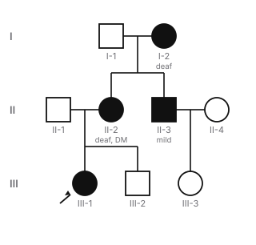
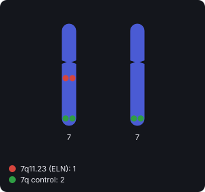
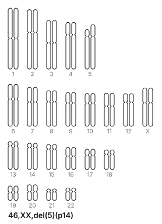

# Biochemistry — Genetics batch 3 review packet

Status: **draft, AI-drafted, not medically reviewed.** Reviewer: mark each concept approved, needs changes or rejected, with notes. A citation alone is not approval.

## How to read this packet

- Options are listed in their **stored** order (deterministically shuffled per item, with opaque ids). Learners see a fresh random order on every presentation; answers are checked by option id, never by position. ✅ marks the correct option.
- Each item shows its **reasoning task** and the **depth** that follows from it: recall/identification → recognition; mechanism → mechanism; interpretation/prediction/comparison/multistep → application. A vignette that only asks for the classic diagnosis is identification (recognition), not application. Application items list the inferential steps they require.
- Facts are split into **verified** (a supporting source was read in full text or as a published abstract/summary and states the claim) and **awaiting direct confirmation** (reasoned from pathway logic, or supported only by sources checked for existence). Awaiting facts block approval in the validator until a reviewer confirms them against a source.
- Citation “checked”: **full-text** (page read), **summary** (published abstract or summary read), **existence** (record confirmed but full text not accessible).
- Mastery: true/false and crossword answers count as weaker recognition evidence; repeating an item within 7 days adds little; “strong” needs at least 3 distinct items, including a mechanism or application item.
- Connections puzzles are checked for a single solution against the **global category catalog** (every bank category, every curated category and decoy, and a catalog of medically plausible groupings such as inheritance patterns, drug classes and toxin sources), not only against their own decoys. The daily builder applies the same check to every board it generates.

- **Two independent classifications.** *Step 1 relevance*: **CORE** (topic and depth supported by the official outline and mainstream Step 1 preparation), **SUPPLEMENTARY** (within the curriculum but beyond core depth; shown less often in games), **SPECIALIST** (obscure or postgraduate; never shown in games, excluded from coverage) or **UNREVIEWED** (not yet evaluated; never assumed core). *Cognitive depth*: **RECOGNITION**, **MECHANISM** or **APPLICATION**, from the reasoning task. A complex vignette on a classic mechanism can be CORE; a simple recall of an obscure finding can be SPECIALIST. The ~80/20 recognition-and-mechanism vs application mix is a flexible game-design target, not a relevance judgement.

## Summary

| Measure | Value |
|---|---|
| Concepts | 13 |
| Objectives taught | 23 |
| Facts verified / awaiting direct confirmation | 62 / 0 |
| **Playable learning items (total)** | **83** |
| — MCQs / true-false / crossword clues | 36 / 21 / 20 |
| — Mechanism Lab sequences / Match Up sets | 2 / 3 |
| — Complete Connections puzzles / Mystery Patient cases | 0 / 1 |
| Connections category-bank entries (builder input, **not** playable alone; excluded from item counts and coverage) | 0 |
| Items, Step 1 relevance: CORE / SUPPLEMENTARY / SPECIALIST / UNREVIEWED | 81 / 2 / 0 / 0 |
| Items, cognitive depth: RECOGNITION / MECHANISM / APPLICATION | 53 / 9 / 21 |
| Objectives, Step 1 relevance: CORE / SUPPLEMENTARY / SPECIALIST / UNREVIEWED | 22 / 1 / 0 / 0 |
| Playable items: recall | 45 |
| Playable items: identification | 8 |
| Playable items: mechanism | 9 |
| Playable items: interpretation | 14 |
| Playable items: prediction | 5 |
| Playable items: comparison | 1 |
| Playable items: multistep | 1 |

## Pleiotropy and linkage disequilibrium (`gen-pleiotropy-ld`)

Objectives: `bc-gen-terms.pleiotropy`, `bc-gen-terms.linkage`

**Citations**

1. Pyeritz RE. Pleiotropy refers to multiple effects on phenotype of a single mutant gene. Am J Med Genet 1989 — PMID 2683776 — <https://pubmed.ncbi.nlm.nih.gov/2683776/> — checked: summary
2. MedlinePlus Genetics: Phenylketonuria — <https://medlineplus.gov/genetics/condition/phenylketonuria/> — checked: full-text
3. MedlinePlus Genetics: Marfan syndrome — <https://medlineplus.gov/genetics/condition/marfan-syndrome/> — checked: full-text
4. Slatkin M. Linkage disequilibrium is the nonrandom association of alleles at different loci. Nat Rev Genet 2008 — PMID 18427557 — <https://pubmed.ncbi.nlm.nih.gov/18427557/> — checked: summary

**Verified facts** [supporting citations]

- Pleiotropy is the presence of multiple effects on the phenotype from a single mutant gene. [1]
- Untreated phenylketonuria causes intellectual disability, and affected children also tend to have lighter skin and hair: one gene, several apparently unrelated features. [2]
- Marfan syndrome, a connective tissue disorder, affects the heart and blood vessels (aortic aneurysm), the eyes (dislocated lens) and the skeleton. [3]
- Linkage disequilibrium is the nonrandom association of alleles at different loci: two alleles are inherited together more (or less) often than chance predicts. [4]

**Mechanism.** One protein can be needed in many tissues or pathways, so a single variant can produce several different features (pleiotropy). Fibrillin-1 is needed in the aorta, lens zonules and skeleton; phenylalanine excess affects the brain and melanin production. Linkage disequilibrium is a population-level idea: alleles at nearby loci tend to travel together through generations, so they appear together more often than random combination would predict.

**Quick.** Pleiotropy: one gene, multiple different phenotypic effects (PKU: intellectual disability + light skin and hair; Marfan: aorta, lens, skeleton). Linkage disequilibrium: alleles at different loci found together more often than chance predicts (nonrandom association in a population).

**Detailed**

> Pleiotropy means that a single gene variant affects several, apparently unrelated traits. In untreated phenylketonuria, phenylalanine accumulation damages the brain and also reduces pigment, so children have lighter skin and hair. In Marfan syndrome, defective connective tissue affects the aorta, the lens of the eye and the skeleton.

> Linkage disequilibrium is the nonrandom association of alleles at different loci in a population. Alleles that lie close together are rarely separated by recombination and so tend to be inherited together; this underlies association studies that use a marker to find a nearby disease allele.

**Misconception.** Pleiotropy (one gene → many features) is not locus heterogeneity (many genes → one feature), and linkage disequilibrium describes alleles in a population, not crossing-over in one meiosis.

**Takeaway.** Pleiotropy = one gene, many effects; linkage disequilibrium = alleles at different loci travelling together.

- **MCQ** **CORE** · depth RECOGNITION · `gen-pleiotropy-ld:mcq1` · identification → **recognition** · difficulty 2 · `bc-gen-terms.pleiotropy`
  - A man has a dislocated lens, long fingers and an aortic root aneurysm, all from a single fibrillin-1 variant. Which genetic term describes one variant producing these different features?
  - ◻️ A. Incomplete penetrance — _Penetrance is whether a carrier shows the condition at all._
  - ✅ B. Pleiotropy
  - ◻️ C. Variable expressivity — _Expressivity describes how severe features are in different people, not one gene affecting many organs._
  - ◻️ D. Locus heterogeneity — _Locus heterogeneity is the reverse: variants in different genes giving the same phenotype._
  - ◻️ E. Linkage disequilibrium — _Linkage disequilibrium describes alleles at two loci occurring together in a population._
  - Explanation: A single gene producing several different effects (eye, skeleton, aorta) is pleiotropy.
- **MCQ** **SUPPLEMENTARY** · depth RECOGNITION · `gen-pleiotropy-ld:mcq2` · recall → **recognition** · difficulty 1 · `bc-gen-terms.linkage`
  - In a population, a disease allele is found far more often together with a particular nearby marker allele than random combination of alleles would predict. What is this called?
  - ◻️ A. Hardy–Weinberg equilibrium — _Hardy–Weinberg describes genotype frequencies at one locus, not association between two loci._
  - ✅ B. Linkage disequilibrium
  - ◻️ C. Uniparental disomy — _Uniparental disomy is inheriting both copies of a chromosome from one parent._
  - ◻️ D. Anticipation — _Anticipation is worsening of a disorder in successive generations._
  - ◻️ E. Pleiotropy — _Pleiotropy is one gene affecting several traits._
  - Explanation: Linkage disequilibrium is the nonrandom association of alleles at different loci, typical of loci that lie close together.
- **True/false** **CORE** · depth RECOGNITION · `gen-pleiotropy-ld:tf1` · recall → **recognition** · difficulty 1 · `bc-gen-terms.pleiotropy`: Pleiotropy means that variants in several different genes produce the same disease. → **False**. That is locus heterogeneity. Pleiotropy is one gene producing several different effects.
- **Crossword** **CORE** · depth RECOGNITION · `gen-pleiotropy-ld:clue1` · recall → **recognition** · difficulty 1 · `bc-gen-terms.pleiotropy`: One gene, several apparently unrelated effects → **PLEIOTROPY**

---

## Mitochondrial disorders: MELAS, MERRF, LHON and ragged-red fibers (`gen-mito-disorders`)

Objectives: `bc-mito-inheritance.diseases`, `bc-mito-inheritance.biopsy`

**Citations**

1. MedlinePlus Genetics: Mitochondrial encephalomyopathy, lactic acidosis, and stroke-like episodes — <https://medlineplus.gov/genetics/condition/mitochondrial-encephalomyopathy-lactic-acidosis-and-stroke-like-episodes/> — checked: full-text
2. El-Hattab AW et al. MELAS (GeneReviews): lactic acidemia is very common, muscle biopsies typically show ragged red fibers, and m.3243A>G in MT-TL1 is present in about 80% of individuals — PMID 20301411 — <https://pubmed.ncbi.nlm.nih.gov/20301411/> — checked: summary
3. El-Hattab AW et al. MELAS is one of the most frequent maternally inherited mitochondrial disorders, with stroke-like episodes, lactic acidemia, myopathy, hearing impairment and diabetes. Mol Genet Metab 2015 — PMID 26095523 — <https://pubmed.ncbi.nlm.nih.gov/26095523/> — checked: summary
4. MedlinePlus Genetics: Myoclonic epilepsy with ragged-red fibers — <https://medlineplus.gov/genetics/condition/myoclonic-epilepsy-with-ragged-red-fibers/> — checked: full-text
5. Velez-Bartolomei F et al. MERRF (GeneReviews): myoclonus, generalized epilepsy, ataxia and ragged red fibers are the four canonic features — PMID 20301693 — <https://pubmed.ncbi.nlm.nih.gov/20301693/> — checked: summary
6. MedlinePlus Genetics: Leber hereditary optic neuropathy — <https://medlineplus.gov/genetics/condition/leber-hereditary-optic-neuropathy/> — checked: full-text
7. Newman NJ et al. LHON is a maternally inherited, bilaterally blinding optic neuropathy predominantly affecting otherwise healthy young individuals, mostly men. J Neuroophthalmol 2020 — PMID 32969847 — <https://pubmed.ncbi.nlm.nih.gov/32969847/> — checked: summary
8. Yoshida K. Modified Gomori trichrome staining shows ragged red fibers with a thick irregular red subsarcolemmal layer. Hokkaido Igaku Zasshi 1997 — PMID 9145310 — <https://pubmed.ncbi.nlm.nih.gov/9145310/> — checked: summary
9. Reichmann H et al. Ragged red fibers are generally considered the morphological characteristic of mitochondrial encephalomyopathies. Eur Neurol 1996 — PMID 8654494 — <https://pubmed.ncbi.nlm.nih.gov/8654494/> — checked: summary

**Verified facts** [supporting citations]

- MELAS (mitochondrial encephalomyopathy, lactic acidosis and stroke-like episodes) usually begins in childhood after normal early development; stroke-like episodes typically begin before age 40, with hemiparesis, vision changes, seizures and migraine-like headaches. Lactic acidemia is very common. [1, 2]
- About 80% of people with MELAS carry the m.3243A>G variant in the mitochondrial tRNA gene MT-TL1. [2]
- MERRF (myoclonic epilepsy with ragged-red fibers) is characterized by myoclonus, generalized epilepsy, ataxia and ragged-red fibers on muscle biopsy. [4, 5]
- Leber hereditary optic neuropathy (LHON) causes painless, subacute vision loss in both eyes from optic nerve damage, mostly in young men; many people with an LHON variant never develop the disorder. [6, 7]
- On modified Gomori trichrome stain, ragged-red fibers show an irregular red subsarcolemmal layer of accumulated mitochondria; they are regarded as the morphological hallmark of mitochondrial encephalomyopathies. [8, 9]
- MELAS, MERRF and LHON are inherited in a mitochondrial (maternal) pattern: fathers do not pass mitochondrial DNA variants to their children. [1, 4, 6]

**Mechanism.** Mitochondrial DNA variants impair oxidative phosphorylation. Tissues with high energy demand (brain, muscle, retina and optic nerve) fail first, and cells shift to anaerobic glycolysis, raising lactate. In muscle, defective mitochondria proliferate under the cell membrane, which the Gomori trichrome stain shows as ragged-red fibers. Because mitochondria come from the egg, transmission is maternal, and heteroplasmy makes severity vary even within a family.

**Quick.** Mitochondrial (maternal) disorders. MELAS: encephalomyopathy, lactic acidosis, stroke-like episodes (often m.3243A>G). MERRF: myoclonic epilepsy, ataxia, ragged-red fibers. LHON: painless bilateral vision loss in young men; incomplete penetrance. Ragged-red fibers = subsarcolemmal mitochondria on Gomori trichrome.

**Detailed**

> Three classic mitochondrial syndromes: MELAS (stroke-like episodes before 40, seizures, migraine-like headaches, lactic acidosis; about 80% carry m.3243A>G in MT-TL1); MERRF (myoclonus, generalized epilepsy, ataxia, ragged-red fibers); and LHON (painless, subacute vision loss in both eyes, mostly in young men, with many variant carriers never affected). All three are maternally inherited.

> Two laboratory clues point to mitochondrial disease: lactic acidosis from impaired oxidative phosphorylation, and ragged-red fibers on muscle biopsy, where proliferating mitochondria form an irregular red rim under the sarcolemma on modified Gomori trichrome stain.

**Misconception.** Stroke-like episodes in MELAS are not ordinary strokes from vessel blockage in older adults: they occur in young people from an energy failure, and are accompanied by lactic acidosis.

**Takeaway.** MELAS = strokes + lactate; MERRF = myoclonus + ragged-red fibers; LHON = young men losing central vision; all maternal.

- **MCQ** **CORE** · depth APPLICATION · `gen-mito-disorders:mcq1` · interpretation → **application** · difficulty 3 · `bc-mito-inheritance.diseases`
  - A 16-year-old girl has a second episode of right-sided weakness and visual loss after a migraine-like headache. Serum lactate is high. Her mother has hearing loss and diabetes. Which diagnosis fits best?
  - Figure (pedigree, original, generated from data; passes validation):

    

  - Figure text: Pedigree. Generation I: I-1 male, unaffected; I-2 female, affected (deaf). Generation II: II-1 male, unaffected; II-2 female, affected (deaf, DM); II-3 male, affected (mild); II-4 female, unaffected. Generation III: III-1 female, affected (proband); III-2 male, unaffected; III-3 female, unaffected. I-1 and I-2 have II-2, II-3. II-1 and II-2 have III-1, III-2. II-3 and II-4 have III-3.
  - ◻️ A. Huntington disease — _Huntington disease causes chorea and dementia, not stroke-like episodes._
  - ◻️ B. Myotonic dystrophy type 1 — _Myotonic dystrophy is autosomal dominant with myotonia and cataracts._
  - ◻️ C. Atherosclerotic stroke — _Recurrent stroke-like events in a teenager with high lactate and a maternal family history do not fit atherosclerosis._
  - ◻️ D. Leber hereditary optic neuropathy — _LHON causes painless vision loss without hemiparesis or lactic acidosis._
  - ✅ E. MELAS
  - Steps: (1) Recurrent stroke-like episodes in a teenager with migraine-like headaches → think mitochondrial encephalopathy. (2) High lactate supports impaired oxidative phosphorylation. (3) Affected mother and maternal relatives, with variable features → maternal (mitochondrial) inheritance → MELAS.
  - Explanation: Stroke-like episodes in a young person, lactic acidosis and a maternal family history of deafness and diabetes = MELAS, a mitochondrial (maternally inherited) disorder.
- **MCQ** **CORE** · depth RECOGNITION · `gen-mito-disorders:mcq2` · identification → **recognition** · difficulty 2 · `bc-mito-inheritance.biopsy`
  - A muscle biopsy from a teenager with myoclonic seizures and ataxia is stained with modified Gomori trichrome. Fibers have an irregular red rim beneath the cell membrane. What does this finding represent?
  - ◻️ A. Absent dystrophin at the sarcolemma — _Dystrophin loss is shown by immunostaining or Western blot._
  - ◻️ B. Regenerating fibers after necrosis — _Regeneration does not produce a subsarcolemmal red rim._
  - ✅ C. Accumulated abnormal mitochondria
  - ◻️ D. Glycogen stored in lysosomes — _Lysosomal glycogen storage is shown with PAS staining and is not a red subsarcolemmal rim._
  - ◻️ E. Fat droplets from carnitine deficiency — _Lipid storage is shown with lipid stains, not as ragged-red fibers._
  - Explanation: Ragged-red fibers: abnormal mitochondria proliferate under the sarcolemma and stain red with modified Gomori trichrome, the hallmark of mitochondrial myopathy (as in MERRF).
- **MCQ** **CORE** · depth APPLICATION · `gen-mito-disorders:mcq3` · interpretation → **application** · difficulty 3 · `bc-mito-inheritance.diseases`
  - A 22-year-old man develops painless blurred central vision in one eye, then the other eye 6 weeks later. His maternal uncle had the same problem at 25. Which inheritance pattern and mechanism are most likely?
  - ◻️ A. X-linked recessive variant in a color-vision gene — _Color-vision defects are present from birth and do not cause sudden vision loss._
  - ◻️ B. Trinucleotide repeat expansion in the retina — _No repeat disorder is suggested by this pattern._
  - ◻️ C. Autoimmune demyelination of the optic nerve — _Optic neuritis is usually painful and not familial through the maternal line._
  - ◻️ D. Autosomal dominant variant in a retinal structural protein — _Transmission through the maternal line to males suggests mitochondrial, not autosomal dominant, inheritance._
  - ✅ E. Mitochondrial DNA variant impairing optic nerve energy supply
  - Steps: (1) Painless central vision loss in one eye, then the other within weeks, in a young man → LHON pattern. (2) An affected maternal uncle fits maternal transmission. (3) LHON = mitochondrial DNA variant affecting optic nerve cells.
  - Explanation: Painless, subacute, sequential bilateral central vision loss in a young man with an affected maternal relative = Leber hereditary optic neuropathy, a mitochondrial DNA disorder.
- **MCQ** **CORE** · depth APPLICATION · `gen-mito-disorders:mcq4` · interpretation → **application** · difficulty 3 · `bc-mito-inheritance.biopsy`, `bc-mito-inheritance.diseases`
  - A 12-year-old has exercise intolerance, myoclonic jerks and an unsteady gait. Blood lactate is raised at rest. His mother has mild hearing loss and his father is well. Which muscle biopsy finding would best support the suspected diagnosis?
  - ◻️ A. Glycogen-filled lysosomes on PAS stain — _Lysosomal glycogen storage does not fit myoclonus with maternal transmission._
  - ◻️ B. Absent dystrophin on immunostaining of fibers — _Absent dystrophin fits Duchenne dystrophy, which does not cause myoclonus or lactic acidosis._
  - ◻️ C. Normal muscle with no abnormal fibers at all — _Mitochondrial myopathy typically produces visible fiber changes on biopsy._
  - ✅ D. Ragged-red fibers on modified Gomori trichrome stain
  - ◻️ E. Endomysial inflammation with T-cell invasion — _Inflammatory myopathy does not explain myoclonus, ataxia and maternal hearing loss._
  - Steps: (1) Myoclonus + ataxia + exercise intolerance → neuromuscular disease with high energy demand. (2) Raised resting lactate and a mildly affected mother → mitochondrial (maternal) disorder, such as MERRF. (3) Mitochondrial myopathy shows ragged-red fibers on modified Gomori trichrome.
  - Explanation: Myoclonus, ataxia, raised lactate and a maternal relative with mild features suggest a mitochondrial disorder such as MERRF; ragged-red fibers (subsarcolemmal mitochondria on Gomori trichrome) are the supporting biopsy finding.
- **True/false** **CORE** · depth RECOGNITION · `gen-mito-disorders:tf1` · recall → **recognition** · difficulty 2 · `bc-mito-inheritance.diseases`: Everyone who carries an LHON mitochondrial variant eventually loses vision. → **False**. A significant percentage of carriers never develop LHON (incomplete penetrance).
- **True/false** **CORE** · depth RECOGNITION · `gen-mito-disorders:tf2` · recall → **recognition** · difficulty 1 · `bc-mito-inheritance.biopsy`: Lactic acidosis is a common clue to mitochondrial disease such as MELAS. → **True**. Correct: impaired oxidative phosphorylation shifts cells to anaerobic glycolysis.
- **Crossword** **CORE** · depth RECOGNITION · `gen-mito-disorders:clue1` · recall → **recognition** · difficulty 2 · `bc-mito-inheritance.diseases`: Mitochondrial syndrome of myoclonic epilepsy with abnormal muscle fibers → **MERRF**
- **Crossword** **CORE** · depth RECOGNITION · `gen-mito-disorders:clue2` · recall → **recognition** · difficulty 2 · `bc-mito-inheritance.biopsy`: Modified Gomori stain that reveals ragged-red fibers → **TRICHROME**

---

## Neurofibromatosis types 1 and 2 (`gen-neurofibromatosis`)

Objectives: `bc-ad-diseases.nf1`, `bc-ad-diseases.nf2`

**Citations**

1. MedlinePlus Genetics: Neurofibromatosis type 1 — <https://medlineplus.gov/genetics/condition/neurofibromatosis-type-1/> — checked: full-text
2. MedlinePlus Genetics: NF1 gene — <https://medlineplus.gov/genetics/gene/nf1/> — checked: full-text
3. MedlinePlus Genetics: Neurofibromatosis type 2 — <https://medlineplus.gov/genetics/condition/neurofibromatosis-type-2/> — checked: full-text
4. MedlinePlus Genetics: NF2 gene — <https://medlineplus.gov/genetics/gene/nf2/> — checked: full-text

**Verified facts** [supporting citations]

- Neurofibromatosis type 1 causes multiple café-au-lait spots from early childhood, freckling in the armpits and groin, neurofibromas along nerves, Lisch nodules of the iris and sometimes optic gliomas; the features vary widely between affected people. [1]
- NF1 (chromosome 17) encodes neurofibromin, a tumor suppressor that prevents cell overgrowth by turning off RAS. [2]
- Neurofibromatosis type 2 causes noncancerous nervous system tumors, most commonly vestibular schwannomas, usually in both ears by age 30, with hearing loss, tinnitus and balance problems; meningiomas and childhood cataracts also occur. [3]
- NF2 (chromosome 22) encodes merlin (schwannomin), a tumor suppressor active particularly in Schwann cells. [4]
- NF1 and NF2 are autosomal dominant; in about half of cases the variant is new (de novo) and the family history is negative. [1, 3]

**Mechanism.** Neurofibromin is a RAS-inactivating protein. With one copy lost in every cell, a second hit in a Schwann-lineage cell removes all neurofibromin, RAS stays active, and cells proliferate to form neurofibromas. Merlin restrains Schwann cell growth; loss of both copies produces schwannomas, classically on both vestibular nerves.

**Quick.** NF1 (chr 17, neurofibromin = RAS off-switch): café-au-lait spots, axillary/groin freckling, neurofibromas, Lisch nodules, optic glioma; very variable. NF2 (chr 22, merlin): bilateral vestibular schwannomas, meningiomas, cataracts. Both autosomal dominant tumor suppressors, about half de novo.

**Detailed**

> NF1 is caused by loss of neurofibromin, a tumor suppressor that switches off RAS. Children develop multiple café-au-lait spots, then axillary and groin freckling, iris Lisch nodules and neurofibromas; some develop optic gliomas or malignant nerve sheath tumors. Expressivity is highly variable, even within a family.

> NF2 is caused by loss of merlin, a Schwann-cell tumor suppressor. Its hallmark is bilateral vestibular schwannomas (hearing loss, tinnitus, imbalance) by early adulthood, with meningiomas and childhood cataracts. Both disorders are autosomal dominant, and about half arise de novo.

**Misconception.** A negative family history does not exclude neurofibromatosis: about half of cases are new variants. And bilateral acoustic (vestibular) schwannomas point to NF2, not NF1.

**Takeaway.** NF1 = chr 17, neurofibromin, skin and nerve tumors; NF2 = chr 22, merlin, bilateral vestibular schwannomas.

- **MCQ** **CORE** · depth RECOGNITION · `gen-neurofibromatosis:mcq1` · identification → **recognition** · difficulty 2 · `bc-ad-diseases.nf1`
  - A 7-year-old has many café-au-lait spots, freckling in both armpits and small pigmented iris nodules. Neither parent is affected. Which protein is most likely deficient?
  - ✅ A. Neurofibromin
  - ◻️ B. Hamartin or tuberin — _Tuberous sclerosis gives ash-leaf (light) macules and facial angiofibromas._
  - ◻️ C. Merlin — _Merlin loss causes NF2, with bilateral vestibular schwannomas rather than café-au-lait spots and freckling._
  - ◻️ D. The VHL protein — _Von Hippel–Lindau syndrome causes hemangioblastomas and renal cancer, not pigmentary changes._
  - ◻️ E. Fibrillin-1 — _Fibrillin-1 loss causes Marfan syndrome._
  - Explanation: Multiple café-au-lait spots, axillary freckling and Lisch nodules = NF1, loss of neurofibromin. Unaffected parents fit a new (de novo) variant, which accounts for about half of cases.
- **MCQ** **CORE** · depth MECHANISM · `gen-neurofibromatosis:mcq2` · mechanism → **mechanism** · difficulty 2 · `bc-ad-diseases.nf1`
  - How does loss of neurofibromin lead to tumors along nerves?
  - ✅ A. RAS stays switched on, driving uncontrolled cell growth
  - ◻️ B. Hypoxia-inducible factor is no longer degraded — _That is the mechanism of von Hippel–Lindau disease._
  - ◻️ C. A toxic protein forms aggregates in Schwann cells — _NF1 is a loss of tumor suppressor function, not a toxic gain._
  - ◻️ D. mTOR is released from inhibition by the hamartin–tuberin complex — _That is the mechanism of tuberous sclerosis._
  - ◻️ E. β-catenin accumulates because it is not targeted for destruction — _That is the mechanism of APC loss in FAP._
  - Explanation: Neurofibromin turns off RAS. Without it, RAS signaling stays active and cells such as Schwann-lineage cells proliferate, forming neurofibromas.
- **MCQ** **CORE** · depth RECOGNITION · `gen-neurofibromatosis:mcq3` · identification → **recognition** · difficulty 2 · `bc-ad-diseases.nf2`
  - A 24-year-old has progressive hearing loss and tinnitus in both ears and a balance problem. MRI shows tumors on both vestibulocochlear nerves; she had a cataract removed at age 9. Which gene is most likely affected?
  - ✅ A. NF2 on chromosome 22
  - ◻️ B. VHL on chromosome 3 — _VHL causes hemangioblastomas, not vestibular schwannomas._
  - ◻️ C. TP53 on chromosome 17 — _Li–Fraumeni syndrome causes sarcomas, breast and brain cancers._
  - ◻️ D. TSC2 on chromosome 16 — _Tuberous sclerosis causes tubers, angiofibromas and angiomyolipomas._
  - ◻️ E. NF1 on chromosome 17 — _NF1 does not typically cause bilateral vestibular schwannomas._
  - Explanation: Bilateral vestibular schwannomas in early adulthood with childhood cataract = NF2 (merlin, chromosome 22).
- **MCQ** **CORE** · depth APPLICATION · `gen-neurofibromatosis:mcq4` · interpretation → **application** · difficulty 3 · `bc-ad-diseases.nf1`
  - A father with NF1 has only a few café-au-lait spots; his daughter, who has the same NF1 variant, has hundreds of neurofibromas and an optic glioma. What best explains this difference?
  - ◻️ A. Anticipation from repeat expansion — _NF1 is not a repeat-expansion disorder._
  - ✅ B. Variable expressivity of the same variant
  - ◻️ C. Locus heterogeneity between father and daughter — _They carry the same variant in the same gene._
  - ◻️ D. Incomplete penetrance in the daughter — _The daughter is clearly affected; penetrance concerns whether any features appear at all._
  - ◻️ E. Uniparental disomy of chromosome 17 — _The father passed on one copy as expected; UPD is not suggested._
  - Steps: (1) Both carry the same NF1 variant and both have features → the variant is penetrant in both. (2) The severity differs greatly within the family. (3) Different severity of the same genotype = variable expressivity.
  - Explanation: The same NF1 variant gives very different severity in different people, even in one family: variable expressivity, a hallmark of NF1.
- **MCQ** **CORE** · depth APPLICATION · `gen-neurofibromatosis:mcq5` · prediction → **application** · difficulty 3 · `bc-ad-diseases.nf2`
  - A 30-year-old woman was found to have bilateral vestibular schwannomas and a meningioma. Her parents are unaffected and have normal MRI scans. What is the risk that each of her children inherits the disorder?
  - ◻️ A. 25%, because both parents must be carriers — _NF2 is autosomal dominant, not recessive._
  - ◻️ B. Only her daughters, through mitochondrial DNA — _NF2 is a nuclear gene; mitochondrial inheritance does not apply._
  - ◻️ C. 0%, because her parents are unaffected — _Her own variant (probably new in her) can be passed to her children._
  - ✅ D. 50%, because NF2 is autosomal dominant
  - ◻️ E. 100% of sons and 0% of daughters — _NF2 is autosomal, not X-linked._
  - Steps: (1) Bilateral vestibular schwannomas + meningioma → NF2. (2) Unaffected parents → the variant most likely arose de novo in her. (3) She now carries it; autosomal dominant → 50% per child (lower only if she is mosaic).
  - Explanation: NF2 is autosomal dominant. A de novo variant in her is still present in her germ cells (unless she is mosaic), so each child has a 50% chance of inheriting it.
- **True/false** **CORE** · depth RECOGNITION · `gen-neurofibromatosis:tf1` · recall → **recognition** · difficulty 1 · `bc-ad-diseases.nf1`: About half of people with neurofibromatosis type 1 have no family history because their variant is new. → **True**. Correct: about half of cases result from new NF1 variants.
- **True/false** **CORE** · depth RECOGNITION · `gen-neurofibromatosis:tf2` · recall → **recognition** · difficulty 1 · `bc-ad-diseases.nf2`: Bilateral vestibular schwannomas are the hallmark of neurofibromatosis type 1. → **False**. They are the hallmark of NF2 (merlin, chromosome 22).
- **Crossword** **CORE** · depth RECOGNITION · `gen-neurofibromatosis:clue1` · recall → **recognition** · difficulty 2 · `bc-ad-diseases.nf1`: NF1 protein that switches off RAS → **NEUROFIBROMIN**
- **Crossword** **CORE** · depth RECOGNITION · `gen-neurofibromatosis:clue2` · recall → **recognition** · difficulty 2 · `bc-ad-diseases.nf2`: Schwann-cell tumor suppressor lost in NF2 → **MERLIN**
- **Match Up** **CORE** · depth RECOGNITION · `match:tumor-syndrome-genes` · recall → **recognition** · difficulty 2 · `bc-ad-diseases.nf1`, `bc-ad-diseases.tsc`, `bc-ad-diseases.vhl`, `bc-ad-diseases.fap`, `bc-ad-diseases.lfs`: Tumor syndrome → gene and pathway. Match each autosomal dominant tumor syndrome to its gene and what the protein normally does.
  - Neurofibromatosis type 1 ↔ NF1: turns off RAS
  - Tuberous sclerosis ↔ TSC1/TSC2: restrain mTORC1
  - Von Hippel–Lindau disease ↔ VHL: degrades HIF
  - Familial adenomatous polyposis ↔ APC: limits β-catenin (Wnt)
  - Li–Fraumeni syndrome ↔ TP53: arrests damaged cells
  - All five are tumor suppressors: one copy is inherited defective, and tumors arise after the second copy is lost in a cell.

---

## Tuberous sclerosis complex (`gen-tsc`)

Objectives: `bc-ad-diseases.tsc`

**Citations**

1. MedlinePlus Genetics: Tuberous sclerosis complex — <https://medlineplus.gov/genetics/condition/tuberous-sclerosis-complex/> — checked: full-text
2. MedlinePlus Genetics: TSC1 gene — <https://medlineplus.gov/genetics/gene/tsc1/> — checked: full-text
3. MedlinePlus Genetics: TSC2 gene — <https://medlineplus.gov/genetics/gene/tsc2/> — checked: full-text
4. Huang J, Manning BD. The TSC1–TSC2 (hamartin–tuberin) complex, through GAP activity toward Rheb, is a critical negative regulator of mTORC1. Biochem J 2008 — PMID 18466115 — <https://pubmed.ncbi.nlm.nih.gov/18466115/> — checked: summary
5. von Ranke FM et al. Common manifestations of TSC include cortical tubers, cardiac rhabdomyoma, lymphangioleiomyomatosis, renal angiomyolipoma and skin lesions. Lung 2015 — PMID 26104489 — <https://pubmed.ncbi.nlm.nih.gov/26104489/> — checked: summary

**Verified facts** [supporting citations]

- Tuberous sclerosis complex causes numerous benign tumors in the brain (cortical tubers), kidneys, heart (cardiac rhabdomyoma), skin and retina, with seizures, intellectual disability and autism spectrum and other neuropsychiatric problems. [1]
- Virtually all people with tuberous sclerosis have skin changes, including patches of light-colored skin, raised thickened skin and growths under the nails; facial angiofibromas begin in childhood. [1]
- TSC1 (chromosome 9) encodes hamartin and TSC2 (chromosome 16) encodes tuberin; the two proteins work together as tumor suppressors. [2, 3]
- The hamartin–tuberin complex inhibits mTORC1 by acting as a GTPase-activating protein for Rheb; losing it leaves mTORC1, which drives cell growth, overactive. [4]
- Tuberous sclerosis is autosomal dominant; about two-thirds of cases are caused by new variants. [1]
- The kidney tumors of tuberous sclerosis are typically renal angiomyolipomas. [5]

**Mechanism.** Hamartin and tuberin form a complex that keeps Rheb inactive and so restrains mTORC1, the hub that drives protein synthesis and cell growth. When a cell loses the remaining functional copy (second hit), mTORC1 is overactive and the cell grows into a hamartoma: tubers, angiofibromas, rhabdomyomas or angiomyolipomas.

**Quick.** Tuberous sclerosis: TSC1 (hamartin) or TSC2 (tuberin) → mTORC1 overactive → hamartomas. Cortical tubers, seizures, intellectual disability, autism; facial angiofibromas, ash-leaf macules, shagreen patch; cardiac rhabdomyoma; renal angiomyolipoma. Autosomal dominant, two-thirds de novo.

**Detailed**

> Tuberous sclerosis complex produces benign growths in many organs: cortical tubers (seizures, intellectual disability, autism and other neuropsychiatric disorders), cardiac rhabdomyomas, renal tumors (angiomyolipomas) and retinal lesions. Skin signs are almost universal: light-colored (ash-leaf) patches, raised thickened skin and facial angiofibromas.

> TSC1 (hamartin) and TSC2 (tuberin) act together as a tumor suppressor complex that inhibits mTORC1 via Rheb. Loss of the second copy in a cell releases mTORC1, driving growth. The disorder is autosomal dominant; two-thirds of cases are de novo.

**Misconception.** Tuberous sclerosis hamartomas are not caused by RAS activation (NF1) or HIF accumulation (VHL): the defect is loss of the hamartin–tuberin brake on mTOR.

**Takeaway.** TSC = hamartin/tuberin loss → mTOR overactive → tubers, angiofibromas, rhabdomyoma, angiomyolipoma.

- **MCQ** **CORE** · depth APPLICATION · `gen-tsc:mcq1` · interpretation → **application** · difficulty 3 · `bc-ad-diseases.tsc`
  - An infant with seizures has several pale, leaf-shaped skin macules. Echocardiography shows a cardiac rhabdomyoma, and MRI shows cortical tubers. Overactivity of which signaling hub explains the growths?
  - ◻️ A. Hypoxia-inducible factor — _HIF accumulation is the mechanism of von Hippel–Lindau disease._
  - ◻️ B. JAK2–STAT — _JAK2 activation drives myeloproliferative neoplasms._
  - ✅ C. mTORC1
  - ◻️ D. Wnt/β-catenin — _β-catenin accumulation is the mechanism of APC loss in FAP._
  - ◻️ E. RAS — _RAS overactivity from neurofibromin loss is the mechanism of NF1._
  - Steps: (1) Seizures + light leaf-shaped macules + cardiac rhabdomyoma + cortical tubers → tuberous sclerosis. (2) TSC1/TSC2 encode hamartin and tuberin, which inhibit mTORC1 (via Rheb). (3) Their loss leaves mTORC1 overactive → hamartomas.
  - Explanation: Ash-leaf macules, cardiac rhabdomyoma and cortical tubers = tuberous sclerosis. Loss of hamartin or tuberin releases mTORC1, which drives cell growth and hamartoma formation.
- **MCQ** **CORE** · depth MECHANISM · `gen-tsc:mcq2` · mechanism → **mechanism** · difficulty 3 · `bc-ad-diseases.tsc`
  - How do hamartin and tuberin normally restrain cell growth?
  - ◻️ A. They arrest the cell cycle after DNA damage — _Cell-cycle arrest after DNA damage is the role of p53._
  - ◻️ B. They inactivate RAS by stimulating its GTPase activity — _Inactivating RAS is the role of neurofibromin (NF1)._
  - ◻️ C. They target HIF for degradation in normal oxygen — _Degrading HIF is the role of the VHL protein._
  - ◻️ D. They promote destruction of β-catenin — _Promoting β-catenin destruction is the role of APC._
  - ✅ E. They keep Rheb inactive, which holds mTORC1 in check
  - Explanation: The hamartin–tuberin complex acts as a GTPase-activating protein for Rheb; inactive Rheb cannot switch on mTORC1, so growth is restrained.
- **True/false** **CORE** · depth RECOGNITION · `gen-tsc:tf1` · recall → **recognition** · difficulty 2 · `bc-ad-diseases.tsc`: Most cases of tuberous sclerosis are inherited from an affected parent. → **False**. About two-thirds of cases are caused by new (de novo) TSC1 or TSC2 variants.
- **Crossword** **CORE** · depth RECOGNITION · `gen-tsc:clue1` · recall → **recognition** · difficulty 2 · `bc-ad-diseases.tsc`: TSC2 protein that partners with hamartin → **TUBERIN**
- **Crossword** **CORE** · depth RECOGNITION · `gen-tsc:clue2` · recall → **recognition** · difficulty 2 · `bc-ad-diseases.tsc`: Benign cardiac tumor of infants with tuberous sclerosis → **RHABDOMYOMA**

---

## Von Hippel–Lindau disease (`gen-vhl`)

Objectives: `bc-ad-diseases.vhl`

**Citations**

1. MedlinePlus Genetics: Von Hippel-Lindau syndrome — <https://medlineplus.gov/genetics/condition/von-hippel-lindau-syndrome/> — checked: full-text
2. MedlinePlus Genetics: VHL gene — <https://medlineplus.gov/genetics/gene/vhl/> — checked: full-text

**Verified facts** [supporting citations]

- Von Hippel–Lindau syndrome causes tumors and cysts in many organs; hemangioblastomas of the brain, spinal cord and retina are characteristic. [1]
- People with von Hippel–Lindau syndrome have increased risks of clear cell renal cell carcinoma, pancreatic neuroendocrine tumors and pheochromocytoma, and commonly develop kidney and pancreatic cysts. [1]
- The VHL gene (chromosome 3) is a tumor suppressor; its protein is part of a complex that targets hypoxia-inducible factor 2-alpha (HIF-2α) for degradation. [2]
- Von Hippel–Lindau syndrome is autosomal dominant; most patients inherit the variant, and about 20% have a new variant. [1]

**Mechanism.** The VHL protein marks HIF for destruction when oxygen is normal. When a cell loses its remaining VHL copy, HIF is not degraded, and the cell behaves as if hypoxic: it switches on genes for blood vessel growth and cell proliferation. The results are highly vascular tumors (hemangioblastomas) and clear cell renal carcinoma.

**Quick.** Von Hippel–Lindau: VHL (chromosome 3) normally targets HIF for degradation; loss → HIF accumulates → angiogenic tumors. CNS and retinal hemangioblastomas, clear cell renal carcinoma, pheochromocytoma, renal and pancreatic cysts. Autosomal dominant.

**Detailed**

> Von Hippel–Lindau disease is an autosomal dominant tumor syndrome. Hemangioblastomas (vascular tumors of the cerebellum, spinal cord and retina), clear cell renal cell carcinoma, pheochromocytoma and kidney and pancreatic cysts are its hallmarks; tumors usually appear in young adulthood.

> VHL, on chromosome 3, encodes part of a complex that degrades hypoxia-inducible factor. Without it, HIF accumulates even in normal oxygen and drives angiogenesis and growth, explaining the vascular tumors.

**Misconception.** VHL loss does not make cells hypoxic: oxygen is normal, but HIF escapes degradation, so cells act as if they were hypoxic.

**Takeaway.** VHL loss → HIF not degraded → hemangioblastomas, clear cell RCC, pheochromocytoma.

- **MCQ** **CORE** · depth APPLICATION · `gen-vhl:mcq1` · interpretation → **application** · difficulty 3 · `bc-ad-diseases.vhl`
  - A 28-year-old has a cerebellar hemangioblastoma. Imaging also shows bilateral renal masses, and his father died of kidney cancer at 40. Which protein function is lost?
  - ✅ A. Degradation of hypoxia-inducible factor
  - ◻️ B. Destruction of β-catenin in the Wnt pathway — _Loss of APC function causes FAP._
  - ◻️ C. Cell-cycle arrest after DNA damage — _Loss of p53 function causes Li–Fraumeni syndrome._
  - ◻️ D. Inhibition of mTORC1 through Rheb — _Loss of the hamartin–tuberin brake causes tuberous sclerosis._
  - ◻️ E. Inactivation of RAS by GTP hydrolysis — _RAS inactivation by neurofibromin is lost in NF1._
  - Steps: (1) Cerebellar hemangioblastoma + bilateral renal masses at a young age → von Hippel–Lindau disease. (2) Affected father → autosomal dominant tumor suppressor syndrome. (3) VHL protein degrades HIF; its loss leaves HIF active → angiogenesis and growth.
  - Explanation: Hemangioblastoma + bilateral renal tumors + a father with early kidney cancer = von Hippel–Lindau disease: VHL normally targets HIF for degradation, so its loss drives vascular tumors and clear cell renal carcinoma.
- **MCQ** **CORE** · depth MECHANISM · `gen-vhl:mcq2` · mechanism → **mechanism** · difficulty 3 · `bc-ad-diseases.vhl`
  - Why do tumors in von Hippel–Lindau disease tend to be highly vascular?
  - ◻️ A. Tumor cells are truly hypoxic because blood flow is low — _Oxygen is normal; HIF escapes degradation despite normal oxygen._
  - ✅ B. Undegraded HIF switches on genes for blood vessel growth
  - ◻️ C. Mutant RAS is constitutively bound to GTP — _Constitutively active RAS is not the mechanism of VHL._
  - ◻️ D. The tumors arise from smooth muscle of large arteries — _Hemangioblastomas arise from vascular-rich tissue driven by HIF, not from arterial smooth muscle._
  - ◻️ E. Overactive mTOR increases protein synthesis in endothelium — _mTOR overactivity is the mechanism of tuberous sclerosis._
  - Explanation: Without VHL, HIF is not degraded even in normal oxygen; it activates angiogenic and growth genes, so the tumors are highly vascular (pseudo-hypoxia).
- **True/false** **CORE** · depth RECOGNITION · `gen-vhl:tf1` · recall → **recognition** · difficulty 1 · `bc-ad-diseases.vhl`: The VHL gene is located on chromosome 3. → **True**. Correct; VHL is a tumor suppressor on chromosome 3.
- **Crossword** **CORE** · depth RECOGNITION · `gen-vhl:clue1` · recall → **recognition** · difficulty 2 · `bc-ad-diseases.vhl`: State that cells lacking VHL mimic although oxygen is normal → **HYPOXIA**
- **Mechanism Lab** **CORE** · depth MECHANISM · `seq:vhl-hif` · mechanism → **mechanism** · difficulty 2 · `bc-ad-diseases.vhl`: From VHL loss to a vascular tumor. Order the steps from a second VHL hit to a hemangioblastoma.
  1. A cell with one inherited VHL variant loses its normal copy
  2. No functional VHL protein is made
  3. HIF is no longer targeted for degradation
  4. HIF accumulates although oxygen is normal
  5. Angiogenic and growth genes switch on
  6. A highly vascular tumor forms
  - VHL marks HIF for destruction. Without it, cells behave as if hypoxic and build blood vessels, giving hemangioblastomas and clear cell renal carcinoma.
- **Mystery Patient** **CORE** · depth APPLICATION · `case:vhl-family` · interpretation → **application** · difficulty 3 · `bc-ad-diseases.vhl`: A cerebellar tumor and a family secret
  - Presentation: A 26-year-old woman has morning headaches, vomiting and an unsteady gait for 2 months.
  - Imaging & tests: MRI shows a cystic cerebellar mass with a brightly enhancing nodule. Abdominal imaging shows several renal cysts and a solid enhancing lesion in the left kidney.
  - History: Her mother had “an eye tumor” treated with laser at 30 and died of kidney cancer at 48.
  - Q: Which mechanism links her tumors?
  - ◻️ A. β-Catenin accumulates without APC — _APC loss causes colonic polyposis._
  - ✅ B. Hypoxia-inducible factor escapes degradation
  - ◻️ C. RAS remains active without neurofibromin — _NF1 causes neurofibromas and café-au-lait spots, not hemangioblastomas and renal carcinoma._
  - ◻️ D. mTORC1 is released by loss of tuberin — _Tuberous sclerosis gives angiomyolipomas and tubers, not cerebellar hemangioblastomas._
  - ◻️ E. A germline TP53 variant — _Li–Fraumeni syndrome causes sarcomas, breast and brain cancers, not this vascular tumor pattern._
  - A cerebellar hemangioblastoma (cyst with enhancing nodule), renal cysts and a solid renal tumor, and a mother with a retinal tumor and early kidney cancer = von Hippel–Lindau disease (autosomal dominant). The VHL protein targets HIF for degradation; when a cell loses its second VHL copy, HIF accumulates and drives angiogenesis, producing hemangioblastomas and clear cell renal carcinoma.
  - Differentials: Sporadic renal cell carcinoma (Would not explain a cerebellar hemangioblastoma and the family history at young ages.); Tuberous sclerosis (Renal angiomyolipomas and cortical tubers, not hemangioblastomas.)

---

## Hereditary cancer predisposition: FAP and Li–Fraumeni syndrome (`gen-cancer-predisposition`)

Objectives: `bc-ad-diseases.fap`, `bc-ad-diseases.lfs`

**Citations**

1. MedlinePlus Genetics: Familial adenomatous polyposis — <https://medlineplus.gov/genetics/condition/familial-adenomatous-polyposis/> — checked: full-text
2. MedlinePlus Genetics: APC gene — <https://medlineplus.gov/genetics/gene/apc/> — checked: full-text
3. MedlinePlus Genetics: Li-Fraumeni syndrome — <https://medlineplus.gov/genetics/condition/li-fraumeni-syndrome/> — checked: full-text
4. Dutzmann CM et al. Li–Fraumeni tumors are dominated by bone and soft tissue sarcomas, brain tumors, premenopausal breast cancer and adrenocortical carcinoma. Pathologe 2019 — PMID 31511974 — <https://pubmed.ncbi.nlm.nih.gov/31511974/> — checked: summary

**Verified facts** [supporting citations]

- In classic familial adenomatous polyposis (FAP), hundreds to thousands of colon polyps develop from childhood; colorectal cancer typically appears around age 40, and at least 90% develop it by 50 unless the colon is removed. [1]
- APC (chromosome 5) encodes a tumor suppressor that blocks Wnt signaling by helping control levels of β-catenin; most FAP variants produce a short, nonfunctional APC protein. [2]
- FAP is autosomal dominant; each child of an affected person has a 50% chance of inheriting the variant. Attenuated FAP has fewer polyps (about 30 on average) and later cancer. [1]
- Li–Fraumeni syndrome greatly increases the risk of cancers in children and young adults, chiefly breast cancer, osteosarcoma, soft tissue sarcomas, brain tumors, leukemias and adrenocortical carcinoma. [3, 4]
- Li–Fraumeni syndrome is autosomal dominant and is associated with germline variants in the tumor suppressor gene TP53. [3]

**Mechanism.** APC is part of the complex that targets β-catenin for destruction. With one APC copy lost in every colonic cell, a second hit lets β-catenin accumulate and drive proliferation in many crypts, so polyps appear by the hundreds and cancer becomes almost certain. In Li–Fraumeni syndrome, a germline TP53 variant removes one copy of the guardian that arrests or kills damaged cells; loss of the second copy allows cancers in many tissues at young ages.

**Quick.** FAP: APC (chromosome 5) loss → β-catenin accumulates (Wnt on) → hundreds to thousands of polyps from childhood; colorectal cancer ~40 without colectomy; AD. Li–Fraumeni: germline TP53 → early sarcomas, breast cancer, brain tumors, leukemia, adrenocortical carcinoma; AD.

**Detailed**

> Familial adenomatous polyposis is autosomal dominant. APC normally restrains Wnt signaling by controlling β-catenin levels; truncating variants inactivate it. Classic FAP produces hundreds to thousands of colon polyps from childhood, and colorectal cancer is near-certain (typically around 40) unless the colon is removed. Attenuated FAP has fewer, later polyps.

> Li–Fraumeni syndrome is an autosomal dominant predisposition to multiple cancers at young ages: breast cancer, osteosarcoma and soft tissue sarcomas, brain tumors, leukemias and adrenocortical carcinoma. Most families carry a germline TP53 variant, so every cell has only one working copy of this tumor suppressor.

**Misconception.** In FAP the risk is not from one polyp: hundreds of polyps each carry a chance of malignancy, so cancer is almost inevitable without colectomy.

**Takeaway.** FAP = APC/β-catenin, hundreds of polyps; Li–Fraumeni = germline TP53, sarcoma–breast–brain–adrenal cancers when young.

- **MCQ** **CORE** · depth RECOGNITION · `gen-cancer-predisposition:mcq1` · identification → **recognition** · difficulty 2 · `bc-ad-diseases.fap`
  - A 19-year-old has colonoscopy because his father died of colon cancer at 42. Hundreds of adenomatous polyps carpet the colon. Which protein normally prevents this by limiting β-catenin?
  - ◻️ A. MLH1 — _MLH1 is a mismatch repair protein; Lynch syndrome causes few polyps._
  - ◻️ B. SMAD4 — _SMAD4 is a TGF-β pathway protein._
  - ◻️ C. Neurofibromin — _Neurofibromin inactivates RAS (NF1)._
  - ◻️ D. p53 — _p53 arrests the cell cycle after DNA damage; its germline loss causes Li–Fraumeni syndrome._
  - ✅ E. APC
  - Explanation: Hundreds of adenomas in a young man with an affected father = FAP. APC is part of the complex that controls β-catenin levels; its loss keeps Wnt signaling on.
- **MCQ** **CORE** · depth MECHANISM · `gen-cancer-predisposition:mcq2` · mechanism → **mechanism** · difficulty 3 · `bc-ad-diseases.fap`
  - Why does a germline APC variant make colorectal cancer almost inevitable without colectomy?
  - ✅ A. Every colonic cell needs only one more hit to lose APC
  - ◻️ B. APC variants block mismatch repair throughout the colon — _Defective mismatch repair is the mechanism of Lynch syndrome._
  - ◻️ C. APC is an oncogene activated by a single hit — _APC is a tumor suppressor._
  - ◻️ D. One mutant APC copy is enough to make each cell malignant — _Tumor cells lose both APC copies; one inherited hit is not enough alone._
  - ◻️ E. The mutant APC protein directly breaks DNA — _APC loss removes a brake on growth; it does not damage DNA directly._
  - Explanation: With one APC copy already lost in every cell, a second hit in any of millions of colonic cells releases β-catenin signaling, producing hundreds of polyps; at least one becomes malignant.
- **MCQ** **CORE** · depth APPLICATION · `gen-cancer-predisposition:mcq3` · interpretation → **application** · difficulty 3 · `bc-ad-diseases.lfs`
  - A 16-year-old with osteosarcoma has a mother who had breast cancer at 31 and a maternal uncle who had a soft tissue sarcoma at 25. Which germline variant is most likely?
  - ✅ A. TP53
  - ◻️ B. SMAD4 — _SMAD4 variants cause juvenile polyposis with HHT, not this sarcoma–breast pattern._
  - ◻️ C. APC — _APC causes hundreds of colon polyps, not this tumor pattern._
  - ◻️ D. VHL — _VHL causes hemangioblastomas and renal carcinoma._
  - ◻️ E. RB1 — _Germline RB1 variants present with retinoblastoma in early childhood, not this breast–sarcoma pattern._
  - Steps: (1) Osteosarcoma in a teenager, breast cancer at 31 and a sarcoma at 25 in close relatives → early, varied cancers. (2) Transmission through the mother’s side in two generations fits autosomal dominant inheritance. (3) Sarcoma + early breast cancer = Li–Fraumeni syndrome (germline TP53).
  - Explanation: Sarcomas and early breast cancer in several relatives at young ages = Li–Fraumeni syndrome, an autosomal dominant germline TP53 disorder.
- **MCQ** **CORE** · depth APPLICATION · `gen-cancer-predisposition:mcq4` · prediction → **application** · difficulty 3 · `bc-ad-diseases.fap`
  - A 32-year-old woman had a colectomy at 24 for classic FAP. Her partner has no APC variant. She asks about her 8-year-old son. What is his risk, and why does surveillance start in childhood rather than at 45?
  - ✅ A. 50%; polyps can appear in childhood and multiply quickly
  - ◻️ B. 100% of sons, because FAP is X-linked — _APC is on chromosome 5; FAP is autosomal._
  - ◻️ C. 50%; but polyps never appear before age 40 — _Classic FAP polyps can appear in childhood, and 95% have polyps by 35._
  - ◻️ D. 25%; both parents must pass on an APC variant — _FAP is autosomal dominant; one inherited APC variant is enough._
  - ◻️ E. Near 0%, because her colon has been removed — _Colectomy does not change the APC variant in her germ cells._
  - Steps: (1) Classic FAP = autosomal dominant APC variant; her partner has none. (2) Each child inherits her APC variant with probability 1/2. (3) Polyps can appear in childhood (95% by 35), so surveillance starts early.
  - Explanation: FAP is autosomal dominant, so each child of an affected parent has a 50% risk. Classic FAP polyps can begin in childhood and increase rapidly, so at-risk children are tested or monitored long before the usual screening age.
- **True/false** **CORE** · depth RECOGNITION · `gen-cancer-predisposition:tf1` · recall → **recognition** · difficulty 2 · `bc-ad-diseases.lfs`: Adrenocortical carcinoma in childhood is a recognized Li–Fraumeni cancer. → **True**. Correct; adrenocortical carcinoma is among its core tumors.
- **True/false** **CORE** · depth RECOGNITION · `gen-cancer-predisposition:tf2` · recall → **recognition** · difficulty 1 · `bc-ad-diseases.fap`: Familial adenomatous polyposis is autosomal recessive. → **False**. FAP is autosomal dominant: each child of an affected person has a 50% risk.
- **Crossword** **CORE** · depth RECOGNITION · `gen-cancer-predisposition:clue1` · recall → **recognition** · difficulty 1 · `bc-ad-diseases.fap`: Hundreds of colonic adenomas, as in FAP → **POLYPOSIS**

---

## Hereditary hemorrhagic telangiectasia (`gen-hht`)

Objectives: `bc-ad-diseases.hht`

**Citations**

1. MedlinePlus Genetics: Hereditary hemorrhagic telangiectasia — <https://medlineplus.gov/genetics/condition/hereditary-hemorrhagic-telangiectasia/> — checked: full-text
2. Drapé E et al. Mutations in TGF-β/BMP signaling components ENG, ACVRL1 and SMAD4 account for most HHT. Front Hum Neurosci 2022 — PMID 36504622 — <https://pubmed.ncbi.nlm.nih.gov/36504622/> — checked: summary

**Verified facts** [supporting citations]

- In hereditary hemorrhagic telangiectasia (HHT), some arteries connect directly to veins without capillaries (arteriovenous malformations); near the skin and mucosa these appear as red telangiectases. [1]
- Nosebleeds are very common in HHT, and more serious bleeding can arise from malformations in the brain, liver, lungs or gastrointestinal tract. [1]
- HHT is autosomal dominant; type 1 is caused by ENG and type 2 by ACVRL1 variants, and SMAD4 variants cause a combined juvenile polyposis–HHT syndrome. [1]
- ENG, ACVRL1 and SMAD4 are components of the TGF-β/BMP signaling pathway in blood vessel lining; their loss accounts for most HHT. [2]

**Mechanism.** TGF-β/BMP signaling through endothelial receptors (endoglin, ALK1) and SMAD4 keeps developing vessels organized. Losing one copy weakens this signaling, so some arteries join veins directly. Without the capillary buffer, thin-walled veins receive arterial pressure, dilate and bleed: telangiectases in the nose and gut, and larger malformations in the lung, liver and brain.

**Quick.** HHT (Osler–Weber–Rendu): autosomal dominant; ENG, ACVRL1 (and SMAD4) in TGF-β/BMP signaling → arteriovenous malformations. Telangiectases, recurrent epistaxis, GI bleeding, AVMs in lung, liver and brain. Coagulation tests normal.

**Detailed**

> Hereditary hemorrhagic telangiectasia is an autosomal dominant vascular disorder. Direct artery-to-vein connections appear as telangiectases on the lips, tongue, nasal mucosa and fingertips, and as larger arteriovenous malformations in the lungs, liver and brain. Recurrent nosebleeds are the commonest problem; GI and organ bleeding are more serious.

> Most cases involve the TGF-β/BMP pathway in endothelial cells: ENG (endoglin, type 1), ACVRL1 (ALK1, type 2) or SMAD4 (combined with juvenile polyposis). Type 1 is more often associated with lung and brain malformations.

**Misconception.** Recurrent nosebleeds in HHT are not a clotting-factor problem: coagulation is normal, and the bleeding comes from fragile malformed vessels.

**Takeaway.** HHT = AD TGF-β/BMP vascular defect (ENG, ACVRL1) → telangiectases, epistaxis, AVMs.

- **MCQ** **CORE** · depth APPLICATION · `gen-hht:mcq1` · interpretation → **application** · difficulty 3 · `bc-ad-diseases.hht`
  - A 35-year-old has had frequent nosebleeds since childhood and now has iron-deficiency anemia. He has small red spots on his lips and tongue that blanch with pressure. His mother has the same spots. Coagulation tests are normal. Which pathway is affected?
  - ◻️ A. Collagen cross-linking in vessel walls — _Defective collagen cross-linking causes fragile vessels and poor wound healing, not discrete telangiectases._
  - ◻️ B. HIF degradation in hypoxia signaling — _HIF accumulation is the mechanism of von Hippel–Lindau disease._
  - ◻️ C. Factor VIII in the coagulation cascade — _Coagulation tests are normal, and hemophilia does not cause mucocutaneous telangiectases._
  - ◻️ D. von Willebrand factor binding to platelets — _Von Willebrand disease does not produce visible telangiectases._
  - ✅ E. TGF-β/BMP signaling in endothelial cells
  - Steps: (1) Lifelong nosebleeds + blanching red spots on lips and tongue + normal coagulation → vascular malformations, not a bleeding diathesis. (2) Affected mother → autosomal dominant. (3) HHT = ENG/ACVRL1/SMAD4 in the TGF-β/BMP pathway.
  - Explanation: Recurrent epistaxis, mucocutaneous telangiectases, an affected parent and normal coagulation = HHT, a TGF-β/BMP endothelial signaling disorder (ENG, ACVRL1).
- **True/false** **CORE** · depth RECOGNITION · `gen-hht:tf1` · recall → **recognition** · difficulty 1 · `bc-ad-diseases.hht`: Hereditary hemorrhagic telangiectasia can cause arteriovenous malformations in the lungs and brain. → **True**. Correct; serious bleeding can arise from malformations in the brain, liver, lungs or gut.
- **Crossword** **CORE** · depth RECOGNITION · `gen-hht:clue1` · recall → **recognition** · difficulty 1 · `bc-ad-diseases.hht`: Recurrent nosebleeds, the commonest symptom of HHT → **EPISTAXIS**

---

## Polycystic kidney disease: ADPKD and ARPKD (`gen-pkd`)

Objectives: `bc-ad-diseases.adpkd`, `bc-ar-diseases.arpkd`

**Citations**

1. MedlinePlus Genetics: Polycystic kidney disease — <https://medlineplus.gov/genetics/condition/polycystic-kidney-disease/> — checked: full-text
2. MedlinePlus Genetics: PKD1 gene — <https://medlineplus.gov/genetics/gene/pkd1/> — checked: full-text
3. MedlinePlus Genetics: PKHD1 gene — <https://medlineplus.gov/genetics/gene/pkhd1/> — checked: full-text

**Verified facts** [supporting citations]

- In polycystic kidney disease, clusters of cysts enlarge the kidneys and can lead to kidney failure; cysts also develop in other organs, particularly the liver. [1]
- Complications include hypertension, flank pain, hematuria, urinary infections, kidney stones, heart valve abnormalities and aneurysms of the aorta or of brain vessels. [1]
- Autosomal dominant PKD is caused by variants in PKD1 (chromosome 16, polycystin-1) or PKD2 (polycystin-2); PKD2 disease is usually less severe. About 90% inherit the variant from an affected parent. [1, 2]
- Autosomal recessive PKD is caused by PKHD1 variants (fibrocystin), is much rarer (about 1 in 20,000 to 40,000 versus 1 in 500 to 1,000 for ADPKD), is usually apparent at birth or in early infancy and is often lethal early in life. [1, 3]

**Mechanism.** Polycystins (ADPKD) and fibrocystin (ARPKD) are membrane proteins thought to relay signals that keep tubular cells organized. When they fail, tubules dilate into cysts that progressively replace kidney tissue. ADPKD shows up in adults with large cystic kidneys and extrarenal vascular involvement; ARPKD shows up in newborns, whose enlarged kidneys can fail before birth.

**Quick.** ADPKD: PKD1 (chr 16) or PKD2; common (1/500–1,000); adult bilateral cystic kidneys, hypertension, hematuria, liver cysts, brain aneurysms, valve disease. ARPKD: PKHD1 (fibrocystin); rare; enlarged cystic kidneys at birth or early infancy, often lethal.

**Detailed**

> Autosomal dominant polycystic kidney disease (PKD1 on chromosome 16 or PKD2) is common. Cysts progressively enlarge both kidneys, causing hypertension, pain, hematuria, infections and eventually kidney failure in adulthood. Extrarenal features include liver cysts, heart valve abnormalities and aneurysms of the aorta or brain vessels, whose rupture can be fatal.

> Autosomal recessive polycystic kidney disease (PKHD1, fibrocystin) is rare and presents at birth or in infancy with massively enlarged kidneys; it is often lethal early in life. The inheritance and age of onset separate the two forms.

**Misconception.** ADPKD is not a childhood disease: cysts are present early but kidney enlargement and failure usually appear in adulthood, unlike ARPKD, which presents in newborns.

**Takeaway.** ADPKD = PKD1/2, adults, liver cysts and brain aneurysms; ARPKD = PKHD1, newborns.

- **MCQ** **CORE** · depth APPLICATION · `gen-pkd:mcq1` · prediction → **application** · difficulty 3 · `bc-ad-diseases.adpkd`
  - A 42-year-old with hypertension and flank pain has bilaterally enlarged kidneys full of cysts and several liver cysts. His father needed dialysis at 55. Which complication should he be specifically asked about because it can be fatal?
  - ◻️ A. Hemangioblastoma of the cerebellum or retina — _Hemangioblastomas are a feature of von Hippel–Lindau disease._
  - ◻️ B. Hundreds of adenomatous polyps in the colon — _Colonic polyposis is a feature of FAP._
  - ◻️ C. Kayser–Fleischer rings at the corneal edge — _Corneal copper rings are a feature of Wilson disease._
  - ◻️ D. Bilateral vestibular schwannomas causing deafness — _Vestibular schwannomas are a feature of NF2._
  - ✅ E. Sudden severe headache from a ruptured brain aneurysm
  - Steps: (1) Bilateral cystic kidneys + liver cysts + hypertension in an adult, affected father → ADPKD. (2) ADPKD also causes aneurysms of the aorta and brain vessels. (3) A ruptured brain aneurysm presents with sudden severe headache and can be fatal.
  - Explanation: Adult bilateral cystic kidneys with liver cysts and an affected father = ADPKD. Aneurysms of brain vessels are a recognized, potentially fatal association.
- **MCQ** **CORE** · depth RECOGNITION · `gen-pkd:mcq2` · identification → **recognition** · difficulty 2 · `bc-ar-diseases.arpkd`
  - A newborn has massively enlarged cystic kidneys on ultrasound. Both parents have normal kidney ultrasounds. Which gene is most likely involved?
  - ◻️ A. PKD2 — _PKD2 disease is dominant and usually milder, in adults._
  - ◻️ B. TSC1 or TSC2 — _Tuberous sclerosis causes angiomyolipomas rather than massive neonatal cystic kidneys._
  - ◻️ C. PKD1 — _PKD1 causes autosomal dominant PKD, usually in adults with an affected parent._
  - ◻️ D. VHL — _VHL causes kidney cysts and clear cell carcinoma in adults._
  - ✅ E. PKHD1
  - Explanation: Enlarged cystic kidneys at birth with unaffected parents = autosomal recessive PKD, caused by PKHD1 (fibrocystin).
- **MCQ** **CORE** · depth APPLICATION · `gen-pkd:mcq3` · prediction → **application** · difficulty 3 · `bc-ar-diseases.arpkd`
  - A couple’s first baby died shortly after birth with massively enlarged cystic kidneys; testing confirmed two PKHD1 variants, and both parents are confirmed carriers with normal kidneys. What is the chance that their next baby is affected?
  - ◻️ A. 100% — _Each parent can pass on the normal PKHD1 allele._
  - ◻️ B. 0% — _Each pregnancy of two carriers carries the same risk, whatever happened before._
  - ◻️ C. 2/3 — _Two-thirds is the carrier chance of an unaffected sibling, not the risk to a new baby._
  - ✅ D. 25%
  - ◻️ E. 50% — _A 50% risk applies to a dominant disorder such as ADPKD with one affected parent._
  - Steps: (1) Neonatal massively enlarged cystic kidneys with two PKHD1 variants → ARPKD. (2) ARPKD is autosomal recessive; both parents are confirmed carriers. (3) Each child: 1/2 × 1/2 = 1/4 risk of inheriting both variants.
  - Explanation: ARPKD is autosomal recessive (PKHD1). Two carrier parents have a 1/2 × 1/2 = 1/4 chance of an affected child in each pregnancy.
- **True/false** **CORE** · depth RECOGNITION · `gen-pkd:tf1` · recall → **recognition** · difficulty 1 · `bc-ad-diseases.adpkd`, `bc-ar-diseases.arpkd`: Autosomal dominant polycystic kidney disease is rarer than the autosomal recessive form. → **False**. ADPKD is far more common (about 1 in 500 to 1,000) than ARPKD (about 1 in 20,000 to 40,000).
- **True/false** **CORE** · depth RECOGNITION · `gen-pkd:tf2` · recall → **recognition** · difficulty 1 · `bc-ad-diseases.adpkd`: PKD1 lies on chromosome 16. → **True**. Correct; PKD1 encodes polycystin-1.
- **Crossword** **CORE** · depth RECOGNITION · `gen-pkd:clue1` · recall → **recognition** · difficulty 2 · `bc-ad-diseases.adpkd`: Membrane protein encoded by PKD1 or PKD2 → **POLYCYSTIN**
- **Crossword** **CORE** · depth RECOGNITION · `gen-pkd:clue2` · recall → **recognition** · difficulty 2 · `bc-ar-diseases.arpkd`: PKHD1 protein lost in the infantile recessive cystic kidney disease → **FIBROCYSTIN**

---

## Wilson disease and hereditary hemochromatosis (`gen-metal-overload`)

Objectives: `bc-ar-diseases.wilson`, `bc-ar-diseases.hemochromatosis`

**Citations**

1. MedlinePlus Genetics: Wilson disease — <https://medlineplus.gov/genetics/condition/wilson-disease/> — checked: full-text
2. MedlinePlus Genetics: ATP7B gene — <https://medlineplus.gov/genetics/gene/atp7b/> — checked: full-text
3. Ferenci P. Wilson disease is autosomal recessive, with impaired intrahepatic trafficking and biliary excretion of copper and accumulation in liver, cornea and brain. Clin Gastroenterol Hepatol 2005 — PMID 16233999 — <https://pubmed.ncbi.nlm.nih.gov/16233999/> — checked: summary
4. MedlinePlus Genetics: Hereditary hemochromatosis — <https://medlineplus.gov/genetics/condition/hereditary-hemochromatosis/> — checked: full-text
5. MedlinePlus Genetics: HFE gene — <https://medlineplus.gov/genetics/gene/hfe/> — checked: full-text
6. Anderson GJ, Bardou-Jacquet E. By far the most common primary iron overload is HFE-related hemochromatosis from homozygosity for C282Y. Ann Transl Med 2021 — PMID 33987429 — <https://pubmed.ncbi.nlm.nih.gov/33987429/> — checked: summary
7. Alexander J, Kowdley KV. The majority of asymptomatic C282Y homozygotes do not develop clinically significant iron overload. Genet Med 2009 — PMID 19444013 — <https://pubmed.ncbi.nlm.nih.gov/19444013/> — checked: summary

**Verified facts** [supporting citations]

- Wilson disease is autosomal recessive; ATP7B (chromosome 13) encodes copper-transporting ATPase 2, which supplies copper to ceruloplasmin and moves excess copper into bile for elimination. [1, 2, 3]
- In Wilson disease copper accumulates, particularly in the liver, brain and eyes; symptoms usually begin in the teenage years, with liver disease in children and neurologic or psychiatric problems more often in adults, and copper in the cornea forms a Kayser–Fleischer ring. [1, 3]
- Hereditary hemochromatosis makes the body absorb too much dietary iron; because iron excretion cannot increase, iron accumulates in the liver, heart, pancreas, skin and joints, causing cirrhosis or liver cancer, diabetes, heart problems and skin discoloration. [4]
- The HFE protein regulates production of hepcidin, the liver hormone that determines how much iron is absorbed from the diet; type 1 (HFE) hemochromatosis is autosomal recessive, and homozygosity for C282Y is by far the most common cause. [4, 5, 6]
- Most C282Y homozygotes never develop clinically significant iron overload; men typically develop symptoms between 40 and 60 and women after menopause. [7, 4]

**Mechanism.** Two metals, two failed exits. In Wilson disease, hepatocytes cannot load copper onto ceruloplasmin or excrete it into bile, so copper builds up in the liver and then spills into the brain and cornea. In HFE hemochromatosis, too little hepcidin is made, so the gut keeps absorbing iron despite full stores; with no regulated excretion route, iron deposits in organs over decades.

**Quick.** Wilson: AR, ATP7B (chr 13) → copper not excreted into bile or loaded onto ceruloplasmin → liver disease, neuropsychiatric signs, Kayser–Fleischer rings. Hemochromatosis: AR, HFE C282Y → low hepcidin → excess iron absorption → liver, pancreas, heart, skin, joints; low penetrance, later onset in women.

**Detailed**

> Wilson disease (autosomal recessive, ATP7B on chromosome 13) prevents hepatocytes from moving copper into ceruloplasmin and bile. Copper accumulates first in the liver (hepatitis, cirrhosis), then in the brain (tremor, dysarthria, psychiatric changes) and the cornea (Kayser–Fleischer ring). Liver disease dominates in children, neuropsychiatric signs in adults.

> HFE hemochromatosis (autosomal recessive, usually C282Y homozygosity) lowers hepcidin, so intestinal iron absorption is unregulated. Iron gradually loads the liver, pancreas, heart, skin and joints. Penetrance is low: most homozygotes never develop clinical disease, and women, protected by menstrual losses, usually present after menopause.

**Misconception.** Hemochromatosis is not due to excessive iron excretion failure alone: the body has no regulated excretion route at all, and the defect is unregulated absorption from low hepcidin. Also, a C282Y homozygote is not certain to develop disease.

**Takeaway.** Wilson = ATP7B, copper stuck in liver → brain and cornea; hemochromatosis = HFE C282Y, low hepcidin → iron overload.

- **MCQ** **CORE** · depth APPLICATION · `gen-metal-overload:mcq1` · interpretation → **application** · difficulty 3 · `bc-ar-diseases.wilson`
  - A 17-year-old has a tremor, slurred speech and a decline in school performance. Liver enzymes are elevated, and a green-brown ring is seen at the edge of each cornea. Which process is defective?
  - ◻️ A. Lysosomal breakdown of glucocerebroside — _Gaucher disease causes hepatosplenomegaly and bone disease._
  - ◻️ B. Hepcidin regulation of intestinal iron absorption — _Iron overload (hemochromatosis) does not cause corneal rings or teenage tremor._
  - ✅ C. Hepatic excretion of copper into bile
  - ◻️ D. Hepatic conjugation of bilirubin — _Bilirubin conjugation defects cause jaundice without neurologic disease._
  - ◻️ E. Copper absorption from the intestine — _Defective copper absorption (Menkes disease) causes copper deficiency, not accumulation._
  - Steps: (1) Tremor, dysarthria and cognitive decline plus liver injury in a teenager → combined hepatic and neurologic disease. (2) A corneal ring of copper (Kayser–Fleischer) points to copper overload. (3) Wilson disease = ATP7B defect → impaired biliary copper excretion.
  - Explanation: Liver disease + neuropsychiatric signs + Kayser–Fleischer rings in a teenager = Wilson disease: ATP7B fails to move copper into bile (and onto ceruloplasmin), so copper accumulates.
- **MCQ** **CORE** · depth MECHANISM · `gen-metal-overload:mcq2` · mechanism → **mechanism** · difficulty 2 · `bc-ar-diseases.wilson`
  - Why do people with Wilson disease accumulate copper even though their dietary copper intake is normal?
  - ◻️ A. The kidneys reabsorb all filtered copper — _Renal handling is not the primary defect._
  - ◻️ B. Ceruloplasmin is overproduced and traps copper in blood — _Copper loading onto ceruloplasmin is reduced, not increased._
  - ◻️ C. Copper is stored in lysosomes because of a lysosomal enzyme deficiency — _Wilson disease is a transporter defect, not a lysosomal enzyme deficiency._
  - ✅ D. Hepatocytes cannot export excess copper into bile
  - ◻️ E. The intestine absorbs copper without any limit — _The primary defect is in hepatic export, not intestinal uptake._
  - Explanation: Bile is the main route for eliminating copper. Without functional ATP7B, hepatocytes cannot move excess copper into bile, so even normal intake leads to accumulation.
- **MCQ** **CORE** · depth MECHANISM · `gen-metal-overload:mcq3` · mechanism → **mechanism** · difficulty 3 · `bc-ar-diseases.hemochromatosis`
  - A 52-year-old man has diabetes, bronze skin, joint pain and an enlarged liver. He is homozygous for HFE C282Y. Which change explains the iron overload?
  - ◻️ A. Ceruloplasmin cannot oxidize iron for transport — _Ceruloplasmin defects are not the cause of HFE hemochromatosis._
  - ◻️ B. Excess hepcidin traps iron inside macrophages — _High hepcidin causes the iron-restricted anemia of chronic disease, not overload._
  - ◻️ C. Repeated transfusions deliver extra iron — _Transfusion causes secondary overload; this is a genetic (primary) form._
  - ✅ D. Low hepcidin lets the gut absorb iron unchecked
  - ◻️ E. The kidneys fail to excrete dietary iron — _There is no regulated excretion route for iron; the defect is absorption._
  - Explanation: HFE normally promotes hepcidin production. With HFE C282Y, hepcidin is low, so the gut absorbs iron despite full stores; iron deposits in liver, pancreas, skin and joints.
- **True/false** **CORE** · depth RECOGNITION · `gen-metal-overload:tf1` · recall → **recognition** · difficulty 2 · `bc-ar-diseases.hemochromatosis`: Most people homozygous for HFE C282Y develop clinically significant iron overload. → **False**. The majority never do: clinical penetrance is low.
- **True/false** **CORE** · depth RECOGNITION · `gen-metal-overload:tf2` · recall → **recognition** · difficulty 1 · `bc-ar-diseases.wilson`: Wilson disease is autosomal recessive and caused by ATP7B variants. → **True**. Correct; ATP7B is on chromosome 13.
- **Crossword** **CORE** · depth RECOGNITION · `gen-metal-overload:clue1` · recall → **recognition** · difficulty 2 · `bc-ar-diseases.hemochromatosis`: Liver hormone that limits iron absorption, low in HFE disease → **HEPCIDIN**
- **Crossword** **CORE** · depth RECOGNITION · `gen-metal-overload:clue2` · recall → **recognition** · difficulty 2 · `bc-ar-diseases.wilson`: Blood copper carrier that ATP7B loads → **CERULOPLASMIN**
- **Mechanism Lab** **CORE** · depth MECHANISM · `seq:wilson-copper` · mechanism → **mechanism** · difficulty 2 · `bc-ar-diseases.wilson`: Where Wilson copper goes. Order the steps from an ATP7B defect to a Kayser–Fleischer ring.
  1. Both ATP7B copies are defective
  2. Hepatocytes cannot load copper onto ceruloplasmin or into bile
  3. Copper accumulates in the liver
  4. Excess copper spreads from the liver to other organs
  5. Copper deposits in the brain and cornea
  - Bile is the exit route for copper. When ATP7B fails, copper builds up in the liver first, then spreads to other organs, depositing in the brain and the cornea.

---

## Spinal muscular atrophy (`gen-sma`)

Objectives: `bc-ar-diseases.sma`

**Citations**

1. MedlinePlus Genetics: Spinal muscular atrophy — <https://medlineplus.gov/genetics/condition/spinal-muscular-atrophy/> — checked: full-text
2. MedlinePlus Genetics: SMN1 gene — <https://medlineplus.gov/genetics/gene/smn1/> — checked: full-text
3. Abati E, Corti S. SMA is autosomal recessive, with progressive degeneration and loss of anterior horn cells in the spinal cord and brainstem nuclei. J Neurol Sci 2018 — PMID 29627031 — <https://pubmed.ncbi.nlm.nih.gov/29627031/> — checked: summary
4. Lorson CL et al. SMN2 is retained in almost all SMA patients but makes little full-length SMN because of defective splicing; severity is inversely related to SMN2 copy number. Hum Mol Genet 2010 — PMID 20392710 — <https://pubmed.ncbi.nlm.nih.gov/20392710/> — checked: summary

**Verified facts** [supporting citations]

- Spinal muscular atrophy (SMA) causes weakness and wasting of skeletal muscles, more severe proximally, because motor neurons are lost; it is autosomal recessive. [1]
- About 95% of people with SMA have deletions of part of SMN1 in both copies; SMN1 encodes the survival motor neuron (SMN) protein needed to maintain motor neurons. [2]
- SMA type I (Werdnig–Hoffmann disease), the most common form, causes weakness at birth or within the first months: most affected infants cannot control the head or sit, and swallowing and breathing problems follow. [1]
- In SMA the anterior horn cells of the spinal cord and brainstem motor nuclei degenerate. [3]
- SMN2, a nearly identical copy gene, makes only a little full-length SMN because of defective splicing; disease severity is inversely related to the number of SMN2 copies. [4, 1]

**Mechanism.** SMN protein maintains lower motor neurons. With both SMN1 copies deleted, the backup SMN2 gene supplies only a fraction of full-length SMN (most of its transcripts skip exon 7). Anterior horn cells die, producing a lower motor neuron picture: hypotonia, weakness, areflexia and atrophy. More SMN2 copies mean more SMN and milder disease.

**Quick.** SMA: autosomal recessive SMN1 deletion (~95%) → anterior horn cell loss → symmetric proximal weakness, hypotonia, areflexia. Type I (Werdnig–Hoffmann): weak from birth or early months, cannot sit, swallowing and respiratory failure. More SMN2 copies → milder.

**Detailed**

> Spinal muscular atrophy is an autosomal recessive degeneration of lower motor neurons in the anterior horn of the spinal cord. Most patients lack part of both SMN1 copies. Infants with type I are floppy and weak within the first months, cannot sit, and develop swallowing and breathing problems.

> The neighbouring SMN2 gene differs from SMN1 by a change that makes most of its transcripts skip exon 7, so it produces little functional SMN. People with more SMN2 copies make more SMN and have milder disease; this is also the basis of splicing-directed therapy.

**Misconception.** SMA weakness is not a muscle disease or an upper motor neuron lesion: it is lower motor neuron loss, so reflexes are reduced or absent rather than brisk.

**Takeaway.** SMA = AR SMN1 loss → anterior horn cells die → floppy, areflexic infant; SMN2 copies set severity.

- **MCQ** **CORE** · depth APPLICATION · `gen-sma:mcq1` · interpretation → **application** · difficulty 3 · `bc-ar-diseases.sma`
  - A 3-month-old is floppy, cannot hold up her head and has absent knee reflexes, with paradoxical (belly) breathing. Facial expression is normal, and she follows faces with her eyes. Where is the primary lesion?
  - ◻️ A. Cerebral cortex and white matter — _A cortical (upper motor neuron) problem would not abolish reflexes in an alert infant._
  - ◻️ B. Corticospinal tracts in the spinal cord — _Upper motor neuron lesions cause brisk reflexes and spasticity._
  - ✅ C. Anterior horn cells of the spinal cord
  - ◻️ D. Neuromuscular junction of skeletal muscle — _Junction disorders usually involve eye and facial muscles; her face and eye movements are normal._
  - ◻️ E. Skeletal muscle fibers themselves — _Absent reflexes with profound proximal and respiratory weakness point to lower motor neuron loss._
  - Steps: (1) Floppy infant with absent reflexes and normal alertness → lower motor neuron disease. (2) Proximal and respiratory weakness at 3 months fits SMA type I. (3) SMA = degeneration of anterior horn cells (SMN1 loss).
  - Explanation: Profound hypotonia, absent reflexes and respiratory weakness with normal alertness and face = spinal muscular atrophy type I, degeneration of anterior horn cells (lower motor neurons).
- **MCQ** **SUPPLEMENTARY** · depth APPLICATION · `gen-sma:mcq2` · comparison → **application** · difficulty 3 · `bc-ar-diseases.sma`
  - Two children both lack functional SMN1. One cannot sit at 6 months; the other walks independently until adolescence. Which difference best explains this?
  - ◻️ A. The milder child is heterozygous for the SMN1 deletion — _Both children lack functional SMN1; heterozygous carriers are unaffected._
  - ◻️ B. The severe child has an extra SMN1 copy — _Extra SMN1 copies would make SMN, not reduce it._
  - ✅ C. The milder child has more SMN2 copies
  - ◻️ D. The severe child inherited a repeat expansion — _SMA is not a repeat-expansion disorder._
  - ◻️ E. The milder child has mitochondrial heteroplasmy — _SMA is a nuclear autosomal recessive disorder._
  - Steps: (1) Both lack SMN1, so SMN comes only from SMN2. (2) SMN2 makes little full-length SMN because of defective splicing. (3) More SMN2 copies → more SMN → milder phenotype.
  - Explanation: Without SMN1, all SMN comes from SMN2, which makes little full-length protein. More SMN2 copies → more SMN → milder disease.
- **True/false** **CORE** · depth RECOGNITION · `gen-sma:tf1` · recall → **recognition** · difficulty 1 · `bc-ar-diseases.sma`: Spinal muscular atrophy is autosomal dominant. → **False**. It is autosomal recessive; most patients lack part of both SMN1 copies.
- **Crossword** **CORE** · depth RECOGNITION · `gen-sma:clue1` · recall → **recognition** · difficulty 2 · `bc-ar-diseases.sma`: Eponym for spinal muscular atrophy type I → **WERDNIGHOFFMANN**

---

## Thalassemia genetics (`gen-thalassemia`)

Objectives: `bc-ar-diseases.thalassemia`

**Citations**

1. MedlinePlus Genetics: Alpha thalassemia — <https://medlineplus.gov/genetics/condition/alpha-thalassemia/> — checked: full-text
2. MedlinePlus Genetics: HBA1 gene — <https://medlineplus.gov/genetics/gene/hba1/> — checked: full-text
3. Bernini LF, Harteveld CL. Deletions of variable size remove one or both alpha-globin genes in cis, or the whole cluster. Baillieres Clin Haematol 1998 — PMID 10872473 — <https://pubmed.ncbi.nlm.nih.gov/10872473/> — checked: summary
4. MedlinePlus Genetics: Beta thalassemia — <https://medlineplus.gov/genetics/condition/beta-thalassemia/> — checked: full-text
5. MedlinePlus Genetics: HBB gene — <https://medlineplus.gov/genetics/gene/hbb/> — checked: full-text

**Verified facts** [supporting citations]

- α-Globin is made from HBA1 and HBA2, two genes close together on chromosome 16; with two copies of each, a person has four α-globin alleles. [1, 2]
- α-Thalassemia usually results from deletions: losing two of four alleles gives α-thalassemia trait (small, pale red cells, mild anemia), three gives HbH disease and all four gives Hb Bart hydrops fetalis syndrome. [1]
- α-Globin deletions can remove one gene, or both genes in cis (on the same chromosome), or the whole cluster. [3]
- β-Thalassemia is caused by variants in HBB on chromosome 11; some variants prevent any β-globin production and others reduce it. Thalassemia major is the transfusion-dependent form. [4, 5]

**Mechanism.** Thalassemias are quantitative defects: too little of one globin chain. α-Thalassemia is mostly a deletion disease, and severity tracks how many of the four α genes are lost. Two deleted genes can sit on the same chromosome (cis, --/αα) or on different chromosomes (trans, -α/-α); only a cis carrier can pass on a chromosome with no α genes, so only two cis carriers can have a child with Hb Bart hydrops. β-Thalassemia is mostly a point-mutation disease of one gene with two copies, so β⁰ (none) and β⁺ (reduced) alleles combine to set severity.

**Quick.** α-Thalassemia: HBA1/HBA2 on chromosome 16 (four alleles), usually deletions; 2 lost = trait, 3 = HbH, 4 = Hb Bart hydrops; cis deletions (--/αα) can transmit a gene-free chromosome. β-Thalassemia: HBB on chromosome 11, point/splice variants, β⁰ (none) or β⁺ (reduced).

**Detailed**

> α-Thalassemia: each chromosome 16 carries two α-globin genes, so there are four alleles. Deletions are the usual cause, and the number lost sets the picture: one is silent, two give trait (microcytosis, mild anemia), three give HbH disease and four give Hb Bart hydrops fetalis. Two deletions on one chromosome (cis) differ from one on each (trans): only the cis arrangement can be passed on as a chromosome without α genes.

> β-Thalassemia: one β-globin gene (HBB) on each chromosome 11. Variants, often point or splicing changes, either abolish (β⁰) or reduce (β⁺) β-globin. Two severe alleles give thalassemia major, which is transfusion dependent; milder combinations give thalassemia intermedia.

**Misconception.** Two parents with α-thalassemia trait are not always at risk of a hydrops fetus: only when both carry the two deletions on the same chromosome (cis) can a child inherit no α genes.

**Takeaway.** α = chromosome 16 deletions, count the genes lost (cis vs trans matters); β = HBB on 11, point variants, β⁰ vs β⁺.

- **MCQ** **CORE** · depth APPLICATION · `gen-thalassemia:mcq1` · multistep → **application** · difficulty 4 · `bc-ar-diseases.thalassemia`
  - Two healthy partners each have α-thalassemia trait (two of four α-globin genes deleted). In one partner both deletions are on the same chromosome 16; in the other they are on different chromosomes. Can they have a child with Hb Bart hydrops fetalis?
  - ◻️ A. Yes: 100% risk because both have trait — _Each child gets one chromosome 16 from each parent._
  - ◻️ B. No: α-thalassemia trait cannot be inherited — _The deleted chromosomes are inherited normally._
  - ◻️ C. Yes: 50% risk because the cis carrier is dominant — _Alpha-thalassemia deletions are not dominant in this sense._
  - ◻️ D. Yes: a 25% risk, as for any two carriers of trait — _A 25% risk applies only if both partners can transmit a chromosome lacking both α genes._
  - ✅ E. No: only one partner can pass on a gene-free chromosome
  - Steps: (1) Cis partner: chromosomes --/αα → passes "--" (no α genes) or "αα". (2) Trans partner: chromosomes -α/-α → always passes "-α" (one α gene). (3) Worst combination: -- with -α = three genes lost (HbH disease); four lost (Hb Bart) is impossible.
  - Explanation: The cis partner (--/αα) can pass a chromosome with no α genes; the trans partner (-α/-α) always passes a chromosome with one α gene. A child can lose at most three genes (HbH disease), never all four, so Hb Bart hydrops cannot occur.
- **MCQ** **CORE** · depth MECHANISM · `gen-thalassemia:mcq2` · mechanism → **mechanism** · difficulty 3 · `bc-ar-diseases.thalassemia`
  - Why is α-thalassemia graded by how many genes are lost, while β-thalassemia is graded by the type of allele?
  - ◻️ A. β-Thalassemia is X-linked, so severity depends on sex — _HBB is on chromosome 11; β-thalassemia is autosomal._
  - ◻️ B. α-Thalassemia is caused by trinucleotide repeat expansions — _Deletions, not repeat expansions, are the usual cause._
  - ✅ C. Four α genes, usually deleted; two β genes, usually point-mutated
  - ◻️ D. β-Globin genes are always completely deleted in disease — _β-thalassemia is usually caused by point and splice variants._
  - ◻️ E. α-Globin is needed only before birth, not afterwards — _α-Globin is part of both fetal and adult hemoglobin._
  - Explanation: Four α genes (two per chromosome 16), usually removed by deletions → severity counts lost genes. One β gene per chromosome 11, usually altered by point or splice variants → severity depends on β⁰ versus β⁺ alleles.
- **True/false** **CORE** · depth RECOGNITION · `gen-thalassemia:tf1` · recall → **recognition** · difficulty 1 · `bc-ar-diseases.thalassemia`: The α-globin genes HBA1 and HBA2 are on chromosome 16. → **True**. Correct; β-globin (HBB) is on chromosome 11.
- **Crossword** **CORE** · depth RECOGNITION · `gen-thalassemia:clue1` · recall → **recognition** · difficulty 2 · `bc-ar-diseases.thalassemia`: Fetal fluid accumulation when all four α-globin genes are lost → **HYDROPS**

---

## Grouping disorders by inheritance: recessive storage diseases, the X-linked list and Wiskott–Aldrich syndrome (`gen-inheritance-groups`)

Objectives: `bc-ar-diseases.map`, `bc-x-linked-diseases.map`, `bc-x-linked-diseases.wiskott`

**Citations**

1. Kloska A et al. Most lysosomal storage diseases are autosomal recessive; Fabry and Hunter (MPS II) disease are X-linked recessive exceptions. Postepy Biochem 2011 — PMID 21913413 — <https://pubmed.ncbi.nlm.nih.gov/21913413/> — checked: summary
2. MedlinePlus Genetics: Fabry disease — <https://medlineplus.gov/genetics/condition/fabry-disease/> — checked: full-text
3. MedlinePlus Genetics: Mucopolysaccharidosis type II — <https://medlineplus.gov/genetics/condition/mucopolysaccharidosis-type-ii/> — checked: full-text
4. MedlinePlus Genetics: X-linked agammaglobulinemia — <https://medlineplus.gov/genetics/condition/x-linked-agammaglobulinemia/> — checked: full-text
5. MedlinePlus Genetics: Glucose-6-phosphate dehydrogenase deficiency — <https://medlineplus.gov/genetics/condition/glucose-6-phosphate-dehydrogenase-deficiency/> — checked: full-text
6. MedlinePlus Genetics: Lesch-Nyhan syndrome — <https://medlineplus.gov/genetics/condition/lesch-nyhan-syndrome/> — checked: full-text
7. MedlinePlus Genetics: Ornithine transcarbamylase deficiency — <https://medlineplus.gov/genetics/condition/ornithine-transcarbamylase-deficiency/> — checked: full-text
8. MedlinePlus Genetics: Ocular albinism — <https://medlineplus.gov/genetics/condition/ocular-albinism/> — checked: full-text
9. MedlinePlus Genetics: Wiskott-Aldrich syndrome — <https://medlineplus.gov/genetics/condition/wiskott-aldrich-syndrome/> — checked: full-text
10. Notarangelo LD, Ochs HD. Wiskott–Aldrich syndrome: X-linked immunodeficiency with thrombocytopenia and small platelets, eczema, recurrent infections, autoimmunity and malignancy; WASP regulates actin polymerization. Curr Opin Immunol 2003 — PMID 14499269 — <https://pubmed.ncbi.nlm.nih.gov/14499269/> — checked: summary
11. Esmaeilzadeh H et al. In Wiskott–Aldrich syndrome, IgG was normal in most, IgA and IgM low to normal, and IgE elevated in many. BMC Immunol 2025 — PMID 41345550 — <https://pubmed.ncbi.nlm.nih.gov/41345550/> — checked: summary

**Verified facts** [supporting citations]

- Most lysosomal storage diseases are autosomal recessive; Fabry disease and Hunter disease (mucopolysaccharidosis type II) are X-linked exceptions. [1]
- Unlike most X-linked disorders, Fabry disease causes significant problems in many females with one altered GLA copy. [2]
- X-linked agammaglobulinemia, G6PD deficiency, Lesch–Nyhan syndrome, Hunter syndrome, ornithine transcarbamylase deficiency and ocular albinism type 1 are X-linked; the severe neonatal form of OTC deficiency usually affects males. [3, 4, 5, 6, 7, 8]
- Wiskott–Aldrich syndrome is X-linked and primarily affects males: microthrombocytopenia (few, small platelets) with easy bleeding, eczema and immune deficiency, with increased risks of autoimmune disease and lymphoma. [9, 10]
- WAS encodes WASP, which relays signals to the actin cytoskeleton in blood cells; in Wiskott–Aldrich syndrome IgE is often elevated while IgA and IgM are low to normal. [9, 10, 11]

**Mechanism.** Most enzyme deficiencies are recessive because one working copy makes enough enzyme; when the gene is on the X chromosome, males (one X) are affected and females usually are not. Fabry disease is the classic exception in which heterozygous women are often affected. In Wiskott–Aldrich syndrome, absent WASP prevents blood cells from reorganizing actin, impairing platelet formation (small platelets) and immune synapses.

**Quick.** Most storage diseases and enzyme defects: autosomal recessive. X-linked exceptions: Fabry (many women affected) and Hunter. X-linked list: Bruton, Wiskott–Aldrich, G6PD, Lesch–Nyhan, Hunter, OTC, ocular albinism, Duchenne/Becker, hemophilia. WAS: small platelets, eczema, infections; WASP/actin; ↑ IgE.

**Detailed**

> Inheritance follows biology. Enzyme deficiencies, including most lysosomal storage diseases, are autosomal recessive because one functional allele suffices. The high-yield exceptions are X-linked: Fabry disease (in which many heterozygous women are affected), Hunter syndrome, Lesch–Nyhan syndrome, G6PD deficiency and OTC deficiency. Other X-linked disorders to know include X-linked agammaglobulinemia, Wiskott–Aldrich syndrome, ocular albinism, Duchenne and Becker dystrophy and hemophilia A and B.

> Wiskott–Aldrich syndrome (WAS gene, X-linked) combines microthrombocytopenia (few, small platelets: bruising, bloody diarrhea, petechiae), eczema and recurrent infections, with increased autoimmunity and lymphoma. WASP links surface signals to the actin cytoskeleton. Immunoglobulins typically show raised IgE with low-to-normal IgA and IgM.

**Misconception.** Hurler (MPS I) and Hunter (MPS II) are not inherited the same way: Hurler is autosomal recessive, Hunter is X-linked.

**Takeaway.** Enzyme defects are AR except the X-linked list; WAS = small platelets + eczema + infections in boys.

- **MCQ** **CORE** · depth APPLICATION · `gen-inheritance-groups:mcq1` · interpretation → **application** · difficulty 3 · `bc-x-linked-diseases.wiskott`
  - A 14-month-old boy has recurrent ear infections, eczema and petechiae. Platelets are low and unusually small on the smear. His maternal uncle died in childhood of a bleeding problem. Which gene is most likely affected?
  - ✅ A. WAS, which links signals to the actin cytoskeleton
  - ◻️ B. F8, which encodes clotting factor VIII — _Hemophilia A causes joint and muscle bleeding with normal platelets._
  - ◻️ C. ADA, which clears toxic purine metabolites — _ADA-SCID is autosomal recessive and does not cause small platelets._
  - ◻️ D. BTK, which is needed for B-cell maturation in marrow — _Bruton agammaglobulinemia causes infections without eczema or small platelets._
  - ◻️ E. G6PD, which protects red cells from oxidants — _G6PD deficiency causes hemolysis, not eczema, infections and small platelets._
  - Steps: (1) Triad: eczema, recurrent infections, thrombocytopenia. (2) Small platelets distinguish WAS from other platelet disorders. (3) Affected boy and maternal uncle → X-linked → WAS gene.
  - Explanation: Eczema + infections + thrombocytopenia with small platelets in a boy with an affected maternal uncle = Wiskott–Aldrich syndrome, an X-linked defect of WASP (actin cytoskeleton).
- **MCQ** **CORE** · depth APPLICATION · `gen-inheritance-groups:mcq2` · interpretation → **application** · difficulty 3 · `bc-ar-diseases.map`, `bc-x-linked-diseases.map`
  - A 34-year-old woman has episodes of pain in her hands and feet, clusters of small dark-red skin spots and declining kidney function. Her son was diagnosed with the same lysosomal enzyme deficiency. Which disorder fits best?
  - ✅ A. Fabry disease
  - ◻️ B. Gaucher disease — _Gaucher disease is autosomal recessive and causes hepatosplenomegaly and bone disease._
  - ◻️ C. Hurler syndrome — _Hurler syndrome (MPS I) is autosomal recessive._
  - ◻️ D. Hunter syndrome — _Hunter syndrome is X-linked, but a female usually needs both copies altered, and it does not cause this picture._
  - ◻️ E. Tay–Sachs disease — _Tay–Sachs disease is autosomal recessive and neurodegenerative in infancy._
  - Steps: (1) A lysosomal disorder shared by a mother and her son suggests X-linked inheritance. (2) Most lysosomal diseases are AR; the X-linked exceptions are Fabry and Hunter. (3) Symptomatic women (pain in hands and feet, angiokeratomas, kidney disease) are characteristic of Fabry.
  - Explanation: Fabry disease is an X-linked lysosomal disorder in which many heterozygous women have significant symptoms (pain in hands and feet, angiokeratomas, kidney failure), unlike most X-linked disorders.
- **True/false** **CORE** · depth RECOGNITION · `gen-inheritance-groups:tf1` · recall → **recognition** · difficulty 2 · `bc-ar-diseases.map`, `bc-x-linked-diseases.map`: Hunter syndrome (MPS II) is X-linked, whereas Hurler syndrome (MPS I) is autosomal recessive. → **True**. Correct: Hunter and Fabry are the X-linked storage diseases.
- **True/false** **CORE** · depth RECOGNITION · `gen-inheritance-groups:tf2` · recall → **recognition** · difficulty 1 · `bc-x-linked-diseases.wiskott`: Wiskott–Aldrich syndrome causes thrombocytopenia with unusually large platelets. → **False**. Platelets are few and small (microthrombocytopenia).
- **True/false** **CORE** · depth RECOGNITION · `gen-inheritance-groups:tf3` · recall → **recognition** · difficulty 1 · `bc-ar-diseases.map`: Most lysosomal storage diseases are inherited in an autosomal recessive pattern. → **True**. Correct; Fabry and Hunter are the main X-linked exceptions.
- **Crossword** **CORE** · depth RECOGNITION · `gen-inheritance-groups:clue1` · recall → **recognition** · difficulty 2 · `bc-x-linked-diseases.map`: X-linked lysosomal disease in which many heterozygous women are affected → **FABRY**
- **Crossword** **CORE** · depth RECOGNITION · `gen-inheritance-groups:clue2` · recall → **recognition** · difficulty 1 · `bc-x-linked-diseases.wiskott`: Skin feature of the Wiskott–Aldrich triad → **ECZEMA**
- **Match Up** **CORE** · depth RECOGNITION · `match:which-inheritance` · recall → **recognition** · difficulty 2 · `bc-x-linked-diseases.map`, `bc-ar-diseases.map`, `bc-ad-diseases.hht`, `bc-mito-inheritance.diseases`, `bc-structural-chromosome.vacterl`: Which inheritance pattern?. Match each disorder to its inheritance pattern.
  - Wiskott–Aldrich syndrome ↔ X-linked recessive
  - Wilson disease ↔ Autosomal recessive
  - Hereditary hemorrhagic telangiectasia ↔ Autosomal dominant
  - MERRF ↔ Mitochondrial (maternal)
  - VACTERL association ↔ Multifactorial, usually sporadic
  - Wiskott–Aldrich is X-linked; Wilson (like most metabolic defects) is recessive; HHT is dominant; MERRF is mitochondrial; VACTERL is a multifactorial association.

---

## Williams syndrome, cri-du-chat syndrome and VACTERL association (`gen-deletion-syndromes`)

Objectives: `bc-structural-chromosome.williams`, `bc-structural-chromosome.cri-du-chat`, `bc-structural-chromosome.vacterl`

**Citations**

1. MedlinePlus Genetics: Williams syndrome — <https://medlineplus.gov/genetics/condition/williams-syndrome/> — checked: full-text
2. Merla G et al. The Williams–Beuren 7q11.23 microdeletion gives facial dysmorphism, supravalvular aortic stenosis, hypercalcemia and a distinctive neurobehavioral profile; elastin loss explains the vascular features. Hum Genet 2010 — PMID 20437059 — <https://pubmed.ncbi.nlm.nih.gov/20437059/> — checked: summary
3. Gijsbers AC et al. Conventional karyotyping only identifies genomic imbalances larger than 5–10 Mb. Eur J Med Genet 2010 — PMID 20542150 — <https://pubmed.ncbi.nlm.nih.gov/20542150/> — checked: summary
4. MedlinePlus Genetics: Cri-du-chat syndrome — <https://medlineplus.gov/genetics/condition/cri-du-chat-syndrome/> — checked: full-text
5. Cerruti Mainardi P. Cri du chat syndrome results from a deletion of variable size of 5p; high-pitched cry, microcephaly and severe psychomotor delay. Orphanet J Rare Dis 2006 — PMID 16953888 — <https://pubmed.ncbi.nlm.nih.gov/16953888/> — checked: summary
6. MedlinePlus Genetics: VACTERL association — <https://medlineplus.gov/genetics/condition/vacterl-association/> — checked: full-text
7. Solomon BD et al. VACTERL association is defined by at least three co-occurring malformations: vertebral, anal atresia, cardiac, tracheo-esophageal fistula, renal and limb. Am J Med Genet A 2012 — PMID 23165726 — <https://pubmed.ncbi.nlm.nih.gov/23165726/> — checked: summary

**Verified facts** [supporting citations]

- Williams syndrome is caused by deletion of 25 to 27 genes from a region of chromosome 7 (7q11.23) that includes ELN; loss of ELN (elastin) underlies supravalvular aortic stenosis and the connective tissue features. [1, 2]
- Williams syndrome causes mild to moderate intellectual disability with outgoing, engaging personalities and strong verbal and musical skills but weak visual-spatial skills, distinctive (elfin) facial features and sometimes high blood calcium in infancy. [1, 2]
- Conventional karyotyping only identifies imbalances larger than about 5–10 Mb, so microdeletions such as 7q11.23 need FISH or a microarray. [3]
- Cri-du-chat syndrome results from loss of part of the short arm of chromosome 5 (5p−): a high-pitched, cat-like cry in infancy, microcephaly, low birth weight, hypotonia and intellectual disability; some children have heart defects. Most cases are not inherited. [4, 5]
- VACTERL association is diagnosed when at least three of vertebral defects, anal atresia, cardiac defects, tracheo-esophageal fistula, renal anomalies and limb abnormalities occur together; it likely results from multiple genetic and environmental factors. [6, 7]

**Mechanism.** Contiguous gene deletions remove several neighbouring genes at once, and each lost gene adds features: in Williams syndrome, elastin haploinsufficiency stiffens and narrows arteries (supravalvular aortic stenosis), while other deleted genes shape cognition and behavior. The deletion is too small to see on a routine karyotype. A terminal 5p deletion is usually large enough to see. VACTERL is different: a statistical co-occurrence of malformations from an early developmental disruption, not one genetic lesion.

**Quick.** Williams: 7q11.23 microdeletion (incl. ELN) → elfin face, very sociable, verbal strength, visual-spatial weakness, supravalvular aortic stenosis, infant hypercalcemia; needs FISH/microarray. Cri-du-chat: 5p deletion → cat-like cry, microcephaly, intellectual disability, heart defects. VACTERL: ≥3 linked malformations, multifactorial.

**Detailed**

> Williams syndrome is a contiguous gene deletion at 7q11.23 that includes ELN. Children are strikingly sociable with relative strengths in language and music and weakness in visual-spatial tasks, have distinctive facial features, and may have infantile hypercalcemia. Elastin loss causes supravalvular aortic stenosis. Because the deletion is far below routine karyotype resolution, FISH or chromosomal microarray is used.

> Cri-du-chat syndrome is a terminal deletion of 5p with a characteristic high-pitched cry, microcephaly, hypotonia and intellectual disability; most cases arise new, a few from a parent’s balanced translocation. VACTERL association is a pattern of at least three co-occurring malformations (vertebral, anal, cardiac, tracheo-esophageal, renal, limb) without a single genetic cause.

**Misconception.** A normal routine karyotype does not exclude Williams syndrome: the 7q11.23 deletion is a microdeletion detected by FISH or microarray.

**Takeaway.** Williams = 7q11.23 + elastin (SVAS, hypercalcemia, sociable); cri-du-chat = 5p−, cat cry; VACTERL = association.

- **MCQ** **CORE** · depth APPLICATION · `gen-deletion-syndromes:mcq1` · interpretation → **application** · difficulty 3 · `bc-structural-chromosome.williams`
  - A 4-year-old is very friendly with strangers and talkative, but struggles to copy simple drawings. He had high calcium as an infant and now has a murmur from narrowing just above the aortic valve. A routine karyotype was normal. Which result is expected?
  - Figure (fish, original, generated from data; passes validation):

    

  - Figure text: FISH on metaphase chromosomes 7. red probe for 7q11.23 (ELN): 1 signal; green probe for 7q control: 2 signals. Red signal on only one homologue; Green signal on both homologues.
  - ◻️ A. Deletion of 22q11.2 on FISH of chromosome 22 — _The 22q11.2 deletion causes thymic and parathyroid defects with conotruncal heart disease._
  - ◻️ B. Trisomy 21 on a repeat routine karyotype — _The karyotype is already normal, and the features do not fit Down syndrome._
  - ◻️ C. Expanded CGG repeat in FMR1 — _Fragile X does not cause supravalvular aortic stenosis or hypercalcemia._
  - ◻️ D. A large terminal 5p deletion on karyotype — _A 5p deletion causes cri-du-chat syndrome and would be visible on the karyotype._
  - ✅ E. Deletion of 7q11.23 including ELN on FISH
  - Steps: (1) Supravalvular aortic stenosis + infant hypercalcemia + sociable, verbal child with visual-spatial weakness → Williams syndrome. (2) Williams is a 7q11.23 microdeletion including ELN. (3) Microdeletions are below karyotype resolution → FISH shows one ELN signal.
  - Explanation: Supravalvular aortic stenosis, infantile hypercalcemia, a very sociable personality with visual-spatial weakness = Williams syndrome, a 7q11.23 microdeletion including ELN, invisible on routine karyotype but seen with FISH or microarray.
- **MCQ** **CORE** · depth RECOGNITION · `gen-deletion-syndromes:mcq2` · identification → **recognition** · difficulty 2 · `bc-structural-chromosome.cri-du-chat`
  - A newborn has a high-pitched, mewing cry, a small head and low muscle tone. A karyotype is performed.
  - Figure (karyogram, original, generated from data; passes validation):

    

  - Figure text: Karyogram 46,XX,del(5)(p14): 46 chromosomes arranged in pairs by size; sex chromosomes XX. Changes: one chromosome 5 missing the end of its p arm (about 20 Mb).
  - ◻️ A. Williams syndrome — _Williams is a 7q11.23 microdeletion, not visible on routine karyotype._
  - ◻️ B. DiGeorge syndrome — _The 22q11.2 deletion is a microdeletion detected by FISH or microarray._
  - ✅ C. Cri-du-chat syndrome
  - ◻️ D. Edwards syndrome — _Trisomy 18 would show 47 chromosomes._
  - ◻️ E. Prader–Willi syndrome — _Prader–Willi involves 15q11–q13, usually a microdeletion._
  - Explanation: A cat-like cry, microcephaly and hypotonia with a terminal deletion of 5p (5p−) on karyotype = cri-du-chat syndrome.
- **MCQ** **CORE** · depth RECOGNITION · `gen-deletion-syndromes:mcq3` · identification → **recognition** · difficulty 2 · `bc-structural-chromosome.vacterl`
  - A newborn has esophageal atresia with a tracheo-esophageal fistula, an imperforate anus and a missing radius. What term best describes this combination?
  - ◻️ A. Williams syndrome — _Williams is a 7q11.23 microdeletion with supravalvular aortic stenosis._
  - ◻️ B. Cri-du-chat syndrome — _Cri-du-chat is a 5p deletion with a cat-like cry._
  - ◻️ C. DiGeorge syndrome — _DiGeorge involves thymus, parathyroids and conotruncal heart defects._
  - ✅ D. VACTERL association
  - ◻️ E. Potter sequence — _Potter sequence follows oligohydramnios from absent kidney function._
  - Explanation: Three or more of vertebral, anal, cardiac, tracheo-esophageal, renal and limb malformations = VACTERL association, a multifactorial pattern rather than a single-gene disorder.
- **MCQ** **CORE** · depth APPLICATION · `gen-deletion-syndromes:mcq4` · prediction → **application** · difficulty 3 · `bc-structural-chromosome.cri-du-chat`
  - A baby with a cat-like cry has a terminal 5p deletion. The genetics team asks to karyotype both parents, who are healthy. What is the main reason?
  - ◻️ A. The deletion must be confirmed in a parent before it can be reported — _The child’s own karyotype establishes the deletion._
  - ◻️ B. A parent probably has an unrecognized mild form of the same deletion — _Most cases arise new; parents are usually unaffected and have no deletion._
  - ◻️ C. Both parents must carry a recessive 5p variant for the child to be affected — _Cri-du-chat results from loss of chromosome material, not recessive inheritance._
  - ◻️ D. Parental karyotypes are needed to decide the child’s treatment — _The parents’ results inform recurrence risk, not the child’s treatment._
  - ✅ E. A parent may carry a balanced translocation that raises recurrence risk
  - Steps: (1) A 5p deletion usually arises new, with low recurrence. (2) In a minority, a healthy parent carries a balanced translocation involving 5p. (3) A balanced carrier can pass on an unbalanced chromosome set → higher recurrence → parental karyotypes are checked.
  - Explanation: Most cri-du-chat cases are new, but in a minority a parent carries a balanced translocation involving 5p; that parent is healthy but can produce unbalanced gametes, so the recurrence risk is much higher.
- **True/false** **CORE** · depth RECOGNITION · `gen-deletion-syndromes:tf1` · recall → **recognition** · difficulty 2 · `bc-structural-chromosome.williams`: A normal routine karyotype excludes Williams syndrome. → **False**. The 7q11.23 deletion is a microdeletion below routine karyotype resolution; FISH or microarray detects it.
- **True/false** **CORE** · depth RECOGNITION · `gen-deletion-syndromes:tf2` · recall → **recognition** · difficulty 2 · `bc-structural-chromosome.cri-du-chat`: Most cases of cri-du-chat syndrome are inherited from a parent. → **False**. Most are not inherited; a minority come from a parent’s balanced translocation.
- **Crossword** **CORE** · depth RECOGNITION · `gen-deletion-syndromes:clue1` · recall → **recognition** · difficulty 2 · `bc-structural-chromosome.williams`: Protein whose gene loss narrows the aorta in Williams syndrome → **ELASTIN**
- **Crossword** **CORE** · depth RECOGNITION · `gen-deletion-syndromes:clue2` · recall → **recognition** · difficulty 1 · `bc-structural-chromosome.vacterl`: Association of vertebral, anal, cardiac, tracheo-esophageal, renal and limb defects → **VACTERL**
- **Match Up** **CORE** · depth RECOGNITION · `match:which-test-shows-it` · recall → **recognition** · difficulty 2 · `bc-structural-chromosome.williams`, `bc-structural-chromosome.cri-du-chat`: Which test shows it?. Match each genetic change to the test that shows it.
  - Trisomy 21 ↔ Routine karyotype
  - Terminal 5p deletion (cri-du-chat) ↔ Routine karyotype (large deletion)
  - 7q11.23 deletion (Williams) ↔ FISH or chromosomal microarray
  - SMN1 exon deletion ↔ Targeted molecular (copy-number) test
  - Routine karyotypes see changes larger than about 5–10 Mb. Microdeletions such as 7q11.23 need FISH or a microarray, and single-gene deletions such as SMN1 need molecular testing.

---

## Items judged SUPPLEMENTARY (shown less often in games)

- `gen-pleiotropy-ld:mcq2` (depth recognition) — Linkage disequilibrium is a recognition-level research concept for Step 1; pleiotropy is core.
- `gen-sma:mcq2` (depth application) — SMN2 as the severity modifier (and therapy target) is useful depth; recognizing SMA as AR SMN1 loss is the core.

## Items flagged SPECIALIST (excluded from gameplay pending editorial review)

None in this batch.

## Medical Connections: complete puzzles (16 tiles, verified single solution against the global catalog)

## Connections category bank (builder input, not complete games)

