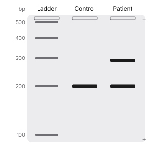
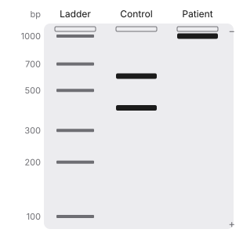
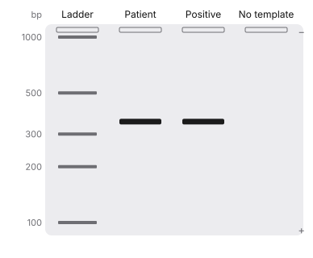
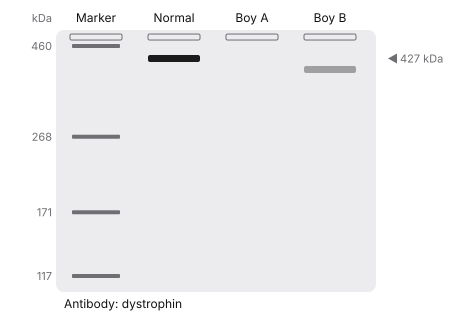

# Biochemistry — Laboratory techniques batch 1 review packet

Status: **draft, AI-drafted, not medically reviewed.** Reviewer: mark each concept approved, needs changes or rejected, with notes. A citation alone is not approval.

## How to read this packet

- Options are listed in their **stored** order (deterministically shuffled per item, with opaque ids). Learners see a fresh random order on every presentation; answers are checked by option id, never by position. ✅ marks the correct option.
- Each item shows its **reasoning task** and the **depth** that follows from it: recall/identification → recognition; mechanism → mechanism; interpretation/prediction/comparison/multistep → application. A vignette that only asks for the classic diagnosis is identification (recognition), not application. Application items list the inferential steps they require.
- Facts are split into **verified** (a supporting source was read in full text or as a published abstract/summary and states the claim) and **awaiting direct confirmation** (reasoned from pathway logic, or supported only by sources checked for existence). Awaiting facts block approval in the validator until a reviewer confirms them against a source.
- Citation “checked”: **full-text** (page read), **summary** (published abstract or summary read), **existence** (record confirmed but full text not accessible).
- Mastery: true/false and crossword answers count as weaker recognition evidence; repeating an item within 7 days adds little; “strong” needs at least 3 distinct items, including a mechanism or application item.
- Connections puzzles are checked for a single solution against the **global category catalog** (every bank category, every curated category and decoy, and a catalog of medically plausible groupings such as inheritance patterns, drug classes and toxin sources), not only against their own decoys. The daily builder applies the same check to every board it generates.

- **Two independent classifications.** *Step 1 relevance*: **CORE** (topic and depth supported by the official outline and mainstream Step 1 preparation), **SUPPLEMENTARY** (within the curriculum but beyond core depth; shown less often in games), **SPECIALIST** (obscure or postgraduate; never shown in games, excluded from coverage) or **UNREVIEWED** (not yet evaluated; never assumed core). *Cognitive depth*: **RECOGNITION**, **MECHANISM** or **APPLICATION**, from the reasoning task. A complex vignette on a classic mechanism can be CORE; a simple recall of an obscure finding can be SPECIALIST. The ~80/20 recognition-and-mechanism vs application mix is a flexible game-design target, not a relevance judgement.

## Summary

| Measure | Value |
|---|---|
| Concepts | 11 |
| Objectives taught | 14 |
| Facts verified / awaiting direct confirmation | 47 / 1 |
| **Playable learning items (total)** | **67** |
| — MCQs / true-false / crossword clues | 30 / 19 / 12 |
| — Mechanism Lab sequences / Match Up sets | 2 / 2 |
| — Complete Connections puzzles / Mystery Patient cases | 0 / 2 |
| Connections category-bank entries (builder input, **not** playable alone; excluded from item counts and coverage) | 0 |
| Items, Step 1 relevance: CORE / SUPPLEMENTARY / SPECIALIST / UNREVIEWED | 61 / 6 / 0 / 0 |
| Items, cognitive depth: RECOGNITION / MECHANISM / APPLICATION | 41 / 8 / 18 |
| Objectives, Step 1 relevance: CORE / SUPPLEMENTARY / SPECIALIST / UNREVIEWED | 13 / 1 / 0 / 0 |
| Playable items: recall | 37 |
| Playable items: identification | 4 |
| Playable items: mechanism | 8 |
| Playable items: interpretation | 14 |
| Playable items: prediction | 4 |
| Playable items: comparison | 0 |
| Playable items: multistep | 0 |

## PCR, RT-PCR and quantitative PCR (`lab-pcr`)

Objectives: `bc-pcr-sequencing.pcr`, `bc-pcr-sequencing.rt-pcr`

**Citations**

1. OpenStax Microbiology, 12.2 Visualizing and Characterizing DNA, RNA, and Protein — <https://openstax.org/books/microbiology/pages/12-2-visualizing-and-characterizing-dna-rna-and-protein> — checked: full-text
2. OpenStax Biology 2e, 17.1 Biotechnology — <https://openstax.org/books/biology-2e/pages/17-1-biotechnology> — checked: full-text
3. Duan MH et al. CML: karyotype detects t(9;22) but misses some rearrangements; RT-PCR is a sensitive way to detect BCR-ABL1. Leuk Res 2017 — PMID 28527402 — <https://pubmed.ncbi.nlm.nih.gov/28527402/> — checked: summary

**Verified facts** [supporting citations]

- PCR amplifies a specific DNA sequence through repeated cycles of three steps: denaturation at about 95 °C, primer annealing at about 50 °C and extension at 72 °C by a heat-stable DNA polymerase such as Taq (from Thermus aquaticus). Each cycle doubles the target; 25–40 cycles give millions to over a trillion copies. [1]
- The high temperature needed to separate the strands is why a heat-stable polymerase is required. PCR uses chemically synthesized DNA primers complementary to the ends of the target sequence. [1]
- Reverse transcriptase PCR (RT-PCR) first converts mRNA to cDNA with reverse transcriptase, then amplifies the cDNA; it shows whether a gene is expressed. [1, 2]
- Standard PCR and RT-PCR are not quantitative. Real-time (quantitative) PCR follows fluorescence as product accumulates, so the starting amount can be calculated; quantitative RT-PCR measures HIV viral load to judge therapy. [1]
- RT-PCR is a sensitive method for detecting the BCR-ABL1 fusion transcript in chronic myeloid leukemia. [3]

**Mechanism.** Heat separates the strands, cooling lets two primers find the ends of the target, and a heat-stable polymerase extends them. Every cycle doubles the target, so a tiny sample becomes enough to see on a gel. Starting from RNA needs reverse transcriptase first (RT-PCR); measuring how much was present needs real-time fluorescence (qPCR).

**Quick.** PCR: denature (95 °C) → primers anneal (~50 °C) → Taq extends (72 °C); each cycle doubles the target. RT-PCR: mRNA → cDNA first (gene expression, RNA viruses). qPCR: real-time fluorescence → starting amount (HIV viral load).

**Detailed**

> PCR copies one chosen stretch of DNA. Two synthetic primers define its ends. Each cycle heats the DNA to separate the strands, cools it so the primers anneal, and warms it so a heat-stable polymerase extends them. Because the copies become templates, the target doubles every cycle.

> Variations answer different questions. RT-PCR adds a reverse-transcription step so RNA can be studied: whether a gene is expressed, or whether an RNA virus or a fusion transcript such as BCR-ABL1 is present. Real-time (quantitative) PCR measures fluorescence during the run, so it can estimate how much template was there at the start, as in HIV viral load monitoring.

**Misconception.** Ordinary PCR does not tell you how much template was present: it is read at the end, after reagents may have run out. Quantity needs real-time (quantitative) PCR.

**Takeaway.** PCR = denature, anneal, extend with Taq; RT-PCR starts from RNA; qPCR measures how much.

- **MCQ** **CORE** · depth MECHANISM · `lab-pcr:mcq1` · mechanism → **mechanism** · difficulty 2 · `bc-pcr-sequencing.pcr`
  - Why does PCR use a DNA polymerase from a hot-spring bacterium rather than a human polymerase?
  - ◻️ A. It can copy RNA directly into DNA — _Copying RNA into DNA needs reverse transcriptase, the extra step in RT-PCR._
  - ◻️ B. It works best at body temperature — _Taq works best at about 72 °C, the extension step._
  - ◻️ C. It proofreads more accurately than human enzymes — _Heat stability, not proofreading, is the reason it is used._
  - ◻️ D. It does not need primers to start synthesis — _All DNA polymerases, including Taq, need a primer with a free 3′-OH._
  - ✅ E. It survives the ~95 °C step that separates the strands
  - Explanation: Strands are separated by heat (~95 °C) every cycle. Taq polymerase, from Thermus aquaticus, survives this and works best at 72 °C, so it can extend primers cycle after cycle.
- **MCQ** **CORE** · depth APPLICATION · `lab-pcr:mcq2` · prediction → **application** · difficulty 3 · `bc-pcr-sequencing.rt-pcr`
  - A patient with HIV starts antiretroviral therapy. Which test best shows whether the amount of virus in the blood is falling?
  - ◻️ A. Southern blot of lymphocyte DNA — _A Southern blot detects specific DNA fragments; it does not measure viral load._
  - ◻️ B. Standard end-point PCR for HIV DNA — _End-point PCR is not quantitative, so it cannot follow a change in amount._
  - ✅ C. Quantitative RT-PCR for HIV RNA
  - ◻️ D. Indirect ELISA for anti-HIV antibodies — _Antibodies persist on treatment; they do not track the amount of virus._
  - ◻️ E. Karyotype of blood lymphocytes — _A karyotype shows chromosome number and structure, not virus._
  - Steps: (1) The question is how much virus is present, and whether it is falling. (2) HIV genomes are RNA, so RNA must be reverse-transcribed before PCR. (3) Only real-time (quantitative) PCR estimates the starting amount → quantitative RT-PCR.
  - Explanation: HIV is an RNA virus, so reverse transcription comes first; real-time (quantitative) PCR then measures how much was present. Quantitative RT-PCR = viral load.
- **MCQ** **CORE** · depth RECOGNITION · `lab-pcr:mcq3` · recall → **recognition** · difficulty 1 · `bc-pcr-sequencing.rt-pcr`
  - A researcher wants to know whether a gene is being expressed in a tissue sample. Which approach answers this with PCR?
  - ◻️ A. Stain the chromosomes and count them — _Karyotyping shows chromosomes, not gene expression._
  - ◻️ B. Run PCR on the protein extract — _PCR amplifies nucleic acids, not proteins._
  - ◻️ C. Cut genomic DNA with a restriction enzyme — _Restriction digestion of DNA does not show expression._
  - ✅ D. Reverse-transcribe the mRNA to cDNA, then run PCR
  - ◻️ E. Run PCR directly on genomic DNA — _Genomic DNA contains the gene whether or not it is expressed._
  - Explanation: Expression means mRNA. RT-PCR converts mRNA to cDNA with reverse transcriptase, then PCR amplifies it, showing the gene is expressed.
- **True/false** **CORE** · depth RECOGNITION · `lab-pcr:tf1` · recall → **recognition** · difficulty 1 · `bc-pcr-sequencing.pcr`: Each PCR cycle roughly doubles the number of copies of the target sequence. → **True**. Correct: 25–40 cycles give millions to over a trillion copies.
- **True/false** **CORE** · depth RECOGNITION · `lab-pcr:tf2` · recall → **recognition** · difficulty 1 · `bc-pcr-sequencing.rt-pcr`: Standard end-point PCR tells you how many template molecules were present at the start. → **False**. End-point PCR is not quantitative; real-time (quantitative) PCR is needed.
- **Crossword** **CORE** · depth RECOGNITION · `lab-pcr:clue1` · recall → **recognition** · difficulty 1 · `bc-pcr-sequencing.pcr`: Heat-stable polymerase from Thermus aquaticus used in PCR → **TAQ**
- **Crossword** **CORE** · depth RECOGNITION · `lab-pcr:clue2` · recall → **recognition** · difficulty 1 · `bc-pcr-sequencing.pcr`: Short synthetic DNA that marks each end of the PCR target → **PRIMER**
- **Mechanism Lab** **CORE** · depth MECHANISM · `seq:pcr-gel` · mechanism → **mechanism** · difficulty 2 · `bc-pcr-sequencing.pcr`: From sample to band. Order the steps from PCR to reading the result on a gel.
  1. Heat to about 95 °C to separate the DNA strands
  2. Cool to about 50 °C so the primers anneal
  3. Warm to 72 °C so Taq polymerase extends the primers
  4. Repeat the cycle 25–40 times
  5. Load the products into wells at the negative electrode
  6. Smaller fragments migrate farther toward the positive electrode
  7. Stain the gel and view the bands under UV light
  - Denature, anneal, extend, repeat; then the gel sorts products by size, smallest farthest.

---

## Reading a gel: deletions, repeat expansions and pathogens (`lab-gel`)

Objectives: `bc-pcr-sequencing.interpret`, `bc-pcr-sequencing.pcr`

**Citations**

1. OpenStax Microbiology, 12.2 Visualizing and Characterizing DNA, RNA, and Protein — <https://openstax.org/books/microbiology/pages/12-2-visualizing-and-characterizing-dna-rna-and-protein> — checked: full-text
2. MedlinePlus Genetics: Huntington disease — <https://medlineplus.gov/genetics/condition/huntington-disease/> — checked: full-text
3. MedlinePlus Genetics: Fragile X syndrome — <https://medlineplus.gov/genetics/condition/fragile-x-syndrome/> — checked: full-text
4. Tassone F. Fragile X diagnosis: cytogenetics replaced by Southern blot and PCR, now PCR methods that size full mutations and methylation. Expert Rev Mol Diagn 2015 — PMID 26489042 — <https://pubmed.ncbi.nlm.nih.gov/26489042/> — checked: summary
5. Sofocleous C et al. Fragile X: >200 CGG repeats are hypermethylated and silence FMR1; molecular diagnosis. Expert Rev Mol Diagn 2009 — PMID 19099346 — <https://pubmed.ncbi.nlm.nih.gov/19099346/> — checked: summary

**Verified facts** [supporting citations]

- In agarose gel electrophoresis, DNA is loaded at the negative electrode and moves toward the positive electrode; the gel slows larger fragments, so smaller fragments travel farther. Bands are seen with a stain such as ethidium bromide under UV light. [1]
- In restriction fragment analysis, a mutation that destroys a restriction site turns two shorter fragments into one longer fragment, so two short bands are replaced by one longer band. [1]
- Huntington disease is caused by an expanded CAG repeat in HTT: normal alleles have 10–35 repeats, and 40 or more almost always cause disease; larger expansions give earlier onset. [2]
- Fragile X syndrome is caused by more than 200 CGG repeats in FMR1, which silence the gene; 55–200 repeats is a premutation. Diagnosis moved from cytogenetics to Southern blot and PCR, and PCR methods now size full mutations and assess methylation. [3, 4, 5]

**Mechanism.** A gel is a sieve: position equals size. A deletion makes a product shorter, so it runs farther; a repeat expansion makes it longer, so it runs less far (or fails to amplify if very large); a lost restriction site joins two fragments into one longer band; a pathogen-specific PCR product appears as a band only when the target is present.

**Quick.** Gel = sieve: smaller fragments run farther toward the + electrode. Deletion → shorter (lower) band; repeat expansion → longer (higher) band; lost restriction site → one longer band instead of two shorter; pathogen PCR → band only if present.

**Detailed**

> DNA is negatively charged, so in an electric field it moves toward the positive electrode. The agarose matrix holds back long molecules, so distance travelled is inversely related to size, read against a ladder of known sizes.

> Clinical reading follows from size: a heterozygous deletion gives one normal and one shorter band; an expanded repeat (CAG in Huntington disease, CGG in fragile X) gives a longer band; a point mutation that removes a restriction site changes the digest pattern; a pathogen-specific PCR shows a band only when the organism is present.

**Misconception.** The band nearest the wells is the largest fragment, not the most abundant one.

**Takeaway.** On a gel, farther = smaller; expansions run higher, deletions lower.

- **MCQ** **CORE** · depth APPLICATION · `lab-gel:mcq1` · interpretation → **application** · difficulty 3 · `bc-pcr-sequencing.interpret`
  - PCR across the HTT CAG repeat is run on a gel. A man’s lanes show one band at the normal size and one band well above it, nearer the wells. What does the upper band represent?
  - Figure (gel, original, generated from data; passes validation):

    

  - Figure text: Agarose gel. Ladder: 500, 400, 300, 200, 100 bp. Control: 200 bp. Patient: 200 bp, 290 bp.
  - ◻️ A. A more abundant copy of the normal allele — _Band position reflects size, not amount._
  - ◻️ B. Contaminating protein in the sample — _Proteins are not stained or separated by this DNA gel in the same way._
  - ◻️ C. An RNA transcript of the HTT gene — _PCR of genomic DNA amplifies DNA, not RNA._
  - ◻️ D. An allele with a deletion of the repeat — _A deletion shortens the product, so its band would run farther, not less far._
  - ✅ E. An allele with an expanded (longer) CAG repeat
  - Steps: (1) On a gel, larger fragments migrate less far, staying nearer the wells. (2) The second band is larger than the normal allele. (3) A larger PCR product across a repeat = more repeats → expanded CAG allele.
  - Explanation: Longer fragments run less far. A band above the normal allele is a larger product: an expanded CAG repeat (40 or more almost always causes Huntington disease).
- **MCQ** **CORE** · depth APPLICATION · `lab-gel:mcq2` · interpretation → **application** · difficulty 3 · `bc-pcr-sequencing.interpret`
  - A gene region is cut with a restriction enzyme and run on a gel. A control gives two short bands; a patient gives one longer band of their combined size. What is the most likely explanation?
  - Figure (gel, original, generated from data; passes validation):

    

  - Figure text: Agarose gel. Ladder: 1000, 700, 500, 300, 200, 100 bp. Control: 600 bp, 400 bp. Patient: 1000 bp.
  - ◻️ A. The patient has a trinucleotide repeat expansion — _An expansion lengthens one fragment; it does not remove a cut site._
  - ◻️ B. The enzyme cut the patient’s DNA at more sites — _More cutting gives more, shorter fragments, not one longer one._
  - ✅ C. A mutation destroyed the restriction site
  - ◻️ D. The gel ran for too short a time — _Run time does not merge two fragments into a band of their combined size._
  - ◻️ E. The patient has an extra copy of the gene — _An extra copy would not join the two fragments into one._
  - Steps: (1) The control is cut once, giving two shorter fragments. (2) The patient’s fragment equals their combined length. (3) So the cut did not happen: a mutation removed the restriction site.
  - Explanation: If the site between two fragments is lost, the enzyme cannot cut there: the two shorter fragments become one longer band of their combined size.
- **MCQ** **CORE** · depth APPLICATION · `lab-gel:mcq3` · interpretation → **application** · difficulty 3 · `bc-pcr-sequencing.interpret`
  - PCR for a pathogen-specific gene is run on a patient sample, a positive control and a no-template control. Only the patient lane and the positive control show a band of the expected size. What does this indicate?
  - Figure (gel, original, generated from data; passes validation):

    

  - Figure text: Agarose gel. Ladder: 1000, 500, 300, 200, 100 bp. Patient: 350 bp. Positive: 350 bp. No template: no band.
  - ◻️ A. The band shows the amount of pathogen present — _End-point PCR is not quantitative._
  - ◻️ B. The patient has antibodies to the pathogen — _PCR detects nucleic acid, not antibodies._
  - ✅ C. The pathogen’s DNA is present in the sample
  - ◻️ D. The patient carries a deletion in the pathogen gene — _The band is the expected size, so no deletion is suggested._
  - ◻️ E. The test failed because the no-template lane is blank — _A blank no-template control is the expected result; it shows no contamination._
  - Steps: (1) The positive control shows the test works. (2) The blank no-template control shows no contamination. (3) A band of the right size in the patient lane → pathogen DNA present.
  - Explanation: A band of the expected size in the patient lane, with a working positive control and a clean no-template control, means the pathogen target was amplified: it is present.
- **True/false** **CORE** · depth RECOGNITION · `lab-gel:tf1` · recall → **recognition** · difficulty 1 · `bc-pcr-sequencing.pcr`: On an agarose gel, smaller DNA fragments travel farther than larger ones. → **True**. Correct: the gel slows large fragments, so small ones migrate farther toward the positive electrode.
- **True/false** **CORE** · depth RECOGNITION · `lab-gel:tf2` · recall → **recognition** · difficulty 1 · `bc-pcr-sequencing.interpret`: Fragile X syndrome is caused by more than 200 CGG repeats in FMR1. → **True**. Correct: the full mutation silences FMR1; 55–200 repeats is a premutation.
- **Crossword** **CORE** · depth RECOGNITION · `lab-gel:clue1` · recall → **recognition** · difficulty 2 · `bc-pcr-sequencing.pcr`: Gel technique that separates DNA fragments by size → **ELECTROPHORESIS**

---

## Sanger and next-generation sequencing; choosing the scope of a genetic test (`lab-sequencing`)

Objectives: `bc-pcr-sequencing.sequencing`

**Citations**

1. OpenStax Microbiology, 12.2 Visualizing and Characterizing DNA, RNA, and Protein — <https://openstax.org/books/microbiology/pages/12-2-visualizing-and-characterizing-dna-rna-and-protein> — checked: full-text
2. OpenStax Biology 2e, 17.3 Whole-Genome Sequencing — <https://openstax.org/books/biology-2e/pages/17-3-whole-genome-sequencing> — checked: full-text
3. MedlinePlus Genetics: What are the different types of genetic tests? — <https://medlineplus.gov/genetics/understanding/testing/types/> — checked: full-text

**Verified facts** [supporting citations]

- Sanger (chain-termination, dideoxy) sequencing copies a template with DNA polymerase and a small proportion of labeled dideoxynucleotides (ddNTPs); a ddNTP lacks the 3′-OH needed to add the next nucleotide, so each incorporation stops the chain. [1, 2]
- Next-generation (massively parallel) sequencing reads hundreds of thousands to millions of short fragments in a day, and software assembles them. [2]
- Molecular genetic tests vary in scope: a targeted single-variant test (for example, testing relatives for a known familial variant), a single-gene test, a gene panel (when many genes can cause the symptoms), and whole-exome or whole-genome sequencing (often when panels have not given a diagnosis or the cause is unclear, and increasingly as an early test). [3]

**Mechanism.** Sanger sequencing works by controlled stopping: a dideoxynucleotide has no 3′-OH, so the chain ends wherever one is added, and the lengths of the stopped fragments reveal the sequence. Next-generation sequencing reads millions of short fragments in parallel, which makes panels, exomes and genomes practical.

**Quick.** Sanger: ddNTP (no 3′-OH) stops the chain → fragment lengths give the sequence. NGS: millions of short reads in parallel. Scope: known familial variant → targeted test; one suspected gene → single-gene test; many possible genes → panel; still unclear → exome/genome.

**Detailed**

> Sanger sequencing copies a single-stranded template from a primer. A small fraction of each nucleotide is a labeled dideoxy form that lacks a 3′-OH, so wherever one is added synthesis stops; separating the stopped fragments by size reads the sequence one base at a time.

> Next-generation sequencing reads very many short fragments at once. In the clinic the scope is chosen to fit the question: a targeted test for a variant already known in the family, a single gene when one diagnosis is suspected, a panel when many genes give the same picture (for example epilepsy), and exome or genome sequencing when targeted testing has not found the cause.

**Misconception.** Broader is not always better: a known familial variant needs only a targeted test, while exome or genome sequencing is used when many genes could be responsible or the cause is unclear.

**Takeaway.** Sanger = chain termination by ddNTPs; NGS = massively parallel; match test scope to the clinical question.

- **MCQ** **CORE** · depth MECHANISM · `lab-sequencing:mcq1` · mechanism → **mechanism** · difficulty 2 · `bc-pcr-sequencing.sequencing`
  - In Sanger sequencing, why does adding a dideoxynucleotide stop the growing DNA chain?
  - ✅ A. It lacks the 3′-OH needed for the next bond
  - ◻️ B. It cannot pair with the template base — _Dideoxynucleotides pair normally; they are incorporated before stopping the chain._
  - ◻️ C. It removes the primer from the template — _Primer removal is not how chain termination works._
  - ◻️ D. It denatures the DNA polymerase — _The polymerase is not damaged; the chain simply cannot be extended._
  - ◻️ E. It is cut out by proofreading at once — _If it were removed, synthesis would continue rather than stop._
  - Explanation: DNA polymerase links each new nucleotide to the 3′-OH of the last one. A ddNTP has no 3′-OH, so the chain ends wherever it is incorporated.
- **MCQ** **CORE** · depth RECOGNITION · `lab-sequencing:mcq2` · identification → **recognition** · difficulty 2 · `bc-pcr-sequencing.sequencing`
  - A child has seizures that could be caused by variants in any of hundreds of genes. No variant is known in the family. Which molecular test examines many of these candidate genes together?
  - ✅ A. A multigene panel for epilepsy genes
  - ◻️ B. A karyotype — _A karyotype detects large chromosomal changes, not variants within single genes._
  - ◻️ C. A targeted test for a single known variant — _No familial variant is known, so there is nothing to target._
  - ◻️ D. Sanger sequencing of one gene at a time — _Testing hundreds of genes one by one is slow and costly._
  - ◻️ E. A Western blot of blood proteins — _Protein blotting does not test for gene variants._
  - Explanation: A gene panel sequences many candidate genes at once; exome or genome sequencing goes further, covering most genes. Which genome-wide or targeted test comes first depends on the clinical picture and current guidelines.
- **True/false** **CORE** · depth RECOGNITION · `lab-sequencing:tf1` · recall → **recognition** · difficulty 1 · `bc-pcr-sequencing.sequencing`: Next-generation sequencing reads very large numbers of short DNA fragments in parallel. → **True**. Correct: software then assembles the short reads.
- **True/false** **CORE** · depth RECOGNITION · `lab-sequencing:tf2` · recall → **recognition** · difficulty 1 · `bc-pcr-sequencing.sequencing`: Relatives of a person with a known familial variant are usually tested with whole-exome sequencing. → **False**. A targeted single-variant test is used; exome sequencing is for unclear causes.
- **Crossword** **SUPPLEMENTARY** · depth RECOGNITION · `lab-sequencing:clue1` · recall → **recognition** · difficulty 2 · `bc-pcr-sequencing.sequencing`: Type of nucleotide that ends the chain in Sanger sequencing → **DIDEOXY**

---

## Southern, Northern, Western and Southwestern blots (`lab-blotting`)

Objectives: `bc-blotting.choose`, `bc-blotting.western`

**Citations**

1. OpenStax Microbiology, 12.2 Visualizing and Characterizing DNA, RNA, and Protein — <https://openstax.org/books/microbiology/pages/12-2-visualizing-and-characterizing-dna-rna-and-protein> — checked: full-text
2. OpenStax Microbiology, 20.2 Detecting Antigen-Antibody Complexes — <https://openstax.org/books/microbiology/pages/20-2-detecting-antigen-antibody-complexes> — checked: full-text
3. MedlinePlus Genetics: Duchenne and Becker muscular dystrophy — <https://medlineplus.gov/genetics/condition/duchenne-and-becker-muscular-dystrophy/> — checked: full-text
4. Nicholson LV et al. Western blot analysis of dystrophin in skeletal muscle for the differential diagnosis of Duchenne and Becker dystrophy. J Neurol Sci 1989 — PMID 2693617 — <https://pubmed.ncbi.nlm.nih.gov/2693617/> — checked: summary
5. Reitter B, Goebel HH. Dystrophinopathies: immunohistochemical and Western blot analysis of dystrophin in diagnosis. Semin Pediatr Neurol 1996 — PMID 8795844 — <https://pubmed.ncbi.nlm.nih.gov/8795844/> — checked: summary
6. Halperin JJ. Lyme disease is diagnosed by two-tier antibody testing: ELISA, then Western blot. Handb Clin Neurol 2014 — PMID 24365431 — <https://pubmed.ncbi.nlm.nih.gov/24365431/> — checked: summary
7. Talagrand-Reboul E et al. Lyme serology: a sensitive first-tier ELISA, then a confirmatory second tier. Front Cell Infect Microbiol 2020 — PMID 32509603 — <https://pubmed.ncbi.nlm.nih.gov/32509603/> — checked: summary
8. Pandori MW et al. The HIV algorithm replaces the HIV-1 Western blot with an HIV-1/HIV-2 differentiation assay after an Ag/Ab screen. J Clin Virol 2013 — PMID 24342485 — <https://pubmed.ncbi.nlm.nih.gov/24342485/> — checked: summary
9. Alyami NH et al. Classic Duchenne features: Gowers sign, calf pseudohypertrophy, hypotonia and raised creatine kinase. Cureus 2025 — PMID 41439068 — <https://pubmed.ncbi.nlm.nih.gov/41439068/> — checked: summary
10. Schriefer ME. Lyme serology: two-tier testing detects early localized infection poorly and late disease well; erythema migrans should prompt treatment without testing. Clin Lab Med 2015 — PMID 26593258 — <https://pubmed.ncbi.nlm.nih.gov/26593258/> — checked: summary
11. Baarsma ME et al. Modified two-tier testing confirms with a second enzyme immunoassay instead of an immunoblot. Eur J Clin Microbiol Infect Dis 2020 — PMID 32632699 — <https://pubmed.ncbi.nlm.nih.gov/32632699/> — checked: summary
12. Corre C et al. Lyme arthritis (mostly knee monoarthritis) documented by IgG ELISA confirmed by Western blot. Eur J Clin Microbiol Infect Dis 2022 — PMID 34417687 — <https://pubmed.ncbi.nlm.nih.gov/34417687/> — checked: summary
13. Bennett B et al. HIV algorithm: 4th-generation Ag/Ab immunoassay → HIV-1/HIV-2 antibody differentiation test → HIV-1 nucleic acid test if the differentiation test is nonreactive or indeterminate. J Clin Virol 2013 — PMID 24342476 — <https://pubmed.ncbi.nlm.nih.gov/24342476/> — checked: summary

**Verified facts** [supporting citations]

- In a Southern blot, DNA fragments are separated by agarose gel electrophoresis, transferred to a membrane and detected with a labeled DNA probe. In a Northern blot, RNA is immobilized and probed, typically to measure how much mRNA a gene makes. [1]
- In a Western blot, proteins are separated by gel electrophoresis (SDS-PAGE), transferred to a membrane and detected with a primary antibody and a labeled secondary antibody. A Southwestern blot probes separated proteins with a labeled DNA probe to find DNA-binding proteins. [2]
- Duchenne muscular dystrophy results from DMD mutations that prevent any functional dystrophin; mutations that leave an abnormal but partly functional dystrophin usually cause the milder Becker form. Western blot of muscle dystrophin helps distinguish them. [3, 4, 5]
- Serologic diagnosis of Lyme disease uses two-tier antibody testing: a sensitive ELISA first, then a confirmatory second tier, classically a Western blot (standard two-tier) or a second enzyme immunoassay (modified two-tier). Serology detects late disease such as Lyme arthritis well but early localized infection poorly, so classic erythema migrans is treated on clinical grounds without testing. [6, 7, 10, 11, 12]
- In current HIV testing, a reactive antigen/antibody screen is followed by an HIV-1/HIV-2 antibody differentiation assay, which has replaced the HIV-1 Western blot as the supplemental test; an HIV-1 nucleic acid test is used if the differentiation assay is nonreactive or indeterminate. [8, 13]
- Classic Duchenne features in a young boy include difficulty rising from the floor (Gowers sign), calf pseudohypertrophy, hypotonia and a raised creatine kinase. [9]

**Mechanism.** Every blot separates molecules on a gel, transfers them to a membrane and finds one target with a specific probe. The probe decides the blot: DNA probe for DNA (Southern) or RNA (Northern), antibody for protein (Western), DNA probe for a DNA-binding protein (Southwestern).

**Quick.** Southern = DNA, Northern = RNA (mRNA amount), Western = protein (antibody probe), Southwestern = DNA-binding protein. Western confirms: absent dystrophin (Duchenne) vs abnormal/reduced (Becker); Lyme two-tier (ELISA → Western or 2nd EIA). HIV: differentiation assay, not Western blot.

**Detailed**

> Blots share three steps: separate by size on a gel, transfer to a membrane, detect with a labeled probe. Southern blots detect DNA and Northern blots RNA with nucleic acid probes; Western blots detect protein with antibodies; Southwestern blots find proteins that bind a DNA probe.

> Western blotting is used to confirm a specific protein. In muscle, absent dystrophin points to Duchenne and an abnormal or reduced band to Becker muscular dystrophy. In Lyme serology (for example suspected Lyme arthritis), a positive screening ELISA is followed by a second tier, classically a Western blot of antibody bands, or a second immunoassay in modified protocols. HIV is the exception to remember: its supplemental test is now a differentiation immunoassay, with nucleic acid testing when indicated.

**Misconception.** The Western blot is no longer the confirmatory test in the standard HIV algorithm: a differentiation immunoassay follows a reactive antigen/antibody screen.

**Takeaway.** SNoW DRoP-style pairing: Southern DNA, Northern RNA, Western protein; Western confirms a specific protein.

- **MCQ** **CORE** · depth RECOGNITION · `lab-blotting:mcq1` · recall → **recognition** · difficulty 1 · `bc-blotting.choose`
  - A researcher wants to measure how much mRNA a tissue makes from a particular gene. Which blot is designed for this?
  - ◻️ A. Southwestern blot — _Southwestern blots find DNA-binding proteins._
  - ◻️ B. Southern blot — _Southern blots detect DNA, which is present whether or not the gene is expressed._
  - ◻️ C. Western blot — _Western blots detect protein with antibodies._
  - ◻️ D. Dot blot of genomic DNA — _A dot blot of DNA does not measure mRNA._
  - ✅ E. Northern blot
  - Explanation: Northern blots immobilize RNA and probe it, so they show how much mRNA a gene makes. Southern = DNA, Western = protein.
- **MCQ** **SUPPLEMENTARY** · depth RECOGNITION · `lab-blotting:mcq2` · identification → **recognition** · difficulty 2 · `bc-blotting.choose`
  - A scientist suspects a nuclear protein binds a specific promoter sequence. Proteins are separated by SDS-PAGE, transferred and probed with that labeled DNA sequence. What is this technique?
  - ◻️ A. Western blot — _A Western blot probes proteins with antibodies, not DNA._
  - ◻️ B. Northern blot — _Northern blots probe immobilized RNA._
  - ✅ C. Southwestern blot
  - ◻️ D. Indirect ELISA — _ELISA is done in wells with antibodies, not by probing a protein blot with DNA._
  - ◻️ E. Southern blot — _Southern blots probe immobilized DNA, not proteins._
  - Explanation: Separated proteins probed with labeled DNA = Southwestern blot, which identifies DNA-binding proteins such as transcription factors.
- **MCQ** **CORE** · depth APPLICATION · `lab-blotting:mcq3` · interpretation → **application** · difficulty 3 · `bc-blotting.western`
  - Two boys with proximal muscle weakness have muscle biopsies. On Western blot for dystrophin, boy A has no band; boy B has a band that is fainter and smaller than normal. Which interpretation fits?
  - Figure (western, original, generated from data; passes validation):

    

  - Figure text: Western blot for dystrophin. Markers: 460, 268, 171, 117 kDa. Normal: strong band at 427 kDa. Boy A: no band at 427 kDa. Boy B: faint band at 400 kDa.
  - ◻️ A. Both need a Southern blot before any interpretation — _The protein result itself distinguishes the two forms._
  - ◻️ B. A: Becker; B: Duchenne — _Duchenne lacks functional dystrophin; Becker keeps an abnormal, partly functional protein._
  - ◻️ C. Neither has a dystrophinopathy — _Absent or abnormal dystrophin defines a dystrophinopathy._
  - ✅ D. A: Duchenne (no dystrophin); B: Becker (abnormal dystrophin)
  - ◻️ E. Both have Duchenne; the blot differs only by sample — _A reduced, abnormal band is the pattern of Becker dystrophy._
  - Steps: (1) A Western blot shows whether dystrophin is present and its size and amount. (2) Mutations that prevent any functional dystrophin cause Duchenne. (3) Mutations that leave an abnormal, partly functional protein cause Becker.
  - Explanation: Western blot shows the protein: no dystrophin → Duchenne; an abnormal, reduced but present dystrophin → milder Becker muscular dystrophy.
- **MCQ** **CORE** · depth APPLICATION · `lab-blotting:mcq4` · interpretation → **application** · difficulty 3 · `bc-blotting.western`
  - A man from a Lyme-endemic area has had a swollen, warm right knee for 6 weeks. He recalls hiking several months ago. His Lyme ELISA is positive, and a standard two-tier protocol is used. What does the follow-up immunoblot (Western blot) add?
  - ◻️ A. It identifies the patient’s HLA type — _HLA typing is not part of Lyme serology._
  - ✅ B. It confirms IgG antibodies to specific Borrelia proteins
  - ◻️ C. It replaces the ELISA, which is not sensitive — _The ELISA is the sensitive first tier; the second tier confirms it._
  - ◻️ D. It detects Borrelia DNA in the joint fluid — _Western blots detect proteins (here, antibodies binding them), not DNA._
  - ◻️ E. It measures how many bacteria are in the joint — _Serologic blots detect antibodies, not the number of organisms._
  - Steps: (1) Months after exposure, a monoarthritis of the knee suggests Lyme arthritis, when antibody testing is reliable. (2) The ELISA is sensitive but can be falsely positive, so a confirmatory second tier is needed. (3) The Western blot shows IgG antibodies against specific Borrelia proteins, confirming infection.
  - Explanation: Suspected Lyme arthritis is late disease, when serology performs well. A sensitive ELISA screens; the second tier confirms, classically a Western blot showing IgG bands to specific Borrelia proteins (modified two-tier protocols use a second immunoassay instead). Classic erythema migrans, in contrast, is treated clinically without serology.
- **MCQ** **CORE** · depth APPLICATION · `lab-blotting:mcq5` · prediction → **application** · difficulty 3 · `bc-blotting.choose`
  - A mutation is suspected to block translation of a gene’s mRNA without affecting transcription. Which pair of blot results would support this?
  - ◻️ A. Southern: gene absent; Western: protein normal — _A missing gene with normal protein is contradictory and does not test translation._
  - ◻️ B. Northern: mRNA absent; Western: protein absent — _Absent mRNA would mean transcription (or mRNA stability) is affected._
  - ◻️ C. Northern: normal mRNA; Western: protein normal — _Normal protein means translation is working._
  - ◻️ D. Southwestern: DNA binding lost; Northern: mRNA absent — _This tests a DNA-binding protein and transcription, not translation._
  - ✅ E. Northern: normal mRNA; Western: protein absent
  - Steps: (1) Transcription makes mRNA (measured by Northern blot); translation makes protein (measured by Western blot). (2) If only translation is blocked, mRNA is made normally. (3) So mRNA is normal on the Northern blot but protein is absent on the Western blot.
  - Explanation: Northern measures mRNA and Western measures protein. Normal mRNA with absent protein places the block after transcription, at translation (or protein stability).
- **True/false** **CORE** · depth RECOGNITION · `lab-blotting:tf1` · recall → **recognition** · difficulty 1 · `bc-blotting.choose`: A Western blot uses antibodies to detect a specific protein. → **True**. Correct: proteins are separated by SDS-PAGE, transferred and detected with antibodies.
- **True/false** **CORE** · depth RECOGNITION · `lab-blotting:tf2` · recall → **recognition** · difficulty 2 · `bc-blotting.western`: In the current HIV testing algorithm, a reactive antigen/antibody screen is confirmed with an HIV-1 Western blot. → **False**. An HIV-1/HIV-2 differentiation assay has replaced the Western blot as the supplemental test.
- **Crossword** **CORE** · depth RECOGNITION · `lab-blotting:clue1` · recall → **recognition** · difficulty 1 · `bc-blotting.choose`: Blot that detects RNA → **NORTHERN**
- **Crossword** **SUPPLEMENTARY** · depth RECOGNITION · `lab-blotting:clue2` · recall → **recognition** · difficulty 2 · `bc-blotting.choose`: Blot that finds DNA-binding proteins → **SOUTHWESTERN**
- **Mechanism Lab** **CORE** · depth MECHANISM · `seq:western-blot` · mechanism → **mechanism** · difficulty 2 · `bc-blotting.choose`: Finding one protein. Order the steps of a Western blot.
  1. Denature proteins with SDS so they carry a uniform negative charge
  2. Separate the proteins by size with gel electrophoresis
  3. Transfer the proteins to a membrane
  4. Add a primary antibody against the protein of interest
  5. Add a labeled secondary antibody that binds the primary
  6. Detect the band by color or fluorescence
  - Separate, transfer, then two antibodies find and reveal one protein; absent dystrophin in Duchenne muscle is the classic clinical result.
- **Match Up** **CORE** · depth RECOGNITION · `match:lab-targets` · recall → **recognition** · difficulty 1 · `bc-blotting.choose`: What does each test detect?. Match each technique to what it detects.
  - Southern blot ↔ A specific DNA sequence
  - Northern blot ↔ mRNA from a gene
  - Western blot ↔ A specific protein, using antibodies
  - Southwestern blot ↔ Proteins that bind a DNA sequence
  - Indirect ELISA ↔ Antibodies in the patient’s serum
  - Flow cytometry ↔ Cells carrying a surface marker
  - Southern DNA, Northern RNA, Western protein, Southwestern DNA-binding protein; indirect ELISA finds antibodies; flow cytometry counts labeled cells.
- **Mystery Patient** **CORE** · depth APPLICATION · `case:dmd-western` · interpretation → **application** · difficulty 3 · `bc-blotting.western`: A boy who climbs up his legs
  - Presentation: A 5-year-old boy falls often and has difficulty climbing stairs. He was late to walk.
  - Examination: He uses his hands on his thighs to stand up from the floor, and his calves look large.
  - Laboratory: Serum creatine kinase is markedly raised.
  - Further clue: A muscle biopsy is analyzed by Western blot with an anti-dystrophin antibody.
  - Q: Which Western blot result is expected in the most likely diagnosis?
  - ◻️ A. Antibodies to Borrelia proteins — _That is a Lyme serology blot, unrelated to this boy’s weakness._
  - ◻️ B. A dystrophin band of normal size and amount — _A normal result would argue against a dystrophinopathy._
  - ✅ C. No dystrophin band at all
  - ◻️ D. A reduced, abnormally sized dystrophin band — _Abnormal but present dystrophin is the pattern of the milder Becker form._
  - ◻️ E. Extra bands from a repeat expansion — _Repeat expansions are DNA findings, not the expected protein result here._
  - Early-onset proximal weakness in a boy, with a markedly raised creatine kinase, suggests Duchenne muscular dystrophy. DMD mutations that prevent any functional dystrophin cause Duchenne, so the Western blot shows no dystrophin; a reduced, abnormal band would suggest Becker dystrophy.
  - Differentials: Becker muscular dystrophy (Later onset, slower progression, abnormal but present dystrophin.); Spinal muscular atrophy (A motor neuron disease with normal dystrophin.)

---

## ELISA: direct, indirect and sandwich assays; screening and confirmation (`lab-elisa`)

Objectives: `bc-elisa-flow.elisa`

**Citations**

1. OpenStax Microbiology, 20.4 EIAs and ELISAs — <https://openstax.org/books/microbiology/pages/20-4-eias-and-elisas> — checked: full-text
2. MedlinePlus Medical Tests: HIV Screening Test — <https://medlineplus.gov/lab-tests/hiv-screening-test/> — checked: full-text
3. Avidor B et al. Fourth-generation assays detect anti-HIV antibodies and p24 antigen but are prone to false positives; confirmation follows. J Clin Virol 2018 — PMID 30007138 — <https://pubmed.ncbi.nlm.nih.gov/30007138/> — checked: summary
4. Talagrand-Reboul E et al. Lyme serology: a sensitive first-tier ELISA, then a confirmatory second tier. Front Cell Infect Microbiol 2020 — PMID 32509603 — <https://pubmed.ncbi.nlm.nih.gov/32509603/> — checked: summary
5. Pandori MW et al. The HIV algorithm replaces the HIV-1 Western blot with an HIV-1/HIV-2 differentiation assay after an Ag/Ab screen. J Clin Virol 2013 — PMID 24342485 — <https://pubmed.ncbi.nlm.nih.gov/24342485/> — checked: summary
6. Bennett B et al. HIV algorithm: 4th-generation Ag/Ab immunoassay → HIV-1/HIV-2 antibody differentiation test → HIV-1 nucleic acid test if the differentiation test is nonreactive or indeterminate. J Clin Virol 2013 — PMID 24342476 — <https://pubmed.ncbi.nlm.nih.gov/24342476/> — checked: summary

**Verified facts** [supporting citations]

- ELISAs use an antibody linked to an enzyme; adding a colorless substrate (chromogen) gives a colored product, which detects or quantifies the target. [1]
- A direct ELISA uses one enzyme-labeled antibody against the antigen; it is faster but less sensitive. A sandwich ELISA captures antigen between two antibodies to quantify it (for example a pathogen antigen or a hormone). [1]
- An indirect ELISA puts known antigen (for example HIV peptides) in the well; the patient’s antibodies bind it and are detected with an enzyme-linked anti-human immunoglobulin, so it detects antibodies. This classic design underlies antibody screening such as the first tier of Lyme serology and earlier HIV antibody tests. [1]
- Cross-reacting antibodies can cause false-positive ELISA results, so a positive screen is confirmed with a more specific test. [1, 4]
- Contemporary HIV screening uses fourth-generation antigen/antibody immunoassays that detect both HIV antibodies and p24 antigen (so infection is detected earlier than with antibody-only tests). They can be falsely positive, so a reactive result goes on to an HIV-1/HIV-2 antibody differentiation immunoassay, and to an HIV-1 nucleic acid test if that is nonreactive or indeterminate; the Western blot is no longer part of this algorithm. [2, 3, 5, 6]

**Mechanism.** An enzyme attached to an antibody turns a colorless substrate into color, so binding becomes visible and measurable. What sits on the plate decides what is detected: capture antibody to find antigen (direct or sandwich), or known antigen to find the patient’s antibodies (indirect). High sensitivity makes ELISA a good screen; cross-reactivity means positives need confirmation.

**Quick.** ELISA: enzyme-linked antibody + chromogen → color. Direct/sandwich: detect or quantify antigen. Indirect: antigen on plate detects patient antibodies (classic antibody screen, e.g. Lyme first tier). Modern HIV screen = 4th-generation Ag/Ab → differentiation assay → NAT if needed.

**Detailed**

> In every ELISA an enzyme bound to an antibody converts a colorless chromogen into a colored product. In a direct ELISA a labeled antibody binds the antigen; in a sandwich ELISA antigen is captured between two antibodies, which allows precise quantification of things like hormones or pathogen antigens.

> An indirect ELISA asks a different question: does the patient have antibodies? Known antigen coats the well, patient serum is added, and an enzyme-linked anti-human antibody reveals any bound antibody. Because screening immunoassays are sensitive but can cross-react, positives are confirmed with a more specific test. Modern HIV screening goes further: fourth-generation assays detect p24 antigen as well as antibody, and reactive results proceed to a differentiation immunoassay and, when indicated, nucleic acid testing.

**Misconception.** A positive screening ELISA is not a diagnosis: cross-reacting antibodies can give false positives, so a more specific test confirms it.

**Takeaway.** ELISA: enzyme + chromogen; indirect finds antibodies, sandwich quantifies antigen; screen, then confirm.

- **MCQ** **CORE** · depth MECHANISM · `lab-elisa:mcq1` · mechanism → **mechanism** · difficulty 2 · `bc-elisa-flow.elisa`
  - In a classic indirect ELISA, HIV peptides coat the wells, patient serum is added, and then an enzyme-linked anti-human immunoglobulin. What does a color change show?
  - ✅ A. The patient has antibodies against HIV
  - ◻️ B. HIV RNA is present in the serum — _This assay detects antibodies; HIV RNA is measured by RT-PCR._
  - ◻️ C. The patient’s CD4 count is low — _CD4 counts are measured by flow cytometry._
  - ◻️ D. HIV has integrated into the patient’s DNA — _Integration is not measured by ELISA._
  - ◻️ E. The enzyme bound directly to free virus — _The enzyme is on the anti-human antibody; it binds the patient’s antibodies._
  - Explanation: Antigen on the plate + patient serum + enzyme-linked anti-human Ig = indirect ELISA. Color means the patient’s antibodies bound the HIV antigen. (Current HIV screening uses fourth-generation assays that detect p24 antigen as well as antibody.)
- **MCQ** **CORE** · depth APPLICATION · `lab-elisa:mcq2` · interpretation → **application** · difficulty 3 · `bc-elisa-flow.elisa`
  - A blood donor has a reactive HIV antigen/antibody screening test but no risk factors. What is the appropriate interpretation and next step?
  - ✅ A. Possible false positive; confirm with a specific supplemental test
  - ◻️ B. Repeat only a karyotype to check for errors — _A karyotype has no role in HIV diagnosis._
  - ◻️ C. HIV infection is confirmed; start therapy — _A screening immunoassay alone cannot confirm infection._
  - ◻️ D. The test is invalid because ELISAs are insensitive — _Screening immunoassays are sensitive; their weakness is false positives._
  - ◻️ E. Confirm with a CD4 count by flow cytometry — _A CD4 count stages immune damage; it does not confirm infection._
  - Steps: (1) Screening ELISAs are chosen for sensitivity. (2) Their trade-off is false positives, especially when infection is unlikely. (3) So a reactive screen needs a specific confirmatory test before diagnosis.
  - Explanation: Screening immunoassays are sensitive but can be falsely positive. A reactive fourth-generation HIV screen goes to an HIV-1/HIV-2 antibody differentiation immunoassay, then to an HIV-1 nucleic acid test if that is nonreactive or indeterminate; it is not confirmed by Western blot.
- **MCQ** **CORE** · depth RECOGNITION · `lab-elisa:mcq3` · recall → **recognition** · difficulty 2 · `bc-elisa-flow.elisa`
  - A laboratory needs to measure the concentration of a hormone in serum by capturing it between two antibodies. Which assay is this?
  - ◻️ A. Flow cytometry — _Flow cytometry measures markers on cells, not hormone levels in serum._
  - ◻️ B. Karyotype — _A karyotype examines chromosomes._
  - ✅ C. Sandwich ELISA
  - ◻️ D. Indirect ELISA — _An indirect ELISA detects the patient’s antibodies, not an antigen such as a hormone._
  - ◻️ E. Southern blot — _Southern blots detect DNA fragments._
  - Explanation: A sandwich ELISA captures antigen between a plate-bound antibody and an enzyme-linked antibody, allowing precise quantification of antigens such as hormones.
- **True/false** **CORE** · depth RECOGNITION · `lab-elisa:tf1` · recall → **recognition** · difficulty 1 · `bc-elisa-flow.elisa`: An indirect ELISA detects antibodies in the patient’s serum. → **True**. Correct: known antigen captures the patient’s antibodies, revealed by an enzyme-linked anti-human antibody.
- **True/false** **CORE** · depth RECOGNITION · `lab-elisa:tf2` · recall → **recognition** · difficulty 1 · `bc-elisa-flow.elisa`: A single positive screening ELISA is enough to diagnose HIV infection. → **False**. Screens can be falsely positive: a reactive result goes to a differentiation immunoassay and, if needed, nucleic acid testing.
- **Crossword** **SUPPLEMENTARY** · depth RECOGNITION · `lab-elisa:clue1` · recall → **recognition** · difficulty 2 · `bc-elisa-flow.elisa`: Colorless enzyme substrate that turns colored in an ELISA → **CHROMOGEN**

---

## Flow cytometry: CD4 counts and PNH (`lab-flow`)

Objectives: `bc-elisa-flow.flow`

**Citations**

1. OpenStax Microbiology, 20.5 Fluorescent Antibody Techniques — <https://openstax.org/books/microbiology/pages/20-5-fluorescent-antibody-techniques> — checked: full-text
2. MedlinePlus Medical Tests: CD4 Lymphocyte Count — <https://medlineplus.gov/lab-tests/cd4-lymphocyte-count/> — checked: full-text
3. MedlinePlus Genetics: Paroxysmal nocturnal hemoglobinuria — <https://medlineplus.gov/genetics/condition/paroxysmal-nocturnal-hemoglobinuria/> — checked: full-text
4. Dulau-Florea A et al. PNH cells lack GPI-anchored proteins (CD55, CD59) and bind little FLAER; diagnosed by flow cytometry. Semin Hematol 2019 — PMID 30573047 — <https://pubmed.ncbi.nlm.nih.gov/30573047/> — checked: summary
5. Sutherland DR et al. PNH diagnosis by flow cytometry: loss of at least two GPI-linked antigens on red cells and neutrophils. Cytometry B Clin Cytom 2007 — PMID 17285629 — <https://pubmed.ncbi.nlm.nih.gov/17285629/> — checked: summary
6. Nightingale SD et al. Survival and AIDS-defining events are inversely related to the CD4 count. Arch Intern Med 1993 — PMID 8099477 — <https://pubmed.ncbi.nlm.nih.gov/8099477/> — checked: summary
7. Afeltra A et al. Multicolour flow cytometry analysed as bivariate dot-plot quadrant displays of co-expressed T-cell markers. Int J Exp Pathol 1997 — PMID 9462230 — <https://pubmed.ncbi.nlm.nih.gov/9462230/> — checked: summary

**Verified facts** [supporting citations]

- Flow cytometry counts cells labeled with fluorescent monoclonal antibodies as they pass single file through a laser; two markers can be studied at once with different fluorochromes. In a histogram, the x-axis is fluorescence (log scale), the y-axis is cell number, and the area under each peak is proportional to the number of cells in that population. [1]
- In HIV infection, CD4 T-cell counts guide care: the lower the count, the higher the risk of opportunistic infections and AIDS-defining events. Below 200 per μL indicates advanced immunosuppression with a substantial opportunistic infection risk. [1, 6]
- A CD4 count is a blood test of CD4 (helper T) cells, mostly used to monitor the immune system in HIV infection, which destroys CD4 cells. [2]
- In paroxysmal nocturnal hemoglobinuria (an acquired PIGA defect), blood cells lack GPI-anchored proteins such as CD55 and CD59 and bind little FLAER; flow cytometry of red cells and neutrophils is the standard diagnostic test. [3, 4, 5]

**Awaiting direct source confirmation** (reasoned or existence-only; must be confirmed before approval)

- When two markers are labeled with different fluorochromes, results can be shown as a two-parameter dot plot: each dot is one cell placed by its fluorescence for each marker, so the four quadrants separate double-negative, single-positive and double-positive cells. [1, 7]

**Mechanism.** Each cell is tagged with fluorescent antibodies against surface markers and passed through a laser one at a time; the detector counts how many cells fluoresce and how brightly. Losing a marker shows up as a population that does not fluoresce: CD4 cells disappearing in HIV, or red cells and neutrophils missing GPI-anchored CD55 and CD59 in PNH.

**Quick.** Flow cytometry: fluorescent antibody-labeled cells pass single file through a laser → counts per marker. CD4 count: HIV monitoring (<200/μL = advanced immunosuppression). PNH: red cells and neutrophils lack GPI-anchored CD55/CD59 (low FLAER).

**Detailed**

> Cells are incubated with fluorescent monoclonal antibodies against surface markers such as CD4, then pushed in single file past a laser. The instrument records each cell’s fluorescence, so populations can be counted. Results are often shown as a histogram of fluorescence (x-axis, log scale) against cell number, where the area under each peak reflects the size of that population.

> Two clinical uses stand out. In HIV infection, the CD4 count shows how far the immune system has been damaged: below 200 per μL indicates advanced immunosuppression with a substantial risk of opportunistic infections. In paroxysmal nocturnal hemoglobinuria, an acquired PIGA defect removes GPI-anchored proteins, so a population of red cells and neutrophils is negative for CD55 and CD59 (and binds little FLAER).

**Misconception.** In a flow histogram, the height of a peak is not the whole story: the area under the peak is proportional to the number of cells in that population.

**Takeaway.** Flow = count cells by fluorescent markers: CD4 in HIV; CD55/CD59-negative cells in PNH.

- **MCQ** **CORE** · depth APPLICATION · `lab-flow:mcq1` · interpretation → **application** · difficulty 3 · `bc-elisa-flow.flow`
  - A young adult has episodes of dark morning urine, hemolytic anemia and a thrombosis in a large abdominal vein. Flow cytometry of red cells shows a large population with no CD55 or CD59 staining. What is the underlying defect?
  - ◻️ A. Antibodies coating the red cells — _Autoimmune hemolysis shows antibody on red cells, not loss of CD55 and CD59._
  - ✅ B. Acquired loss of GPI anchors from a PIGA mutation
  - ◻️ C. Deficiency of glucose-6-phosphate dehydrogenase — _G6PD deficiency causes oxidant hemolysis without loss of GPI-anchored proteins._
  - ◻️ D. A JAK2 V617F mutation in marrow stem cells — _JAK2 V617F causes myeloproliferative neoplasms, not CD55/CD59 loss._
  - ◻️ E. Inherited spectrin deficiency in the red cell membrane — _Spherocytosis does not remove GPI-anchored proteins._
  - Steps: (1) CD55 and CD59 are GPI-anchored surface proteins. (2) A population missing both points to failure of the GPI anchor. (3) With hemolysis and dark morning urine → PNH (acquired PIGA defect).
  - Explanation: Cells negative for CD55 and CD59 lack GPI-anchored proteins: paroxysmal nocturnal hemoglobinuria, caused by an acquired PIGA mutation in a blood stem cell.
- **MCQ** **CORE** · depth MECHANISM · `lab-flow:mcq2` · mechanism → **mechanism** · difficulty 2 · `bc-elisa-flow.flow`
  - How does a flow cytometer measure the number of CD4 T cells in a blood sample?
  - ◻️ A. Chromosomes are arrested in metaphase and counted — _That describes karyotyping._
  - ◻️ B. CD4 DNA is amplified by PCR and run on a gel — _Flow cytometry measures labeled cells, not amplified DNA._
  - ◻️ C. Proteins are separated by SDS-PAGE and blotted — _That describes a Western blot._
  - ◻️ D. Serum is added to wells coated with CD4 antigen — _That describes an indirect ELISA for antibodies._
  - ✅ E. Fluorescent anti-CD4 cells are counted passing a laser
  - Explanation: Cells are labeled with a fluorescent anti-CD4 monoclonal antibody and pass single file through a laser; the instrument counts the fluorescent cells.
- **MCQ** **CORE** · depth APPLICATION · `lab-flow:mcq3` · interpretation → **application** · difficulty 3 · `bc-elisa-flow.flow`
  - A patient with HIV has a CD4 count of 150 per μL on flow cytometry. What does this result indicate?
  - ◻️ A. High viral load, measured directly — _Viral load is measured by quantitative RT-PCR, not by CD4 count._
  - ◻️ B. A normal CD4 count with no added risk — _Below 200 per μL is far below normal._
  - ✅ C. Advanced immunosuppression with substantial infection risk
  - ◻️ D. HIV infection has been confirmed by this test — _A CD4 count stages immune damage; it does not diagnose HIV._
  - ◻️ E. A false result, because flow cannot count T cells — _Flow cytometry is the standard way to count CD4 T cells._
  - Steps: (1) HIV destroys CD4 T cells, and flow cytometry counts them. (2) Opportunistic infection risk rises as the count falls; below 200 per μL indicates advanced immunosuppression. (3) 150 per μL → advanced immunosuppression with substantial opportunistic infection risk.
  - Explanation: A CD4 count below 200 per μL indicates advanced immunosuppression: the risk of opportunistic infections is substantial (immunity is impaired, not entirely absent).
- **MCQ** **CORE** · depth APPLICATION · `lab-flow:mcq4` · interpretation → **application** · difficulty 3 · `bc-elisa-flow.flow`
  - A dot plot of a patient’s T cells shows CD4 fluorescence on the y-axis and CD8 on the x-axis. Most cells fall in the lower-right quadrant and few in the upper-left. What does this show?
  - ✅ A. CD4 T cells are depleted relative to CD8 T cells
  - ◻️ B. The sample contains red cells lacking CD59 — _CD59 loss is a PNH finding and is not what this plot measures._
  - ◻️ C. Most T cells express both CD4 and CD8 — _Double-positive cells would fall in the upper-right quadrant._
  - ◻️ D. The cells express neither marker — _Double-negative cells would fall in the lower-left quadrant._
  - ◻️ E. CD8 T cells are depleted relative to CD4 T cells — _The lower-right quadrant is CD8-positive, CD4-negative, and it holds most cells._
  - Steps: (1) Each axis is one marker; a dot’s position shows that cell’s fluorescence for both. (2) Lower-right = CD8-positive, CD4-negative; upper-left = CD4-positive, CD8-negative. (3) Many lower-right and few upper-left cells → CD4 T cells depleted relative to CD8.
  - Explanation: Each dot is one cell. Upper-left = CD4⁺CD8⁻; lower-right = CD8⁺CD4⁻. Most cells lower-right with few upper-left means CD4 T cells are depleted, as in advanced HIV infection.
- **True/false** **CORE** · depth RECOGNITION · `lab-flow:tf1` · recall → **recognition** · difficulty 1 · `bc-elisa-flow.flow`: In paroxysmal nocturnal hemoglobinuria, affected blood cells lack GPI-anchored proteins such as CD55 and CD59. → **True**. Correct: flow cytometry shows CD55/CD59-negative red cells and neutrophils.
- **True/false** **SUPPLEMENTARY** · depth RECOGNITION · `lab-flow:tf2` · recall → **recognition** · difficulty 2 · `bc-elisa-flow.flow`: In a flow cytometry histogram, the area under a peak reflects the number of cells in that population. → **True**. Correct: x-axis = fluorescence (log), y-axis = cell number.
- **Crossword** **CORE** · depth RECOGNITION · `lab-flow:clue1` · recall → **recognition** · difficulty 1 · `bc-elisa-flow.flow`: Flow ___: counts fluorescent-labeled cells passing a laser → **CYTOMETRY**
- **Mystery Patient** **CORE** · depth APPLICATION · `case:pnh-flow` · interpretation → **application** · difficulty 3 · `bc-elisa-flow.flow`: Dark urine at dawn
  - Presentation: A 28-year-old woman has fatigue and pallor, and her first urine each morning is dark.
  - History: Episodes are worse after infections. She has no family history of anemia.
  - Laboratory: Hemoglobin is low with raised reticulocytes and LDH; haptoglobin is low. Urine dipstick is positive for blood without red cells on microscopy. The direct antiglobulin test is negative.
  - Further clue: Flow cytometry is requested on her red cells and neutrophils.
  - Q: Which flow cytometry result would confirm the most likely diagnosis?
  - ◻️ A. Increased CD55 and CD59 on all cells — _PNH removes these GPI-anchored proteins; it does not increase them._
  - ✅ B. A population lacking CD55 and CD59
  - ◻️ C. A CD4 count below 200 per μL — _A low CD4 count reflects HIV-related immune damage, not hemolysis._
  - ◻️ D. Normal surface markers on all cells — _A normal result would argue against PNH._
  - ◻️ E. Red cells coated with IgG — _IgG coating would give a positive direct antiglobulin test, which is negative here._
  - Hemolysis with hemoglobinuria most noticeable in the morning, a negative antiglobulin test and no family history point to paroxysmal nocturnal hemoglobinuria. An acquired PIGA mutation in a blood stem cell removes GPI-anchored proteins, so flow cytometry shows red cells and neutrophils lacking CD55 and CD59.
  - Differentials: Autoimmune hemolytic anemia (Positive direct antiglobulin test from antibody-coated red cells.); G6PD deficiency (Oxidant-triggered hemolysis, usually inherited, with normal GPI-anchored proteins.)

---

## Microarrays: expression profiles, SNPs and copy-number changes (`lab-microarray`)

Objectives: `bc-elisa-flow.microarray`

**Citations**

1. OpenStax Microbiology, 12.2 Visualizing and Characterizing DNA, RNA, and Protein — <https://openstax.org/books/microbiology/pages/12-2-visualizing-and-characterizing-dna-rna-and-protein> — checked: full-text
2. Wang R et al. SNP-array CMA finds pathogenic copy-number changes in children with normal karyotypes. Pediatr Neonatol 2019 — PMID 29631977 — <https://pubmed.ncbi.nlm.nih.gov/29631977/> — checked: summary
3. Cheng SSW et al. Chromosomal microarray is a first-tier test for developmental delay, intellectual disability, autism and multiple anomalies. Am J Med Genet C 2019 — PMID 30903683 — <https://pubmed.ncbi.nlm.nih.gov/30903683/> — checked: summary

**Verified facts** [supporting citations]

- A microarray holds thousands of known DNA sequences (more than 30,000 per slide) on a glass slide. Labeled DNA or cDNA (made from mRNA by reverse transcriptase) from two samples, typically with red and green dyes, hybridizes to complementary spots, comparing gene expression between samples such as cancerous and healthy cells. [1]
- SNP-based chromosomal microarrays detect pathogenic copy-number changes in children whose standard karyotypes are normal. [2]
- Chromosomal microarray detects chromosomal imbalances (copy-number changes) and is widely used in the genetic evaluation of developmental delay, intellectual disability, autism and multiple congenital anomalies. [3]

**Mechanism.** A microarray is many hybridization tests at once: each spot is a known sequence, and the color and intensity of labeled sample bound to it reports how much of that sequence (or its mRNA) the sample contains. Expression arrays compare mRNA; chromosomal arrays compare DNA copy number.

**Quick.** Microarray: thousands of known sequences on a slide; labeled sample DNA/cDNA hybridizes → expression profile (cancer vs normal) or copy-number changes and SNPs (chromosomal microarray).

**Detailed**

> In a microarray, known DNA fragments are fixed in thousands of spots. Sample DNA, or cDNA made from mRNA, is labeled with fluorescent dye and allowed to hybridize; comparing two samples labeled red and green shows which genes are more or less active in each.

> The same principle applied to genomic DNA measures copy number across the genome. Chromosomal (often SNP-based) microarrays find deletions and duplications too small for a karyotype and are widely used in evaluating unexplained developmental delay or multiple anomalies.

**Misconception.** Microarrays measure how much of each sequence is present; they do not read the order of bases the way sequencing does.

**Takeaway.** Microarray = thousands of hybridizations at once: expression profiles or copy-number changes.

- **MCQ** **CORE** · depth RECOGNITION · `lab-microarray:mcq1` · recall → **recognition** · difficulty 1 · `bc-elisa-flow.microarray`
  - Researchers want to compare the activity of thousands of genes in a tumor with nearby normal tissue in one experiment. Which technique fits best?
  - ✅ A. cDNA microarray with two-color labeling
  - ◻️ B. Sanger sequencing of one gene — _Sequencing one gene does not compare the activity of thousands._
  - ◻️ C. Southern blot with one probe — _A Southern blot detects one DNA sequence at a time and does not measure expression._
  - ◻️ D. Karyotype of the tumor cells — _A karyotype shows chromosomes, not gene expression._
  - ◻️ E. Sandwich ELISA for one protein — _An ELISA measures one antigen at a time._
  - Explanation: An expression microarray hybridizes labeled cDNA from two samples (red and green) to thousands of spots at once, comparing gene activity.
- **True/false** **CORE** · depth RECOGNITION · `lab-microarray:tf1` · recall → **recognition** · difficulty 1 · `bc-elisa-flow.microarray`: A microarray can test a sample against tens of thousands of known DNA sequences at once. → **True**. Correct: each spot holds a known sequence for hybridization.
- **Crossword** **CORE** · depth RECOGNITION · `lab-microarray:clue1` · recall → **recognition** · difficulty 1 · `bc-elisa-flow.microarray`: Slide of thousands of DNA spots used for expression or copy-number analysis → **MICROARRAY**

---

## Karyotyping (`lab-karyotype`)

Objectives: `bc-karyotype-fish.karyotype`

**Citations**

1. OpenStax Biology 2e, 13.2 Chromosomal Basis of Inherited Disorders — <https://openstax.org/books/biology-2e/pages/13-2-chromosomal-basis-of-inherited-disorders> — checked: full-text
2. MedlinePlus Genetics: What are the different types of genetic tests? — <https://medlineplus.gov/genetics/understanding/testing/types/> — checked: full-text
3. Duan MH et al. CML: karyotype detects t(9;22) but misses some rearrangements; RT-PCR is a sensitive way to detect BCR-ABL1. Leuk Res 2017 — PMID 28527402 — <https://pubmed.ncbi.nlm.nih.gov/28527402/> — checked: summary
4. MedlinePlus Genetics: Down syndrome — <https://medlineplus.gov/genetics/condition/down-syndrome/> — checked: full-text

**Verified facts** [supporting citations]

- To make a karyotype, cells are stimulated to divide, colchicine arrests the condensed chromosomes in metaphase, and the chromosomes are stained to show their reproducible banding patterns; they are then arranged by size, centromere position and banding. [1]
- Chromosomal tests detect large-scale changes: an extra or missing chromosome (trisomy, monosomy), large duplications or deletions, and rearrangements such as translocations; for example, Down syndrome is trisomy 21. [2, 1]
- Conventional karyotyping detects the t(9;22) of chronic myeloid leukemia but misses some BCR-ABL1 rearrangements, which more sensitive molecular tests detect. [3]
- Down syndrome causes hypotonia in infancy, upslanting palpebral fissures, a single palmar crease and, in about half, a heart defect. Most cases are trisomy 21 arising at random; translocation Down syndrome can be inherited from an unaffected parent who carries a rearrangement between chromosome 21 and another chromosome. [4]

**Mechanism.** Chromosomes are only visible as distinct structures when condensed in dividing cells, so cells are grown, stopped in metaphase with colchicine and stained to show bands. The picture shows number and large structural changes, but not small changes below the resolution of banding.

**Quick.** Karyotype: dividing cells → colchicine (metaphase) → banding stain → karyogram. Detects aneuploidy (trisomy 21), large deletions/duplications, translocations (t(9;22) in CML). Misses microdeletions and point mutations.

**Detailed**

> Karyotyping needs dividing cells. Cultured cells are arrested in metaphase with colchicine, when chromosomes are most condensed, then stained so each chromosome shows a characteristic banding pattern and can be paired and ordered by size and centromere position.

> The result shows chromosome number and large structural changes: trisomies such as Down syndrome, large deletions or duplications, and translocations such as t(9;22) in chronic myeloid leukemia. Smaller changes fall below its resolution and need targeted molecular tests.

**Misconception.** A normal karyotype does not exclude small deletions or single-gene changes; those need FISH, microarray or sequencing.

**Takeaway.** Karyotype = metaphase chromosomes, banded: number and large structural changes only.

- **MCQ** **CORE** · depth MECHANISM · `lab-karyotype:mcq1` · mechanism → **mechanism** · difficulty 2 · `bc-karyotype-fish.karyotype`
  - Why is colchicine added to cultured cells when preparing a karyotype?
  - ◻️ A. To separate DNA fragments by size — _Size separation is done by gel electrophoresis, not in karyotyping._
  - ◻️ B. To label a specific chromosome region — _Labeling a specific region with a probe is FISH._
  - ◻️ C. To stain the chromosomes for banding — _Banding comes from a separate stain after arrest._
  - ✅ D. To arrest dividing cells in metaphase
  - ◻️ E. To start the cells dividing — _Cells are stimulated to divide first; colchicine then stops them in metaphase._
  - Explanation: Colchicine blocks spindle formation, arresting cells in metaphase, when chromosomes are most condensed and visible; staining then shows the bands.
- **MCQ** **CORE** · depth RECOGNITION · `lab-karyotype:mcq2` · identification → **recognition** · difficulty 2 · `bc-karyotype-fish.karyotype`
  - A newborn has upslanting palpebral fissures, a single palmar crease, hypotonia and a heart defect. Which test confirms the diagnosis and also shows whether a translocation is involved?
  - ◻️ A. Sanger sequencing of one gene — _A single-gene test cannot show an extra chromosome or a translocation._
  - ◻️ B. Northern blot — _A Northern blot measures RNA._
  - ✅ C. Karyotype
  - ◻️ D. Indirect ELISA — _ELISA detects antibodies or antigens, not chromosomes._
  - ◻️ E. Flow cytometry for CD4 — _Flow cytometry counts labeled cells, not chromosomes._
  - Explanation: Suspected Down syndrome: a karyotype shows trisomy 21 and, because it displays whole chromosomes, whether the extra 21 is part of a translocation.
- **MCQ** **CORE** · depth APPLICATION · `lab-karyotype:mcq3` · interpretation → **application** · difficulty 3 · `bc-karyotype-fish.karyotype`
  - An infant with typical features of Down syndrome has a karyotype showing 46 chromosomes. One chromosome 14 carries extra chromosome 21 material joined to it. What does this result mean for the family?
  - ◻️ A. The finding needs a CD4 count to interpret — _CD4 counts are unrelated to chromosome rearrangements._
  - ◻️ B. The result shows a point mutation on chromosome 21 — _A karyotype cannot detect point mutations; it shows a rearrangement._
  - ✅ C. A translocation is present; parents should be karyotyped
  - ◻️ D. No further testing is needed because trisomies are always sporadic — _A translocation may be inherited, so parental testing matters._
  - ◻️ E. Down syndrome is excluded because there are 46 chromosomes — _Extra chromosome 21 material on another chromosome still causes Down syndrome._
  - Steps: (1) 46 chromosomes but extra chromosome 21 material → a translocation, not free trisomy. (2) Translocations can be carried in balanced form by a parent. (3) So parental karyotyping is needed to assess recurrence risk.
  - Explanation: Extra 21 material attached to another chromosome = translocation Down syndrome. Because a parent may carry a balanced form, parental karyotypes guide recurrence counseling.
- **True/false** **CORE** · depth RECOGNITION · `lab-karyotype:tf1` · recall → **recognition** · difficulty 1 · `bc-karyotype-fish.karyotype`: A karyotype can detect trisomies, large deletions and translocations. → **True**. Correct: it shows chromosome number and large structural changes.
- **True/false** **CORE** · depth RECOGNITION · `lab-karyotype:tf2` · recall → **recognition** · difficulty 2 · `bc-karyotype-fish.karyotype`: A normal karyotype rules out a 22q11.2 microdeletion. → **False**. Microdeletions are usually too small to see; FISH or chromosomal microarray is used.
- **Crossword** **CORE** · depth RECOGNITION · `lab-karyotype:clue1` · recall → **recognition** · difficulty 2 · `bc-karyotype-fish.karyotype`: Drug that arrests cells in metaphase for karyotyping → **COLCHICINE**

---

## FISH: microdeletions, translocations and interphase cells (`lab-fish`)

Objectives: `bc-karyotype-fish.fish`

**Citations**

1. OpenStax Microbiology, 12.2 Visualizing and Characterizing DNA, RNA, and Protein — <https://openstax.org/books/microbiology/pages/12-2-visualizing-and-characterizing-dna-rna-and-protein> — checked: full-text
2. MedlinePlus Genetics: 22q11.2 deletion syndrome — <https://medlineplus.gov/genetics/condition/22q112-deletion-syndrome/> — checked: full-text
3. Ramírez-Velazco A et al. The 22q11.2 deletion detected by fluorescence in situ hybridization. Colomb Med (Cali) 2018 — PMID 30410196 — <https://pubmed.ncbi.nlm.nih.gov/30410196/> — checked: summary
4. Cook JR. Interphase FISH on paraffin sections in lymphoma diagnosis. Diagn Mol Pathol 2004 — PMID 15538109 — <https://pubmed.ncbi.nlm.nih.gov/15538109/> — checked: summary
5. Duan MH et al. CML: karyotype detects t(9;22) but misses some rearrangements; RT-PCR is a sensitive way to detect BCR-ABL1. Leuk Res 2017 — PMID 28527402 — <https://pubmed.ncbi.nlm.nih.gov/28527402/> — checked: summary

**Verified facts** [supporting citations]

- In fluorescence in situ hybridization (FISH), a fluorescently labeled DNA probe hybridizes to its complementary sequence in denatured chromosomal DNA, so the location (or absence) of that sequence can be seen. [1]
- 22q11.2 deletion syndrome is a contiguous gene deletion of about 3 million base pairs on one chromosome 22, causing heart defects, recurrent infections from immune problems, palate abnormalities and low calcium; the deletion is detected by FISH. [2, 3]
- FISH can be applied to interphase nuclei, including cells in paraffin tissue sections, so dividing cells are not required. [4]
- The BCR-ABL1 fusion of chronic myeloid leukemia can be shown by FISH as well as by karyotype. [5]

**Mechanism.** A fluorescent probe for a chosen sequence binds wherever that sequence is. Two signals for a region means both copies are present; one signal means a deletion (as in 22q11.2); probes for two genes that end up side by side show a fusion such as BCR-ABL1. Because it reads a sequence rather than chromosome shape, FISH works on non-dividing (interphase) cells.

**Quick.** FISH: fluorescent probe binds its complementary sequence. One signal instead of two = deletion (22q11.2). Fused signals = translocation (BCR-ABL1). Works on interphase nuclei (no culture needed). Targeted: tests only the probed region.

**Detailed**

> FISH uses a fluorescently labeled DNA probe that hybridizes to its complementary sequence in the patient’s denatured chromosomal DNA. Counting and positioning the signals shows whether a region is present in two copies, deleted, or moved next to another region.

> It detects deletions too small for a routine karyotype, such as the 3-million-base-pair 22q11.2 deletion (heart defects, immune problems, palate abnormalities, hypocalcemia), and specific translocations such as BCR-ABL1. Because it does not need metaphase chromosomes, it can be done on interphase nuclei and even fixed tissue sections.

**Misconception.** FISH only answers the question its probe asks: a normal 22q11.2 FISH result does not exclude deletions elsewhere in the genome.

**Takeaway.** FISH = fluorescent probe for one sequence: microdeletions, fusions, interphase cells.

- **MCQ** **CORE** · depth APPLICATION · `lab-fish:mcq1` · interpretation → **application** · difficulty 3 · `bc-karyotype-fish.fish`
  - A newborn has a congenital heart defect, hypocalcemic seizures and recurrent infections. Her karyotype is normal. FISH with a 22q11.2 probe shows one signal and a control signal on each chromosome 22. What explains this?
  - ✅ A. A 22q11.2 microdeletion on one chromosome 22
  - ◻️ B. A balanced translocation of chromosome 22 — _A balanced translocation keeps both copies of the region, giving two signals._
  - ◻️ C. Trisomy 22 missed by the karyotype — _Trisomy would give three signals, and a karyotype would show it._
  - ◻️ D. A point mutation in a single gene on chromosome 22 — _FISH probes large regions; a point mutation would not remove a signal._
  - ◻️ E. A failed test, because FISH needs abnormal karyotypes — _FISH is used precisely when the deletion is too small for a karyotype._
  - Steps: (1) Control probes show two chromosome 22s. (2) Only one 22q11.2 signal → that region is missing from one copy. (3) Heart defect, hypocalcemia and immune problems fit 22q11.2 deletion syndrome.
  - Explanation: Both chromosomes 22 are present (control signals), but the 22q11.2 probe binds only one: a microdeletion too small for the karyotype, i.e. 22q11.2 deletion (DiGeorge) syndrome.
- **MCQ** **CORE** · depth APPLICATION · `lab-fish:mcq2` · prediction → **application** · difficulty 3 · `bc-karyotype-fish.fish`
  - A lymph node biopsy has been fixed in paraffin, so no cells can be grown for a karyotype. Which test can still show a specific translocation in the tumor cells?
  - ✅ A. Interphase FISH on the tissue sections
  - ◻️ B. Conventional G-banded karyotype — _Karyotyping needs living, dividing cells._
  - ◻️ C. Northern blot of serum — _A Northern blot measures RNA and cannot localize a rearrangement in cells._
  - ◻️ D. CD4 count by flow cytometry — _Flow cytometry counts cell markers, not chromosome rearrangements._
  - ◻️ E. Indirect ELISA on the tissue — _ELISA detects antigens or antibodies, not translocations._
  - Steps: (1) A karyotype needs dividing cells in metaphase, which fixed tissue cannot provide. (2) FISH probes hybridize to DNA in non-dividing (interphase) nuclei. (3) So interphase FISH can show the translocation in the fixed tumor.
  - Explanation: FISH reads DNA sequence rather than chromosome shape, so it works on interphase nuclei, including paraffin sections, where a karyotype is impossible.
- **True/false** **CORE** · depth RECOGNITION · `lab-fish:tf1` · recall → **recognition** · difficulty 1 · `bc-karyotype-fish.fish`: FISH can be performed on interphase nuclei. → **True**. Correct: it does not require metaphase chromosomes, so it works on fixed tissue.
- **Crossword** **CORE** · depth RECOGNITION · `lab-fish:clue1` · recall → **recognition** · difficulty 2 · `bc-karyotype-fish.fish`: Base pairing of a labeled probe to its target sequence → **HYBRIDIZATION**

---

## Choosing a genetic test: karyotype, FISH, chromosomal microarray or sequencing (`lab-test-choice`)

Objectives: `bc-karyotype-fish.choose`

**Citations**

1. Flore LA, Milunsky JM. Chromosomal microarray is first-line for global developmental delay/intellectual disability; G-banded karyotype is now an adjunct. Semin Pediatr Neurol 2012 — PMID 23245550 — <https://pubmed.ncbi.nlm.nih.gov/23245550/> — checked: summary
2. Cheng SSW et al. Chromosomal microarray is a first-tier test for developmental delay, intellectual disability, autism and multiple anomalies. Am J Med Genet C 2019 — PMID 30903683 — <https://pubmed.ncbi.nlm.nih.gov/30903683/> — checked: summary
3. Wang R et al. SNP-array CMA finds pathogenic copy-number changes in children with normal karyotypes. Pediatr Neonatol 2019 — PMID 29631977 — <https://pubmed.ncbi.nlm.nih.gov/29631977/> — checked: summary
4. MedlinePlus Genetics: What are the different types of genetic tests? — <https://medlineplus.gov/genetics/understanding/testing/types/> — checked: full-text
5. OpenStax Biology 2e, 13.2 Chromosomal Basis of Inherited Disorders — <https://openstax.org/books/biology-2e/pages/13-2-chromosomal-basis-of-inherited-disorders> — checked: full-text
6. Rodan LH et al. Genetic evaluation of the child with intellectual disability or global developmental delay (AAP clinical report): phenotype-driven testing when possible, otherwise an agnostic (hypothesis-free) approach. Pediatrics 2025 — PMID 40545261 — <https://pubmed.ncbi.nlm.nih.gov/40545261/> — checked: summary
7. Manickam K et al. ACMG guideline: exome or genome sequencing recommended as a first- or second-tier test for congenital anomalies, developmental delay or intellectual disability. Genet Med 2021 — PMID 34211152 — <https://pubmed.ncbi.nlm.nih.gov/34211152/> — checked: summary
8. Mantere T et al. Copy-number microarrays cannot detect balanced structural variants; karyotyping has low resolution. Am J Hum Genet 2021 — PMID 34237280 — <https://pubmed.ncbi.nlm.nih.gov/34237280/> — checked: summary

**Verified facts** [supporting citations]

- Chromosomal microarray detects deletions and duplications (copy-number changes) across the genome, and for unexplained developmental delay or intellectual disability it largely replaced the karyotype, which is now an adjunct. [1, 2]
- Microarrays find pathogenic copy-number changes in many children whose karyotypes are normal. [3]
- A targeted single-variant test is used for relatives of someone with a known familial variant; panels are used when many genes can cause the condition; exome or genome sequencing when the cause remains unclear. [4]
- A karyotype shows chromosome number and structure, including translocations. [5, 4]
- Guidelines allow more than one initial approach: the AAP (2025) recommends testing selected by phenotype when possible and a hypothesis-free approach otherwise, and the ACMG (2021) recommends exome or genome sequencing as a first- or second-tier test; chromosomal microarray has also long been used first-line. [6, 7, 1]
- Copy-number microarrays cannot detect balanced structural changes (such as balanced translocations), because no DNA is gained or lost. [8]

**Mechanism.** Each test answers a different question. A karyotype shows number and arrangement of whole chromosomes; FISH asks about one known region; chromosomal microarray measures copy number across the genome; sequencing reads the bases of chosen genes. Because a microarray measures amount, a balanced rearrangement (same DNA, new position) is a karyotype question.

**Quick.** Ask what kind of change is suspected. Copy-number changes genome-wide → chromosomal microarray; sequence variants genome-wide → exome/genome; trisomy or balanced translocation → karyotype; one known region → FISH; known family variant → targeted test.

**Detailed**

> Start from the kind of change each test can see. Chromosomal microarray finds deletions and duplications across the genome, many invisible on a karyotype; exome or genome sequencing finds sequence variants in many genes at once. For unexplained developmental delay or intellectual disability, current guidelines accept either genome-wide approach as an initial test, and choose targeted tests when the phenotype points to a specific disorder.

> A karyotype remains the test for suspected aneuploidy and for rearrangements that do not change the amount of DNA, such as a balanced translocation in a couple with recurrent miscarriage. FISH confirms a specific suspected region, and sequencing is chosen for single-gene questions, from a targeted variant to an exome.

**Misconception.** Chromosomal microarray is not a better karyotype for every question: it measures copy number, so a balanced translocation, which changes position but not amount, is sought with a karyotype.

**Takeaway.** Match the test to the question: CMA for copy number, karyotype for number and arrangement, FISH for one region, sequencing for genes.

- **MCQ** **CORE** · depth APPLICATION · `lab-test-choice:mcq1` · interpretation → **application** · difficulty 3 · `bc-karyotype-fish.choose`
  - A 4-year-old has global developmental delay and minor dysmorphic features; no syndrome is recognized. Chromosomal microarray shows a 1.5-million-base-pair deletion that was not visible on an earlier karyotype. Why did the microarray detect it?
  - ✅ A. It measures copy number genome-wide at higher resolution
  - ◻️ B. It measures the protein made from each gene — _Microarrays of genomic DNA measure DNA copy number, not protein._
  - ◻️ C. It uses a probe for one suspected region — _That describes FISH; a microarray covers the whole genome._
  - ◻️ D. It detects balanced translocations — _Microarrays cannot see balanced changes, because no DNA is gained or lost._
  - ◻️ E. It reads the base sequence of every gene — _Reading sequence is what exome or genome sequencing does; microarrays measure amount._
  - Steps: (1) A karyotype only resolves large changes, so a 1.5-Mb deletion can be invisible. (2) A microarray measures DNA amount at many points across the genome. (3) A region with one copy instead of two shows up as a deletion → detected by the microarray.
  - Explanation: Chromosomal microarray compares the amount of DNA at many points across the genome, so it finds deletions and duplications far smaller than a karyotype can show. (Exome/genome sequencing is the genome-wide test for sequence variants.)
- **MCQ** **CORE** · depth APPLICATION · `lab-test-choice:mcq2` · prediction → **application** · difficulty 3 · `bc-karyotype-fish.choose`
  - A healthy couple has had three first-trimester miscarriages. A balanced chromosomal rearrangement in one partner is suspected. Which test is most appropriate for the parents?
  - ◻️ A. Flow cytometry of the partners’ blood — _Flow cytometry counts cell types, not chromosome structure._
  - ◻️ B. Indirect ELISA for antiphospholipid antibodies only — _Antibody testing does not show a chromosome rearrangement._
  - ◻️ C. Chromosomal microarray of both partners — _Copy-number microarrays cannot detect a balanced rearrangement, because no DNA is gained or lost._
  - ◻️ D. Gene panel for epilepsy genes — _A single-gene panel does not show chromosome rearrangements._
  - ✅ E. Karyotype of both partners
  - Steps: (1) A balanced rearrangement changes chromosome structure, not DNA amount. (2) Microarray detects changes in amount, so it can miss it. (3) A karyotype shows chromosome structure → the right test for the parents.
  - Explanation: A balanced translocation moves DNA without gaining or losing it, so copy-number tests can miss it; a karyotype shows the rearranged chromosomes.
- **MCQ** **CORE** · depth RECOGNITION · `lab-test-choice:mcq3` · identification → **recognition** · difficulty 2 · `bc-karyotype-fish.choose`
  - A woman’s brother has sickle cell disease with a known HBB variant. She wants to know if she carries it. Which test is most efficient?
  - ◻️ A. Chromosomal microarray — _Microarrays detect copy-number changes, not single-base variants._
  - ◻️ B. FISH for chromosome 11 — _FISH probes large regions and cannot detect a point variant._
  - ◻️ C. Whole-genome sequencing — _Genome sequencing is for unclear causes, not a known familial variant._
  - ✅ D. A targeted test for the known HBB variant
  - ◻️ E. Karyotype — _A karyotype cannot detect a single-base variant._
  - Explanation: When the family variant is known, a targeted single-variant test answers the question directly; broader sequencing is for unknown causes.
- **True/false** **CORE** · depth RECOGNITION · `lab-test-choice:tf1` · recall → **recognition** · difficulty 1 · `bc-karyotype-fish.choose`: Chromosomal microarray detects deletions and duplications too small to see on a karyotype. → **True**. Correct: it measures copy number genome-wide; it cannot see balanced rearrangements.
- **Match Up** **CORE** · depth RECOGNITION · `match:which-test` · recall → **recognition** · difficulty 2 · `bc-karyotype-fish.choose`: Which test answers it?. Match each clinical question to the test that answers it.
  - HIV viral load on treatment ↔ Quantitative RT-PCR
  - CD4 count in HIV ↔ Flow cytometry
  - Suspected trisomy 21 in a newborn ↔ Karyotype
  - Suspected 22q11.2 deletion ↔ FISH
  - Small deletions or duplications genome-wide ↔ Chromosomal microarray
  - Absent dystrophin in muscle ↔ Western blot
  - Choose by the question: amount of viral RNA (qRT-PCR), labeled cells (flow), whole chromosomes (karyotype), one region (FISH), genome-wide copy number (microarray), one protein (Western blot).

---

## Cloning with cDNA, and genome editing (CRISPR-Cas9) (`lab-cloning-editing`)

Objectives: `bc-gene-editing.cloning`, `bc-gene-editing.crispr`

**Citations**

1. OpenStax Biology 2e, 17.1 Biotechnology — <https://openstax.org/books/biology-2e/pages/17-1-biotechnology> — checked: full-text
2. OpenStax Microbiology, 12.2 Visualizing and Characterizing DNA, RNA, and Protein — <https://openstax.org/books/microbiology/pages/12-2-visualizing-and-characterizing-dna-rna-and-protein> — checked: full-text
3. MedlinePlus Genetics: What are genome editing and CRISPR-Cas9? — <https://medlineplus.gov/genetics/understanding/genomicresearch/genomeediting/> — checked: full-text
4. OpenStax Microbiology, 12.1 Microbes and the Tools of Genetic Engineering — <https://openstax.org/books/microbiology/pages/12-1-microbes-and-the-tools-of-genetic-engineering> — checked: full-text

**Verified facts** [supporting citations]

- Reverse transcriptase copies mRNA into complementary DNA (cDNA). Because mature mRNA has already had its introns removed, cDNA contains only the coding sequence. [1, 2, 4]
- In molecular cloning, a DNA fragment is inserted into a plasmid vector (a small circular DNA that replicates independently) at a multiple cloning site and introduced into bacteria; this is how human insulin and growth hormone are produced. [1]
- CRISPR-Cas9 genome editing uses a guide RNA with a short sequence complementary to a target site in the DNA; Cas9 cuts the DNA there, and the cell’s repair can disable the gene or insert a change. It was adapted from a bacterial defense against viruses. [3]

**Mechanism.** Cloning makes many copies of one piece of DNA by carrying it in a plasmid that bacteria replicate; starting from mRNA (via cDNA) gives the coding sequence without introns, which bacteria can express as protein. Genome editing goes the other way, changing the DNA in place: a guide RNA brings Cas9 to the target, Cas9 cuts, and repair alters the gene.

**Quick.** cDNA = reverse transcriptase copy of mRNA (no introns) → insert into plasmid → bacteria make the protein (recombinant insulin). CRISPR-Cas9: guide RNA targets the sequence, Cas9 cuts, repair edits the gene.

**Detailed**

> To make a human protein in bacteria, the gene is usually cloned as cDNA: reverse transcriptase copies mature mRNA, which already lacks introns, and the cDNA is inserted into a plasmid vector that bacteria copy and express. Recombinant insulin and growth hormone are made this way.

> CRISPR-Cas9 edits DNA where it sits. A guide RNA matching the target sequence directs the Cas9 nuclease to cut both strands there; the cell’s repair of the cut can knock out the gene or, with a supplied template, change it.

**Misconception.** A cDNA is not a copy of the whole gene: it copies mature mRNA, so it lacks introns and regulatory regions.

**Takeaway.** cDNA = mRNA copy without introns, cloned in plasmids; CRISPR = guide RNA + Cas9 cut.

- **MCQ** **CORE** · depth MECHANISM · `lab-cloning-editing:mcq1` · mechanism → **mechanism** · difficulty 2 · `bc-gene-editing.cloning`
  - A company wants bacteria to produce human insulin. Why do they clone insulin cDNA rather than the insulin gene from genomic DNA?
  - ◻️ A. cDNA is made by DNA polymerase from the genome — _cDNA is made by reverse transcriptase from mRNA._
  - ◻️ B. cDNA contains the gene’s promoter and enhancers — _cDNA copies mRNA, so it lacks the promoter and other regulatory DNA._
  - ◻️ C. Genomic DNA cannot be inserted into plasmids — _Genomic fragments can be cloned; the problem is the introns._
  - ◻️ D. cDNA is longer than the genomic gene — _Without introns, cDNA is shorter than the genomic gene._
  - ✅ E. cDNA comes from mature mRNA, so it lacks introns
  - Explanation: Reverse transcriptase copies mature mRNA, which has already had its introns spliced out. The cDNA is the continuous coding sequence that bacteria can express.
- **True/false** **SUPPLEMENTARY** · depth RECOGNITION · `lab-cloning-editing:tf1` · recall → **recognition** · difficulty 1 · `bc-gene-editing.crispr`: In CRISPR-Cas9 editing, a guide RNA directs the Cas9 nuclease to cut a chosen DNA sequence. → **True**. Correct: the cell’s repair of the cut then disables or changes the gene.
- **True/false** **CORE** · depth RECOGNITION · `lab-cloning-editing:tf2` · recall → **recognition** · difficulty 1 · `bc-gene-editing.cloning`: cDNA is made from mRNA by reverse transcriptase. → **True**. Correct: it therefore lacks introns.
- **Crossword** **CORE** · depth RECOGNITION · `lab-cloning-editing:clue1` · recall → **recognition** · difficulty 1 · `bc-gene-editing.cloning`: Small circular DNA vector used for cloning in bacteria → **PLASMID**

---

## Items judged SUPPLEMENTARY (shown less often in games)

- `lab-sequencing:clue1` (depth recognition) — Sequencing chemistry term; what Sanger and NGS detect is core.
- `lab-blotting:mcq2` (depth recognition) — Southwestern blotting is specialised; Southern, Northern and Western blots are core.
- `lab-blotting:clue2` (depth recognition) — Southwestern blotting is specialised; Southern, Northern and Western blots are core.
- `lab-elisa:clue1` (depth recognition) — Assay terminology rather than a tested principle.
- `lab-flow:tf2` (depth recognition) — Histogram mechanics are technical detail; reading which population is present or missing is core.
- `lab-cloning-editing:tf1` (depth recognition) — Genome-editing tools are recognition-level background at Step 1.

## Items flagged SPECIALIST (excluded from gameplay pending editorial review)

None in this batch.

## Medical Connections: complete puzzles (16 tiles, verified single solution against the global catalog)

## Connections category bank (builder input, not complete games)

